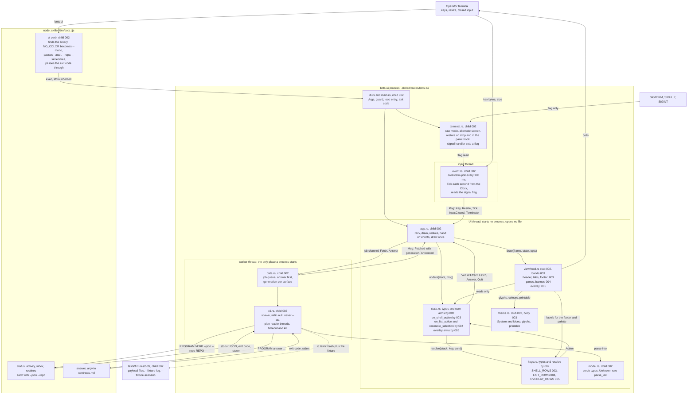
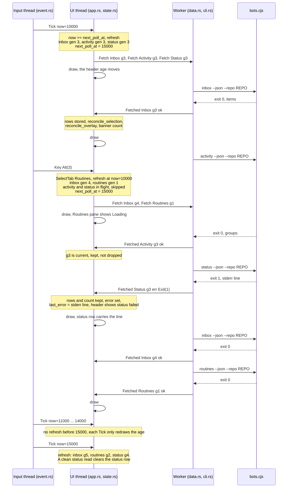

# Terminal screen architecture

This file freezes the vocabulary the six children share. Every type below exists, with every field listed, once 002 closes. A later child adds reducer arms, key rows and draw code inside the sections the owner map gives it, and never adds or renames a type, a field or a variant. A child that finds a type missing stops and amends this file first, because two lanes that each invent half of a seam cannot agree by reading each other. [SOURCE: specs/system-skilled-bots/003-openbot-parity-build/003-terminal-screen/002-architecture-and-contracts/plan.md:143-145]

The payload keys, the sample payloads, the answer argv and the refusal table live in `contracts.md` beside this file. This file names the Rust types those payloads parse into and only the fields the state selects by. Where the two files touch, `contracts.md` owns the JSON key and this file owns the Rust name.

The sketches below are Rust with the trailing semicolons left out of type aliases and tuple structs, because this document carries none. Every type derives `Clone`, `Debug` and `PartialEq` unless its section says otherwise.

---

## 1. THE SHARED VOCABULARY

### 1.1 Scalars and row keys (`state.rs`)

```rust
pub type EpochMs = i64              // milliseconds since the Unix epoch, UTC. Every time the state holds is one of these
pub struct ItemId(pub String)       // an inbox item's `id`. The inbox selection key and the only target an Answer carries
pub struct BotId(pub String)        // a routine's `botId`. The routines selection key, unique within one checkout

pub enum ActivityKey {              // the activity selection key, built from one row
    Run { identity: String, bot_id: String, run_id: String },   // a row that carries a runId. The key follows the run when it moves from Working to Done
    Slot { identity: String, bot_id: String, group: String, at: String },   // a row whose runId is null, such as a scheduled or recurring row. `at` is the row's own timestamp, so two scheduled rows for one bot in one group stay distinct
}
```

`botId` alone cannot key an activity row, because frame 1 draws `hello`, `digest` and `nightly-report` in two or three groups each. [SOURCE: specs/system-skilled-bots/003-openbot-parity-build/003-terminal-screen/001-ux-and-component-map/design/mockups.md:93-107] The scheduled row in the sample payload carries `runId: null`, which is why the key has a second shape. [SOURCE: specs/system-skilled-bots/003-openbot-parity-build/003-terminal-screen/002-architecture-and-contracts/design/payloads/activity.json:47-55]

### 1.2 Tab and Surface (`state.rs`)

```rust
pub enum Tab { Activity, Inbox, Routines, Chat }      // the four tabs in Alt+1..4 order. Chat holds no state and has no surface
pub enum Surface { Status, Activity, Inbox, Routines } // one per read verb, the unit a Fetch, a generation and an in-flight flag belong to
```

`Tab` carries three helpers: `surface(self) -> Option<Surface>` (Chat answers `None`), `next(self) -> Tab` and `prev(self) -> Tab`, both wrapping. [SOURCE: specs/system-skilled-bots/003-openbot-parity-build/003-terminal-screen/001-ux-and-component-map/design/key-map.md:46-47]

### 1.3 Remote and the five pane states (`state.rs`)

```rust
pub struct Remote<T> {
    pub rows: T,                     // the payload of the last successful read, T::default() before the first one
    pub last_ok_at: Option<EpochMs>, // state.now when the last successful read landed, None before the first
    pub error: Option<String>,       // the composed failure line `cli.rs` builds for the last failed read, cleared by the next success
    pub in_flight: bool,             // a Fetch for this surface is out and its reply has not landed
    pub generation: u64,             // the generation of the newest Fetch issued for this surface
}

pub enum PaneState { Loading, Empty, Rows, Stale, Error }   // derived by Remote::pane_state, never stored
```

The first four fields are the ones 002 already names. [SOURCE: specs/system-skilled-bots/003-openbot-parity-build/003-terminal-screen/002-architecture-and-contracts/spec.md:198] `generation` is added because the review asks for one generation per surface. [SOURCE: specs/system-skilled-bots/003-openbot-parity-build/003-terminal-screen/research/fable-review-1.md:56]

`pane_state` derives the inventory's five states from the four values, in this order. [SOURCE: specs/system-skilled-bots/003-openbot-parity-build/003-terminal-screen/001-ux-and-component-map/design/component-inventory.md, section "2. THE FIVE STATES EVERY DATA PANE SHARES"]

| Derived state | Condition |
|---------------|-----------|
| `Loading` | `last_ok_at` is `None` and `error` is `None` |
| `Error` | `last_ok_at` is `None` and `error` is `Some` |
| `Stale` | `last_ok_at` is `Some` and `error` is `Some`. A last good read with zero rows is still `Stale`, and draws the empty line under a stale title |
| `Empty` | `last_ok_at` is `Some`, `error` is `None` and the rows are empty |
| `Rows` | `last_ok_at` is `Some`, `error` is `None` and at least one row exists |

`in_flight` never changes the derived state, so a pane that is polled every 5 seconds never flickers back to `Loading`. The `stale <n>m` age in a pane title is `now - last_ok_at`, formatted by `stale_label`. [SOURCE: specs/system-skilled-bots/003-openbot-parity-build/003-terminal-screen/003-shell-and-navigation/spec.md, REQ-013]

### 1.4 The per-pane view (`state.rs`)

```rust
pub struct PaneView<K> {
    pub selected: Option<K>,   // the selected row's key. None only while the list is empty
    pub anchor: usize,         // the selected row's index after the last move or reconcile, read only to find the nearest survivor
    pub scroll: usize,         // the first visible display line of the list, moved so the selected row stays in view
}
```

| Pane | Field in `State` | Row key | Built from |
|------|------------------|---------|------------|
| Activity | `activity_view` | `ActivityKey` | `identity`, `botId` and `runId`, or `group` and `at` when `runId` is null |
| Inbox | `inbox_view` | `ItemId` | the item `id` |
| Routines | `routines_view` | `BotId` | the routine's `botId` |
| Chat | none | none | Chat draws one line and selects nothing |

A display line is one drawn list line: a group heading and an activity row are one line each, and a routine is three lines plus a blank. The reducer moves `scroll` so the selected row's first display line sits inside `[scroll, scroll + page_rows())`. A non-empty list always has a selection, because the key map draws `No row selected.` only for an empty list. [SOURCE: specs/system-skilled-bots/003-openbot-parity-build/003-terminal-screen/001-ux-and-component-map/design/key-map.md:106]

### 1.5 The overlay and the palette (`state.rs`)

```rust
pub struct Overlay {
    pub item_id: ItemId,        // captured on open, the only id an Answer from this overlay can carry
    pub options: Vec<String>,   // captured on open. Empty draws the decision shape, non-empty the choice shape
    pub item: InboxItem,        // the item as it stood on open, drawn while the live row is gone or reordered
    pub phase: Phase,           // where the overlay is in the answer flow
    pub buffer: String,         // the typed line, kept through Refused so a retry does not retype it
}

pub enum Phase {
    Idle,                       // frames 18, 23 and 24. Shortcuts are live
    Typing,                     // frame 19. Every printable key is text
    Sending,                    // frame 20. Every answer key is a no-op until Answered lands
    Refused(String),            // frame 21. The refusal's first stderr line, and the answer keys live again
    Gone,                       // frame 22. Every answer key is disabled. Esc, Ctrl+C and Ctrl+D still act
}

pub struct Palette {
    pub filter: String,         // the typed filter, matched against each entry's label
    pub selected: usize,        // index into the filtered entries, clamped after every filter change
    pub scroll: usize,          // the first visible entry, moved so the selection stays in view
}
```

`item` is needed because frame 22 draws the question of an item the inbox no longer lists. [SOURCE: specs/system-skilled-bots/003-openbot-parity-build/003-terminal-screen/001-ux-and-component-map/design/mockups.md:1687-1703] `Typing` is a phase of its own because the inventory and the key map both give the overlay a typing state. [SOURCE: specs/system-skilled-bots/003-openbot-parity-build/003-terminal-screen/001-ux-and-component-map/design/component-inventory.md:32] The `grant present` state is not a phase: it is `Idle` drawn with `item.grants` set.

The palette lives in `State.palette` and only there. Its entries are not stored: `keys::palette_entries()` lists them from the table each time, so the index in `selected` is stable while the filter is unchanged. The palette's arms are `on_shell_action`, owned by 003, and its drawing is in `view/mod.rs`, also 003's. [SOURCE: specs/system-skilled-bots/003-openbot-parity-build/003-terminal-screen/003-shell-and-navigation/spec.md:250]

### 1.6 State (`state.rs`)

```rust
pub struct State {
    pub now: EpochMs,                        // the time the last Tick carried, the only clock the reducer reads
    pub next_poll_at: EpochMs,               // the first Tick at or after this time issues a refresh
    pub size: Size,                          // the terminal's columns and rows from the last Resize
    pub active_tab: Tab,                     // the tab the body draws
    pub status: Remote<StatusPayload>,       // `status --json`, read by the header
    pub activity: Remote<Vec<ActivityGroup>>,// `activity --json`, read by the activity pane
    pub inbox: Remote<Vec<InboxItem>>,       // `inbox --json`, read by the inbox pane, the banner and the overlay
    pub routines: Remote<Vec<Routine>>,      // `routines --json`, read by the routines pane
    pub activity_view: PaneView<ActivityKey>,// the activity selection and scroll
    pub inbox_view: PaneView<ItemId>,        // the inbox selection and scroll
    pub routines_view: PaneView<BotId>,      // the routines selection and scroll
    pub overlay: Option<Overlay>,            // the decision or choice overlay, when open
    pub palette: Option<Palette>,            // the command palette, when open
    pub last_error: Option<StatusLine>,      // what the status row draws. The newest failure or warning wins
    pub pending_answers: Vec<ItemId>,        // items with an Answer effect out and no Answered back yet
    pub answered: Vec<AnsweredRow>,          // outcome words drawn on answered rows until a later successful inbox read
}

pub struct Size { pub cols: u16, pub rows: u16 }          // a terminal size in cells
pub struct StatusLine { pub source: Source, pub text: String }   // one status row message and the call it came from
pub enum Source { Read(Surface), Answer, Shell }          // which call wrote the line. Shell is the loop's own message
pub enum Outcome { Approved, Denied, Answered }           // the word drawn on an answered row: `y` gives `approved`, `n` gives `denied`, a digit or a typed line gives `answered`
pub struct AnsweredRow { pub id: ItemId, pub outcome: Outcome, pub inbox_generation: u64 }   // one mark, and the inbox generation it was set at
```

The shell reads `active_tab`, `status`, `last_error` and `now`, the four fields 003 names. [SOURCE: specs/system-skilled-bots/003-openbot-parity-build/003-terminal-screen/003-shell-and-navigation/plan.md, section "AFFECTED SURFACES", row `.skilled/crates/bots-tui/src/state.rs`]

`last_error` follows one rule: a failed call, or a call that exits 0 and writes stderr, sets the line with its own source. A later call from the same source that exits 0 with empty stderr clears the line, and only when the line still carries that source. A clean read of the activity surface therefore never wipes a refusal from `bots answer`.

A successful answer issues no read of its own. The row keeps its outcome word and the answered item stays drawn until the next 5-second poll's successful inbox read, because an immediate read would drop the item at once and the word would only flash. `inbox_generation` is the inbox surface's generation when the mark was set, so a read issued before the answer cannot clear it. [SOURCE: specs/system-skilled-bots/003-openbot-parity-build/003-terminal-screen/005-answer-flow/design/state-machines.md, section "3. THE ANSWER-FLOW SEQUENCE"] An inbox read that lands after `Answered` and carries the mark's own generation keeps the answered item in `inbox.rows` until the next poll's read.

Four derived helpers sit beside the struct, owned by 002, so the reducer and the view do the same size arithmetic without the reducer importing the view.

| Helper | Value |
|--------|-------|
| `too_small()` | `size.cols < 24` or `size.rows < 8` |
| `body_rows()` | `size.rows` minus 7, saturating |
| `page_rows()` | `body_rows()` minus 2 (the pane title and the blank under it), and at least 1 |
| `wide()` | `size.cols >= 120`, which draws the detail column |

### 1.7 Msg (`state.rs`)

```rust
pub enum Msg {
    Key(Key),                                   // one key press, mapped from crossterm by event.rs
    Paste(String),                              // one bracketed paste, the whole pasted text, never split into keys
    Resize { cols: u16, rows: u16 },            // the terminal's size. Sent once at start and on every change
    Tick { now: EpochMs },                      // the time. Sent once at start and then once a second by the event source
    InputClosed,                                // stdin closed or the terminal went away. Quits with 0
    Terminate { signal: i32 },                  // SIGTERM, SIGHUP or SIGINT seen by the handler flag. Quits with 128 + signal
    Fetched { surface: Surface, generation: u64, outcome: Result<Read, ReadError> },   // one read's reply
    Answered { id: ItemId, text: String, scope: Scope, outcome: Result<AnswerOk, AnswerError> },  // the write's reply: the id, the class and the first line, never dropped
    ThreadLost { thread: &'static str },        // the input or worker thread died. Quits with 1
}

pub struct Read { pub payload: Payload, pub warning: Option<String> }   // a read that exited 0, with its first stderr line when it wrote one
pub enum Payload { Status(StatusPayload), Activity(Vec<ActivityGroup>), Inbox(Vec<InboxItem>), Routines(Vec<Routine>) }
pub struct AnswerOk { pub warning: Option<String> }                     // the write exited 0
pub struct ReadError { pub kind: FailKind, pub line: String }           // a read that did not produce a payload, and the composed failure line `cli.rs` builds for it
pub struct AnswerError { pub kind: FailKind, pub refusal: Option<String>, pub line: String }  // a write that did not land, with the refusal name when stderr named one
pub enum FailKind { Exit(i32), Spawn, Timeout, Parse }                  // why a call failed
```

`Msg` carries no `Action`. A key reaches the reducer as `Msg::Key`, and the reducer turns it into an action itself (section 1.10), so no second message type exists for one key press.

A bracketed paste reaches the reducer as one `Msg::Paste`. It is never split into keys and it never sends. In the overlay's text mode it is appended to the typed line, each carriage return or line feed written as one space. In every other phase, on every tab and in the palette it does nothing, so a pasted `y` cannot approve and a pasted line feed cannot open the selected row. This child's reducer arm for `Msg::Paste` does nothing, and 005 adds the one arm that appends in text mode. The design mirrors a GPL reference, so no code is copied.

`ReadError.line` and `Remote.error` hold the same composed line, and `cli.rs` builds it once so the status row and the pane title draw one wording. The shape is `bots: <verb> --json exited <code>: <first stderr line with a leading "bots: " removed>`, and `contracts.md` section 9 owns it. A read that timed out or failed to spawn composes its line the same way with the reason in place of the exit code. [SOURCE: specs/system-skilled-bots/003-openbot-parity-build/003-terminal-screen/002-architecture-and-contracts/design/contracts.md, section "9. THE STATUS ROW"]

### 1.8 Effect and Scope (`state.rs`)

```rust
pub enum Effect {
    Fetch { surface: Surface, generation: u64 },     // one read: `<program> <verb> --json --repo <repo>`
    Answer { id: ItemId, text: String, scope: Scope },// the one write. The argv is contracts.md's
    Quit { code: i32 },                              // leave the loop with this exit code
}

pub enum Scope { Once, Deny }                         // `--scope once` and `--scope deny`, the only two the screen writes
```

`Fetch` and `Answer { id, text, scope }` are 002's names. [SOURCE: specs/system-skilled-bots/003-openbot-parity-build/003-terminal-screen/002-architecture-and-contracts/spec.md:198] `Quit` is added so a test asserts a quit the same way it asserts a write, from the returned list.

### 1.9 The key table types (`keys.rs`)

```rust
pub enum Context { Main, Inbox, List, Overlay, Palette, TooSmall }   // the key map's six, verbatim: main, inbox, list, overlay, palette, too-small

pub enum Key { Char(char), Alt(char), Ctrl(char), Enter, Esc, Backspace, Up, Down, PageUp, PageDown, Other }   // a key after event.rs maps it

pub enum KeyMatch { Exact(Key), Digit, Printable }   // what a row matches: one key, the digits 1 to 9, or any printable character

pub enum When { InboxTab, NoOptions, Options, NotTyping, Typing, NotGone, NotSending }   // one condition a row needs beyond its context

pub enum FooterLine { One, Two }                     // the footer line the label lands on

pub struct Row {
    pub context: Context,      // where the row binds
    pub key: KeyMatch,         // what it matches
    pub when: &'static [When], // every condition here must hold. An empty slice always holds
    pub action: Action,        // what it does
    pub label: &'static str,   // what the frame draws, such as `n deny`. Several rows may share one label
    pub line: FooterLine,      // where the footer draws it
}

pub enum Action {
    SelectTab(Tab),    // Alt+1..4
    PrevTab,           // [
    NextTab,           // ]
    MoveUp,            // Up in a list
    MoveDown,          // Down in a list
    PageUp,            // PgUp in a list
    PageDown,          // PgDn in a list
    OpenItem,          // Enter in the inbox list
    OpenPalette,       // Ctrl+P and ?
    PaletteUp,         // Up in the palette
    PaletteDown,       // Down in the palette
    PaletteType(char), // a printable key in the palette
    PaletteDelete,     // Backspace in the palette
    PaletteRun,        // Enter in the palette
    Close,             // Esc and Ctrl+C in an overlay or the palette
    EnterText,         // t in an overlay with no options
    Deny,              // n in an overlay, not typing
    ApproveOnce,       // y in an overlay with no options, not typing
    Pick(u8),          // 1 to 9 in an overlay with options
    TypeChar(char),    // a printable key while typing
    DeleteChar,        // Backspace while typing
    SendText,          // Enter while typing
    Quit,              // Ctrl+C in main or inbox, and Ctrl+D everywhere
}
```

Every row of the key map has its action here, so 003, 004 and 005 add rows and arms and never a variant. [SOURCE: specs/system-skilled-bots/003-openbot-parity-build/003-terminal-screen/001-ux-and-component-map/design/key-map.md:40-70]

The table is three `const` slices, one per owner: `SHELL_ROWS` (003: `main`, `inbox`, `palette`, `too-small`), `LIST_ROWS` (004) and `OVERLAY_ROWS` (005). `rows() -> impl Iterator<Item = &'static Row>` chains the three in that order, and every reader goes through it. 002 writes `rows`, `resolve`, `palette_entries` and the three slices empty. 003, 004 and 005 fill their slice.

`resolve(stack: &[Context], key: &Key, cond: &Cond) -> Option<Action>` walks the context stack and returns the first row whose context, key and every `When` match. Three actions carry a payload the row cannot know: for a `Digit` row the row holds `Pick(0)` and `resolve` returns `Pick` with the pressed digit, and for a `Printable` row the row holds `PaletteType(' ')` or `TypeChar(' ')` and `resolve` returns it with the pressed character. `palette_entries() -> Vec<&'static Row>` returns the rows of `main`, `inbox` and `list`, one per distinct label.

`Cond` is a plain struct of the facts a `When` reads: `inbox_tab: bool`, `has_options: bool`, `typing: bool`, `gone: bool`, `sending: bool`. `state.rs` builds it. The footer draws a context's rows whose conditions hold, so `t type` and `y approve once` carry `[NoOptions, NotTyping, NotGone, NotSending]`, `n deny` carries `[NotTyping, NotGone, NotSending]` and `1-9 pick` carries `[Options, NotGone, NotSending]`. Frames 20 and 22 draw only `Esc close` and the line 2 keys. [SOURCE: specs/system-skilled-bots/003-openbot-parity-build/003-terminal-screen/001-ux-and-component-map/design/mockups.md:1706-1707]

### 1.10 The model types (`model.rs`)

These are the Rust names. The JSON keys, their types and their nullability are `contracts.md`'s, and the sample payloads sit in `design/payloads/`.

| Type | Parsed from | Fields the state or the view reads by name |
|------|-------------|---------------------------------------------|
| `StatusPayload` | `status --json` | `built_at`, `updated_at`, `stale`, `rows` (each `StatusRow` with `kind` and `bot_id`) |
| `ActivityGroup` | each entry of `groups` | `id`, `title`, `rows` |
| `ActivityRow` | each row of a group | `bot_id`, `identity`, `state: RunState`, `at`, `actor`, `run_id: Option<String>`, `schedule: Option<String>` |
| `InboxItem` | each entry of `items` | `id: ItemId`, `bot_id`, `kind: Option<String>`, `question`, `state: ItemState`, `at`, `options: Vec<String>` (null parses as empty), `expires_at`, `grants: Option<Grant>` |
| `Routine` | each routine | `bot_id: BotId`, and the sentence fields `contracts.md` names |
| `Grant` | an item's `grants` | `kind`, `rung` |
| `RunState` | a row's `state` | `NeedsYou`, `Working`, `Scheduled`, `Done`, `Stopped`, `Failed`, `Recurring`, `Unknown(String)` |
| `ItemState` | an item's `state` | `Open`, `Answered`, `Expired`, `Unknown(String)` |

`model.rs` is complete when 002 closes, `options` and `grants` included, because 004's detail column draws an item's options and grant before 005 runs. [SOURCE: specs/system-skilled-bots/003-openbot-parity-build/003-terminal-screen/research/fable-review-1.md:83] Every optional key carries a serde default, and an unnamed state value stays as `Unknown(raw)`. [SOURCE: specs/system-skilled-bots/003-openbot-parity-build/003-terminal-screen/002-architecture-and-contracts/spec.md:196]

Three of those fields are named by `contracts.md` and not by the payloads that ship today. `updated_at` is the field the header ages, and `built_at` is drawn only when `updated_at` is absent. `schedule` is the start's `summary` phrase on a `recurring` row. `kind` is null until packet 005 writes a value, and null draws `decision`. The JSON keys, their types and their nullability are `contracts.md` sections 4 to 6.

Times arrive as ISO 8601 UTC text. `model::parse_utc(&str) -> Option<EpochMs>` parses `YYYY-MM-DDTHH:MM:SS`, an optional fraction and a trailing `Z`, with the days-from-civil arithmetic written by hand, because the crate adds no time crate (A6). Any other shape parses to `None` and draws `-`.

### 1.11 The loop entry and its four seams

```rust
// lib.rs
pub fn run(args: Args) -> i32        // the production entry: install the guard, build the real seams, call app::run, return its code
// with --version, run prints `bots-ui <crate version> contract <CONTRACT>` to stdout and returns 0 before the guard is installed

pub struct Args { pub repo: PathBuf, pub skilled_tree: PathBuf, pub mono: bool, pub ascii: bool, pub version: bool }   // parsed from argv by lib.rs
pub const CONTRACT: u32 = 1           // the payload contract major this binary reads, contracts.md section 8
pub struct Options { pub mono: bool, pub ascii: bool }   // what the view needs from Args

// app.rs
pub fn run<B: Backend>(terminal: &mut Terminal<B>, events: Box<dyn EventSource>, program: Program, opts: Options) -> i32

pub struct App<B: Backend> { /* terminal, state, the Msg receiver, the job sender, the worker handle, opts */ }
// App::new(terminal, program, opts) -> App           spawns the worker
// App::handle(&mut self, msg: Msg) -> Option<i32>    reduces one message, hands off its effects, returns Some(code) on Quit
// App::settle(&mut self, deadline: Duration) -> bool handles worker replies until nothing is in flight, false on timeout
// App::draw(&mut self)                               draws one frame from the state

// event.rs
pub trait EventSource: Send { fn run(self: Box<Self>, tx: Sender<Msg>) }   // runs on the input thread until it sends InputClosed or Terminate
pub trait Clock: Send { fn now(&self) -> EpochMs }
pub struct TerminalEvents { clock: Box<dyn Clock> }   // production: crossterm poll at 100 ms, a Tick each second, the signal flag
pub struct ScriptedEvents { steps: Vec<Msg> }          // tests: sends its steps in order, then InputClosed

// cli.rs
pub struct Program {
    pub program: PathBuf,           // `node` in production, `bash` in tests
    pub leading: Vec<String>,       // `<skilled-tree>/.skilled/bin/bots.cjs` in production, the fixture path plus its --fixture-* arguments in tests
    pub repo: PathBuf,              // passed as `--repo` on every call
    pub read_timeout: Duration,     // 10 s in production
    pub answer_timeout: Duration,   // 30 s in production
}
```

The four seams the review names enter here. [SOURCE: specs/system-skilled-bots/003-openbot-parity-build/003-terminal-screen/research/fable-review-1.md:29]

| Seam | Where it enters | Production value | Test value |
|------|-----------------|------------------|------------|
| Backend | `app::run` and `App::new` | crossterm on stdout | ratatui `TestBackend` |
| Event source | `app::run` | `TerminalEvents` | `ScriptedEvents`, or no source when a test calls `App::handle` |
| Program plus arguments | `Program` | `node` plus `bots.cjs` | `bash` plus the fixture, its log path and its scenario |
| Clock | `TerminalEvents::new(clock)` | `std::time::SystemTime` | none needed: scripted `Tick` messages carry their own time |

The end-to-end test does not use the event source. It calls `App::handle(Msg::Resize)`, `App::handle(Msg::Tick)`, then `App::settle`, then `App::draw`, and compares the buffer with frame 1. That keeps the test deterministic without a sleep.

### 1.12 The reducer layout

`state.rs` is one file split into named functions. Each function has one owner, and a later child fills a function body 002 wrote as an empty stub, so no child edits another's arm.

| Function | Owner | What it does |
|----------|-------|--------------|
| `update(&mut State, Msg) -> Vec<Effect>` | 002 | Dispatches on the message and returns the effects |
| `on_tick` | 002 | Sets `now`, and calls `refresh` when `now >= next_poll_at` |
| `refresh` | 002 | Issues `Fetch` for Inbox, then the active tab's surface when it is Activity or Routines, then Status, skipping any surface in flight. Bumps each issued surface's `generation`, sets `in_flight`, sets `next_poll_at = now + 5000` |
| `on_resize` | 002 | Sets `size`, then calls `clamp_scroll` |
| `on_fetched` | 002 | Drops a reply whose `generation` is not the surface's current one. Otherwise clears `in_flight`, stores rows and `last_ok_at` or keeps rows and sets `error`, updates `last_error`, drops every `answered` mark whose `inbox_generation` is older than a successful inbox read's, then calls `reconcile_selection(surface)` and `reconcile_overlay()` |
| `on_answered` | 002 | Removes the id from `pending_answers`, sets or clears `last_error` with `Source::Answer`, pushes the mark into `answered` on success with the inbox generation it was set at, and calls `overlay_on_answered`. It issues no read, so the word stays until the next poll |
| `on_key` | 002 | Builds the context stack and `Cond`, calls `keys::resolve`, then `apply` |
| `context_stack` | 002 | `[TooSmall]`, or `[Overlay]`, or `[Palette]`, or `[Inbox, List]` on the Inbox tab, or `[Main, List]` on Activity and Routines, or `[Main]` on Chat, which has no rows and draws no list keys |
| `apply(&mut State, Action) -> Vec<Effect>` | 002 | Routes the action to one of the three arms below, and turns `Quit` into `Effect::Quit { code: 0 }` |
| `on_shell_action` | 003 | `SelectTab`, `PrevTab`, `NextTab` (each then calls `refresh`), `OpenPalette` and every `Palette*` action, and `Close` while the palette is open. `PaletteRun` closes the palette and calls `apply` with the entry's action |
| `on_list_action` | 004 | `MoveUp`, `MoveDown`, `PageUp`, `PageDown` on the active tab's `PaneView` |
| `reconcile_selection(surface)` | 004 | After a read: keeps the key when it survives, else falls to the row nearest `anchor`, else `None` on an empty list, then calls `clamp_scroll` |
| `clamp_scroll` | 004 | Moves each `scroll` so its selected row stays visible within `page_rows()` |
| `on_overlay_action` | 005 | `OpenItem`, `EnterText`, `Deny`, `ApproveOnce`, `Pick`, `TypeChar`, `DeleteChar`, `SendText`, and `Close` while an overlay is open |
| `reconcile_overlay` | 005 | After an inbox read: moves an open overlay to `Gone` when its `item_id` is no longer listed, unless the phase is `Sending` |
| `overlay_on_answered` | 005 | Moves a `Sending` overlay for that id to closed on success, to `Gone` on a refusal `005-answer-flow/design/state-machines.md` section 4.2 classes as gone, or on any other refusal or a timeout when the latest inbox rows no longer list the item open, else to `Refused` |
| `InputClosed`, `Terminate`, `ThreadLost` arms | 002 | Return `Effect::Quit` with 0, 128 plus the signal, and 1 |

The rules 005 must hold in its arms, fixed here because they shape the state:

- An answer key sets `Sending` and returns the `Answer` effect in the same call, and pushes the id onto `pending_answers`. Any answer key while `Sending` returns nothing. [SOURCE: specs/system-skilled-bots/003-openbot-parity-build/003-terminal-screen/005-answer-flow/plan.md:73]
- `SendText` on a line that is empty after trimming returns nothing and stays in `Typing`.
- `Close` while `Sending` closes the overlay and the answer still completes. Its result reaches the status row through `last_error`. [SOURCE: specs/system-skilled-bots/003-openbot-parity-build/003-terminal-screen/005-answer-flow/spec.md, REQ-015]
- `OpenItem` on an expired item, or on an item with a mark in `answered`, opens in `Gone`. On an item in `pending_answers` it opens in `Sending`.
- From `Refused`, `t` returns to `Typing` with `buffer` kept, and `n`, `y` or a digit act as in `Idle`.
- An `AnswerError` whose kind is `Timeout` moves to `Refused`, never to closed, because the write may have landed. The latest inbox rows decide whether the item is still open, and no read is issued to find out.

### 1.13 The drawing and text signatures (`view/`, `theme.rs`)

The band modules and the two text helpers are called from `view/mod.rs` and from the panes, so their signatures freeze here rather than in the child that fills them. A later child fills a body and never changes a signature.

```rust
// view/header.rs, 003. The title band: the bot count, the index age and the stale marker
pub fn draw(frame: &mut Frame, area: Rect, state: &State)

// view/tabs.rs, 003. The tab bar: four labels, the active one marked
pub fn draw(frame: &mut Frame, area: Rect, state: &State)

// view/footer.rs, 003. The two footer lines: the bound keys for the current context
pub fn draw(frame: &mut Frame, area: Rect, state: &State)

// theme.rs, 003. The `stale <n>m` age a pane title draws, from now and last_ok_at
pub fn stale_label(now: EpochMs, last_ok_at: EpochMs) -> String

// theme.rs, 003. Runtime text with control characters and bidi overrides replaced, so a payload cannot move a cell
pub fn printable(text: &str) -> String

// theme.rs, 003. The one-character marker a row state draws, and its ASCII fallback under --ascii
pub fn marker(state: RowState, ascii: bool) -> &'static str
```

`marker` is the single place a row state becomes a character, so the glyph table's seven group ids, the three added glyphs and the ASCII fallback set all resolve through it. 003's T005 writes it and its test asserts one glyph and one ASCII character per state. [SOURCE: specs/system-skilled-bots/003-openbot-parity-build/003-terminal-screen/001-ux-and-component-map/design/glyph-table.md, section "1. THE GLYPH TABLE"]

---

## 2. THE THREAD MODEL

### 2.1 Three threads and one channel

| Thread | Runs | Owns | Never does |
|--------|------|------|------------|
| UI thread (the main thread) | `app.rs`, `state.rs`, `keys.rs`, `view/*`, `theme.rs` | the terminal and its guard, the `State`, the receiving end of the Msg channel, the sending end of the job channel | start a process, open a file, block on anything but the Msg channel |
| Input thread | `event.rs` | the crossterm reader, the tick timer, the read side of the signal flag | touch the state or draw |
| Worker thread | `data.rs`, `cli.rs` | the job queue and the one running child | touch the state or draw |

There is one Msg channel, a `std::sync::mpsc` channel whose sender is cloned once to the input thread and once to the worker. Every message the reducer sees arrives on it. The job channel is the worker's queue: the UI thread sends `Effect::Fetch` and `Effect::Answer` into it and nothing else. [SOURCE: specs/system-skilled-bots/003-openbot-parity-build/003-terminal-screen/002-architecture-and-contracts/spec.md:192]

`cli.rs` starts two short-lived reader threads per read child inside `std::thread::scope`, one for stdout and one for stderr, so a payload larger than the pipe buffer cannot block the child while the worker waits on its deadline. A 2,000-row activity payload is far larger than a 64 KB pipe. The readers end with the child and never outlive the call. An answer child started at quit is the one exception: it is spawned with stdout and stderr null and gets no readers at all, because nothing will read them once the screen is gone (section 2.5).

The UI loop takes one message with a blocking `recv`, then drains every message already waiting with `try_recv`, reducing each, then draws once. A burst of replies therefore costs one draw. A disconnected channel cannot happen while the input thread lives, so a lost worker reports itself (section 2.6).

### 2.2 The tick

The event source owns the tick. `TerminalEvents` sends `Resize` with the starting size and `Tick` with `clock.now()` before its first poll, then polls crossterm every 100 ms and sends a `Tick` whenever a second has passed since the last one. [SOURCE: specs/system-skilled-bots/003-openbot-parity-build/003-terminal-screen/002-architecture-and-contracts/spec.md:251]

The reducer owns the 5-second cadence. `on_tick` compares `now` with `next_poll_at` and calls `refresh` when it is due. The first Tick is due, because `next_poll_at` starts at 0, so the first refresh fires as soon as the screen opens. A tab switch calls `refresh` too, which moves `next_poll_at` 5 seconds on. An answer result does not: a successful answer issues no read, and the row keeps its outcome word until the next poll's successful inbox read. [SOURCE: specs/system-skilled-bots/003-openbot-parity-build/003-terminal-screen/002-architecture-and-contracts/spec.md:204]

The Tick is once a second rather than once every 5 seconds so the header's index age moves in whole seconds, the one cell the frames say changes on a quiet screen. [SOURCE: specs/system-skilled-bots/003-openbot-parity-build/003-terminal-screen/001-ux-and-component-map/design/mockups.md:2082]

### 2.3 The worker rules

1. **A generation is per surface.** A reply is dropped only when its generation is older than the newest Fetch issued for the same surface. Because `refresh` never issues a Fetch for a surface already in flight, no reply is dropped in normal running. The check stays so a later change to the in-flight rule cannot let an old read overwrite a newer one, and its test builds the case by hand.
2. **An answer result is never dropped.** `Answered` carries no generation.
3. **An answer jumps ahead of queued fetches.** Before each job the worker moves every waiting job from the job channel into a local queue and takes an `Answer` first. A read already running finishes first, so an answer waits at most one read.
4. **Every child has a timeout.** The worker polls `try_wait` every 10 ms and kills a read at its deadline: 10 seconds. A killed read reports `FailKind::Timeout` with the line `bots-ui: <verb> timed out after 10s`. The answer's deadline is 30 seconds and it is not a kill: the worker stops waiting, reports `FailKind::Timeout` with `bots-ui: answer timed out after 30s, it may have landed`, and leaves the child running, because a kill could land between the item write and the print. The measured read is 0.18 to 0.34 seconds, so 10 seconds is a hang, not a slow read. [SOURCE: specs/system-skilled-bots/003-openbot-parity-build/003-terminal-screen/002-architecture-and-contracts/spec.md:247]
5. **One named source sends the time.** The input thread's `Tick` is the only clock the reducer reads, so a test sets the time by sending a Tick.

Every child runs with stdin null and never with `--as`. [SOURCE: specs/system-skilled-bots/003-openbot-parity-build/003-terminal-screen/002-architecture-and-contracts/spec.md:204] A read that exits 0 and writes stderr still returns its payload, with the first stderr line as `warning`, so the "did not read" lines `bots inbox` writes reach the status row. [SOURCE: .skilled/bin/bots.cjs:461-473]

### 2.4 Why a refresh cannot close an overlay that is sending

The worker runs one job at a time and sends each reply before it starts the next job. So for an overlay in `Sending`, every inbox reply that reaches the reducer before `Answered` came from a read that finished before the answer's child started, and that read still lists the item. The reply that drops the item, our own answer landing, can only arrive after `Answered`, when the overlay has already closed. The review's race cannot happen with one serial worker. [SOURCE: specs/system-skilled-bots/003-openbot-parity-build/003-terminal-screen/research/fable-review-1.md:73] `reconcile_overlay` still skips a `Sending` overlay, so the rule holds if the worker ever runs jobs in parallel.

### 2.5 Shutdown

`Effect::Quit` reaches `app.rs`, which:

1. Sets the shared `shutting_down` flag the worker reads, and drops the job sender.
2. Draws nothing more. An answer child already running is not waited for.
3. Joins the worker. The worker kills a running read and drops every queued read. It starts a queued answer if one waits and returns without waiting for any answer child, because `bots answer` writes the item before it prints and the write completes after the screen exits. An answer child started at quit, and one already running when quit arrives, is spawned with stdout and stderr null and gets no reader threads, so a write that outlives the screen cannot block on a pipe nobody drains. `cli.rs` starts the answer child in its own process group, so a hangup sent to the screen does not reach it.
4. Returns the code. The guard's `Drop` then restores the terminal, and the input thread ends with the process.

So Ctrl+D, Ctrl+C, a closed input and a signal never wait for an answer and never write a new one. [SOURCE: specs/system-skilled-bots/003-openbot-parity-build/003-terminal-screen/002-architecture-and-contracts/spec.md:193]

An answer that reaches its 30-second deadline is the one child the worker stops waiting for without killing. It reports `FailKind::Timeout` with the line `bots-ui: answer timed out after 30s, it may have landed`, and the status row appends the exact command that re-runs the write, so the operator can repeat it by hand rather than guess what the screen sent. The child is left running, because a kill at the deadline could land between the item write and the print and turn a landed answer into a reported failure. `quit_does_not_wait_for_answer` proves the quit path: it starts an answer whose child sleeps past the quit, quits and asserts the loop returned without the child's exit and that the child was spawned with null stdout and stderr.

### 2.6 Signals and panics

`terminal.rs` installs one `sigaction` handler for `SIGTERM`, `SIGHUP` and `SIGINT` through `libc`. The handler stores the signal number in a static `AtomicI32` and does nothing else, because writing to the terminal from a handler while the UI thread holds the output lock can deadlock. [SOURCE: specs/system-skilled-bots/003-openbot-parity-build/003-terminal-screen/research/fable-review-1.md:111] The input thread reads the flag on every 100 ms poll and sends `Msg::Terminate { signal }`. The loop then shuts down as in section 2.5, and the guard's `Drop` restores the terminal on the normal path. `SIGINT` joins the set because raw mode turns Ctrl+C into a key, so a `SIGINT` can only come from outside, and its default action would kill the process with the terminal still raw. Resize is crossterm's event, not this handler's.

The panic hook restores the terminal once, through the same idempotent restore `Drop` calls, and then runs the previous hook so the backtrace prints on a usable terminal. [SOURCE: specs/system-skilled-bots/003-openbot-parity-build/003-terminal-screen/002-architecture-and-contracts/spec.md:189] A panic on any thread is fatal. The input thread and the worker each hold a drop guard that sends `Msg::ThreadLost` when the thread unwinds, so the loop quits with 1 rather than drawing into a terminal the hook already restored. The release profile keeps `panic = "unwind"`, which the hook and the guards need.

### 2.7 Exit codes

| Code | When |
|------|------|
| 0 | Ctrl+C with no overlay open, Ctrl+D, or a closed input |
| 1 | `ThreadLost`, or a terminal I/O error the loop cannot recover from |
| 101 | A panic on the UI thread, the Rust default, after the hook has restored the terminal |
| 128 plus N | Signal N: 129 for `SIGHUP`, 130 for `SIGINT`, 143 for `SIGTERM` |

The `ui` verb passes the code through unchanged. [SOURCE: specs/system-skilled-bots/003-openbot-parity-build/003-terminal-screen/002-architecture-and-contracts/spec.md, REQ-001]

---

## 3. THE OWNER MAP

"Created by" writes the file, and for every file the first version is complete enough to compile. "Modified by" may edit only the section named. Any other edit is a defect in the lane that made it.

| File | Created by | Modified by, and the section each owns |
|------|------------|----------------------------------------|
| `Cargo.toml`, `Cargo.lock` | 002 | none. No later child adds a dependency (A6) |
| `src/lib.rs` | 002, with every `pub mod` line including `keys`, `theme` and `view`, and the whole argument parser including `--mono` and `--ascii` | none |
| `src/main.rs` | 002 | none |
| `src/terminal.rs` | 002: the guard, the panic hook, the signal handler and flag | none |
| `src/event.rs` | 002: `EventSource`, `Clock`, `TerminalEvents`, `ScriptedEvents`, the crossterm to `Key` mapping, the paste as one `Msg::Paste`, the tick, the signal read | none |
| `src/data.rs` | 002: the worker, the job queue, the answer-first order, the shutdown rule | none |
| `src/cli.rs` | 002: every read, the answer call in the argv `contracts.md` fixes, the timeout, the pipe readers, the stderr first line and the refusal name | none |
| `src/model.rs` | 002: every payload type complete, `options` and `grants` included, `parse_utc` | none |
| `src/app.rs` | 002: `run`, `App`, effect hand-off, the drain-then-draw loop, shutdown and the exit code | 010 child 003: the Chat tab's surface wiring, so the placeholder becomes a transcript. It edits the Chat arm of the tab switch and nothing else |
| `src/state.rs` | 002: every type in section 1, `update`, `on_tick`, `refresh`, `on_resize`, `on_fetched`, `on_answered`, `on_key`, `context_stack`, `apply`, the quit arms, the size helpers, and empty stubs for the five functions below | 003: `on_shell_action`. 004: `on_list_action`, `reconcile_selection`, `clamp_scroll`. 005: `on_overlay_action`, `reconcile_overlay`, `overlay_on_answered`. Each child's unit tests sit in its own `#[cfg(test)]` module named after its function |
| `src/keys.rs` | 002: every type in section 1.9, `resolve`, `palette_entries`, `rows`, and the three slices empty | 003: `SHELL_ROWS`. 004: `LIST_ROWS`. 005: `OVERLAY_ROWS` |
| `src/theme.rs` | 002: a stub holding `Theme::new(opts: &Options) -> Theme` and nothing drawn | 003: the whole body, the System and Mono palettes, the glyph table, `marker`, `printable` |
| `src/view/mod.rs` | 002: a stub `draw(frame, state, opts)` that draws the empty frame | 003: the band layout, the too-small screen, the palette panel, the `header`, `tabs` and `footer` module lines. 004: the `panes` and `banner` module lines, the body-slot call and the banner-slot call. 005: the `overlay` module line and the overlay call |
| `src/view/header.rs`, `tabs.rs`, `footer.rs` | 003 | none. 004 calls `stale_label` from `header.rs` |
| `src/view/panes.rs` | 004 | none |
| `src/view/banner.rs` | 004: the needs-you count band | none |
| `src/view/overlay.rs` | 005 | none |
| `tests/fixtures/bots` | 002: every verb including `answer`, the argv log at `--fixture-log <path>`, the scenarios at `--fixture-scenario <name>` | none |
| `tests/fixtures/payloads/*.json` | 002: the canonical data set the frames draw, copied from `design/payloads/` | 004 and 005 may add a new scenario file, never edit an existing one |
| `tests/common/mod.rs`, `frames.rs`, `fixture.rs` | 002: the frame loader that reads a frame from `design/mockups.md` by heading and size, and the helper that builds a `Program` with a temp log | none |
| `tests/cli_client.rs` | 002 | none |
| `tests/render_keys.rs` | 003 | none |
| `tests/panes.rs` | 004 | 010 child 003: the `chat_placeholder_names_phase_010` test, which it rewrites to assert the transcript. No other test in the file moves |
| `tests/answer_flow.rs`, `tests/end_to_end.rs` | 005 | none |
| `tests/pty_smoke.rs` | 006: the release binary in a pseudo-terminal from `libc::openpty`, against the fixture | none |
| `design/` | 002: 001's four files plus this file and `contracts.md`. The sample payloads go to `tests/fixtures/payloads/`, not here | none. A later edit is made at the source and copied again |
| `README.md` | 006 | none |
| `.skilled/bin/bots.cjs`, `cli-ui.vitest.ts`, `.github/workflows/bots-runtime.yml`, `.gitignore` | 002 | none from this phase |
| `.skilled/skills/system-skilled-bots/SKILL.md` | 006: one line | none |

006 repairs only the line a gate names, in whichever file holds it, which is the one exception to the table. [SOURCE: specs/system-skilled-bots/003-openbot-parity-build/003-terminal-screen/006-hardening-and-proof/spec.md:123]

### 3.1 The double claims, settled

| Work | Claimed by | Keeps it | Why |
|------|------------|----------|-----|
| The answer call in `cli.rs` | 002 and 005 | 002 | 002 already tests `answer_argv_carries_scope`. [SOURCE: specs/system-skilled-bots/003-openbot-parity-build/003-terminal-screen/002-architecture-and-contracts/tasks.md:59] [SOURCE: specs/system-skilled-bots/003-openbot-parity-build/003-terminal-screen/005-answer-flow/spec.md:128] |
| The fixture's answer branch, argv log and refusal switch | 002 and 005 | 002 | 002's client test already reads two answers from the log. [SOURCE: specs/system-skilled-bots/003-openbot-parity-build/003-terminal-screen/002-architecture-and-contracts/tasks.md, T011] [SOURCE: specs/system-skilled-bots/003-openbot-parity-build/003-terminal-screen/005-answer-flow/spec.md:131] |
| `options` on the inbox item | 004 by use, 005 by claim | 002 | 004 runs first and draws the options. [SOURCE: specs/system-skilled-bots/003-openbot-parity-build/003-terminal-screen/005-answer-flow/spec.md:129] |
| The closed-input exit in `app.rs` | 002 and 005 | 002 | REQ-011 is 002's, and 005 keeps its own closed-input test with an overlay open. [SOURCE: specs/system-skilled-bots/003-openbot-parity-build/003-terminal-screen/005-answer-flow/spec.md:130] |
| The lock and the refusal path | 005 in `app.rs` | 005 in `state.rs` | A lock in the loop is outside the reducer, and the reducer must move the phase in the same step. [SOURCE: specs/system-skilled-bots/003-openbot-parity-build/003-terminal-screen/005-answer-flow/plan.md:69] |
| `--mono` and `--ascii` parsing | 002 and 003 | 002 | [SOURCE: specs/system-skilled-bots/003-openbot-parity-build/003-terminal-screen/002-architecture-and-contracts/spec.md:158] [SOURCE: specs/system-skilled-bots/003-openbot-parity-build/003-terminal-screen/003-shell-and-navigation/tasks.md:62] |
| The `pub mod` lines for `keys`, `theme` and `view` | 003 | 002 | 002's plan already writes every `pub mod` line so no later task edits `lib.rs`. [SOURCE: specs/system-skilled-bots/003-openbot-parity-build/003-terminal-screen/002-architecture-and-contracts/plan.md:145] |
| The header's status read | 003 through `cli.rs` | the worker | The header reads `state.status`. Only `cli.rs` starts a process. [SOURCE: specs/system-skilled-bots/003-openbot-parity-build/003-terminal-screen/003-shell-and-navigation/plan.md:64] [SOURCE: specs/system-skilled-bots/003-openbot-parity-build/003-terminal-screen/goal.md:48] |
| The palette's filter and selection | 003 in `view/mod.rs` and `keys.rs` | 003 in `state.rs` | Palette state lives in the reducer. `view/mod.rs` only draws it. [SOURCE: specs/system-skilled-bots/003-openbot-parity-build/003-terminal-screen/003-shell-and-navigation/tasks.md, T010] |

---

## 4. DIAGRAMS

### 4.1 Module and data flow

This is the review's Draft A with its open points closed: the tick has an owner, the key reaches `keys.rs` from the reducer rather than from the loop, the worker carries its timeout and its pipe readers, and the signal reaches the loop as a message. [SOURCE: specs/system-skilled-bots/003-openbot-parity-build/003-terminal-screen/research/fable-review-1.md:170-242]



Rules the graph implies:

- Only `cli.rs` starts a process, and only on the worker thread. [SOURCE: specs/system-skilled-bots/003-openbot-parity-build/003-terminal-screen/goal.md:48]
- `state.rs` imports `model.rs` and `keys.rs`, and nothing that draws or spawns. `keys.rs` imports nothing but `state.rs`'s `Tab`. `view/*` imports `state.rs`, `keys.rs`, `theme.rs` and `model.rs`, and never `cli.rs`, `data.rs` or `app.rs`.
- The build order inside the crate is `model`, `event`, `terminal` and the `keys`, `theme` and `view` stubs first, then `cli` and `state`, then `data`, then `app`. [SOURCE: specs/system-skilled-bots/003-openbot-parity-build/003-terminal-screen/002-architecture-and-contracts/plan.md:147]

### 4.2 One refresh cycle, a tab switch and a failed read

The screen opened at time 0 on the Activity tab. This is the cycle that starts at 10 s, when the operator switches to Routines in the middle of it and the status read fails.



No reply in this cycle is dropped, because no surface was fetched twice while in flight. A generation is dropped only when a test builds that case by hand (section 2.3, rule 1).

### 4.3 The layout grid

The bands are mockups section 1, with rows numbered from 1. [SOURCE: specs/system-skilled-bots/003-openbot-parity-build/003-terminal-screen/001-ux-and-component-map/design/mockups.md:23-33]

```text
80x24                                              120x40
col 1                                    col 80    col 1                       col 72 73 74                col 120
row  1   header                                    row  1   header
row  2   tab bar                                   row  2   tab bar
row  3   rule                                      row  3   rule
row  4   pane title                                row  4   pane title                     |  Detail title
row  5   blank                                     row  5   blank                          |
row  6   list line 1                               row  6   list line 1                    |  detail of the
...      list, 15 lines, the page step             ...      list, 31 lines, the page step  |  selected row,
row 20   list line 15                              row 36   list line 31                   |  47 columns
row 21   banner                                    row 37   banner
row 22   status row                                row 38   status row
row 23   footer line 1                             row 39   footer line 1
row 24   footer line 2                             row 40   footer line 2

overlay panel, 80x24: rows 4-20, cols 2-79         overlay panel, 120x40: rows 12-28, cols 11-110
palette panel, 80x24: rows 8-15, cols 2-79         palette panel, 120x40: rows 16-23, cols 11-110
```

The overlay rows and columns are read from frames 18 and 22 at both sizes. [SOURCE: specs/system-skilled-bots/003-openbot-parity-build/003-terminal-screen/001-ux-and-component-map/design/mockups.md:1383-1399] [SOURCE: specs/system-skilled-bots/003-openbot-parity-build/003-terminal-screen/001-ux-and-component-map/design/mockups.md:1724-1740] The palette rows are read from frame 25 at both sizes. [SOURCE: specs/system-skilled-bots/003-openbot-parity-build/003-terminal-screen/001-ux-and-component-map/design/mockups.md:1919-1926] [SOURCE: specs/system-skilled-bots/003-openbot-parity-build/003-terminal-screen/001-ux-and-component-map/design/mockups.md:1956-1963] While an overlay or the palette is open, the banner row draws blank and the footer draws the overlay's or the palette's own two lines, as every overlay and palette frame shows. [SOURCE: specs/system-skilled-bots/003-openbot-parity-build/003-terminal-screen/001-ux-and-component-map/design/mockups.md:1400-1403]

**Every size from the floor up** follows one rule set, so no size between 24x8 and 80x24 is undefined.

| Rule | Value at any size of 24 columns and 8 rows or more |
|------|-----------------------------------------------------|
| Fixed rows | Header, tab bar, rule, banner, status row and the two footer lines: 7 rows |
| Body | `rows - 7`, which is 1 row at 8 rows high, 17 at 24 and 33 at 40 |
| Page step | `body - 2`, and at least 1 |
| Detail column | Only at 120 columns or wider: the list takes `cols - 48`, a `│` rule, then 47 columns of detail |
| Overlay panel | `min(cols - 2, 100)` wide and `min(17, body)` tall, centred in the body. When the body is shorter than 17 rows the panel keeps its border, its first line and its status line, and clips the lines between |
| Palette panel | The overlay's width, 8 rows tall, centred in the body, clipped the same way |
| Footer | Each line draws whole labels left to right and stops before the first label that does not fit, never drawing part of one. `Ctrl+P/? commands` leads line 2 and is 17 columns, so it fits at the 24-column floor and the palette, which lists every binding, stays reachable |
| Below the floor | Below 24 columns or 8 rows only `Too small · Ctrl+D exit` on row 1, cut to the width |

The widest pane footer line is the inbox's, 67 columns, so every bound key is in the footer itself at 67 columns or wider. Between 24 and 66 columns the right-hand labels drop and the palette carries them. [SOURCE: specs/system-skilled-bots/003-openbot-parity-build/003-terminal-screen/001-ux-and-component-map/design/key-map.md:74]

---

## 5. DECISIONS TAKEN

Each of these is a choice the other documents did not fix.

| Decision | Why |
|----------|-----|
| 002 creates `keys.rs`, `theme.rs` and `view/mod.rs` as compiling stubs | Types freeze in 002, `app.rs` must call `view::draw`, and no later child then edits `lib.rs` |
| `state.rs` and `keys.rs` are split into named functions and named slices, one owner each | A modifier owns a named section, not a share of a file |
| The reducer resolves keys, not the loop | Palette Enter runs an action, and one path from key to action keeps that pure and testable |
| `Msg` carries no `Action` | One message per key press, so a test feeds keys only |
| Activity rows key on the run when `runId` is set and on the group otherwise | `botId` repeats across groups, and a run key follows a run from Working to Done |
| Each pane keeps its own `PaneView` with an anchor and a scroll | Three panes have three kinds of row identity, and the nearest-survivor rule needs the old position |
| `Remote<T>` gains `generation` | A generation per surface, as the review asks |
| A last good read with zero rows that then fails is `Stale` | A successful read exists, so its age is known and drawn |
| The size helpers live in `state.rs` | The reducer needs the page size and cannot import the view |
| The overlay keeps a snapshot of the item | Frame 22 draws an item the inbox no longer lists |
| The event source sends a Tick once a second, and the reducer holds `next_poll_at` | The header age moves each second, the poll stays at 5 s, and a test sets time by message |
| One worker, answer first, 10 s read and 30 s answer timeouts | One serial worker makes the sending race impossible, and a timeout stops one hung child freezing every read |
| `cli.rs` drains stdout and stderr on scoped reader threads | A payload larger than the pipe would block the child and trip the timeout |
| A timed-out answer goes to `Refused`, then the latest inbox rows decide | The write may have landed, so it is not a refusal and not a success, and a read issued to find out would race the write |
| Quit never waits for an answer child and never kills one | `bots answer` writes the item before it prints, so the write completes after the screen exits, and a kill could cut it |
| `SIGINT` joins `SIGTERM` and `SIGHUP` | Raw mode makes Ctrl+C a key, so an outside `SIGINT` would otherwise leave the terminal raw |
| Every panic is fatal, through drop guards that send `ThreadLost` | The panic hook restores the terminal, so drawing on afterwards would write into the shell |
| Exit code 128 plus the signal number | The shell convention, passed through by the `ui` verb |
| The status row line clears only on a clean result from the same source | A clean read must not wipe a refusal |
| The banner draws blank under an open overlay or palette | Frames 18 to 25 draw it blank |
| Footer labels drop whole from the right, and the palette label leads line 2 | Defines every size between the floor and 80x24 |
| `tests/end_to_end.rs` belongs to 005 and `tests/pty_smoke.rs` to 006 | Frame 1 needs the banner, which 004 lands, and the pty run needs the finished binary |
| The fixture takes its log and scenario as leading arguments | Parallel tests cannot share one log or one environment |

### 5.1 The defaults this file relies on

| Default | How this file uses it |
|---------|-----------------------|
| A1 Build order | The fixture is the only payload source, so the screen builds and tests before or after packet phases 001 and 002 land |
| A2 Index refresh on read | `refresh` only reads. No `--rebuild`, no rebuild key, no `Action` for one |
| A3 Fresh worktree | No source pointer in this file names a gitignored path, and the sample payloads are tracked |
| A4 Key map approved before the build | Section 1.9's `Action` list is frozen against the approved map, so the `PaletteDelete` row must be in it when the operator approves |
| A5 macOS and Linux | `sigaction`, `openpty` and the signal numbers in section 2.7 are Unix only |
| A6 No time or signal crate | `parse_utc` by hand on `std`, `libc` for `sigaction` and `openpty` |
| A7 Outcome word until the next 5-second poll | A successful answer issues no read, so the word stays on the row and the answered item stays drawn until the next poll's successful inbox read. `State.answered` carries the inbox generation each mark was set at, so a read issued before the answer cannot clear it |

---

## 6. EDITS THE OTHER DOCS NEED

The edits inside this phase were applied in commit cf6bb92a5ce. Line numbers are the pre-edit lines and are kept as a record.

Each row names the file, the line as read on 2026-11-25 and the replacement. Paths are relative to `specs/system-skilled-bots/003-openbot-parity-build/003-terminal-screen/`.

### 6.1 The phase parent

| File:line | Replacement text |
|-----------|------------------|
| `spec.md:137` | `` `.skilled/crates/bots-tui/src/app.rs` \| Create \| 002 \| The loop: receive one message, reduce it, hand off its effects, draw once `` |
| `spec.md:143` | `` `.skilled/crates/bots-tui/src/terminal.rs` \| Create \| 002 \| RAII guard, a chained panic hook and a signal handler that only sets a flag `` |
| `spec.md:144` | `` `.skilled/crates/bots-tui/src/keys.rs` \| Create \| 002 \| The key types, `resolve` and the empty row slices. 003, 004 and 005 fill `SHELL_ROWS`, `LIST_ROWS` and `OVERLAY_ROWS` `` |
| `spec.md:145` | `` `.skilled/crates/bots-tui/src/theme.rs` \| Create \| 002 \| A stub. 003 writes the System and Mono palettes, the glyph table and `printable` `` |
| `spec.md:149` | `` `.skilled/crates/bots-tui/src/view/mod.rs` \| Create \| 002 \| A stub that draws the empty frame. 003 writes the seven bands, the too-small screen and the palette panel, and 004 and 005 add their module lines and slot calls `` |
| `spec.md`, after line 157 | Add rows: `` `.skilled/crates/bots-tui/tests/common/` \| Create \| 002 \| The frame loader and the fixture helper ``, `` `.skilled/crates/bots-tui/tests/fixtures/payloads/` \| Create \| 002 \| The canonical payloads ``, `` `.skilled/crates/bots-tui/tests/end_to_end.rs` \| Create \| 005 \| Scripted loop to frame 1 ``, `` `.skilled/crates/bots-tui/tests/pty_smoke.rs` \| Create \| 006 \| The release binary in a pseudo-terminal `` |
| `spec.md:179` | Append to REQ-010: `At 67 columns or wider every bound key is in the footer. Narrower, labels drop whole from the right and the palette, whose label leads footer line 2, lists the rest.` |

### 6.2 002 architecture and contracts

| File:line | Replacement text |
|-----------|------------------|
| `002-architecture-and-contracts/spec.md:157` | `` `.skilled/crates/bots-tui/src/lib.rs` \| Create \| Library root: the whole argument parser including `--mono` and `--ascii`, the terminal guard, the loop entry and every `pub mod` line including `keys`, `theme` and `view`, whose stub files this child also creates `` |
| `002-architecture-and-contracts/spec.md:189` | REQ-005, last clause: `and it installs a SIGTERM, SIGHUP and SIGINT handler that only sets an atomic flag, which the event source turns into a Terminate message, so the loop returns and the guard's Drop restores the terminal.` |
| `002-architecture-and-contracts/spec.md:190` | REQ-006: `No process is spawned on the UI thread. One worker thread runs every CLI call, answer jobs ahead of queued reads, each child under a timeout, and sends every result over one std::sync::mpsc channel. Each read carries its surface's generation and the reducer drops a read whose generation is older than the newest issued for that surface. An answer result is never dropped.` |
| `002-architecture-and-contracts/spec.md:196` | REQ-012: `` `state.rs` is a pure reducer, `update(state, msg) -> Vec<Effect>`, with the effects `Fetch`, `Answer { id, text, scope }` and `Quit`. Each surface is a `Remote<T> { rows, last_ok_at, error, in_flight, generation }`, and each pane keeps its own `PaneView` keyed by the row key `design/architecture.md` names, never a row index. `` |
| `002-architecture-and-contracts/spec.md:219` | Replace `restore_runs_on_signal` with `signal_becomes_terminate_event` |
| `002-architecture-and-contracts/spec.md:221` | SC-006: `` `ls .skilled/crates/bots-tui/design` prints 001's four documents plus `architecture.md` and `contracts.md`. `diff -r -x architecture.md -x contracts.md specs/system-skilled-bots/003-openbot-parity-build/003-terminal-screen/001-ux-and-component-map/design .skilled/crates/bots-tui/design` prints nothing, `diff` of each of `architecture.md` and `contracts.md` against `002-architecture-and-contracts/design/` prints nothing, and `diff` of each of the four canonical payload files in `002-architecture-and-contracts/design/payloads/` against `.skilled/crates/bots-tui/tests/fixtures/payloads/` prints nothing. The payload files are copied into the fixtures folder, not into `.skilled/crates/bots-tui/design/` `` |
| `002-architecture-and-contracts/plan.md:71` | Replace `and the selection is Option<ItemId> rather than a row index` with `and each pane keeps a PaneView keyed by its row key, as design/architecture.md section 1.4 names` |
| `002-architecture-and-contracts/plan.md:72` | Replace `and the loop drops a result whose generation is not current` with `and the reducer drops a read whose generation is older than its surface's newest, and never drops an answer result` |
| `002-architecture-and-contracts/plan.md:80` | Replace the sentence that starts `The loop drops a stale generation` with `The reducer drops a read older than its surface's newest generation, stores a current one, and the loop redraws.` |
| `002-architecture-and-contracts/plan.md:145` | Append: `T006 also writes keys.rs, theme.rs and view/mod.rs as compiling stubs, so 003 never edits lib.rs.` |
| `002-architecture-and-contracts/tasks.md, T006` | Add `$CRATE/src/keys.rs`, `$CRATE/src/theme.rs` and `$CRATE/src/view/mod.rs` to T006's file list |
| `002-architecture-and-contracts/tasks.md:62` | Replace `selection_is_an_item_id` with `selection_is_a_row_key_per_pane`, and add the test `stale_generation_is_dropped` here |
| `002-architecture-and-contracts/tasks.md:64` | Replace `names stale_generation_is_dropped and loop_thread_spawns_nothing` with `names answer_jumps_queued_reads, child_past_timeout_is_killed and loop_thread_spawns_nothing` |
| `002-architecture-and-contracts/tasks.md:71` | T028 copies 001's four files plus `architecture.md` and `contracts.md` |
| `002-architecture-and-contracts/tasks.md:72` | T029: `Install the signal handler that sets a flag, and the event source read that turns it into Terminate. Verify: --lib terminal names signal_becomes_terminate_event.` |

### 6.3 003 shell and navigation

| File:line | Replacement text |
|-----------|------------------|
| `003-shell-and-navigation/spec.md:95` | `Fill .skilled/crates/bots-tui/src/keys.rs's SHELL_ROWS, the main, inbox, palette and too-small rows, in the table 002 creates` |
| `003-shell-and-navigation/spec.md:112` | Change Type `Modify`: `` SHELL_ROWS, each carrying the label the renderer draws. The types are 002's `` |
| `003-shell-and-navigation/spec.md:113` | Change Type `Modify`, the stub 002 creates |
| `003-shell-and-navigation/spec.md:114` | Change Type `Modify`, the stub 002 creates |
| `003-shell-and-navigation/spec.md:118` | Delete the `lib.rs` row. Add `` `.skilled/crates/bots-tui/src/state.rs` \| Modify \| `on_shell_action`: tabs, palette and quit `` |
| `003-shell-and-navigation/spec.md:249` | `Does the header's age need a clock in the state? Decision: yes. state.now is the time the last Tick carried, sent by the event source once a second.` |
| `003-shell-and-navigation/spec.md:250` | `Where does the palette live? Decision: its state in State.palette with its arms in on_shell_action, its drawing in view/mod.rs.` |
| `003-shell-and-navigation/plan.md:64` | Replace `It reads bots status --json through 002's cli.rs and draws nothing else.` with `It reads state.status and draws nothing else.` |
| `003-shell-and-navigation/plan.md:70` | Replace the last sentence with `A key reaches the reducer as Msg::Key. The reducer calls keys::resolve with the context stack and applies the action, and the next frame draws the label the same row carries.` |
| `003-shell-and-navigation/plan.md:80` | Delete the `lib.rs` row |
| `003-shell-and-navigation/plan.md:81` | `` update - `on_shell_action` only. The shell reads `active_tab`, `status`, `last_error`, `now` and `palette`, and adds no field `` |
| `003-shell-and-navigation/tasks.md:54` | Drop `the three pub mod lines` and `$CRATE/src/lib.rs` from T004 |
| `003-shell-and-navigation/tasks.md, T010` | T010 files: `$CRATE/src/state.rs` (`on_shell_action`), `$CRATE/src/keys.rs`, `$CRATE/src/view/mod.rs` |
| `003-shell-and-navigation/tasks.md:62` | Delete T012. 002 owns the flags and their `args` tests |

### 6.4 004 panes

| File:line | Replacement text |
|-----------|------------------|
| `004-panes/spec.md:56` | `` `.skilled/crates/bots-tui/src/state.rs`, `on_list_action`, `reconcile_selection` and `clamp_scroll`, which move each pane's `PaneView` and fall to the nearest surviving row `` |
| `004-panes/spec.md:113` | Replace `Hold the selection as Option<ItemId>` with `Hold each pane's selection as its row key, as design/architecture.md section 1.4 names` |
| `004-panes/spec.md:123` | Replace `` The `Global`, `Tabs`, `Palette` and `Overlay` rows `` with `` The `main`, `inbox`, `palette`, `too-small` and `overlay` rows `` |
| `004-panes/spec.md:135` | `` The `on_list_action`, `reconcile_selection` and `clamp_scroll` bodies `` |
| `004-panes/spec.md:157` | REQ-022: replace `Selection is Option<ItemId>` with `Selection is the pane's row key: ItemId for the inbox, BotId for routines, ActivityKey for activity` |
| `004-panes/plan.md:78` | Replace `` fills `Global`, `Tabs` and `Palette` `` with `` fills `SHELL_ROWS` `` |

### 6.5 005 answer flow

| File:line | Replacement text |
|-----------|------------------|
| `005-answer-flow/spec.md:126` | `` `on_overlay_action`, `reconcile_overlay` and `overlay_on_answered`: the phases `Idle`, `Typing`, `Sending`, `Refused` and `Gone`, the buffer and the lock that `Sending` is `` |
| `005-answer-flow/spec.md:128-131` | Delete the `cli.rs`, `model.rs`, `app.rs` and fixture rows. 002 owns all four. Add `` `.skilled/crates/bots-tui/tests/end_to_end.rs` \| Create \| The scripted loop from the fixture to frame 1 `` |
| `005-answer-flow/spec.md:155` | REQ-016: `A bots answer that fails puts the first stderr line in the status row. A refusal contracts.md classes as gone moves the overlay to Gone, and every other failure, a timeout included, keeps it open on the same item in Refused.` |
| `005-answer-flow/plan.md:63` | `` Overlay { item_id, options, item, phase, buffer } where phase is Idle, Typing, Sending, Refused(String) or Gone `` |
| `005-answer-flow/plan.md:65` | Delete. `cli.rs` is 002's |
| `005-answer-flow/plan.md:69` | Replace with `` **`app.rs`**: unchanged. The reducer sets `Sending` and returns the `Answer` effect, and 002's loop hands it to the worker `` |
| `005-answer-flow/plan.md:70` | Delete. `model.rs` is 002's |
| `005-answer-flow/tasks.md:71` | Delete T005 |
| `005-answer-flow/tasks.md:72` | Add `Typing` to the phases T006 names |
| `005-answer-flow/tasks.md:74-75` | Delete T008 and T009 |
| `005-answer-flow/tasks.md:78` | T012: `Write tests/end_to_end.rs: App::handle Resize and Tick, App::settle, App::draw, and compare the buffer with frame 1 cell for cell` |
| `005-answer-flow/tasks.md:48-51` | Rewrite the waves without `src/model.rs`, `src/cli.rs`, `src/app.rs` and `tests/fixtures/bots` |

### 6.6 006 hardening and proof

| File:line | Replacement text |
|-----------|------------------|
| `006-hardening-and-proof/spec.md`, after line 124 | Add a row: `` `.skilled/crates/bots-tui/tests/pty_smoke.rs` \| Create \| The release binary in a pseudo-terminal against the fixture, answering one item `` |

### 6.7 001 design files

| File:line | Replacement text |
|-----------|------------------|
| `001-ux-and-component-map/design/key-map.md:55` | Add a row after it: `` `Backspace` \| `palette` \| Delete the last filter character \| `Bksp delete` \| Palette footer line 1 `` |
| `001-ux-and-component-map/design/component-inventory.md:34` | Palette keys: `` `Ctrl+P`, `?`, `Up`, `Down`, typing, `Backspace`, `Enter`, `Esc`, `Ctrl+C`, `Ctrl+D` `` |
| `001-ux-and-component-map/design/component-inventory.md:87` | `` 78 wide and 17 tall, centred in the body \| 100 wide and 17 tall, centred in the body. Both clip to the body when it is shorter `` |
| `001-ux-and-component-map/design/component-inventory.md:100` | `` The refresh timer \| The event source sends a Tick each second and the reducer's `next_poll_at` issues the reads. It draws nothing `` |
| `001-ux-and-component-map/design/mockups.md:78` | Replace `the smallest frame that holds its message whole` with `a size below the 8-row floor. The message is 23 columns, so it fits whole at 23 columns` |
| `001-ux-and-component-map/design/mockups.md:93` | Frame 1 at 80x24 draws no `›` on the selected row, while the 120x40 detail column shows `hello` selected. Draw `›` on that row as frame 2 does at `mockups.md:169` |
| `001-ux-and-component-map/design/mockups.md:128-129` | Frame 1 at 120x40 lost the `✓ hello` done row and the `Stopped` heading. Restore them to match the 80x24 frame at `mockups.md:100-103` |
| `001-ux-and-component-map/design/mockups.md:2007` | Replace `The 30x7 frame is the smallest one that holds it whole.` with `It fits whole from 23 columns up.` |
| `001-ux-and-component-map/design/mockups.md:1933` | Frame 25's footer line 1, and its 120x40 twin, once the key-map row lands: `↑↓ select · type to filter · Bksp delete · Enter select · Esc close` |
