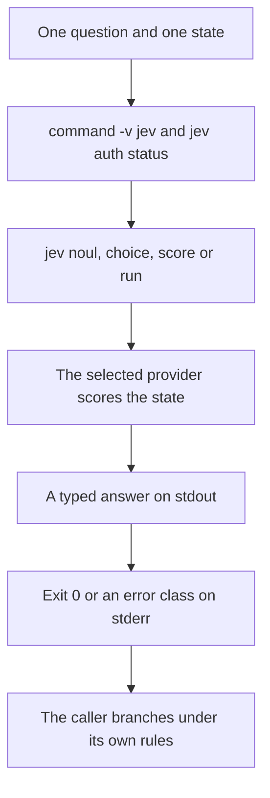

# cli-jev

> Turns one question about a piece of text into one typed value a script can branch on and an exit code that says when no judgment could be made.

---

## 1. OVERVIEW

### At a Glance

| Aspect | What you get |
|---|---|
| **Use it for** | A typed value that code branches on |
| **Invoke with** | `jev noul`, `jev choice`, `jev score` or `jev run` |
| **Works on** | One state and the questions it answers |
| **Produces** | Typed answers on stdout and an exit code |

### What It Does

`cli-jev` is the packet of the `cli-jev` transport mode in the `cli-classifier` hub. It bridges the `jev` CLI and its judgment contract, so a request that needs a value instead of a paragraph has a defined route. Jev reads the state you pass, sends the question or questions you name to the selected provider and prints a typed answer for each. The run edits no file and spawns no child process, so a judgment is input to a decision and never the decision.

Pair the packet with a workflow mode when the answer feeds an edit or a review. The workflow acts. This packet answers.

### The Four Judgment Types

Pick the question type before you write the words, because the type decides the shape of the value.

| Subcommand | Answers with | Range |
|---|---|---|
| `jev noul` | A probability | `[0, 1]` |
| `jev choice` | One submitted option key, verbatim | One of your keys |
| `jev score` | An ordered position | Zero-based, may be fractional |
| `jev run` | One typed answer per caller-named question | One per key |

The [question-shaping card](./assets/question-shaping-card.md) turns this table into a checklist.

---

## 2. QUICK START

**Step 1: Check that the binary resolves.**

```bash
command -v jev && jev --version
```

The first line is the path to the binary and the second is `jev 0.6.2`, the version the contract is pinned against. If nothing prints, install it with `uv tool install jev-cli`.

**Step 2: Check that a credential resolves.**

```bash
jev auth status --provider official </dev/null
```

One JSON line with `"ok": true` and `"stored": true`, then exit 0. A missing key exits 3 with `official API key is not stored` instead.

**Step 3: Ask one question.**

```bash
jev noul -q 'Does this message express urgency?' -s 'Please restore service today.' --value </dev/null
```

A number between 0 and 1 on stdout and exit 0. The value is a judgment about that text, so compare it against a threshold you own.

---

## 3. HOW IT WORKS

A dispatch has three phases. Availability comes first, where `command -v jev` decides whether the route exists and `jev auth status` decides whether a judgment is possible for the selected provider. The command then builds one System One request from the state and the question, plus any criteria the type needs. That request goes to the provider, the answer arrives on stdout and the outcome class arrives in the exit code.

Read the exit code before the payload. A judgment error prints one JSON object on stderr as `{"ok": false, "error": "<message>"}` and leaves stdout empty. A malformed command prints usage text instead. Exit 0 is the only signal that a judgment exists.



### The Dispatch Rules

Eight rules sit in [the hard rules file](./hard-rules.json) beside `SKILL.md`. The dispatch preflight reads that sidecar before the command runs. Six are errors that block the call: a missing binary, unbounded stdin, a `choice` with fewer than two options, a `score` with fewer than two levels, `--value` with `run` and `custom` without an endpoint. The other two warn about an inline key and a shell start of `jev-mcp`.

The dispatch audit classifies `jev noul`, `jev choice`, `jev score`, `jev run` and `jev-mcp` as this packet. The rules therefore apply to a real dispatch and to nothing that merely mentions one.

### The Packet Files

```text
cli-jev/
  SKILL.md                   # runtime surface: activation, dispatch shape, rules
  ROUTER.md                  # intent map, resource map and loading levels
  README.md                  # this page
  hard-rules.json            # the eight rules the preflight enforces
  references/
    cli-reference.md         # subcommands, flags, state forms, exit codes
    providers-and-models.md  # the four providers, their keys and endpoints
    integration-patterns.md  # the gate, triage, branch and batch patterns
    mcp-server.md            # the jev-mcp stdio server and its host-only rule
  assets/
    question-shaping-card.md # drafting a question that returns a usable value
  changelog/                 # one entry per release
  benchmark/                 # reports derived from playbook runs
  manual-testing-playbook/   # 22 deterministic scenarios in five categories
  feature-catalog/           # the capability index with source anchors
```

### The Output Contract

Default output is compact JSON on stdout. `--pretty` indents it and `--value` prints the primary answer alone, so `noul` gives a probability and `choice` gives the selected key. A `score` call gives a zero-based position.

| Exit | Meaning | Your move |
|---|---|---|
| 0 | A judgment was produced | Read the payload as evidence about your options |
| 1 | An unexpected or unclassified response | Inspect the body before you retry |
| 2 | A usage error such as a bad flag or unreadable state | Fix the command |
| 3 | The credential is missing or rejected | Set the key for that provider, then re-run |
| 4 | A retryable transport error: 429, 500, 502, 503, 504, a connection failure or a timeout | Back off. Never read it as a judgment |
| 130 | Interrupted | The operator aborted the call |

Three argument rules are easy to miss. `choice` needs at least two `-o` pairs and `score` needs at least two `-l` levels, even though the CLI itself accepts one. `--value` is refused with `run`. The refusal costs a billed call because the check runs on the parsed answer.

---

## 4. INTEGRATION & NAVIGATION

### When To Use This Skill

Reach for it when a step needs a value to compare, such as a gate that must clear a threshold before it proceeds. Reach for it to triage a request into a known queue, to rank severity against fixed levels, to batch several questions about one state or to score a result another mode produced.

Skip it when the repository can answer the question. A grep or a test run is evidence, while a judgment about it is a guess printed as JSON. Skip it when the state is a secret too, because the state travels verbatim to the provider. An edit or a review belongs to a workflow mode, which takes the judgment as an input.

### Related Skills

| Skill | Relationship |
|---|---|
| `cli-classifier` | The hub that registers this packet and routes a typed-judgment request to it |
| The workflow modes in `cli-external-orchestration` | They perform the work. This packet scores the result they hand over |

---

## 5. TROUBLESHOOTING

| What you see | Why | Fix |
|---|---|---|
| Exit 127 or `command not found` | `jev` is not on `PATH` for this shell | `uv tool list`, then `command -v jev` |
| Exit 3 with a key exported | The key belongs to a different provider than `--provider` selects | `jev auth status --provider <name>` |
| Exit 3 while `auth status` reports stored | The provider rejected the stored key with HTTP 401 or 403 | Run `jev auth test --provider <name>` and rotate the key if it fails |
| Exit 4 on every call | Network egress is blocked or a `custom` endpoint is not listening | Re-probe against a known-refused port |
| Exit 2 on a command that looks right | A flag conflict such as `--value` with `run` | Compare the command with the CLI reference |
| Exit 2 with `state is required as an argument, @file, or stdin` | State defaulted to stdin and stdin is a terminal | Pass `-s` inline or feed the state on stdin |

---

## 6. FAQ

### Why ask Jev instead of writing the question into a prompt?

A prompt returns text that the caller must parse. Jev returns a value and an exit code, which a script or a hook can branch on.

### Can a judgment authorize an action?

No. A `choice` answer is evidence about the options you submitted, never permission to act on one. The consequence stays behind the caller's own authorization.

### Should I use the CLI or `jev-mcp`?

The CLI is this hub's dispatch surface. It supports the file and stdin state forms, along with the `--value` output. Use `jev-mcp` when a host already runs the server. Remember that `-` and `@path` are literal strings in its tools.

### What happens if I pass one option or one level?

The CLI sends the request anyway, so a caller can pay for an answer that carries no information. `jev-mcp` refuses one entry. This packet's rules refuse it before dispatch.

### Which provider should I use?

Use one whose key resolves on the machine. `jev auth status --provider <name>` answers that without printing the key. Each provider has its own key variable.

---

## 7. VERIFICATION

| Check | How to run it |
|---|---|
| README structure | `python3 .skilled/skills/sk-doc/scripts/validate_document.py .skilled/skills/cli-classifier/cli-jev/README.md --type readme` prints `VALID` with zero issues |
| Contract pin | `jev --version` prints `jev 0.6.2` |
| Flag surface | `jev noul --help </dev/null` lists `--provider`, `--model`, `--json-state`, `--pretty` and `--value`. It does not list the hidden `--endpoint` |
| Rule count | `rg -c '"id": ' .skilled/skills/cli-classifier/cli-jev/hard-rules.json` prints `8` |
| Playbook | 22 scenarios in `manual-testing-playbook/`, with the recorded runs under `benchmark/reports/` |

---

## 8. RELATED DOCUMENTS

| Document | Purpose |
|---|---|
| [`SKILL.md`](./SKILL.md) | Runtime instructions |
| [`ROUTER.md`](./ROUTER.md) | Machine router: intent map, resource map and loading levels |
| [`hard-rules.json`](./hard-rules.json) | The eight rules the dispatch preflight enforces |
| [`references/cli-reference.md`](./references/cli-reference.md) | Every subcommand, flag, input form, exit code and output shape |
| [`references/providers-and-models.md`](./references/providers-and-models.md) | The four providers, their key variables, endpoints and default models |
| [`references/integration-patterns.md`](./references/integration-patterns.md) | The gate, triage, branch and batch patterns |
| [`references/mcp-server.md`](./references/mcp-server.md) | The `jev-mcp` stdio server, its tools and the host-only rule |
| [`assets/question-shaping-card.md`](./assets/question-shaping-card.md) | Drafting a question so the returned value is usable |
| [`manual-testing-playbook/manual-testing-playbook.md`](./manual-testing-playbook/manual-testing-playbook.md) | 22 deterministic scenarios and the failure triage |
| [`feature-catalog/feature-catalog.md`](./feature-catalog/feature-catalog.md) | The capability index with source anchors |
| [`benchmark/README.md`](./benchmark/README.md) | The reports derived from playbook runs |
| [`changelog/`](./changelog/) | One entry per release |
