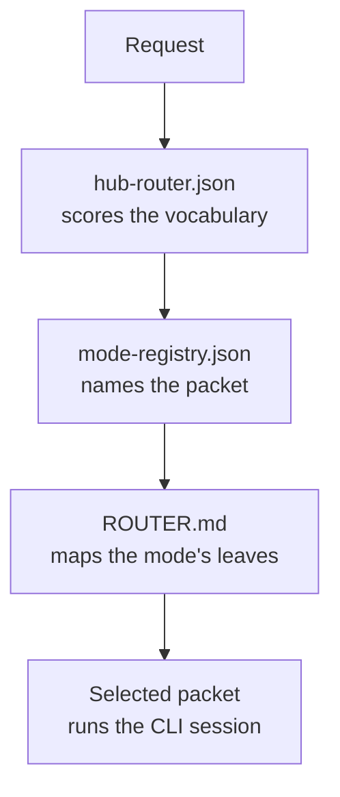

# cli-external-orchestration

> Send a coding or review task to the external CLI that fits it, with every write landing in this repository's workspace.

---

## 1. OVERVIEW

### At a Glance

| Aspect | What you get |
|---|---|
| **Use it for** | Cross-AI dispatch of a coding pass, a review, a research question or a second opinion to one of eight external CLI runtimes |
| **Invoke with** | A trigger phrase that names an executor, such as `delegate to codex` or `mistral vibe`. No mode has a bound slash command |
| **Works on** | Requests that carry executor vocabulary and the repository workspace the dispatched session writes to |
| **Produces** | One dispatched CLI session whose writes land in this repository or a request for disambiguation |

### What It Does

The hub is the front door for external CLI dispatch. It reads the request and hands the task to one of eight workflow packets. The hub carries no per-mode logic, so each packet keeps its own dispatch contract and references.

Start with `node .skilled/bin/compiled-route.cjs --hub cli-external-orchestration --prompt "<task>"` when you want the decision before a dispatch. The reply names the mode the hub picked.

Work with no cross-AI handoff belongs to the skill that owns it. Application-code implementation and review with no dispatch need go to `sk-code`. The hub exists for the task that has to leave this runtime.

### The Mode Roster

Eight packets sit under the hub. Each one is a `workflow` packet with `mutatesWorkspace: true`, and each runs one CLI binary.

| Mode | What the packet dispatches |
|---|---|
| [cli-opencode](./cli-opencode/SKILL.md) | `opencode run` sessions, including parallel detached workers and the full runtime with its plugins and MCP tools |
| [cli-claude-code](./cli-claude-code/SKILL.md) | `claude -p` runs for reasoning passes and structured JSON output |
| [cli-codex](./cli-codex/SKILL.md) | `codex exec` runs for coding, repo analysis, review and web research |
| [cli-cursor](./cli-cursor/SKILL.md) | `cursor-agent` runs, including read-only plan mode and a worktree-isolated worker |
| [cli-devin](./cli-devin/SKILL.md) | `devin -p` runs, including subagent delegation and a cloud handoff |
| [cli-pi](./cli-pi/SKILL.md) | `pi` headless runs, including print mode and JSON-event output |
| [cli-deepseek-harness](./cli-deepseek-harness/SKILL.md) | `dsh --profile headless` one-task runs over a closed two-route set. Experimental |
| [cli-mistral-vibe](./cli-mistral-vibe/SKILL.md) | `vibe -p` one-task runs over a closed two-alias roster. Experimental |

### Guards Stay Inside The Packets

Each packet owns its guard. Most packets refuse to load when the caller already runs inside their own CLI. `cli-opencode` allows an explicit parallel detached request, which must start a separate session with its own state directory. `cli-pi` is exempt from the two layers that mean the caller sits inside Pi. Every packet still refuses a dispatch from inside a fan-out lineage or a repeat in the dispatch stack.

---

## 2. QUICK START

**Step 1: Resolve the mode.**

```bash
node .skilled/bin/compiled-route.cjs --hub cli-external-orchestration --prompt "delegate to codex for a diff review"
```

The reply is one JSON line. `action` reads `route` and `targets[0].workflowMode` reads `cli-codex`:

```json
{"hubId":"cli-external-orchestration","action":"route","selectionKind":"single","targets":[{"backendKind":"cli-dispatch","packetId":"cli-codex","packetKind":"workflow","skillId":"cli-external-orchestration","workflowMode":"cli-codex"}],"effectivePolicyHash":"…","generation":…}
```

The `effectivePolicyHash` and `generation` values change whenever the routing files are re-minted, so compare `action` and `targets` only.

An `action` of `defer` or `clarify` means the prompt named no clear executor. Name one of the eight modes and run the command again.

**Step 2: Read the packet contract.** Open the mode's `SKILL.md` before you compose the prompt. Every packet requires that read, and the router's answer does not replace it.

**Step 3: Check the hub before you rely on it.**

```bash
node .skilled/commands/doctor/scripts/parent-skill-check.cjs .skilled/skills/cli-external-orchestration
```

The run prints `PASS` and `INFO` lines and ends with `OK: parent-skill-check`. It exits 0.

---

## 3. HOW IT WORKS

Routing runs in two stages. The hub scores the request against the vocabulary in `hub-router.json` and picks a workflow mode. `ROUTER.md` then maps that mode's intent to the leaf files the packet loads. The hub never emits a leaf path, and the surface router never picks a mode.



### The Outcomes

`hub-router.json` declares three outcomes.

| Outcome | What happens |
|---|---|
| `single` | One dominant executor signal routes to one mode |
| `orderedBundle` | Several explicitly requested executors run in `tieBreak` order |
| `defer` | Unclear or contradictory intent asks for disambiguation |

`defaultMode` is `null`, so the router never picks a fallback for you. A prompt that names no executor takes the `defer` outcome. A DeepSeek model name alone does not choose a mode either, because the runtime named in the request decides that. `composer` is the exception. It names Cursor's own model, so it routes to `cli-cursor`.

### Compiled Routing

Compiled routing runs first. `node .skilled/bin/compiled-route.cjs` returns a decision, and a `route` decision carries the targets to load. On a legacy sentinel or an error the hub falls back to `hub-router.json`. Set `SPECKIT_COMPILED_ROUTING=0` to force the registry path.

---

## 4. INTEGRATION & NAVIGATION

### When To Use This Skill

Reach for the hub when the work should run in another CLI. That covers a second opinion on a diff, a review from another runtime, a research pass with web access or a full-runtime session against this repository. Reach for `sk-code` when the code work stays here. A quick in-process task with no handoff does not need a dispatch.

### Related Skills

| Skill | Relationship |
|---|---|
| `sk-code` | Owns application-code implementation and review, so a task with no CLI handoff stays there |
| `sk-prompt` | Holds the canonical CLI prompt-quality card and its persona-injection contract |
| `system-spec-kit` | Provides the spec folder and continuity contract a full-runtime `cli-opencode` session carries |
| `system-skill-advisor` | Resolves an executor prompt to this hub and reads its registry for the executor-delegation scorer |

---

## 5. TROUBLESHOOTING

| What you see | Why | Fix |
|---|---|---|
| `action` reads `defer` or `clarify` | The prompt named no executor, or named several with no clear winner | Name one of the eight modes and run the router again |
| A packet refuses to load | The caller runs inside that packet's own CLI | Dispatch from another runtime. `cli-pi` is the one packet a Pi session may call |
| The compiled router returns a legacy sentinel or an error | The compiled path cannot serve the request | Follow `hub-router.json` or set `SPECKIT_COMPILED_ROUTING=0` to force the registry path |

---

## 6. VERIFICATION

| Check | Command and pass criterion |
|---|---|
| Hub invariants | `node .skilled/commands/doctor/scripts/parent-skill-check.cjs .skilled/skills/cli-external-orchestration` prints `OK: parent-skill-check` and exits 0 |
| README structure | `python3 .skilled/skills/sk-doc/scripts/validate_document.py .skilled/skills/cli-external-orchestration/README.md` prints `Total issues: 0` and exits 0 |
| Voice | `python3 .skilled/skills/sk-doc/sk-create-with-human-voice/scripts/hvr_scan.py .skilled/skills/cli-external-orchestration/README.md` prints `hard blockers: 0` and exits 0 |

---

## 7. RELATED DOCUMENTS

| Document | Purpose |
|---|---|
| [`SKILL.md`](./SKILL.md) | Hub runtime: when to use it, the mode table and the hub rules |
| [`ROUTER.md`](./ROUTER.md) | Stage-two router: dispatch intent to the leaf files a mode loads |
| [`mode-registry.json`](./mode-registry.json) | Mode identity, packet folder, aliases and tool surface |
| [`hub-router.json`](./hub-router.json) | Routing policy, signals and vocabulary classes |
| [`leaf-manifest.json`](./leaf-manifest.json) | The registered leaf resources and their typed pairs |
| [`feature-catalog/feature-catalog.md`](./feature-catalog/feature-catalog.md) | Current-state inventory of the hub surface |
| [`manual-testing-playbook/manual-testing-playbook.md`](./manual-testing-playbook/manual-testing-playbook.md) | Operator scenarios that test routing against the live hub |
| [`shared/references/child-dispatch-preamble.md`](./shared/references/child-dispatch-preamble.md) | The preamble every non-interactive dispatch prompt carries |
| [`changelog/`](./changelog/) | Per-release entries, one file per version |
