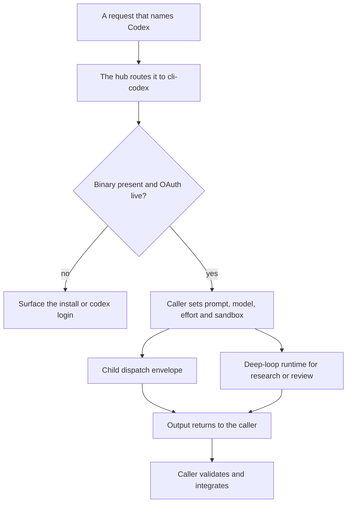

# cli-codex

> Finish a coding or review task through the Codex CLI without leaving your current session.

---

## 1. OVERVIEW

### At a Glance

| Aspect | What you get |
|---|---|
| **Use it for** | Sandboxed coding, repo analysis, diff-aware review and live web research through the `codex` binary |
| **Invoke with** | "codex", "codex cli", "web search", "second opinion" or the hub's `cli-codex` mode |
| **Works on** | Any runtime that is not Codex itself and can reach the `codex` binary |
| **Produces** | File edits inside the workspace, review findings, sourced research answers or a second opinion |

### What It Does

cli-codex turns a task into a `codex exec` run and hands the output back to the calling assistant. The packet owns the routing, the availability probe, the prompt shape and the self-invocation guard. Research and review lineages run through the shared deep-loop runtime rather than a packet-local adapter.

It does not write the standards your code has to meet. Nor does it manage spec folders. `sk-code` owns code quality and verification. `system-spec-kit` owns spec folders, memory and continuity.

### Why This Skill Exists

A non-Codex assistant has no way to reach the `codex` binary. A hand-built `codex exec` line drifts on the sandbox flag and the auth check. A caller that is already inside Codex burns a run on a dispatch that cannot start. This packet holds those decisions in one place.

### The Dispatch Surfaces

| Capability | What the packet does with it |
|---|---|
| **Sandboxed coding** | runs `codex exec` with `--sandbox workspace-write` so edits land inside the caller's workspace |
| **Repo analysis** | reads a codebase in a read-only run and maps files, dependencies or architecture |
| **Diff-aware review** | uses `codex exec review` on a commit diff, a base branch or the uncommitted changes |
| **Live web research** | places the top-level `--search` flag before `exec` so answers cite current results |
| **Image input** | attaches a screenshot or mockup with `-i` for design-to-code and visual bug work |
| **Second opinion** | runs a separate dispatch, often with the `review` profile, over work the caller produced |

---

## 2. QUICK START

**Step 1: Check the binary.**

```bash
command -v codex
```

Expected output: the path to the binary, for example `/opt/homebrew/bin/codex`. Nothing prints when the CLI is missing. Run `npm i -g @openai/codex` to install it.

**Step 2: Confirm the ChatGPT login.**

```bash
codex login status
```

Expected output: a line that reports the login state. The pre-flight in [`SKILL.md`](./SKILL.md) matches `logged in` or `chatgpt-oauth`. When it reports no login, run `codex login` and finish the browser flow with a Plus, Pro, Business, Edu or Enterprise account. cli-codex uses ChatGPT OAuth only and never an API key.

**Step 3: Run the default dispatch.**

```bash
codex exec \
  --model gpt-6-luna \
  -c model_reasoning_effort="medium" \
  -c service_tier="fast" \
  -c approval_policy=never \
  --sandbox workspace-write \
  "Add input validation to src/utils.ts" </dev/null
```

Expected output: exit code 0. The answer arrives on stdout and the file is changed in the workspace. A non-zero exit carries the failure on stderr. The `</dev/null` keeps the child from reading your stdin.

**Step 4: Review a commit.**

```bash
codex exec review "Focus on security" --commit HEAD --model gpt-6-luna -c model_reasoning_effort="medium" -c service_tier="fast" </dev/null
```

Expected output: a review that stays on the `HEAD` diff and the security focus you named, then exit 0.

---

## 3. HOW IT WORKS

A dispatch starts when the hub routes a request here or when a caller reads the skill directly. The packet probes `command -v codex` and checks the ChatGPT login before it builds anything. The calling assistant writes the prompt and pins the model, the reasoning effort, the service tier and the sandbox.

Then one of two paths runs the work. A single build or doc task goes out through the child dispatch envelope in [`references/providers-and-models.md`](./references/providers-and-models.md). A research or review lineage goes to the shared deep-loop runtime at [`fanout-run.cjs`](../../system-deep-loop/runtime/scripts/fanout-run.cjs), which accepts only those two loop types with executor kind `cli-codex`. The output returns to the caller, which validates it before integrating.



### The Packet Layout

| Path | Role |
|---|---|
| `SKILL.md` | Runtime instructions and the dispatch rules |
| `ROUTER.md` | Machine router: intent map, resource map and loading levels |
| `README.md` | This front page |
| `references/cli-reference.md` | Flags, sandbox modes, sessions and auth, loaded on every run |
| `references/agent-delegation.md` | Profile roster, routing table and invocation patterns |
| `references/codex-tools.md` | Built-in review, search, MCP, image and session surfaces |
| `references/hook-contract.md` | Native hook wiring for startup context and the advisor brief |
| `references/integration-patterns.md` | Cross-AI orchestration patterns |
| `references/providers-and-models.md` | Model ids, effort ceilings and the dispatch envelope |
| `assets/prompt-quality-card.md` | Fast-path prompt discipline, loaded on every run |
| `assets/prompt-templates.md` | Copy-paste prompt templates |
| `hard-rules.json` | The two preflight rules: stdin redirect and binary availability |
| `manual-testing-playbook/` | 43 scenarios across 11 categories |
| `benchmark/reports/` | Dated runs of the playbook |
| `changelog/` | One entry per release |

### Profiles And Reasoning Effort

A profile sets the sandbox and the effort for one kind of task. `-p review` loads `$CODEX_HOME/review.config.toml`. A profile named `debug` loads `$CODEX_HOME/debug.config.toml` the same way. The `.codex/agents/*.toml` files are a separate surface: they define personas for the interactive multi-agent TUI and are not loaded by `-p`.

Reasoning effort goes through the config override `-c model_reasoning_effort="<level>"`. There is no `--reasoning-effort` or `--quiet` flag. The ladder runs eight levels from `none` to `ultra`. Each model caps at its own ceiling. The roster with the ceilings lives in the [provider and model reference](./references/providers-and-models.md).

### The Silent Traps

Four defaults surprise an operator who has not read the reference.

**The read-only default.** `codex exec` runs read-only when no `--sandbox` is passed. A task that asks for edits reads the files and plans the change without writing anything. Pass `--sandbox workspace-write` for any task that edits.

**The misplaced search flag.** `--search` belongs before the subcommand. `codex --search exec "<prompt>"` turns on live browsing, while `codex exec --search` fails with `unexpected argument '--search'` on current builds.

**The service tier fallback.** Without `-c service_tier="fast"` the run uses whatever `~/.codex/config.toml` sets, which can be a slower tier.

**The inherited stdin.** A backgrounded `codex exec` reads the caller's stdin unless you close it. A loop over `input.jsonl` stops after a few dispatches and reports no error. Add `</dev/null` to every non-interactive dispatch.

### The Self-Invocation Guard

If the agent reading this skill is itself running inside Codex, the packet refuses to load and returns `Self-invocation refused`. The guard reads the `CODEX_*` environment variables first. It then walks the process ancestry for a `codex` parent before it checks for a lock file under `~/.codex/state/<id>/lock`. When any layer matches, nothing loads. The cli-X family exists for cross-AI delegation. A running CLI skill never dispatches itself.

---

## 4. INTEGRATION & NAVIGATION

### When To Use This Skill

Reach for cli-codex when the work needs a sandboxed editor, a diff-aware review, live web research or a second opinion on code the caller wrote. Skip it for a question the caller can answer from context it already holds. Skip it too for interactive terminal work where `codex` itself is the right tool. If the caller is already inside Codex, the guard refuses the route, so use a sibling skill or a different runtime.

### Related Skills

| Skill | Relationship |
|---|---|
| `cli-claude-code` | Deep reasoning and schema-validated output through the `claude` CLI. Reach for it when the task needs those instead of a sandboxed editor. |
| `cli-opencode` | Full runtime dispatch with every plugin and registered MCP server. |
| `sk-code` | Owns the code standards and the verification that the returned work has to pass. |
| `system-spec-kit` | Owns spec folders, memory and continuity. The Memory Handback carries a Codex session back into the caller's packet. |
| `system-deep-loop` | Owns the runtime that runs research and review lineages. |

---

## 5. TROUBLESHOOTING

| What you see | Why | Fix |
|---|---|---|
| `command not found: codex` | the binary is not installed or not on `PATH` | `npm i -g @openai/codex`, then restart the terminal |
| `401 Unauthorized` or `not authenticated` | the ChatGPT OAuth login is missing or expired | run `codex login` and finish the browser flow |
| The run finished but no file changed | `codex exec` defaulted to the read-only sandbox | add `--sandbox workspace-write`, with `-a never` before `exec` for a headless run |
| `unexpected argument '--search'` | `--search` was placed after `exec` | place it before the subcommand: `codex --search exec "<prompt>"` |
| `unexpected argument '--reasoning' found` | no reasoning flag exists | set the effort with `-c model_reasoning_effort="high"` |
| A background loop stops after a few dispatches | the backgrounded `codex` inherited the loop's stdin | close stdin on every dispatch with `</dev/null` |
| `Self-invocation refused` | the caller is already running inside Codex | use a sibling cli-* skill or a different runtime |
| A read-only child reports `FILES READ: none` | the inlined persona named tools the child does not have | place the tool-mapping line above the persona and treat the run as failed |

---

## 6. FAQ

### Why not call `codex exec` from a script directly?

You can. This packet exists for a calling assistant that has to choose the model, the effort, the sandbox and the auth check on every dispatch. That assistant must not dispatch itself. It holds those decisions in one place and refuses the route when the binary or the login is missing.

### When should I use `codex exec review` instead of a read-only prompt?

`codex exec review --commit HEAD` reads the commit diff, so the review stays on the lines that changed. Use a read-only prompt for a question about named files or a pattern.

### Why does `--search` sit before `exec`?

Because it is a top-level flag. `codex --search exec "<prompt>"` turns on live web access for the session. The same flag after `exec` is rejected on current builds.

### Which model and effort should I pass?

Start from the default in the [provider and model reference](./references/providers-and-models.md), then raise the effort for architecture work and security review and lower it for a quick lookup. The effort has to stay under the chosen model's ceiling. A ChatGPT login accepts only the models its plan lists.

### Can the packet run itself from inside Codex?

No. The guard refuses the load and returns `Self-invocation refused`. Dispatch from a sibling cli-* skill in another runtime instead.

---

## 7. VERIFICATION

The packet ships a manual testing playbook of 43 scenarios across 11 categories. The categories cover CLI invocation, sandbox modes, reasoning effort, agent routing, session continuity, integration patterns, prompt templates, built-in tools, Codex cloud, git preflight and a hermetic stress matrix.

| Check | How to run it |
|---|---|
| README structure | `python3 .skilled/skills/sk-doc/scripts/validate_document.py .skilled/skills/cli-external-orchestration/cli-codex/README.md --type readme` reports zero issues |
| Playbook structure | `python3 .skilled/skills/sk-doc/scripts/validate_document.py .skilled/skills/cli-external-orchestration/cli-codex/manual-testing-playbook/manual-testing-playbook.md --type playbook` reports zero issues |
| Binary and login | `command -v codex` prints a path and `codex login status` reports a ChatGPT login |
| Behavior | run the scenarios under `manual-testing-playbook/<category>/` from a runtime that is not Codex. Record each result under `benchmark/reports/` |

---

## 8. RELATED DOCUMENTS

| Document | Purpose |
|---|---|
| [`SKILL.md`](./SKILL.md) | Runtime instructions and the dispatch rules |
| [`ROUTER.md`](./ROUTER.md#3-machine-router) | Machine router: intent map, resource map and loading levels |
| [`references/cli-reference.md`](./references/cli-reference.md) | Flags, sandbox modes, sessions, auth and troubleshooting |
| [`references/providers-and-models.md`](./references/providers-and-models.md) | Model ids, effort ceilings and the dispatch envelope |
| [`references/agent-delegation.md`](./references/agent-delegation.md) | Profile roster, routing table and invocation patterns |
| [`references/codex-tools.md`](./references/codex-tools.md) | Built-in review, search, MCP, image and session surfaces |
| [`references/integration-patterns.md`](./references/integration-patterns.md) | Cross-AI orchestration patterns |
| [`references/hook-contract.md`](./references/hook-contract.md) | Native hook wiring for startup context and the advisor brief |
| [`assets/prompt-quality-card.md`](./assets/prompt-quality-card.md) | Fast-path prompt discipline and the CLEAR check |
| [`assets/prompt-templates.md`](./assets/prompt-templates.md) | Copy-paste prompt templates |
| [`manual-testing-playbook/manual-testing-playbook.md`](./manual-testing-playbook/manual-testing-playbook.md) | The scenario directory for operators |
| [`hard-rules.json`](./hard-rules.json) | The two preflight rules |
