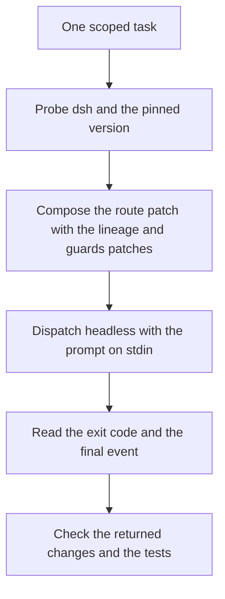

# cli-deepseek-harness

> Dispatch one scoped task to DeepSeek Harness in headless mode and read the outcome from the JSON event stream it returns.

The binary selects the model from its own config, so the caller has to compose the run. This packet fixes that composition and the way a result is judged.

---

## 1. OVERVIEW

### At a Glance

| Aspect | What you get |
|---|---|
| **Use it for** | One-task headless reviews, scoped builds and second opinions |
| **Invoke with** | `deepseek harness`, `dsh headless`, `delegate to dsh` |
| **Works on** | A checkout that can reach the pinned `dsh` binary, from a scratch cwd with a disposable `DSH_HOME` |
| **Produces** | A JSON event stream, a final answer and any workspace changes |

### What It Does

The packet turns a bounded request into one `dsh --profile headless` run and tells you how to judge what came back. It fixes the argv shape the caller has to copy. It also names the two routes that may run and states the rules a dispatch has to satisfy. The flag-level contract lives in [the CLI reference](./references/cli-reference.md).

### Why This Skill Exists

DeepSeek Harness selects its model from a config row. Headless mode takes no model, provider, timeout or working-directory option. The base composition names the official DeepSeek API, which this repository never dispatches.

A dispatch that omits the route patch reaches that default. A dispatch started from the repository root can read the root `.env`. A keyless run can produce a parseable `final` event and still exit 1. This packet closes all three gaps with a fixed argv and a set of rules the preflight enforces.

### Route Status

The checked-in patches set LLM Gateway `deepseek-v4.1-flash-1017` as the default route. A keyed run completed on dsh 0.2.2-rc.3. OpenCode Go `deepseek-v4.1-flash` answered a keyed run against `https://opencode.ai/zen/go/v1` and stays out of defaults. The deep-loop executor kind stays experimental while dsh is a release candidate.

---

## 2. QUICK START

Run this from the repository root. The first line records the checkout root. Every `dsh` call after it runs in a scratch directory with a home of its own.

**Step 1: Create a scratch home and probe the binary.**

```bash
REPO="$(pwd -P)"
RUN_DIR="$(mktemp -d)"
export DSH_HOME="$RUN_DIR/.dsh-home"
cd "$RUN_DIR"
command -v dsh
dsh --version </dev/null
```

Expected: the first line is the binary's absolute path and the second is `0.2.2-rc.3`. An empty path or any other version stops the dispatch before a command is built.

**Step 2: Prove the patches compose, with no model call.**

```bash
dsh --profile headless \
  --patch "$REPO/.dsh/patches/route-llmgateway-deepseek.patch.yml" \
  --patch "$REPO/.dsh/patches/lineage.patch.yml" \
  --patch "$REPO/.dsh/patches/guards.patch.yml" \
  --dump-config </dev/null
```

Expected: exit 0, nothing on stderr, the route's provider and model under `agent-default-model` and a `repo-guards` row in the printed config.

**Step 3: Dispatch, then read the last event.**

```bash
printf '%s' "$PROMPT" | DSH_HOME="$RUN_DIR/.dsh-home" \
  dsh --profile headless \
    --patch "$REPO/.dsh/patches/route-llmgateway-deepseek.patch.yml" \
    --patch "$REPO/.dsh/patches/lineage.patch.yml" \
    --patch "$REPO/.dsh/patches/guards.patch.yml" \
    --json --permission-mode read-only --approval-policy never - \
  >"$RUN_DIR/stdout.jsonl" 2>"$RUN_DIR/stderr.txt"
```

Expected: exit 0 plus a last stdout line that starts `{"type":"final"` and carries `"reason":{"kind":"completed"`. The answer is that event's `text` field. A run with no key for its route instead exits 1. Its last line carries `"reason":{"kind":"error"` with code `MISSING_CREDENTIAL`.

A writer swaps `read-only` for `workspace-write` and names any directory outside the cwd with `--add-dir`. `$PROMPT` holds the composed prompt, which follows [the prompt-quality card](./assets/prompt-quality-card.md).

---

## 3. HOW IT WORKS

Every dispatch runs the same sequence. The caller probes the binary, picks one route patch, composes a prompt, starts `dsh` in a scratch directory and reads two signals when the process ends: the exit code and the last event on stdout.

The caller stays the conductor. It owns the route choice, the scratch directory, the disposable home, the prompt and the judgement of the result. `dsh` answers one task and exits.

The model is not on the command line. `dsh` builds its runtime from layered YAML patches. The last layer wins per row. The route patch replaces the `agent-default-model` row and the provider entry behind it, so the patch file is the model choice. The lineage patch switches telemetry export, the DeepSeek session log, the goal service and plan mode off. The guards patch inserts the repo-guards plugin bundle, which loads the repository guards before the model is asked anything.

Completion is a pair of signals. A run is complete only on exit 0 plus a last `final` event whose `reason.kind` is `completed`. A parseable stream proves nothing on its own: the keyless probe produced a valid `final` event with `reason.kind` `error` and exited 1.



### What the Caller Owns

The binary takes no timeout, so the caller owns the time bound and enforces it outside the process. The prompt carries the resolved persona inline, because `dsh` has no agent-file loader. It names every file by absolute path, because the process runs in a scratch directory. Headless has no answer channel, so a prompt that needs a decision has to state the choice or tell the child to stop and report.

### Composition, Not Flags

`dsh` reads its launcher flags first and stops at the first token it does not know, which is why `--profile` and `--patch` come before the app options. The patch grammar is small:

- `- id: <row>` with `config:` replaces the whole config of that row.
- `- id: <row>` with `disabled: true` switches the row off.
- `- insert:` adds new rows. A relative plugin `name` resolves beside the patch file.

A patch whose target row is missing is only a loader warning. A renamed row therefore turns the patch into a no-op without failing, so a `--dump-config` run is read for stderr before any route is used.

### Where the Files Sit

```text
cli-deepseek-harness/
  SKILL.md                                  runtime instructions and the hard rules
  ROUTER.md                                 intent map, resource map and loading levels
  README.md                                 folder orientation and navigation
  hard-rules.json                           the thirteen fail-closed dispatch rules
  assets/
    prompt-quality-card.md                  prompt-quality delegator plus dsh addenda
    prompt-templates.md                     preflight, review, build, validation and handback shapes
  changelog/                                versioned release notes
  manual-testing-playbook/                  live probes, evidence rules and scenario files
  references/
    cli-reference.md                        version pin, headless options, dispatch shape, exit contract
    providers-and-models.md                 the closed two-route roster and the route patch shape
    runtime-folder-and-sync.md              .dsh/ layout, DSH_HOME isolation, skills, prompts, personas
    guards-and-hooks.md                     guard seams, the repo-guards bundle, the adapter set
    mcp.md                                  MCP off by default and the opt-in Code Mode patch
    fanout-executor.md                      the experimental executor kind and its lineage command
    repin-runbook.md                        route, confinement, reasoning and lineage probes after an rc bump
```

`hard-rules.json` sits beside `SKILL.md` because the shared preflight reads the sidecar from that folder.

### Fail-Closed Rules

[hard-rules.json](./hard-rules.json) carries thirteen rules at severity `error`, from `headless-only` to `mcp-opt-in-only`. The shared preflight evaluates them against a composed command before the command spawns. It denies the call when a rule blocks or when the rule check throws. Inside a dsh run the same cores load through the repo-guards bundle, so a `bash` dispatch is checked before it executes. The hook pair is described in [the dispatch hook guide](../../../../.skilled/hooks/cli-dispatch/dsh/README.md).

---

## 4. INTEGRATION & NAVIGATION

### When To Use This Skill

Reach for this packet when a request names DeepSeek Harness or `dsh`. It also fits a bounded build that should answer once and exit. Use it for a second opinion from a run that is not the calling runtime. A composition check fits too, where a `--dump-config` run proves the patches still apply before any model is called.

Use a sibling packet when the request names another CLI. Use one too when the task needs an interactive session. Headless has no answer channel and no plan mode. The lineage patch switches the native goal rounds off. A request that needs any of them belongs somewhere else.

### Related Skills

| Skill | Relationship |
|---|---|
| `cli-pi` | Pi's terminal coding agent. It carries its own model and provider surface |
| `cli-opencode` | The project's full plugin, skill and MCP runtime in one dispatch, plus parallel detached sessions |
| `cli-claude-code`, `cli-codex`, `cli-cursor`, `cli-devin` | Their own vendors' CLIs |
| `cli-mistral-vibe` | Mistral Vibe print-mode dispatch. Mistral work goes through it, not through dsh |

---

## 5. TROUBLESHOOTING

| What you see | Why | Fix |
|---|---|---|
| `dsh` is not found | The binary is absent from PATH | Install the pinned `@deepseek-ai/dsh`, then rerun the probe |
| `dsh --version` prints another version | A different release is installed | Re-pin offline before dispatching on it |
| Exit 1, final reason `error`, code `MISSING_CREDENTIAL` | The route's key variable is not set | Export the variable stderr names, by name, in the dispatch environment |
| A command carries a model or provider option | Headless has no such option, so the command is wrong before `dsh` reads it | Drop the option and select the model with the route patch |
| The preflight denies with `route-patch-required` | The patch path sits behind a shell variable | Name the literal patch file so the roster check can read it |
| `--dump-config` prints a stderr line | A patch may target a row the release renamed | Fix the patch before any dispatch |
| The `session` event's `cwd` is the repository root | The dispatch started at the root | Stop. Rerun from a scratch cwd, because the root `.env` was readable |

---

## 6. FAQ

### Why does the route patch choose the model?

Headless `dsh` takes no model or provider option. The model comes from the `agent-default-model` row. A `--patch` layer replaces that row. One checked-in patch per route keeps the choice explicit and lets the preflight check the file name against the roster.

### Does a valid JSON stream mean the run worked?

No. The keyless probe printed a well-formed stream whose last event was `final` with `reason.kind` `error`. It exited 1. Read the exit code and the final reason together.

### Why keep `DSH_HOME` out of `~/.dsh`?

Every profile-scoped command initializes profile files in the home it resolves. An unset `DSH_HOME` resolves to `~/.dsh`. A fresh home per dispatch keeps sessions and profiles out of the operator's own setup.

### What happens if the dispatch starts at the repository root?

Headless reads keys from the environment, then `<cwd>/.env`, then `$DSH_HOME/.env`. The root holds a `.env`. The `session` event's `cwd` field shows where a run started, which is the cheap way to catch it.

---

## 7. VERIFICATION

| Check | Result |
|---|---|
| Availability | `command -v dsh` prints a path and `dsh --version` prints `0.2.2-rc.3` |
| Composition | `--dump-config` with the route, lineage and guards patches exits 0 with empty stderr |
| Completion | Exit 0 and a last `final` event with `reason.kind` `completed` |
| Rules | `hard-rules.json` parses and carries 13 ids, all at severity `error` |
| Packet docs | The README validator reports zero issues |

```bash
cd .skilled/skills/cli-external-orchestration/cli-deepseek-harness
node -e 'const r=require("./hard-rules.json"); console.log(r.length, r.every((x) => x.severity === "error"))'
```

Expected: `13 true`.

```bash
python3 .skilled/skills/sk-doc/scripts/validate_document.py \
  .skilled/skills/cli-external-orchestration/cli-deepseek-harness/README.md --type readme
```

Expected: `✅ VALID` on the first line and `Total issues: 0`.

The [manual testing playbook](./manual-testing-playbook/manual-testing-playbook.md) carries the live probes, their evidence rules and 25 scenarios.

---

## 8. RELATED DOCUMENTS

| Document | Purpose |
|---|---|
| [`SKILL.md`](./SKILL.md) | Runtime instructions and the hard rules |
| [`ROUTER.md`](./ROUTER.md#3-machine-router) | Intent map, resource map and loading levels |
| [`hard-rules.json`](./hard-rules.json) | The thirteen fail-closed rules |
| [`references/cli-reference.md`](./references/cli-reference.md) | Version pin, headless options, dispatch shape and exit contract |
| [`references/providers-and-models.md`](./references/providers-and-models.md) | The closed roster and the route patch shape |
| [`references/runtime-folder-and-sync.md`](./references/runtime-folder-and-sync.md) | The `.dsh/` layout and `DSH_HOME` isolation |
| [`references/guards-and-hooks.md`](./references/guards-and-hooks.md) | Guard seams and the repo-guards adapter set |
| [`references/mcp.md`](./references/mcp.md) | MCP off by default and the Code Mode patch |
| [`references/fanout-executor.md`](./references/fanout-executor.md) | The executor kind and its lineage command |
| [`references/repin-runbook.md`](./references/repin-runbook.md) | Probes after an rc bump |
| [`assets/prompt-quality-card.md`](./assets/prompt-quality-card.md) | Prompt-quality delegator plus dsh addenda |
| [`assets/prompt-templates.md`](./assets/prompt-templates.md) | Dispatch, validation and handback shapes |
| [`manual-testing-playbook/manual-testing-playbook.md`](./manual-testing-playbook/manual-testing-playbook.md) | The 25-scenario live playbook |
