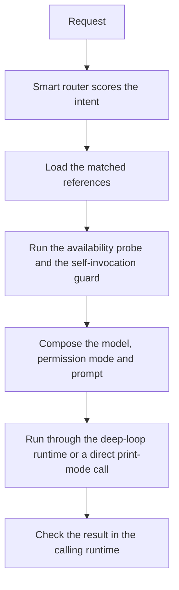

# cli-devin

> Hand a long task or a second-opinion review to a second AI that works in its own context and returns the result to your session.

---

## 1. OVERVIEW

### At a Glance

| Aspect | What you get |
|---|---|
| **Use it for** | Delegating coding, review, research or a second opinion to Cognition's Devin CLI without leaving your current runtime |
| **Invoke with** | "devin", "cognition", "cloud handoff", "subagent delegation", "second opinion" or "cross-validate" |
| **Works on** | Any runtime other than Devin that can reach the `devin` binary, with a Devin account login |
| **Produces** | Code edits, structured reviews, research notes, subagent results and cloud sessions |

### What It Does

cli-devin routes a request to Cognition's Devin CLI when the task benefits from a separate agent with its own context window. A smart router scores the request against weighted intent signals and loads the matching references. The calling AI stays in charge. It composes the prompt and runs the `command -v devin` availability probe. It checks every result before using it.

Orchestrated research and review lineages run through the shared deep-loop runtime at `.skilled/skills/system-deep-loop/runtime/scripts/fanout-run.cjs` with executor kind `cli-devin`. That runner accepts only the `research` and `review` loop types, so a single build or documentation dispatch uses the child dispatch envelope described in [the provider catalog](references/providers-and-models.md). The direct `devin -p` commands in this README are operator reference and manual-testing shapes.

### The Delegation Layer

The skill covers the parts of Devin that a calling AI cannot reach on its own. Each row names a surface the skill can operate.

| Capability | What the skill can operate |
|---|---|
| **Multi-model dispatch** | a focused roster of model families, selected per dispatch with `--model` |
| **Subagent delegation** | read-only and full-access workers through `run_subagent`, plus custom `.devin/agents/<name>/AGENT.md` profiles |
| **Cloud handoff** | a cloud VM with its own shell and browser plus full repo access through `/handoff` |
| **Session management** | continue and resume sessions with `devin -c` and `devin -r <session-id>` |
| **MCP integration** | external servers attached with `devin mcp add` and listed with `devin mcp list` |

Subagents accept a profile, not a model. `subagent_explore` runs on the default subagent model and `subagent_general` inherits the parent model. To pin a model on a write-capable subagent, add a `model:` field to a custom profile. The roster, ids and aliases live in [the provider catalog](references/providers-and-models.md).

### What This Skill Does Not Own

cli-devin does not replace the calling runtime. The calling AI still plans the work and checks the result. It does not own application-code standards, which belong to `sk-code`, and it does not build a second execution adapter, because the shared deep-loop runtime owns process construction. A session already running inside Devin is refused outright, so a CLI skill never dispatches itself.

---

## 2. QUICK START

**Step 1: Confirm the binary and the login.**

```bash
command -v devin
devin auth status
```

`command -v devin` prints the binary path, for example `/Users/you/.local/bin/devin`. `devin auth status` prints `Logged in (via Devin).` followed by the credential and account details. If the binary is missing, run `devin setup` or `curl -fsSL https://devin.ai/install | bash`. If the status is not logged in, run `devin auth login` and finish the browser flow.

**Step 2: Run a read-only dispatch.**

```bash
devin -p --model swe-2-max --permission-mode auto -- "Summarize what src/utils.ts exports" 2>&1
```

Expect the model's reply on stdout and exit code 0. `auto` approves read-only tools and prompts for writes and shell. A print-mode session has nobody to answer a prompt, so keep a read-only dispatch to reading and summarizing.

**Step 3: Raise the mode for an edit task.**

```bash
devin -p --model swe-2-max --permission-mode dangerous -- "Add input validation to src/utils.ts" 2>&1
```

Expect the file changed in the working tree and a short response on stdout. `dangerous` auto-approves every tool, so use it only after the operator approves it for the task. Its alias is `bypass`. For a narrower grant, `accept-edits` approves workspace edits and leaves shell commands to prompt.

For long-running work, start a session with `devin -- "prompt"` and type `/handoff <task>` inside it. The cloud session keeps working after you disconnect, and you can track it from the terminal or the Devin web app.

---

## 3. HOW IT WORKS

A dispatch starts with the router. It scores the request against weighted intent signals such as generation, review, research or handoff, then loads only the matching references. `references/cli-reference.md` and `assets/prompt-quality-card.md` load on every invocation. Before any process is built, the skill runs the `command -v devin` probe and the self-invocation check. The prompt is then composed with a model and a permission mode, and the work runs through the deep-loop runtime or as a direct print-mode call.



### Permission Modes

Devin has no headless reasoning-effort flag. Autonomy is set through `--permission-mode`, so pick the least-permissive mode that lets the task finish.

| Mode | Flag | What it approves | Use for |
|---|---|---|---|
| **Auto** | `auto` | read-only tools, prompting for writes and shell | reading, review, analysis |
| **Accept Edits** | `accept-edits` | workspace edits and read-only tools, prompting for shell | code generation and refactoring |
| **Smart** | `smart` | actions a fast model judges safe | trusted workflows |
| **Dangerous** | `dangerous`, also `yolo` and `bypass` | every tool without prompting | full trust, after explicit approval |
| **Autonomous** | `autonomous` with `--sandbox` | sandboxed execution with OS limits, while file writes still prompt | unattended work inside the sandbox |

`devin -p` itself starts in `auto`. In print mode a tool call that wants confirmation is refused, and the run can exit 0 having done nothing. Pass the mode the task needs, then check the worktree after an edit dispatch.

### The Self-Invocation Guard

If the calling session is itself running inside Devin, the skill refuses to load. The guard reads `$DEVIN_PROJECT_DIR` and checks process ancestry for a `devin` parent. It also probes for active-session credentials. A circular dispatch burns tokens and cannot converge, so the refusal is a hard rule.

### The Skill Files

| File | Role |
|---|---|
| `SKILL.md` | hard rules and the full rule set |
| `ROUTER.md` | intent map, resource map and loading levels |
| `README.md` | this front page |
| `hard-rules.json` | dispatch preflight checks |
| `references/cli-reference.md` | flags, auth, permission modes, sessions and troubleshooting |
| `references/providers-and-models.md` | model families, ids, aliases and dispatch shapes |
| `references/agent-delegation.md` | subagent profiles and installed-version probes |
| `references/cloud-handoff.md` | `/handoff` mechanics and state transfer |
| `references/devin-tools.md` | built-in tools, MCP and sessions |
| `references/integration-patterns.md` | orchestration patterns and failure modes |
| `assets/prompt-quality-card.md` | prompt discipline and the CLEAR check |
| `assets/prompt-templates.md` | copy-paste prompt templates |
| `manual-testing-playbook/manual-testing-playbook.md` | 38 manual scenarios across 12 categories |
| `benchmark/reports/` | dated manual-testing results |
| `changelog/` | one entry per release |

---

## 4. INTEGRATION & NAVIGATION

### When To Use This Skill

Use cli-devin when a task benefits from a separate agent context: an independent review, a security audit, a generation pass or research that would fill your own window. Use it for long-running work that should outlive your terminal, and for a second-model opinion on code you are about to keep.

Skip it for a quick task the calling agent can finish faster, or for interactive refinement that needs the full-screen REPL. Run `devin` directly for that. If you are already inside Devin, use a different runtime, because this skill refuses self-dispatch.

### Related Skills

| Skill | Relationship |
|---|---|
| `cli-codex`, `cli-claude-code`, `cli-opencode`, `cli-cursor` | sibling dispatchers in the cli-* family, one dispatch at a time unless the operator authorizes parallel work |
| `sk-code` | owns the application-code standards a dispatched session loads for review or generation |
| `sk-prompt` | owns prompt-quality guidance and the canonical card |
| `system-deep-loop` | owns the fan-out runtime that executes orchestrated cli-devin dispatches |
| `system-spec-kit` | owns spec folders, memory and the Memory Handback procedure |

---

## 5. TROUBLESHOOTING

| What you see | Why | Fix |
|---|---|---|
| `command not found: devin` | the CLI is not installed or not on `PATH` | run `devin setup` or the install one-liner, then open a new terminal |
| An auth error on dispatch | the Devin account login is missing or expired | run `devin auth login`, or `devin auth login --force-manual-token-flow` on an SSH-only machine |
| The task ran but no files changed | print mode started in `auto`, and the write prompt was refused | pass `--permission-mode accept-edits` or `dangerous`, with approval for the latter |
| A delegated agent stalls on a spec-folder question | `devin -p` cannot answer an interactive prompt | include `Spec folder: <path> (pre-approved, skip Gate 3)` in the prompt, or ask the user before dispatching |
| Self-invocation refused | the calling session is already inside Devin | use a different runtime or exit the Devin session |
| A cloud handoff fails | uncommitted changes or a network problem blocked the transfer | commit or stash unwanted changes and verify connectivity to `app.devin.ai` |
| A background subagent is denied a tool | background workers cannot prompt for new permissions | pre-approve the tool or resume the subagent in the foreground |
| `--sandbox` will not start | the platform prerequisites are missing | run `devin sandbox setup` to print the Linux prerequisites, then install `bwrap` and `socat`. macOS works out of the box |

The full troubleshooting table lives in [the CLI reference](references/cli-reference.md). The anti-patterns to avoid are in [the integration patterns](references/integration-patterns.md).

---

## 6. FAQ

### When should I dispatch to Devin instead of doing the work myself?

When the task benefits from a separate context window or a second opinion. Reach for it for an independent review or for research that would crowd your own session. If the calling agent already holds the context and can finish quickly, doing it directly is faster.

### Does this skill run Devin directly?

Orchestrated research and review lineages run through the shared deep-loop runtime (`fanout-run.cjs`, executor kind `cli-devin`). The skill owns routing, the availability probe and prompt construction. The direct `devin -p` commands in this README are operator reference and manual-testing examples.

### Can a Devin session keep working after I close my laptop?

Yes, through `/handoff`. The command runs inside an interactive Devin session and moves the current session to a cloud VM with full repo access. The cloud session keeps running after you disconnect. Track it from the terminal or the Devin web app. Hand off long-running, browser-dependent, CI-like or high-parallelism work, not a quick edit.

### Why did an edit dispatch exit 0 with no changes?

`devin -p` starts in `auto`, which prompts for writes and shell. In print mode there is nobody to answer, so the call is refused and the run can still exit 0. Pass an elevated mode and check the worktree yourself.

### Where are dispatch defaults stored?

User defaults live in `~/.config/devin/config.json` and project defaults in `.devin/config.json`. Pass `--model` and `--permission-mode` explicitly in scripts so another machine's config cannot change the dispatch.

---

## 7. VERIFICATION

```bash
python3 .skilled/skills/sk-doc/scripts/validate_document.py .skilled/skills/cli-external-orchestration/cli-devin/README.md --type readme
```

The validator prints `✅ VALID` and `Total issues: 0` when the structure holds.

| Check | Result |
|---|---|
| README structure | the validator command above reports `✅ VALID` and `Total issues: 0` |
| Voice and punctuation | the HVR scan in `sk-create-with-human-voice` reports zero hard blockers |
| CLI reachable | `command -v devin` prints the binary path and `devin auth status` reports `Logged in (via Devin).` |
| Manual scenarios | [the manual playbook](manual-testing-playbook/manual-testing-playbook.md) runs 38 scenarios across 12 categories |

---

## 8. RELATED DOCUMENTS

| Document | Purpose |
|---|---|
| [`SKILL.md`](./SKILL.md) | runtime instructions and hard rules |
| [`ROUTER.md`](./ROUTER.md) | intent map, resource map and loading levels |
| [`references/cli-reference.md`](./references/cli-reference.md) | flags, auth, permission modes, sessions and troubleshooting |
| [`references/providers-and-models.md`](./references/providers-and-models.md) | model families, ids, aliases and dispatch shapes |
| [`references/agent-delegation.md`](./references/agent-delegation.md) | subagent profiles and custom profiles |
| [`references/cloud-handoff.md`](./references/cloud-handoff.md) | `/handoff` mechanics and state transfer |
| [`references/devin-tools.md`](./references/devin-tools.md) | built-in tools, MCP and sessions |
| [`references/integration-patterns.md`](./references/integration-patterns.md) | orchestration patterns and failure modes |
| [`assets/prompt-quality-card.md`](./assets/prompt-quality-card.md) | prompt discipline and the CLEAR check |
| [`assets/prompt-templates.md`](./assets/prompt-templates.md) | copy-paste prompt templates |
| [`manual-testing-playbook/manual-testing-playbook.md`](./manual-testing-playbook/manual-testing-playbook.md) | manual validation scenarios |
| [`hard-rules.json`](./hard-rules.json) | preflight checks for stdin redirect and binary availability |
