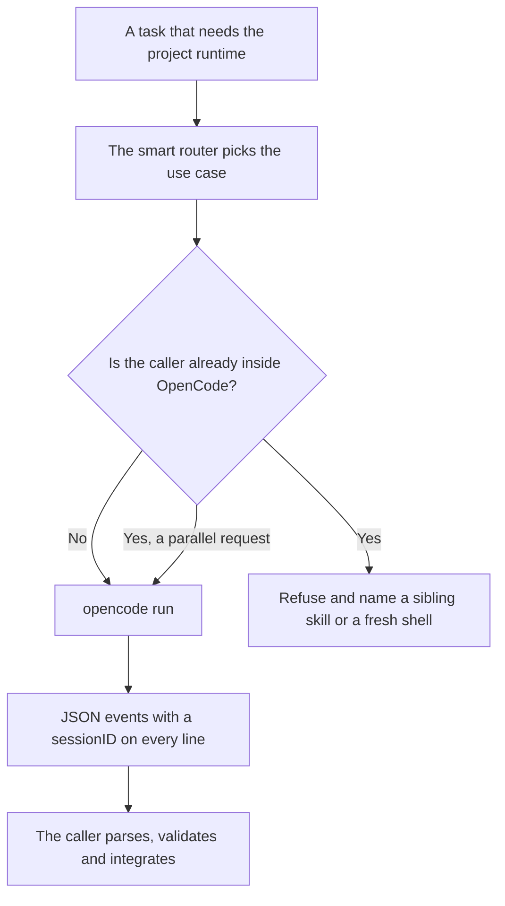

# cli-opencode

> Give an external assistant the project's whole runtime in one dispatch, with every plugin, skill, MCP server and instruction file loaded, plus a parallel detached session when you need a second one with its own state.

---

## 1. OVERVIEW

### At a Glance

| Aspect | What you get |
|---|---|
| **Use it for** | A one-shot dispatch into the project's whole runtime, plus a parallel detached session with its own session id |
| **Invoke with** | "delegate to opencode", "opencode run", "full plugin runtime", "parallel detached" or auto-routing on OpenCode keywords |
| **Works on** | A session in Claude Code, Copilot, OpenCode or a raw shell, plus an OpenCode session that asks for a parallel detached worker |
| **Produces** | A JSON event stream parsed as the run proceeds and the work the session returns, with an optional Memory Handback for the caller's spec folder |

### What It Does

cli-opencode is the routing point for an OpenCode dispatch. The hub sends a request here when it names OpenCode, `opencode run`, a parallel detached session or a full runtime. The smart router loads only the references that match. A `run` session loads the project wholesale: every plugin OpenCode finds under `.opencode/plugins/`, every skill under `.skilled/skills/`, every MCP server registered in `opencode.json` and the repository's `AGENTS.md` instructions.

A guard at three layers refuses the dispatch when the caller already runs inside OpenCode. The one exception is a request that asks for a parallel detached session, because that request starts a separate session rather than re-entering the current one.

It writes no application code and owns no spec folder. `sk-code` owns code standards and tests. `system-spec-kit` owns spec folders, memory and continuity. This skill builds the dispatch, reads the result and hands it back.

### The Dispatch Surface

A sibling CLI dispatch sends a prompt to one provider's binary behind a thin wrapper. This one starts a full OpenCode session, so the work arrives with the project's own tooling already in place.

| Capability | What the skill knows how to operate |
|---|---|
| **Full runtime dispatch** | `opencode run` loads the project plugins, skills, MCP servers and instruction file in one session |
| **Parallel detached session** | a separate run with its own session id and state in the shared `~/.local/share/opencode/` database |
| **Cross-AI handback** | a Memory Handback that carries the run's context back into the caller's spec folder |
| **Provider and model catalog** | every reachable provider and model id, with the effort level for each |
| **Agent delegation** | the project agents under `.skilled/agents/`, with the primary and subagent rules in `references/agent-delegation.md` |

**Verified versions.** `SKILL.md`, the CLI reference and the install guide are verified against OpenCode 2.3.0 and OpenCode 1.19.4 as of 2026-11-14. The other references still carry an earlier read of 2.0.32 and 1.19.3. OpenCode 2 is the expected version. OpenCode 1 stays supported as a fallback for readers who have not updated. The capability delta between the two lives in [`references/install-and-versions.md`](./references/install-and-versions.md).

---

## 2. QUICK START

**Step 1: Find the binary.**

```bash
command -v opencode2 || command -v opencode
```

Expect one resolved path when either name is installed. Expect no output when neither resolves. The resolver prefers `opencode2` and falls back to `opencode`. `OPENCODE_BIN` overrides both. A side-by-side layout has no `opencode2`: there `opencode` is OpenCode 2 and OpenCode 1 answers to `opencode1`. If nothing prints, install with `brew install opencode` or `curl -fsSL https://opencode.ai/install | bash`.

**Step 2: Confirm the major version.**

```bash
opencode --version
```

Expect `opencode v2.3.0` on OpenCode 2 or `1.19.4` on OpenCode 1. Either major is supported. A different version is drift. [`references/install-and-versions.md`](./references/install-and-versions.md) explains what moved between the baselines.

**Step 3: Confirm provider auth.**

```bash
opencode auth list
```

Expect a list of configured providers under their display names, such as `DevPass (LLM Gateway)`. On OpenCode 1 the listing command is `opencode providers list`. If the provider you intend to dispatch through is absent, ask before you substitute another model.

**Step 4: Run the default dispatch.**

```bash
cd "$REPO_ROOT" && opencode run --standalone \
  -m llmgateway/deepseek-v4.1-flash-1017#max \
  --format json \
  "Summarize references/integration-patterns.md in one paragraph." \
  </dev/null
```

Expect one JSON object per line on stdout. Each event carries `type`, `timestamp`, `sessionID` and a `part` payload. The reply text arrives in `text` events. The process exits 0 when the run completes.

On OpenCode 1, the same task uses this shape:

```bash
opencode run \
  --model llmgateway/deepseek-v4.1-flash-1017 \
  --variant max \
  --format json \
  --dir "$REPO_ROOT" \
  "Summarize references/integration-patterns.md in one paragraph." \
  </dev/null
```

Expect the same event names and the same fields as the OpenCode 2 run. On a side-by-side install, run the line as `opencode1`.

**Step 5: Ask for a parallel detached session.**

Add `parallel detached` or `worker farm` to a request you send from inside OpenCode. The guard passes it because the run starts a separate session with its own id. On OpenCode 1 you can bind a known port:

```bash
opencode run --port 4096 \
  --model llmgateway/deepseek-v4.1-flash-1017 --variant max \
  --format json --dir "$REPO_ROOT" \
  "Run a parallel research branch for the approved spec folder." \
  </dev/null &
```

Expect the shell prompt to return at once and the run to appear under its own `sessionID`. `opencode export <sessionID>` prints that session's log. OpenCode 2 has no `--port` on `run`, so the new session comes from the run itself.

---

## 3. HOW IT WORKS

### The Dispatch Lifecycle

The caller composes a prompt for the task and picks the use case the smart router matches. It loads the references that match, then the caller builds one `opencode run` command with an explicit model, effort level, format and working directory. OpenCode starts a fresh session that loads the project runtime. The caller reads the event stream as it arrives, validates the work and integrates the result. The round trip is non-interactive: send the prompt, read the events, exit.



Each run is stateless by default. Keep every fact the session needs in the prompt, or continue an earlier session with `--continue` or `--session <id>`.

### The Two Run Rules

**Rule 1: close stdin on every non-interactive run.** Append `</dev/null` after the prompt argument and before any file redirect. On OpenCode 1 the CLI reads stdin at startup, so a run that sends stdout and stderr to files waits forever at 0% CPU when stdin stays open. Whether OpenCode 2 shares the hang is unverified, so close stdin on both. A foreground pipe such as `| tail` closes stdin for you. A background run inside a `while read` loop does not.

**Rule 2: omit `--agent` on a top-level run.** The default agent covers the general case. Omitting the flag is how you select it. On OpenCode 1 a named agent such as `general` is not a primary agent, so the CLI rejects it at the top level. Pass `--agent` only for a primary profile such as `plan` or `orchestrate`, and only after `opencode run --help` confirms the top-level form. For any other role, state the role in the prompt body, as in 'Act as a code-review agent: ...'.

### The Self-Invocation Guard

A session that already runs inside OpenCode must not dispatch to OpenCode. The guard checks three layers. Any positive result refuses the dispatch unless the prompt asks for a parallel detached session:

1. Any `OPENCODE_*` environment variable other than `OPENCODE_API_KEY`, which is a provider key an operator exports in any shell.
2. An `opencode` process in the parent tree.
3. A lock file under `~/.opencode/state/<id>/lock`. This layer is best effort, because a standard install keeps its state in `~/.local/share/opencode/` and that lock path is absent.

The exception turns on the words in the prompt: `parallel detached`, `ablation suite`, `worker farm`, `spawn detached`, `parallel research` or `share URL`. Each one names a second session with its own id, not a dispatch back into the current one. The full detection contract is in [`references/self-invocation-guard.md`](./references/self-invocation-guard.md).

### The Child Dispatch Envelope

When a non-interactive parent starts the run, pass the spec folder in the prompt and set the child marker in the environment:

```bash
cd "$REPO_ROOT" && SYSTEM_SPEC_GATE_ENFORCE=0 AI_SESSION_CHILD=1 \
  opencode run --standalone -m llmgateway/deepseek-v4.1-flash-1017#max --format json \
  "Spec folder: <path> (pre-approved, skip Gate 3). <task>" </dev/null
```

Expect the same event stream a plain run returns. The variables mark the run as a bound child, and the spec-folder line tells it where to write. The prompt also has to state the exemption, because a model cannot see an environment variable.

Keep the prompt's `ALLOWED WRITE PATHS` and `BANNED OPERATIONS` lines literal. For a run with `--dangerously-skip-permissions` against a populated worktree, apply the four-layer mitigation in `SKILL.md` ALWAYS rule 15 before you dispatch. It starts with a literal write scope in the prompt and a fresh git worktree as the working directory. The rest of the checklist is in [`references/destructive-scope-violations.md`](./references/destructive-scope-violations.md). The permissions-matrix gate is built and unit tested but has no production caller, so a `--permissions-matrix` config enforces nothing today.

### Providers And Models

Run the auth pre-flight once per session. On OpenCode 2, list models and filter for the `<provider-id>/` prefix, because `models` takes no provider argument there. On OpenCode 1 the form is `opencode models <provider-id>`. The exact command and its decision tree are in [`references/cli-reference.md`](./references/cli-reference.md) §4.

The roster is closed. [`references/providers-and-models.md`](./references/providers-and-models.md) lists every provider, model id, effort level and dispatch shape in scope. A model outside that list is out of scope. Effort rides on the model id as `#<level>` on OpenCode 2 and on `--variant` on OpenCode 1. If the provider a dispatch needs is missing, ask the operator before you change the model.

### Agents And Routing

OpenCode separates primary agents from subagents. `plan` is built in. `orchestrate` is this project's primary agent. Subagents live under `.skilled/agents/` (`.opencode/agents/` links there) with `mode: subagent`, and the dispatch contract routes them through a primary rather than a direct slug. Route `context`, `review`, `debug` and the rest through `--agent orchestrate`. Route `ai-council` through `/speckit:ai-council` or through `orchestrate`. The loop executors belong to the `/deep:*` and `/prompt` commands, so none of them is dispatched as a raw slug.

On a bare run that names no agent, inline the persona block in the prompt. The child cannot resolve an agent path by reference, so a persona left out of the payload is a persona the run never sees. The roster and the per-class routing rules are in [`references/agent-delegation.md`](./references/agent-delegation.md).

### What Is In The Packet

| File | Role |
|---|---|
| [`SKILL.md`](./SKILL.md) | The runtime instruction surface and the full rule set |
| [`ROUTER.md`](./ROUTER.md) | Machine router: the intent and resource maps and the loading levels |
| [`hard-rules.json`](./hard-rules.json) | Preflight checks read before a dispatch |
| [`references/cli-reference.md`](./references/cli-reference.md) | Every subcommand and `run` flag, plus the version drift table |
| [`references/install-and-versions.md`](./references/install-and-versions.md) | Install layouts and the side-by-side launcher, plus the capability delta |
| [`references/providers-and-models.md`](./references/providers-and-models.md) | The closed provider roster and the effort ladder for each model id |
| [`references/integration-patterns.md`](./references/integration-patterns.md) | The use cases and the decision tree, plus the silent stdin trap |
| [`references/agent-delegation.md`](./references/agent-delegation.md) | Agent classes and the routing matrix, plus the leaf constraints |
| [`references/self-invocation-guard.md`](./references/self-invocation-guard.md) | The detection contract in bash and Python |
| [`references/opencode-tools.md`](./references/opencode-tools.md) | What a full session carries that a sibling dispatch does not |
| [`references/destructive-scope-violations.md`](./references/destructive-scope-violations.md) | The incident record and the four-layer prevention checklist |
| [`references/permissions-matrix.md`](./references/permissions-matrix.md) | The matrix schema and its resolution rules, plus the wiring status |
| [`references/context-budget.md`](./references/context-budget.md) | Model context windows and the truncation marker |
| [`assets/prompt-quality-card.md`](./assets/prompt-quality-card.md) | Fast-path prompt discipline, delegating the CLEAR check to the canonical card |
| [`assets/prompt-templates.md`](./assets/prompt-templates.md) | Copy-paste templates for each use case and agent |
| [`assets/permissions-matrix.schema.json`](./assets/permissions-matrix.schema.json) | Schema for a permissions-matrix config |
| [`assets/permissions-matrix.example-readonly.json`](./assets/permissions-matrix.example-readonly.json) | Example matrix for read-only corpus inspection |
| [`assets/permissions-matrix.example-packet-local.json`](./assets/permissions-matrix.example-packet-local.json) | Example matrix that confines writes to the active packet |
| [`assets/permissions-matrix.example-repo-wide.json`](./assets/permissions-matrix.example-repo-wide.json) | Example matrix for `.skilled` writes with explicit denials |
| [`scripts/opencode-setup.sh`](./scripts/opencode-setup.sh) | Builds the v2 or v1 layout, alone or side by side, and reports what each name resolves to |
| [`scripts/probe-worktree-confinement.cjs`](./scripts/probe-worktree-confinement.cjs) | Probes whether a dispatch shape keeps tool paths inside the worktree |
| [`manual-testing-playbook/manual-testing-playbook.md`](./manual-testing-playbook/manual-testing-playbook.md) | Per-feature scenarios grouped by category |
| [`benchmark/README.md`](./benchmark/README.md) | Index of the archived validation reports |
| [`changelog/`](./changelog/) | One release note per version |

---

## 4. INTEGRATION & NAVIGATION

### When To Use This Skill

Reach for cli-opencode when the task needs the project's runtime rather than a model: every plugin, skill, MCP tool and instruction file the project registers. Reach for it too for a cross-repo dispatch and for a parallel detached session in an ablation suite. A non-OpenCode CLI that needs spec-kit or the skill advisor also lands here.

Skip it for a task the caller can answer itself, for raw model dispatch where a sibling cli-* is leaner, for the interactive TUI and for anything a plain shell command already handles.

### Sibling Boundaries

The cli-X skills each dispatch to a different provider and never overlap.

| Skill | Provider | When to reach for it |
|---|---|---|
| `cli-opencode` | OpenCode | Full project runtime, parallel detached sessions, cross-repo dispatch |
| `cli-claude-code` | Anthropic | Deep reasoning, diff-based edits, `--json-schema` output, agent delegation |
| `cli-codex` | OpenAI | Sandboxed coding, repo analysis, PR review, web research |
| `cli-cursor` | Cursor | Composer-model dispatch, read-only plan and ask exploration |
| `cli-devin` | Cognition | Cloud coding via `devin -p`, subagent delegation, `/handoff` |
| `cli-pi` | Pi | Guarded headless print and JSON-event dispatch |
| `cli-deepseek-harness` | DeepSeek Harness | Pinned headless one-task dispatch over a closed roster, prompt on stdin |
| `cli-mistral-vibe` | Mistral | Pinned print-mode one-task dispatch, outcome read from `export.json` |

If you already run inside one runtime, the matching cli-X skill refuses to load. Use a different runtime or exit first.

### Related Skills

| Skill | Relationship |
|---|---|
| `system-spec-kit` | Owns spec folders and continuity. The Memory Handback writes the run's context back into the caller's spec folder. |
| `sk-code` | Owns code standards and verification. cli-opencode dispatches the work, sk-code governs what comes back. |
| `mcp-code-mode` | Orchestrates external MCP calls from the caller. The dispatched session already has the project's MCP servers loaded. |
| `system-deep-loop` | Owns the loop runtime. Its `fanout-run.cjs` builds and runs the process for `research` and `review` lineages. |

---

## 5. TROUBLESHOOTING

| What you see | Why | Fix |
|---|---|---|
| `command not found: opencode` | The CLI is not installed or the shell has not reloaded | `brew install opencode` or `curl -fsSL https://opencode.ai/install \| bash`, then restart the terminal |
| The run hangs at 0% CPU after the snapshot line | Missing `</dev/null` on a non-interactive run | Append `</dev/null` after the prompt and before any `> stdout.log 2> stderr.log` redirect |
| The run prints nothing and retries for a long time | The default provider is out of quota, so every attempt returns `429` | Pin a model with live quota. Diagnose with `--print-logs --log-level DEBUG` and look for `stream error` |
| `--agent general` warns or fails | OpenCode 1 treats `general` as a subagent at the top level | Omit `--agent`. Route a subagent through `--agent orchestrate` |
| `provider/model not found` or `401 Unauthorized` | The provider is not configured on this machine | `opencode auth list` on OpenCode 2 or `opencode providers list` on OpenCode 1, then `opencode auth login <provider>` on OpenCode 2 or `opencode providers login <provider>` on OpenCode 1 |
| The event stream is empty | The format defaulted to formatted output | Force `--format json` |
| `Self-invocation refused` | The caller already runs inside OpenCode | Use a different runtime, exit the current session, open a fresh shell or restate with `parallel detached` |
| `Session sharing has been discontinued` | `--share` was passed on OpenCode 1.19.3 | Drop the flag. OpenCode 2 `run` has no share flag, so there is no URL to publish |
| `unknown option --variant` on OpenCode 1 | The binary is older than the documented baseline | Run `opencode --version` and `opencode run --help`, then upgrade |
| The context is too large or the reply is truncated | The prompt names broad paths instead of specific files | Name the files, pass `-f` and split a large task |

---

## 6. FAQ

**Q: What does a full-runtime dispatch buy over a sibling cli-* skill?**

A: A sibling skill sends a prompt to one provider's binary behind a thin wrapper. cli-opencode starts a full OpenCode session, so the work runs with the project's plugins, skills, MCP servers and instruction file already loaded. When the task needs a project skill or a project plugin, this is the one-shot path that carries it. When the task needs a model answer, a sibling is leaner.

**Q: Why should I omit `--agent`?**

A: The default agent covers the general case. Omitting the flag selects it. On OpenCode 1 a named agent such as `general` is not a primary agent, so the CLI rejects it at the top level. For a specific profile, describe the role in the prompt body. Route through `orchestrate` when the target is a subagent.

**Q: Why does a non-interactive dispatch hang without `</dev/null`?**

A: OpenCode 1 reads stdin at startup, and OpenCode 2 is unverified. When stdout and stderr go to files, stdin stays open and the process waits forever at 0% CPU. `</dev/null` gives it an immediate end of input.

**Q: Is there a share URL?**

A: No. OpenCode 2 `run` has no `--share` flag. On OpenCode 1.19.3 the flag is a deprecated no-op that prints `Session sharing has been discontinued` and publishes nothing. Inspect a run with `opencode export <sessionID>` instead.

**Q: How should I choose a model?**

A: Start from the shipped command, which pins one model at its `max` effort level on both versions. [`references/providers-and-models.md`](./references/providers-and-models.md) lists every other id in scope and the effort ladder each one accepts. If the provider you need is not configured, ask before you change the model, because a silent substitution is the failure the pre-flight exists to catch.

---

## 7. VERIFICATION

The packet ships a playbook with per-feature scenarios, plus checks any reader can run.

| Check | Command | Pass |
|---|---|---|
| README structure | `python3 .skilled/skills/sk-doc/scripts/validate_document.py .skilled/skills/cli-external-orchestration/cli-opencode/README.md --type readme` | `✅ VALID` with zero issues |
| README voice | `python3 .skilled/skills/sk-doc/sk-create-with-human-voice/scripts/hvr_scan.py .skilled/skills/cli-external-orchestration/cli-opencode/README.md` | `hard blockers: 0` |
| README references | `python3 .skilled/skills/sk-doc/sk-create-readme/scripts/check_readme_references.py .skilled/skills/cli-external-orchestration/cli-opencode/README.md` | `SUMMARY files=1 pass=1 fail=0` |
| Playbook structure | `python3 .skilled/skills/sk-doc/scripts/validate_document.py .skilled/skills/cli-external-orchestration/cli-opencode/manual-testing-playbook/manual-testing-playbook.md` | `✅ VALID` with one document-type warning |
| Default dispatch | `cd . && opencode run --standalone -m llmgateway/deepseek-v4.1-flash-1017#max --format json "Say hello" </dev/null` | JSON events with a `sessionID` on every line, exit 0 |
| Fallback dispatch | `opencode run --model llmgateway/deepseek-v4.1-flash-1017 --variant max --format json --dir . "Say hello" </dev/null` | The same event names, exit 0 |

The playbook groups its scenarios by category: CLI invocation, external dispatch, provider and model routing, agent routing, session continuity, integration patterns, prompt templates, parallel detached sessions, cross-repo and cross-server dispatch, routing recall, plugin utilization, the git preflight advisory, the goal hook and the stress matrix.

---

## 8. RELATED DOCUMENTS

| Document | Purpose |
|---|---|
| [`SKILL.md`](./SKILL.md) | Runtime instructions and the full rule set |
| [`ROUTER.md`](./ROUTER.md) | Machine router: the intent and resource maps and the loading levels |
| [`references/cli-reference.md`](./references/cli-reference.md) | Complete subcommand, flag, auth and version drift reference |
| [`references/install-and-versions.md`](./references/install-and-versions.md) | Install layouts and the side-by-side launcher, plus the capability delta |
| [`references/providers-and-models.md`](./references/providers-and-models.md) | Provider and model catalog, with the effort ladder for each |
| [`references/integration-patterns.md`](./references/integration-patterns.md) | The use cases and the decision tree, plus the stdin trap |
| [`references/agent-delegation.md`](./references/agent-delegation.md) | Agent roster and routing matrix, plus the leaf constraints |
| [`references/self-invocation-guard.md`](./references/self-invocation-guard.md) | The layered guard and the parallel detached exception |
| [`references/destructive-scope-violations.md`](./references/destructive-scope-violations.md) | The incident record and the four-layer prevention checklist |
| [`references/permissions-matrix.md`](./references/permissions-matrix.md) | Matrix schema and resolution rules, plus the wiring status |
| [`assets/prompt-quality-card.md`](./assets/prompt-quality-card.md) | Fast-path prompt discipline and the CLEAR check |
| [`assets/prompt-templates.md`](./assets/prompt-templates.md) | Copy-paste prompt templates for each use case |
| [`manual-testing-playbook/manual-testing-playbook.md`](./manual-testing-playbook/manual-testing-playbook.md) | Per-feature validation scenarios |
