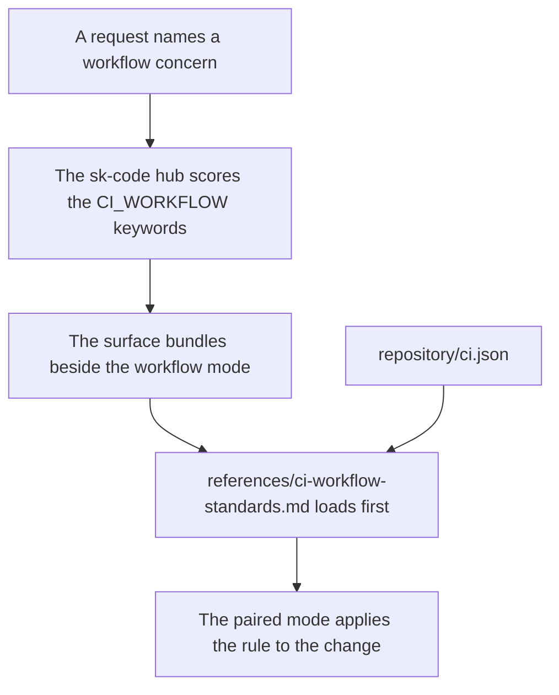

# sk-code-ci

> A workflow change lands with the repository's CI rules already attached: which paths a filter must pair, how long a job may run, which workflows must never switch off and which trigger only looks like drift.

---

## 1. OVERVIEW

### At a Glance

| Aspect | What you get |
|---|---|
| **Use it for** | Editing or reviewing a GitHub Actions workflow or a composite action it calls |
| **Invoke with** | No direct invocation. The sk-code hub bundles it beside a workflow mode when a request names a workflow concern |
| **Works on** | The workflow rules, the trigger and job-shape references, the protected set, the scaffold templates and the CI profile |
| **Produces** | Each rule a change must meet with the file and line that prove it, plus the protected set |

### What It Does

sk-code-ci is the written evidence for this repository's GitHub Actions workflows. When you change a workflow, it hands your paired mode each rule with the file and line that prove it. It says whether a machine gate enforces that rule. It names the workflows a change must not weaken. It also names the one trigger that looks like drift and is not. It holds a whole-workflow scaffold and a job scaffold that start compliant.

The packet writes nothing. The mode the hub pairs it with applies the change, and the `/doctor:ci` routes read the same CI profile for their own work.

Author-side quality gates stay with `sk-code-quality`. A formal findings-first review stays with `sk-code-review`. This surface supplies the evidence both apply.

### The Repository Profile

The rules are universal. The values they apply to are not. Branch names, switch variables, protected workflows, path twins, the workflows README and the setup action differ from one repository to the next, so `/doctor:ci` reads them from one file, `repository/ci.json` in this packet.

The lookup order is `--profile`, then the git config value `skcode.ciProfile`, then `repository/ci.json`, then a generic default that forces nothing. A `repository` field limits the file to the repository it names, so a copy shipped with the skills into another repository is ignored. A file left at the former root-level `.sk-code/` path is refused rather than read.

A repository without a profile reads clean. The report requires no switch. The scaffold omits the branches filter and the switch condition. The toggle accepts any variable a job compares against `off`. Copy `assets/ci-profile.template.json` to start one.

---

## 2. QUICK START

**Step 1: Let the hub bundle it.** There is nothing to install. When a request names a workflow concern, the sk-code hub bundles this surface beside the workflow mode it selected. When no workflow mode scores, the hub routes the surface alone and the acting agent reads and applies it directly.

**Step 2: See the rules applied to the current tree.**

```bash
node .skilled/commands/doctor/scripts/ci-report.cjs --no-gh
```

It prints `CI WORKFLOW REPORT`, a `workflows:` and `jobs:` count, the profile it read, then one row per workflow with its switch state, events, filters, drift flags and purpose. It ends with a `STATUS=` line, after a `not checked` line that names the prose rules a parser cannot test. `--no-gh` keeps the run offline, so every GitHub-owned switch reads `unknown`. An exempt workflow carries no switch and reads `on`. Exit 0 means the report printed, 1 means a workflow failed to parse, 2 means a bad argument and 3 means the profile is missing or invalid.

**Step 3: Verify before you rely on it.**

```bash
node .skilled/skills/sk-code/sk-code-skilled/assets/scripts/verify-router-sync.cjs --checks 2
```

It prints `PASS check 2: surface RESOURCE_MAP equals the children union plus the parent tier, and the vocabulary copies agree` and exits 0. A failure means the hub and this packet disagree about which references route here.

---

## 3. HOW IT WORKS

A request reaches this surface through the `sk-code` hub. The advisor routes the single identity `sk-code`, and the hub resolves which packet that means, because this packet is advisor-invisible metadata. The packet declares one intent, `CI_WORKFLOW`, at weight 4. Every keyword behind that intent is multi-word, so a bare "workflow" never scores the surface. Those keywords live in the machine router at the end of `ROUTER.md` and mirror the two CI classes of `../hub-router.json`.

When the request scores, the hub bundles the surface beside the workflow mode it picked, with the workflow mode first. The packet advertises no `surfaceDetection` block, so detection by file path never selects it. The first resource a run loads is `references/ci-workflow-standards.md`, the rule index that the other three references extend. The paired mode then applies the rules to the change, and the values those rules name come from the CI profile rather than from the packet.



### The File Map

| File | Carries |
|---|---|
| `references/ci-workflow-standards.md` | The rule index: path parity, SHA pins, a README row per workflow, `set -euo pipefail`, fork and secret safety, matrix and `fail-fast`, each row with a file and line, plus an enforcement note |
| `references/trigger-and-filter-rules.md` | The twin rule for path filters, the rebuild-commit skip, push-only scope for generated paths and the intentional exceptions table |
| `references/job-shape-rules.md` | Timeouts, least-privilege permissions, the concurrency template, the composite setup action and the switch `if:` shape |
| `references/protected-set.md` | The CI profile and its keys, the workflows protected by function and the rules that follow |
| `references/workflow-implement.md` | Symlink to the shared implement doctrine in `../shared/references/` |
| `references/workflow-debug.md` | Symlink to the shared debug doctrine in `../shared/references/` |
| `references/workflow-verify.md` | Symlink to the shared verify doctrine in `../shared/references/` |
| `assets/workflow-template.yml` | Whole-workflow scaffold that `/doctor:ci scaffold` renders from the profile |
| `assets/job-block-template.yml` | Single-job scaffold for a workflow that already carries its permissions and concurrency blocks |
| `assets/ci-profile.template.json` | Profile skeleton a repository fills in for its own conventions |
| `manual-testing-playbook/` | The routing recall the hub's router-sync guard replays, a routing floor, four rule-reference checks and two foreign-repository scenarios that run the doctor against a mocked `gh` |

### The One Recorded Exception

`.github/workflows/message-contract.yml` pushes on every branch, while the norm is a push on the profile's `integrationBranches` alone. A report that read only the norm would flag it as drift.

`references/trigger-and-filter-rules.md` records the row as `intentional-exception` with the reason and the evidence. A report route reads that row before it flags a trigger. The workflow also holds the only status context the branch ruleset requires, which is why a switch that would turn it off is refused.

If `branches: ['**']` or the comment block disappears from the workflow file, the row is stale. Re-record the new trigger with its own reason instead of trusting the old row.

---

## 4. INTEGRATION & NAVIGATION

### When To Use This Surface

Reach for it when a request names a workflow concern: a trigger, a path filter, a job timeout, a concurrency group, a permissions block or a required status check. Reach for it when the task touches a file under `.github/workflows/` or `.github/actions/`. A workflow script under `.github/scripts/` bundles it too.

Author-side quality gates stay with `sk-code-quality`, which selects `references/ci-workflow-standards.md` through the `quality.checklists` row this packet declares in `../mode-registry.json` for `.github/workflows/**`. A formal findings-first review stays with `sk-code-review`. For a read-only inventory outside the hub, run `/doctor:ci report`, which writes nothing.

### Related Skills

| Skill | Relationship |
|---|---|
| `sk-code` | Parent hub. Bundles this surface beside a workflow mode, or alone when no workflow mode scores |
| `sk-code-quality` | Author-side quality gate. Selects the rule index as its checklist for `.github/workflows/**` |
| `sk-code-review` | Formal findings-first review. Applies these rules to a workflow diff |

---

## 5. TROUBLESHOOTING

| What you see | Why | Fix |
|---|---|---|
| A report flags the every-branch push in `message-contract.yml` as drift | The exceptions table was not read first | Read the exceptions table in `references/trigger-and-filter-rules.md` before you treat a trigger as drift |
| A cited file and line no longer matches its quoted text | The workflow tree moved since the reference was written | Trust the tree, re-run the quoted command in the row and refresh the reference |
| `/doctor:ci` exits 3 on a `--profile` path | A named path that does not exist is an error and never falls back | Point `--profile` at a file that exists |
| A copy of this packet reads the generic default in another repository | The profile's `repository` field names this repository, so the file is ignored there | Set the field to the repository that owns the file, or pass `--profile` |
| `verify-router-sync.cjs --checks 2` fails | The hub `RESOURCE_MAP` and the packet `ROUTER.md` hold different paths | Keep the routed paths equal in both files |

---

## 6. FAQ

### Can I invoke this packet directly?

No. The advisor routes the identity `sk-code`, so this packet is reached through the hub and has no route of its own. When no workflow mode scores, the hub routes the surface alone and the acting agent reads and applies it directly.

### Does the packet ever edit a workflow?

No. Its tool surface is `Read`, `Bash`, `Grep` and `Glob`. `/doctor:ci scaffold` writes a new workflow from `assets/workflow-template.yml` after a yes, and `/doctor:ci toggle` changes one switch variable. Both read the same CI profile.

### Why does a rule say honour-system?

A machine gate is a script or a workflow that fails on a violation. Honour-system means nothing checks the rule, so a green CI run proves nothing about it. The index labels each row rather than implying a check exists.

### What happens in a repository with no CI profile?

It reads clean. The generic default requires no switch and checks no README row, so nothing this repository does is treated as a rule. Copy `assets/ci-profile.template.json` and fill in the keys that differ.

---

## 7. VERIFICATION

| Check | How to run it |
|---|---|
| README structure | `python3 .skilled/skills/sk-doc/scripts/validate_document.py .skilled/skills/sk-code/sk-code-ci/README.md --type readme` reports zero issues |
| Hub gate | `node .skilled/commands/doctor/scripts/parent-skill-check.cjs .skilled/skills/sk-code` exits 0 and prints an `OK: parent-skill-check` line naming 0 warnings |
| Drift guards | `bash .skilled/skills/sk-code/sk-code-skilled/scripts/run-all-drift-guards.sh` exits 0 with `run-all-drift-guards: all 4 guards PASSED` and a non-blocking warning count |
| Keyword copies | `node .skilled/skills/sk-code/sk-code-skilled/assets/scripts/verify-router-sync.cjs --checks 2` prints `PASS check 2` and `router-sync: 1/1 checks passed` |
| Playbook replay | `node .skilled/skills/sk-code/sk-code-skilled/assets/scripts/verify-router-sync.cjs --checks 4` prints `PASS check 4` and `router-sync: 1/1 checks passed` |
| Compiled route | `node --test .skilled/bin/tests/compiled-route-surface-hint.test.cjs` exits 0 and reports `fail 0` in its summary |
| CI doctor scripts | `node --test .skilled/commands/doctor/scripts/tests/ci-profile.test.cjs .skilled/commands/doctor/scripts/tests/ci-report.test.cjs .skilled/commands/doctor/scripts/tests/ci-scaffold.test.cjs .skilled/commands/doctor/scripts/tests/ci-toggle.test.cjs` exits 0 and reports `fail 0` in its summary |

---

## 8. RELATED DOCUMENTS

| Document | Purpose |
|---|---|
| [`SKILL.md`](./SKILL.md) | Surface contract: when the hub bundles this packet, the reference map and the non-negotiables |
| [`ROUTER.md`](./ROUTER.md) | Machine router: intent model, resource map and the routing pseudocode |
| [`../SKILL.md`](../SKILL.md) | The `sk-code` hub that bundles this surface |
| [`../sk-code-quality/README.md`](../sk-code-quality/README.md) | The quality mode that applies these rules to a workflow being authored |
| [`../sk-code-review/README.md`](../sk-code-review/README.md) | The review mode that applies these rules to a workflow diff |
| [`../../../commands/doctor/ci.md`](../../../commands/doctor/ci.md) | The `/doctor:ci` command whose routes read the same profile |
| [`repository/ci.json`](./repository/ci.json) | This repository's committed CI profile |
| [`../../../../.github/workflows/README.md`](../../../../.github/workflows/README.md) | The workflow README the rules cite for the purpose rows |
| [`changelog/`](./changelog/) | Release history for this surface |
