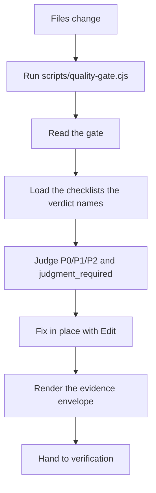

# sk-code-quality

> A change can behave correctly and still fail the rules the repository lives by. This mode checks the change against those rules before verification, loads the checklists its paths need and fixes what it finds inside the current scope.

---

## 1. OVERVIEW

### At a Glance

| Aspect | What you get |
|---|---|
| **Use it for** | A quality gate over written code: comment hygiene, P0/P1/P2 author checks and the checklists a changed path needs |
| **Invoke with** | `quality gate` or `code quality`, plus `comment hygiene` and `authoring checklist` |
| **Works on** | Any repository, with the universal floor on every file and a checklist per surface the change resolves |
| **Produces** | In-place fixes to files already in scope, plus a handoff that states the gate and the checklists it loaded |

### What It Does

The mode runs the quality runner over the change and reads the gate it prints. It loads every checklist the verdict names and judges the items no check can decide. When a gate failure sits in a file already in scope, the mode edits that file and runs the runner again. It creates no files and claims nothing is done, so the final evidence goes to the surface verification workflow.

### The Checklist Router

The mode routes by target path, so the checklists follow the files a change touches rather than the words in a request. The universal floor loads for every file. Each surface adds its own rows to that set.

| Target | Checklist the verdict names |
|---|---|
| `.skilled/skills/` | `skill-authoring.md` under the SKILLED checklists |
| `.skilled/agents/` and `.skilled/commands/` | `agent-authoring.md` or `command-authoring.md` |
| `specs/` | The spec-folder authoring checklist that `system-spec-kit` owns, in this hub's own repository |
| MCP server source | `mcp-server-authoring.md` |
| JavaScript, TypeScript, Python, Shell, Rust or config | The matching language checklist |
| A path your own repository config names | The checklist its `checklists[]` row points at |

---

## 2. QUICK START

**Step 1: Start after the change lands.** Reach for the mode once files have changed and before verification collects its evidence.

**Step 2: Run the quality runner.**

```bash
node .skilled/skills/sk-code/sk-code-quality/scripts/quality-gate.cjs --format text
```

The run prints one `code-quality-run/v1` verdict. Its first line names the gate and the exit code, such as `code-quality-run/v1 gate=NO_BLOCKER_FOUND exit=0 status=advisory`. The lines below it carry the surfaces, the enforcement layers, one line per check, the checklists to load and the items left to judgment. Exit 0 means no blocker was found and every required check produced evidence.

**Step 3: Ask which checklists one path needs.**

```bash
node .skilled/skills/sk-code/sk-code-quality/scripts/quality-gate.cjs --explain .skilled/skills/sk-code/sk-code-quality/scripts/quality-gate.cjs
```

It prints a `code-quality-explain/v1` document and exits 2, because it runs nothing and writes nothing. Each checklist row names the file and the seat that declared it. The row's `why` value says what selected it.

**Step 4: Fix in scope or hand back.** Correct a gate failure with `Edit` when the file already belongs to the change, then rerun the runner. Send a failure that needs diagnosis to the surface debugging workflow and send the final evidence to the surface verification workflow.

---

## 3. HOW IT WORKS

The mode sits between implementation and verification. It resolves the surface of each changed file. It then runs the built-in checks and reads the gate before anything else. It loads the checklists the verdict names and applies the P0/P1/P2 tiers. P0 blocks completion. P1 is fixed unless the user accepts a documented risk. P2 is fixed when cheap or deferred with a stated reason.



A run that ends `BLOCKED` stops the handoff. A run that ends `UNVERIFIED` leaves each named check or rule open. `NOTHING_CHECKED` says no check read a file as code, so it never reads as clean. `ERROR` stops the gate until its error is repaired.

### The Five Gate Values

| Gate | Exit | What it tells you |
|---|---|---|
| `NO_BLOCKER_FOUND` | 0 | No blocking finding and every required check produced evidence |
| `BLOCKED` | 1 | At least one blocking finding or a required P0 configured check that failed |
| `NOTHING_CHECKED` | 2 | No check read a file in scope as code. A Markdown file only meets the sensors, so it stays unchecked |
| `ERROR` | 3 | The run could not finish. `errors[]` names why |
| `UNVERIFIED` | 4 | A required check produced no evidence or two override sources at one level disagree on a rule |

### The P0/P1/P2 Gate

| Severity | Meaning | Gate effect |
|---|---|---|
| **P0** | Correctness, safety, a broken contract or forbidden comment metadata | Blocks completion until fixed or escalated |
| **UNVERIFIED** | Unchecked generated drift, missing checklist evidence, a required check with no evidence or two override sources that disagree | The claim stays open until verification proves it or reports it open |
| **P1** | A maintainability or authoring-contract issue that would confuse future work | Fixed before handoff unless the user accepts a documented risk |
| **P2** | Local polish or a minor consistency issue with low behavioral risk | Fixed when cheap, otherwise deferred with a documented reason |

After the P0 items are clear, `--format envelope` renders the `code-quality/v1` handoff. Its three judgment fields read `PENDING_AGENT_JUDGMENT` until an agent fills them, so a field that still reads it is open work. The envelope never stands in for the verification workflow.

---

## 4. INTEGRATION & NAVIGATION

### When To Use This Skill

Use it after the change is written and before final verification: skill authoring, script changes, config changes, frontend work, comment hygiene or a stale generated artifact. Skip it when the task is to build new behavior, diagnose a failing symptom, collect non-mutating evidence or review without editing.

The mutation boundary is the sharp edge. The mode edits files the change already touched. It cannot write a new file or dispatch a subagent. A findings-first report belongs to the review mode.

### Related Skills

| Skill | Relationship |
|---|---|
| `sk-code` | The parent hub that routes a quality request here |
| `sk-code-skilled` | Implements the change, owns root-cause debugging and gathers verification evidence |
| `sk-code-review` | Produces findings-first reports when no author-side edit is wanted |
| `system-spec-kit` | Owns the spec-folder checklist that a `specs/` target loads |

---

## 5. TROUBLESHOOTING

| What you see | Why | Fix |
|---|---|---|
| A configured check reads `SKIPPED_UNTRUSTED` | The config holds no grant to run commands | Run `git config --local skilled.trustRepoChecks true` or name the file with `--config` |
| `NOTHING_CHECKED`, exit 2 | No check read a file in scope as code | Pass code files with `--files` and never report this gate as clean |
| `CONFIG_INVALID`, exit 3 | A config field or a checklist override section failed validation | Read the `config.errors` row, which names the field and the repair |
| `UNVERIFIED`, exit 4 | A required check produced no evidence or two checklists at one level disagree on a rule | Hand each id in `summary.unverified` to verification as an open claim |

---

## 6. FAQ

### Why this mode instead of a review?

The review mode reports findings and writes a report. This mode edits a file that already belongs to the change and reruns the gate. Use review when you want a second pair of eyes without edits.

### Does exit 0 mean the change is done?

No. Exit 0 says no blocker was found and every required check produced evidence. The gate is advisory. The done claim still needs the surface verification workflow.

### Can my repository drop a rule it does not want?

Yes, within limits. A checklist your repository config names may carry a `## Rule overrides` section. `commentHygiene.disableRules` switches off named comment-hygiene rules. Parse failures, conflict markers, credential signatures and the other fixed floor rules never move.

### What happens when the gate finds a problem on a line the change did not write?

A hygiene finding on an unchanged line of a touched file blocks only when the pre-commit or CI layer is present. Otherwise it reads P1 and counts as touched-file debt.

---

## 7. VERIFICATION

| Check | Command | Pass looks like |
|---|---|---|
| Quality verdict | `node .skilled/skills/sk-code/sk-code-quality/scripts/quality-gate.cjs --format text` | A `code-quality-run/v1` first line with a gate and an exit code from 0 to 4. It writes no file |
| Runner suites | `node --test .skilled/skills/sk-code/sk-code-quality/scripts/tests/*.test.cjs` | The run ends with an `ℹ pass` count and `ℹ fail 0` |
| Comment hygiene | `.skilled/skills/sk-code/sk-code-quality/scripts/check-comment-hygiene.sh <file>` | No output and exit 0 for a clean file. A hit prints `file:line: excerpt [reason]` and exits 1 |
| Rule overrides | `node .skilled/skills/sk-code/shared/scripts/check-rule-overrides.cjs <checklist.md>` | `OK <path>: N rule override(s)`, or `OK <path>: no Rule overrides section`, and exit 0. A refused row exits 1 |
| Ceiling report | `.skilled/skills/sk-code/sk-code-quality/scripts/ceiling-report.sh <file>` | One `path:line  text  [tags]` line per marker, then `markers=N no-trigger=N no-signal=N`. It exits 0 because it never gates |
| README structure | `python3 .skilled/skills/sk-doc/scripts/validate_document.py .skilled/skills/sk-code/sk-code-quality/README.md --type readme` | `✅ VALID` and `Total issues: 0` |
| Manual playbook | `node .skilled/skills/sk-doc/sk-create-manual-testing-playbook/scripts/validate-playbook-package.cjs --package .skilled/skills/sk-code/sk-code-quality/manual-testing-playbook` | `PASS` with `violations=0 warnings=0` |

`check-comment-hygiene.sh` and `check-dist-staleness.sh` carry a Python shebang, so run them as programs rather than through `bash`. The mode itself never claims the work is done. Hand its evidence to the surface verification workflow.

---

## 8. RELATED DOCUMENTS

| Document | Purpose |
|---|---|
| [`SKILL.md`](./SKILL.md) | Runtime contract for the quality mode |
| [`ROUTER.md`](./ROUTER.md) | Machine router: intent map, resource map and the call sequence |
| [`references/runner-contract.md`](./references/runner-contract.md) | The runner's CLI, exit codes, gate values, verdict and envelope grammar |
| [`references/quality-config.md`](./references/quality-config.md) | The repository config schema, its discovery order and its trust boundary |
| [`references/code-style-guide.md`](./references/code-style-guide.md) | The universal style and comment guide the mode reads |
| [`scripts/quality-gate.cjs`](./scripts/quality-gate.cjs) | The runner: one verdict per change in any repository |
| [`scripts/check-comment-hygiene.sh`](./scripts/check-comment-hygiene.sh) | The per-file comment-hygiene checker the runner calls once per run |
| [`scripts/check-dist-staleness.sh`](./scripts/check-dist-staleness.sh) | The generated artifact drift checker |
| [`scripts/ceiling-report.sh`](./scripts/ceiling-report.sh) | The `ceiling:` marker report for a debt pass or a release check |
| [`../shared/references/universal/code-quality-standards.md`](../shared/references/universal/code-quality-standards.md) | The universal floor, with a rule id and an override mark per rule |
| [`../shared/references/universal/rule-overrides.md`](../shared/references/universal/rule-overrides.md) | How a repository drops or replaces a rule and the floor nobody can change |
| [`../sk-code-skilled/assets/checklists/`](../sk-code-skilled/assets/checklists/) | The SKILLED authoring checklists for skills, agents, commands, MCP servers, language files and config |
| [`manual-testing-playbook/manual-testing-playbook.md`](./manual-testing-playbook/manual-testing-playbook.md) | The manual scenarios that validate the gate, one file per scenario under `quality-gate/` |
| [`repository/quality.json`](./repository/quality.json) | This repository's own quality config |
