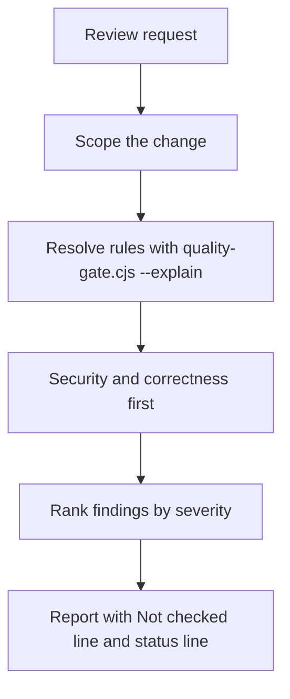

# sk-code-review mode

> A findings-first code review that names what blocks a merge, backs each blocking finding with a file and line and closes on one exact status line a gate can parse.

---

## 1. OVERVIEW

### At a Glance

| Aspect | What it gives you |
|---|---|
| **Use it for** | A review that separates merge blockers from optional polish |
| **Invoke with** | The review keywords or a dispatch of the `@review` agent |
| **Works on** | A diff, staged changes, a commit range or a list of files |
| **Produces** | Severity-ranked findings with evidence, a `Rule sources:` line and one exact `Review status:` line |

### What It Does

The `sk-code-review` mode is the single-pass review baseline of the `sk-code` family. It reads a change and ranks every finding by blocking severity. Security and correctness checks run before anything else. Each P0 and P1 finding carries a file and line citation, so you can check the claim instead of trusting it.

The mode keeps the floor every review shares and adds a lens a repository can change. Start with [the runtime instructions](./SKILL.md), which hold the full rule set. The `@review` agent is the main consumer. It applies these rules and keeps no checklist of its own. It decides its verdict from severity alone. Its 100-point score is advisory.

The mode is not the iterative loop. `deep-review` owns repeated passes with tracked state and convergence. `sk-code-quality` owns the author-side gate that runs before a review.

### Why This Mode Exists

An ad-hoc review reads the diff once and reports whatever the reviewer noticed. Security gaps slip through. A correctness bug arrives as a claim with no evidence. A generic checklist cannot describe a specific stack's idioms or its build commands. A reviewer that carries one house style into every repository raises findings the repository has already decided against. A report with no fixed shape leaves automation unable to tell an approval from a request for changes.

This mode closes those gaps. The floor applies in every repository. The repository can change the lens. The report ends on one line a script reads.

### The Severity Taxonomy

Every finding carries one of three levels.

| Severity | What it means | What lands here |
|---|---|---|
| **P0 - Critical** | Blocks merge | An exploitable security issue, such as an auth bypass or destructive data loss |
| **P1 - High** | Fixed before merge | A correctness bug, a spec mismatch, a must-fix floor issue or a must-fix lens issue |
| **P2 - Suggestion** | Optional | A non-blocking improvement or a style follow-up |

A P0 or P1 finding also names its reach: the input or the caller that produces the failure. A finding that cannot name one is P2. The rule and its exceptions are in [the shared review doctrine](./references/review-core.md) section 2.

---

## 2. QUICK START

**Step 1: Invoke it.** The hub routes a review request here on review words such as `review` or `code review`. You can also dispatch the `@review` agent directly. When `@orchestrate` dispatches it, the rendered prompt starts with a `CODE-REVIEW` line so the reviewer knows it acts as the baseline.

**Step 2: Run the primary workflow.** The review runs in one pass. Security and correctness checks come first. Findings come before the summary. The report ends on one exact status line. This is the tail of a report.

```markdown
## Code Review Summary
**Files reviewed**: X files, Y lines changed
**Overall assessment**: REQUESTED_CHANGES
**Baseline used**: sk-code (sk-code-review)
**Surface evidence used**: SKILLED
**Quality gate evidence**: absent
Rule sources: hub:sk-code/shared/references/universal/code-quality-standards.md, hub:sk-code/sk-code-skilled/assets/checklists/universal-checklist.md. Overrides: review.todo-tracking replace from hub:sk-code/sk-code-skilled/assets/checklists/universal-checklist.md. Refused: none. Ignored: none. Conflicts: none

## Findings

### P0 - Critical
1. src/auth.ts:42 A request with no session token reaches the write path
   - Case: a caller with no session token sends a write request and the handler stores the record
   - Risk: an unauthenticated write path
   - User impact: until this is fixed, any caller can change user records
   - Finding class: cross-consumer
   - Scope proof: rg -n "writeUser" src/ shows three call sites
   - Recommended fix: enforce the permission guard before the mutation

### P1 - High
2. src/api/users.ts:18 The endpoint stores a role field from the request body
   - Case: a caller sends a role field and the handler stores it without a check

### P2 - Suggestion
...

## Removal/Iteration Plan
...

## Next Steps
1. Fix the auth gap at src/auth.ts:42
2. Add input validation for the /api/users endpoint

Not checked: the permission guard's behavior for service accounts, because no fixture covers them

Review status: REQUESTED_CHANGES
```

The `Rule sources:` line lists the checklists the review read and every override it applied, refused, ignored or found in conflict, with `none` for an empty group. The line above the status line names what the review could not check and why. The final line of a full review is exactly one of these values, with no trailing whitespace. An M-1 or M-2 skip is the single line `Review status: COMMENTED (<reason>)`:

- `Review status: APPROVED`
- `Review status: REQUESTED_CHANGES`
- `Review status: COMMENTED`

Downstream automation reads the last line by exact string match and blocks or passes the merge on it.

**Step 3: Verify before you rely on it.**

```bash
node .skilled/skills/sk-code/sk-code-review/scripts/check-rule-copies.js
```

It prints `OK: all rule invariants present (8 exact-string file(s) + 2 Iron Law file(s) + 21 delivery-prefix anchor(s) + 6 extension floor(s) + 2 example output(s)).` and exits 0. The run checks the three status values and the Iron Law wording across the skill docs. It pins the resolver step, the four review floor ids, the extension floors and both documented examples. In a repository that installed the skill without this repository's `AGENTS.md`, add `--mode-only`. It then checks only the skill's own pins and prints a `SKIPPED:` line.

---

## 3. HOW IT WORKS

A review starts with scope. The reviewer reads the diff, the staged set, the file list or the commit range, then resolves the rules for the reviewed paths in one call. That call returns each file's surfaces, checklists and parsed override rows. With those rules loaded, the review checks the change. It ranks the findings and writes the report. All findings arrive in one message with a next-action prompt, because the mode is single-pass. Findings never drip across turns.



### The Analysis Order

Security and correctness come first. Quality, performance, architecture and removal checks follow. This order puts the blocking risk at the top, where a merge decision needs it. Findings are numbered once across the severity groups, so the first P1 continues after the last P0. A finding with no case is not reported.

### Floor, Default Lens And Surface

The floor is the part no repository and no surface can change: the severity levels, the reach rule, the evidence rules and the minimum security and correctness checks. Everything else is the default lens, this mode's own view of maintainable code, with rules such as function length or nesting depth. Each lens rule has an id in the review doctrine. A repository may drop it or replace it with a `## Rule overrides` row.

A repository applies one in a checklist its quality config or a surface declaration already names. The review does not search for such a section. It runs the quality runner's `--explain` entry once. That call names each reviewed file's surfaces, checklists and parsed override rows. The review then applies them in one order: the floor, the repository checklist, a specific surface, the SKILLED fallback and the default lens.

That command exits 2 by design, because it runs nothing. One missing path makes it stop the whole call with `FILE_NOT_FOUND` and exit 3, so the review passes only paths that exist and names a deleted path on the `Not checked:` line when its removal matters.

When a code surface is detected, `sk-code` supplies the surface style and the build and test standards that override the lens on those topics. A surface the hub's router bundles from request words is only a candidate. It applies to the files the resolver places in it. When no surface is detected, the review runs on the floor and the lens and states that the surface was not detected.

### Efficiency Gates

Two optional gates save work. The dedup gate skips a re-review when the diff and the latest commit subject are unchanged since the last review. It writes its signature under `${XDG_CACHE_HOME:-$HOME/.cache}/sk-code-review/` in your user cache directory, never into the reviewed repository.

The minimum-evidence gate skips a full review for a tiny diff only when `SK_CODE_REVIEW_MIN_CHANGED_LINES` is set above zero. It never skips a diff that touches auth, config, persistence, dependencies, sandboxing or a public response path.

`SK_CODE_REVIEW_DEPTH=lite|full|ultra` names and persists the routing for a session. `ultra` biases intent selection toward the deep-dive references. `lite` applies the conservative skip only when the line threshold is set. Neither value relaxes the floor.

---

## 4. INTEGRATION & NAVIGATION

### When To Use This Mode

Reach for this mode when a change needs a severity-ranked review before merge. It also fits a gate workflow that dispatches `@review` for pre-commit validation. Use it for a read-only security and correctness pass whose status a script reads. Use it again to re-review findings after a fix. Skip it for feature work with no review intent. Skip it also for a documentation edit that changes no code behavior. A git task with no code quality question belongs elsewhere.

### Related Skills

| Skill | Relationship |
|---|---|
| `sk-code` | The hub that routes a request to this mode and supplies the surface evidence |
| `sk-code-quality` | Runs the author-side gate before a review |
| `sk-code-skilled` | Carries the workflow doctrine the acting agent applies after a fix is accepted |
| `sk-code-ci` | CI surface the hub bundles beside review when a request names workflow terms |
| `sk-code-frontend` | Frontend surface the hub bundles beside review when a request names web terms |
| `deep-review` | The iterative loop with tracked state, built on the same severity labels |

---

## 5. TROUBLESHOOTING

| What you see | Why | Fix |
|---|---|---|
| A finding carries no severity label | The reviewer skipped classification | Give every finding one level from the review doctrine |
| The security checks did not run | The security checklist was skipped | The security and correctness minimums are floor. Load the checklists and run the review again |
| A rule the repository dropped still appears | Either the override row sits in a checklist no declaration names or the linter refused it | Move the row into a declared checklist, then run `node .skilled/skills/sk-code/shared/scripts/check-rule-overrides.cjs <checklist.md>` and read its `FAIL <checklist>: N refused` line and the errors listed above it |
| The `Rule sources:` line lists a file under `Refused:` | The section names a floor id, a `replace:` row on a machine-checked id, a repeated id or a second section | Remove the offending row. No row can change a floor rule. Use `commentHygiene.disableRules` to switch off a hygiene rule |
| Findings arrive across several messages | The reviewer broke the single-pass rule | Collect every finding and send one report |
| The report has no `Review status:` line | The reviewer missed the final-line contract | End every report on the exact status line. Leave the `Not checked:` line directly above it, with one blank line between |
| A low score still passes the gate | The score is advisory | The verdict follows severity: only a P0 or an open P1 fails the gate |
| Surface evidence claimed with no source | `sk-code` returned UNKNOWN | Run the review on the floor and state that the surface was not detected |

---

## 6. FAQ

### Why report findings before the summary?

The findings are the blocking pieces. A merge decision depends on them, so they come first and the evidence sits where a reader and a script both look.

### How does this differ from deep-review?

This mode runs one pass and hands the next step to a person. `deep-review` runs repeated passes with tracked state and convergence. Both read the same severity labels and evidence rules from the shared review doctrine.

### Can a repository switch off a review rule?

Yes, for any rule outside the floor. Add a row to a `## Rule overrides` section in a checklist the repository already declares. `none` drops the rule. `replace: <text>` puts the text in its place at the same severity. The `Rule sources:` line records each outcome.

### Why the exact status line?

Automation reads the last line by exact string match to decide whether to block a merge. A full review ends on one of the three exact lines. Only the documented M-1 or M-2 skip appends a reason in parentheses, and a parse of the leading verdict still reads it as `COMMENTED`.

---

## 7. VERIFICATION

The packet ships the checks that prove the review and its docs still agree.

| Check | How to run it |
|---|---|
| README structure | `python3 .skilled/skills/sk-doc/scripts/validate_document.py .skilled/skills/sk-code/sk-code-review/README.md --type readme` reports `Total issues: 0` |
| Rule invariants | `node .skilled/skills/sk-code/sk-code-review/scripts/check-rule-copies.js` prints the `OK: all rule invariants present` line and exits 0 |
| Report shape | `node .skilled/skills/sk-code/sk-code-review/scripts/check-review-final-line.js <review-output>` prints `OK: review output ends on the exact status line` |
| Finding shape | `node .skilled/skills/sk-code/sk-code-review/scripts/check-review-findings.js <review-output>` prints `OK: findings are numbered once and each carries a Case line` |
| Playbook package | `node .skilled/skills/sk-doc/sk-create-manual-testing-playbook/scripts/validate-playbook-package.cjs --package .skilled/skills/sk-code/sk-code-review/manual-testing-playbook` prints `PASS` with `violations=0 warnings=0` |
| Behavior | Run the scenarios under `manual-testing-playbook/<topic>/<scenario>.md` in a live session |

---

## 8. RELATED DOCUMENTS

| Document | Purpose |
|---|---|
| [`SKILL.md`](./SKILL.md) | Runtime instructions and the full rule set |
| [`ROUTER.md`](./ROUTER.md) | Machine router: intent signals, resource map and loading levels |
| [`references/review-core.md`](./references/review-core.md) | Shared doctrine: severity, reach, evidence, the floor, the lens and rule overrides |
| [`references/review-ux-single-pass.md`](./references/review-ux-single-pass.md) | Single-pass report flow and the next-step prompt |
| [`references/pr-state-dedup.md`](./references/pr-state-dedup.md) | The dedup gate: signature, cache format and retention |
| [`references/quick-reference.md`](./references/quick-reference.md) | Index across the reference files |
| [`../shared/references/universal/rule-overrides.md`](../shared/references/universal/rule-overrides.md) | The shared override format, ids, floor and precedence |
| [`assets/security-checklist.md`](./assets/security-checklist.md) | Security and reliability checks |
| [`assets/code-quality-checklist.md`](./assets/code-quality-checklist.md) | Correctness, performance, boundaries, KISS and DRY checks |
| [`assets/solid-checklist.md`](./assets/solid-checklist.md) | SOLID prompts and architecture smells |
| [`assets/test-quality-checklist.md`](./assets/test-quality-checklist.md) | Test coverage, structure and reliability |
| [`assets/fix-completeness-checklist.md`](./assets/fix-completeness-checklist.md) | Finding classes and the producer and consumer inventories |
| [`assets/removal-plan.md`](./assets/removal-plan.md) | Safe-now and deferred removal planning |
| [`manual-testing-playbook/manual-testing-playbook.md`](./manual-testing-playbook/manual-testing-playbook.md) | The playbook scenarios in their category folders |
