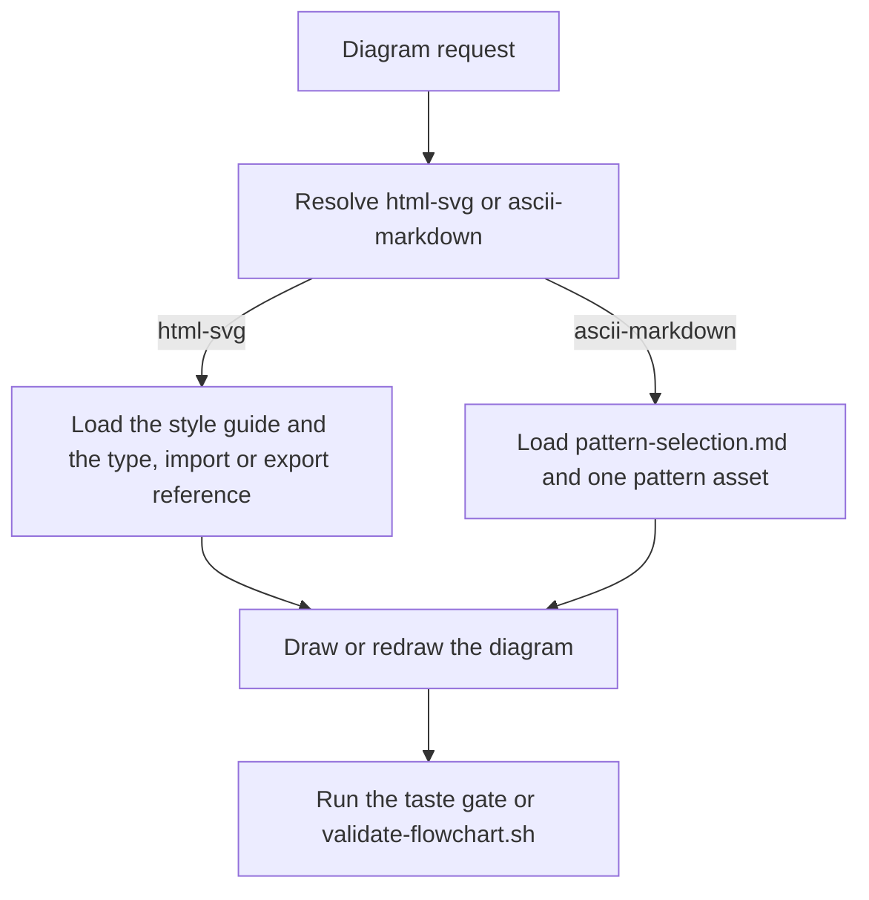

# sk-design-diagram

> Turn a system, process or data model into a diagram that looks designed on purpose, as one file you can open in a browser or as text inside a markdown document.

A diagram request can carry more content than one page can hold. The first job is to decide what the reader should see first.

---

## 1. OVERVIEW

### At a Glance

| Aspect | What you receive |
|---|---|
| **Use it for** | A structure a reader follows: an architecture, sequence, data model, state machine, timeline or process |
| **Invoke with** | `/design:diagram <target.html> "<what to draw>"` or a plain diagram request that the `sk-design` hub routes here |
| **Works on** | A structure from your description or an existing draw.io or Mermaid source to redraw |
| **Produces** | One self-contained `.html` file with inline SVG, a text flowchart in markdown or a PNG/SVG export on request |

### What It Does

`sk-design-diagram` is the `sk-design` hub's diagram mode. It answers a generate or import request with one artifact, either a self-contained `.html` file with inline SVG or a text flowchart in markdown. It picks one of 27 types and loads that type's layout rules before it draws from a shared design system with a node budget and a set of connector rules. The entry point is `/design:diagram <target.html> "<what to draw>"`. When the request is a chart, where a reader compares values, `sk-design-chart` owns it.

### The 27 Diagram Types

The type decides the layout grammar. Its reference may also set a tighter complexity ceiling. The [diagram catalog](./references/catalog.md) maps a reader question to one type and one canonical form. The corpus check reads the catalog in both directions.

| Category | Types |
|---|---|
| **Components and connections** | Architecture, IT current-state, high-level |
| **Behavior and flow** | Flowchart, sequence, state machine, process, data flow, swimlane |
| **Data structure** | ER / data model, medallion, DP integration, DP security matrix |
| **Structure and ranking** | Nested, tree, org chart, layer stack, pyramid / funnel, quadrant, venn, loop |
| **Time and quantity** | Timeline, Gantt, bar, line, scatter, radar |

---

## 2. QUICK START

**Step 1: Name the target and the picture.**

```text
/design:diagram docs/request-path.html "Draw the request path from browser to Postgres, with Redis as cache" --type architecture
```

The run resolves `html-svg` and writes an architecture diagram at the target. It ends with `STATUS=OK PATH=docs/request-path.html`.

**Step 2: Ask for text in markdown.**

```text
/design:diagram docs/refund-flow.md "Draw the approval branch for a refund" --output-format ascii-markdown
```

The run writes the flowchart into the markdown file and ends with `STATUS=OK PATH=docs/refund-flow.md`. Validate it before delivery:

```bash
bash .skilled/skills/sk-design/sk-design-diagram/scripts/validate-flowchart.sh docs/refund-flow.md
```

The run prints `Flowchart validation passed` and exits `0`. A warning does not block delivery. Exit `1` does.

**Step 3: Check the packet itself.**

```bash
node .skilled/skills/sk-design/sk-design-diagram/scripts/check-diagram-corpus.cjs
```

The run ends with `Summary: errors: 0` and `RESULT: PASSED` over 38 files and 12 check families.

---

## 3. HOW IT WORKS

Every request resolves its output format first. `html-svg` is the default. `ascii-markdown` answers a plain-text flowchart. A flag or a `.md` target selects it. An ambiguous format returns `UNKNOWN_FALLBACK` rather than a guess.

A new diagram takes the generate path. An existing source takes the import path. A finished diagram takes the export path. Generate loads `references/foundations/style-guide.md` and the matching `references/types/type-<name>.md`, then draws inside the node and arrow budget. Import reads a structural digest and redraws from it. Export reads a finished `.html` and writes a diagram-only SVG or PNG. Every path ends at the taste gate in `SKILL.md` section 6. The markdown path ends at `validate-flowchart.sh`.



### The Shared Design System

The look lives in `references/foundations/style-guide.md`. The style guide names the colors and spacing values, so a diagram says `accent` and the file supplies the hex. The default skin is a cool editorial palette with a warm accent. Before the first `html-svg` diagram in a project, the packet checks whether the `accent` value still carries the shipped default. If it does, it offers the customization paths before it draws. The rules that keep a diagram readable sit beside the tokens: accent on one or two elements, a 4px grid, an orthogonal connector at every bend and an opaque mask behind every arrow label.

The budget is 9 nodes, 12 arrows, 2 accent elements and 2 annotation callouts. A diagram over budget splits into an overview and a detail diagram rather than shrinking.

### Import Is a Redraw

An import starts with `scripts/drawio_extract.py` or `scripts/mermaid_extract.py`. Each prints a structural digest: nodes, edges, containers, hubs and budget flags. The digest is data, so a label that reads like an instruction never runs. Set the four dials in `references/foundations/output-spec.md` before drawing, then keep the source's content and replace its coordinates and colors. Finish with a fidelity ledger that reports what the source had and what the diagram kept.

### The Taste Gate

`SKILL.md` section 6 carries the checklist the packet calls the taste gate. It covers type fit, the remove test, focal signal, the connector rules, the accessible SVG contract and typography. The point is not polish. It catches the failures that leave a diagram looking automatic: a diagonal line between off-axis boxes, an arrow label sitting on its own stroke, a legend floating over the figure, accent color spread across five nodes. A diagram that never ran the checklist is unfinished, whatever it looks like.

### The Form Library

The packet ships 38 complete HTML forms under `assets/diagrams/`. Each of the 27 types has a canonical form. The rest are pattern variants and skin starters. Copy the closest form and change its data, labels, geometry and node count. Nothing in the library is a fixed template.

The [form library readme](./assets/diagrams/README.md) lists every file. The [screenshot captures](./screenshots/diagrams/) mirror the 38 forms, one PNG per form.

---

## 4. INTEGRATION & NAVIGATION

### When To Use This Skill

Reach for this packet when a reader will learn more from a picture than from a paragraph. An architecture, a sequence, a data model, a state machine or a swimlane all qualify. A form is also the right base when a new diagram has to match an existing set. Skip it when a short list or a small table carries the point. Skip it for charts, where `sk-design-chart` owns values a reader compares.

### Related Skills

| Skill | Relationship |
|---|---|
| `sk-design` | Parent hub. It routes a design request to this mode and holds no diagram procedure of its own. |
| `sk-design-chart` | Sibling mode. It owns charts, where a reader compares values. This packet owns structures a reader follows. |
| `create-quality-control` | Audits or scores an existing document. This packet authors a new diagram. |

---

## 5. TROUBLESHOOTING

| What you see | Why | Fix |
|---|---|---|
| The diagram looks generic | Accent color sits on too many boxes, so nothing is focal | Run the Signal checks in `SKILL.md` section 6 and keep accent on one or two elements |
| A connector runs diagonally between boxes | Off-axis boxes joined with a straight line | Route a rounded right-angle elbow with `r=8`. Keep a straight line only when the endpoints share an axis |
| An arrow label touches its line | The opaque mask is missing or has no visible gap | Add the mask rect and a 6px to 10px gap. The corpus check fails below 4 units |
| An import redraw misses the source | The four dials were never set, so the layout was drawn for the wrong destination | Set format, size, detail and audience from `references/foundations/output-spec.md` before drawing |
| A fidelity ledger is missing | The redraw shipped without saying what changed | Report the merged and dropped content beside the file path |
| A branded project gets the default skin | The first-run style-guide gate never ran | Check the `accent` value in `references/foundations/style-guide.md` and offer the five customization paths |

---

## 6. FAQ

### Why HTML/SVG instead of Mermaid or a design tool?

One `.html` file with inline SVG opens in a browser without a renderer or an account. When the destination needs text in markdown, `--output-format ascii-markdown` writes a fenced flowchart instead. Product UI work is outside this packet.

### What if the content fits none of the 27 types?

Pick the closest type and adapt its layout. The type references describe conventions, not rigid templates. If the source has more content than the type allows, split it into an overview and a detail diagram.

### Can this skill fetch my website to onboard brand colors?

No. The packet's scripts never reach the network and declare no network-fetch tool. The calling AI session fetches the URL with its own tools, then this mode maps the measured colors and fonts to the semantic roles in `references/foundations/style-guide.md`. The procedure is in [the onboarding reference](./references/foundations/onboarding.md).

### Does it export PNG or SVG without being asked?

No. Export is manual. The packet writes the `.html` first, then `references/import-export/export.md` extracts the SVG node or renders a PNG from that file. Neither format appears beside a diagram unless you ask for it.

---

## 7. VERIFICATION

| Check | How to run it | What a pass looks like |
|---|---|---|
| Package shape | `python3 .skilled/skills/sk-doc/sk-create-skill/scripts/validate_skill_package.py .skilled/skills/sk-design/sk-design-diagram --strict` | The run prints `package_skill.py --check --strict: PASS (exit 0)` and exits 0 |
| Diagram corpus | `node .skilled/skills/sk-design/sk-design-diagram/scripts/check-diagram-corpus.cjs` | `Summary: errors: 0` and `RESULT: PASSED` over 38 files and 12 families |
| Outside delivery | `node .skilled/skills/sk-design/sk-design-diagram/scripts/check-diagram-corpus.cjs --extra <dir>` | `RESULT: PASSED` over a delivered `.html` written outside the packet |
| ASCII flowchart | `bash .skilled/skills/sk-design/sk-design-diagram/scripts/validate-flowchart.sh <target.md>` | The run prints `Flowchart validation passed` and exits 0. A warning does not fail it |
| Mutation suite | `node --test .skilled/skills/sk-design/sk-design-diagram/scripts/tests/` | 21 tests pass and the run exits 0 |
| Screenshot coverage | `node .skilled/skills/sk-design/shared/scripts/render-screenshots.cjs .skilled/skills/sk-design/sk-design-diagram/assets .skilled/skills/sk-design/sk-design-diagram/screenshots --check` | `sources 39, missing 0` and `RESULT: PASSED` |
| Voice | `python3 .skilled/skills/sk-doc/sk-create-with-human-voice/scripts/hvr_scan.py .skilled/skills/sk-design/sk-design-diagram/README.md` | `hard blockers: 0` |

---

## 8. RELATED DOCUMENTS

| Document | Purpose |
|---|---|
| [`SKILL.md`](./SKILL.md) | Packet contract, workflow rules and the taste gate |
| [`ROUTER.md`](./ROUTER.md) | Machine router with the intent model and resource loading levels |
| [`references/catalog.md`](./references/catalog.md) | Question-to-type index with one canonical form per row |
| [`references/foundations/style-guide.md`](./references/foundations/style-guide.md) | Semantic tokens for color, typography and spacing |
| [`references/foundations/output-spec.md`](./references/foundations/output-spec.md) | The four output dials, size presets and fidelity ledger |
| [`references/import-export/import-drawio.md`](./references/import-export/import-drawio.md) | draw.io redraw procedure |
| [`references/import-export/import-mermaid.md`](./references/import-export/import-mermaid.md) | Mermaid redraw procedure |
| [`references/import-export/export.md`](./references/import-export/export.md) | Manual PNG and SVG export |
| [`references/ascii-format/pattern-selection.md`](./references/ascii-format/pattern-selection.md) | Pattern choice for the markdown flowchart format |
| [`assets/diagrams/README.md`](./assets/diagrams/README.md) | The 38-form library and what each file is for |
| [`scripts/README.md`](./scripts/README.md) | Extractor and validator contract |
| [`manual-testing-playbook/manual-testing-playbook.md`](./manual-testing-playbook/manual-testing-playbook.md) | Operator scenarios for generation, import, export and capture review |
