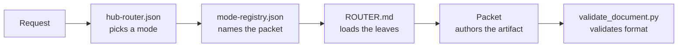

# sk-doc

> Write documentation, a skill, an agent or a slash command in the shape this repository expects, then prove it cleared the gate before it ships.

---

## 1. OVERVIEW

### At a Glance

| Aspect | What you get |
|---|---|
| **Use it for** | Document quality, plus authoring for skills, agents, commands, READMEs, catalogs, playbooks, benchmarks, changelogs, diffs, repo rules, frontmatter, goals and voice passes |
| **Invoke with** | A `/create:*` command or auto-routing on a documentation keyword |
| **Works on** | Markdown documents, skill and agent packages, slash commands, packet goals and the prose inside any of them |
| **Produces** | A DQI score, a validated document, a scaffolded component or a rewritten passage that passed its checks |

### What It Does

sk-doc is the front door for documentation and Skilled component work. It resolves your request to one of fifteen workflow modes and loads that mode's packet. The authoring contract stays inside the packet, so a README task and a changelog task read only the rules they need.

The hub routes and the packets author. `mode-registry.json` names the packet, aliases and command for each mode. `hub-router.json` holds the vocabulary that picks one. The hub itself carries no per-packet logic.

A packet hands its work to a check. `validate_document.py` reads the file path and its content shape, picks the enforcement level for that document class and reports what blocks delivery. `extract_structure.py` adds a score from 0 to 100 and the list of checks that failed. A voice pass scores prose against the Human Voice Rules before the rewrite and again after it.

Start with a `/create:*` command when you know the artifact. Reach for a plain description when you are unsure.

### Why This Skill Exists

Documentation drifts. One README numbers its sections, the next does not, frontmatter goes missing and a reviewer checks a different list each time. A skill package picks up a shape of its own, so a reader re-learns the layout at every stop.

sk-doc makes structure the first gate, so a document of a given type carries the same landmarks wherever it lives.

### The Type-Aware Gate

One validator serves every document class and the class sets the bar. `shared/references/validation.md` lists the gate for each class. The validator applies that level unless you pass `--type` to override it.

| Document class | What the gate allows |
|---|---|
| SKILL.md and command docs | Strict, with no checklist failure allowed |
| README docs | Flexible, with minor issues accepted |
| Reference and template docs | Moderate, with no critical failure allowed |
| Active spec docs | Loose, as a working document |

---

## 2. QUICK START

**Step 1: Resolve the mode.**

```bash
node .skilled/bin/compiled-route.cjs --hub sk-doc --prompt "create a skill readme for my new skill"
```

The reply is JSON. `"action":"route"` with a target that names `sk-create-readme` means the hub picked a mode. `"action":"defer"` means no mode matched the prompt, so name the artifact or call its `/create:*` command. `"action":"clarify"` means two modes matched and the hub needs you to pick one.

**Step 2: Score a document.**

```bash
python3 .skilled/skills/sk-doc/scripts/extract_structure.py .skilled/skills/sk-doc/README.md
```

The output is JSON. Read `dqi.total` and `dqi.band` for the score, `checklist.failed` for how many checks did not pass, `checklist.results` for each check and `evaluation_questions` for the judgements the script leaves to you.

**Step 3: Validate before delivery.**

```bash
python3 .skilled/skills/sk-doc/scripts/validate_document.py .skilled/skills/sk-doc/README.md
```

```
✅ VALID: .skilled/skills/sk-doc/README.md
Document type: readme
Total issues: 0
```

Exit 0 means the file passed. Exit 1 means a blocking format error, so fix what the report names and run it again. Exit 2 means the file could not be read, so check the path.

---

## 3. HOW IT WORKS

Routing runs in two stages. The first picks a mode. `hub-router.json` holds the routing vocabulary and `mode-registry.json` maps the winning mode to its packet. A request that matches no mode returns `defer` rather than a default, because `routerPolicy.defaultMode` is `null`.

The second stage picks files inside the mode. `ROUTER.md` maps the authoring intent to the references and assets that mode loads, in its packet or in the shared backbone. The hub never emits a leaf path. The surface router never re-decides the mode.



### What The Scripts Measure

The scripts own what a machine can settle. `extract_structure.py` parses a document and computes the DQI. `validate_document.py` gates format at the exit-code level and runs the render checks, which catch a document that Markdown would show differently from how it reads. `quick_validate.py` checks a skill name, its frontmatter and its description budget. `package_skill.py` validates a skill and bundles it to a zip. `audit_readmes.py` runs the template check across every README in scope.

Judgement stays with the reader. A script can report a failed checklist. It cannot decide that the section under it carries enough depth, that the example is clear or that the prose holds the voice.

### The DQI

`extract_structure.py` computes a Documentation Quality Index from 0 to 100 across three parts.

| Component | Points | What it measures |
|---|---|---|
| Structure | 40 | Checklist pass rate for the detected document type |
| Content | 30 | Word count, heading density, code examples, tables, links |
| Style | 30 | H2 format, section dividers, style issues, intro paragraph |

The total lands in a band. 90 and above is Excellent, 75 to 89 is Good, 60 to 74 is Acceptable and below 60 is Needs Work, which means the document is not ready to ship.

---

## 4. INTEGRATION & NAVIGATION

### When To Use This Skill

Reach for sk-doc when you write or edit a markdown document. Reach for it when you scaffold a skill, an agent, a slash command or a README. The packets also cover a feature catalog, a manual testing playbook, a benchmark package, a changelog entry and a before/after document review.

Thirteen `/create:*` commands front those modes. `sk-create-frontmatter` and `sk-create-quality-control` route by alias instead and carry no command of their own.

### Related Skills

| Skill | Relationship |
|---|---|
| `sk-code` | Owns code standards and the test run. sk-doc scores the docs around the code. |
| `system-spec-kit` | Owns the spec folder, memory and continuity. sk-doc judges a document's quality, spec docs included, without owning the packet contract. |
| `sk-git` | Owns worktrees, commits and pull requests. |
| `sk-design` | Owns diagram and chart authoring through `sk-design-diagram` and `sk-design-chart`, so `/design:diagram` and `/design:chart` route to that hub instead. |

---

## 5. TROUBLESHOOTING

| What you see | Why | Fix |
|---|---|---|
| `"action":"defer"` from the router | No mode matched the prompt | Name the artifact you need or call its `/create:*` command |
| A DQI band of Needs Work | Checklist failures, thin content or style findings | Fix the checklist failures first, then content, then style |
| `validate_document.py` exits 1 | A blocking format error, such as a missing H2 or malformed frontmatter | Read each reported line, fix it and run the validator again |
| A `cite-drift advisory` line appears | A Jev credential is stored, so the citation check ran on the document | Treat it as advice because it never changes the exit code. Set `JEV_FEATURE_CITE_DRIFT=0` to skip the check |

---

## 6. VERIFICATION

| Check | Command and pass criterion |
|---|---|
| README structure | `python3 .skilled/skills/sk-doc/scripts/validate_document.py .skilled/skills/sk-doc/README.md` prints `Total issues: 0` and exits 0 |
| Voice | `python3 .skilled/skills/sk-doc/sk-create-with-human-voice/scripts/hvr_scan.py .skilled/skills/sk-doc/README.md` reports `hard blockers: 0` |
| Skill metadata | `python3 .skilled/skills/sk-doc/scripts/quick_validate.py .skilled/skills/sk-doc` prints `✅ Skill is valid!` and exits 0 |
| Full score | `python3 .skilled/skills/sk-doc/scripts/extract_structure.py <document.md>` prints JSON keyed by `dqi`, `checklist` and `evaluation_questions` |

---

## 7. RELATED DOCUMENTS

| Document | Purpose |
|---|---|
| [`SKILL.md`](./SKILL.md) | The hub: when to use it, the mode table and the hub rules |
| [`ROUTER.md`](./ROUTER.md) | Stage-two surface router, intent to the leaf files a mode loads |
| [`mode-registry.json`](./mode-registry.json) | The fifteen modes, with the packet and the command where one exists |
| [`shared/references/quick-reference.md`](./shared/references/quick-reference.md) | Commands, quality gates and DQI bands on one page |
| [`shared/references/validation.md`](./shared/references/validation.md) | DQI components, bands and the gate for each document class |
| [`shared/references/core-standards.md`](./shared/references/core-standards.md) | Filename, type detection and heading rules the validator enforces |
| [`sk-create-readme/assets/skill-readme-template.md`](./sk-create-readme/assets/skill-readme-template.md) | The skill README template this file follows |
| [`sk-create-readme/references/README.md`](./sk-create-readme/references/README.md) | README type, voice and quality references |
| [`sk-create-with-human-voice/references/hvr-rules.md`](./sk-create-with-human-voice/references/hvr-rules.md) | The Human Voice Rules, the standard every passage here has to meet |
| [`sk-create-with-human-voice/SKILL.md`](./sk-create-with-human-voice/SKILL.md) | The voice pass: scope gate, scoring and the re-scan |
| [`sk-create-quality-control/references/workflows.md`](./sk-create-quality-control/references/workflows.md) | The four execution modes of a document audit |
| [`shared/scripts/doc-rewrite-guard.py`](./shared/scripts/doc-rewrite-guard.py) | Compares a rewritten doc with its base and reports a lost claim |
| [`shared/scripts/cite-drift-scan.mjs`](./shared/scripts/cite-drift-scan.mjs) | Counts the citations in skill docs and checks they still point at the code |
| [`changelog/`](./changelog/) | Per-release entries, one file per version |
