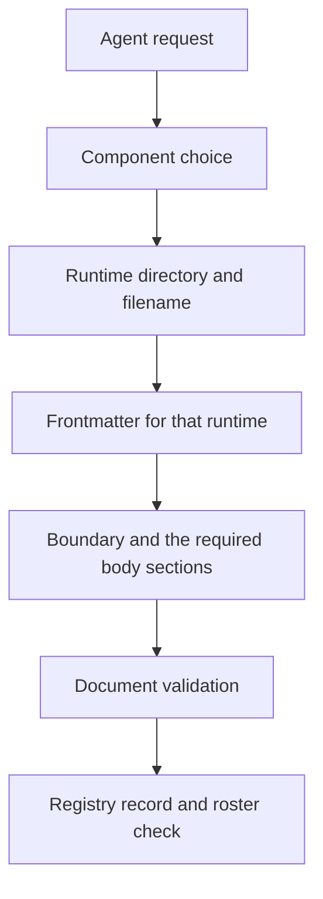

# create-agent

> Write one runtime agent file with the frontmatter its runtime enforces and the authority boundary its role needs.

---

## 1. OVERVIEW

### At a Glance

| Aspect | What you get |
|---|---|
| **Use it for** | Creating or updating one OpenCode or Claude Code agent markdown file |
| **Invoke with** | `/create:agent`, "create agent" or a direct read of `SKILL.md` |
| **Works on** | Agent files under `.skilled/agents/` or `.claude/agents/` |
| **Produces** | One validated agent file with runtime-correct frontmatter, an authority boundary, the required body sections and a registry record when the file lives under `.skilled/agents/` |

### What It Does

create-agent is the `sk-doc` packet behind `/create:agent`. It decides whether a request needs a named persona, writes the file into the active runtime directory and gives it the frontmatter schema that runtime enforces. The body must carry an authority boundary, a workflow, a capability scan, an output contract and explicit checks before delivery. Reusable domain knowledge stays in a skill and is linked, not pasted.

### Why This Skill Exists

The two runtime directories read frontmatter in different ways. OpenCode enforces the `permission:` object and ignores a bare `tools:` key. Claude Code enforces `tools:` and ignores `permission:`. Neither runtime warns about the block it does not read. A Claude Code agent with no `tools:` key inherits the parent session's full tool set. A hand-written file drifts from that contract quickly, so this packet ties the schema to the directory it writes into.

---

## 2. QUICK START

**Step 1: Confirm an agent is the right component.** An agent answers who does the work, with explicit authority. A skill answers how the work is done. A command answers how a user starts it. When the request only needs reusable guidance, use `create-skill` instead. The full comparison is in [agent versus skill versus command](./references/agent-vs-skill-vs-command.md).

**Step 2: Start from the scaffold.** Read [the agent template](./assets/agent-template.md) before drafting. It carries the frontmatter shape for each runtime, the eight required body sections, the boundary variants and a complete skeleton. Never start from an empty file.

**Step 3: Validate the file before you ship it.**

```bash
python3 .skilled/skills/sk-doc/shared/scripts/validate_document.py .skilled/agents/<agent-name>.md --type agent
```

A clean file prints `✅ VALID: <path>`. The report also names `Document type: agent` and closes with `Total issues: 0`.

**Step 4: Add the registry record and check the rosters.** A new file under `.skilled/agents/` needs a record in `.skilled/agents/agent-registry.json`. Copy an existing record, then run `node .skilled/bin/sync-agent-roster.cjs` to rewrite the generated rosters.

```bash
node .skilled/bin/sync-agent-roster.cjs --check
```

The check ends with `agent-roster: OK`. A file that lives only in `.claude/agents/` gets no record, because the check reads `.skilled/agents/` alone.

---

## 3. HOW IT WORKS

Start with the component choice, because an agent is the heavier option. Search the active runtime directory for an existing persona that already holds the authority. When one does, extend it. Then resolve the directory and the filename. The `.opencode/agents/` path links to `.skilled/agents/`, so both names reach the same files. Draft the frontmatter before the body. The hard boundary comes before the general workflow on purpose. It names the forbidden actions, so a reader who skims the top sees the limits first.

The body carries eight required sections under the frontmatter: illegal nesting, core workflow, capability scan, hook-injected context routing, output format, output verification, anti-patterns and related resources. The roster check reads that list from [the agent template](./assets/agent-template.md) and fails a file whose section list does not match it in name or order. Keep the file at or below 600 lines and link deep guidance instead of pasting it.

A file under `.skilled/agents/` then receives its registry record. The record holds `name`, `tier`, `priority`, `dispatchers`, `taskType`, `skills`, `notes` plus `summary`. A required section the role leaves out is declared under `templateExceptions` with the section and a reason.



### Key Concept: The Schema Follows the Directory

The same role needs a different frontmatter block in each runtime directory. An OpenCode reviewer in `.skilled/agents/review.md` carries `mode: subagent` plus `temperature: 0.1` and a `permission:` object with values such as `read: allow` and `write: deny`. Its Claude Code counterpart in `.claude/agents/review.md` carries `tools: Read, Bash, Grep, Glob` and no `permission` block and no OpenCode-only field such as `mode` or `temperature`. Map the allowed permissions to the `tools:` list when you write both. The runtime ignores a block it does not read, so a schema in the wrong file does not raise an error. It changes the authority the agent runs with.

---

## 4. INTEGRATION & NAVIGATION

### When To Use This Skill

Reach for create-agent when a request needs a stable named persona with explicit tool permissions and behavioral limits. It also fits when an existing agent's permissions or authority boundary needs a material rewrite. It fits again when a workflow needs orchestration authority that no current agent holds. Skip it for reusable knowledge and for a slash command. A one-off task with no named role needs neither. `create-quality-control` audits an agent that already exists.

### Related Skills

| Skill | Relationship |
|---|---|
| `create-skill` | Owns reusable knowledge and domain guidance. Link to the skill from the agent body instead of copying its content. |
| `create-command` | Owns slash-command entry points. A command can dispatch a named persona, but a trigger alone does not need an agent. |
| `create-quality-control` | Audits and scores an existing agent. create-agent authors and updates the file. |

---

## 5. TROUBLESHOOTING

| What you see | Why | Fix |
|---|---|---|
| A Claude Code agent runs with unrestricted tools | `tools:` is absent from `.claude/agents/` | Add a least-authority `tools:` allow-list. An absent key inherits the parent session's full tool set. |
| A `permission:` block has no effect | The block sits in a `.claude/agents/` file, which ignores it | Use `tools:` in `.claude/agents/` and `permission:` in `.skilled/agents/` |
| `agent file without a registry record: <name>` | A new file under `.skilled/agents/` has no record | Add the record, run `node .skilled/bin/sync-agent-roster.cjs` and rerun the check |
| `missing required section: <name>: <SECTION>` | A required body section is absent or named differently | Copy the section list from `assets/agent-template.md` and keep its order |
| A filename and its `name` field disagree | One was changed without the other | Keep the filename stem and `name` identical and lowercase kebab-case |
| A LEAF agent can dispatch sub-agents | `task` is set to `allow` | Set `task: deny` and quote the canonical REFUSE line from the template |

---

## 6. FAQ

### Why not add another skill instead of an agent?

A skill is knowledge a session can read. An agent is a persona with its own tool permissions and dispatch rights. When the task needs no scoped tool policy or stable role identity, a skill is lighter and easier to maintain.

### Can one file serve both runtimes?

No. Write two files, one in each runtime directory. Map the OpenCode allow set to the Claude Code `tools:` list. The Claude Code file carries no `permission` block and no OpenCode-only fields such as `mode` or `temperature`.

### When does an agent need `task: allow`?

Only when orchestration is the agent's explicit authority. A LEAF agent that does not orchestrate keeps `task: deny` and emits the canonical REFUSE line when a prompt asks it to delegate.

### Does this workflow cover an existing agent?

Yes. Read the current file completely first, then apply the same frontmatter and section rules a new file would follow. Preserve behavior the request did not ask to change. Validate the result the same way.

---

## 7. VERIFICATION

| Check | How to run it | What a pass looks like |
|---|---|---|
| Document structure | `python3 .skilled/skills/sk-doc/shared/scripts/validate_document.py <agent-file> --type agent` | `✅ VALID` and `Total issues: 0` |
| Structure report | `python3 .skilled/skills/sk-doc/shared/scripts/extract_structure.py <agent-file>` | A JSON report whose `file` key names the target and whose `structure.headings` list follows the document order. The `type` key reads `generic` for an agent file |
| Filename shape | `python3 .skilled/skills/sk-doc/shared/scripts/check_authored_name_kebab.py <agent-file>` | `PASS: authored artifact name is kebab-case: <path>` |
| Registry and rosters | `node .skilled/bin/sync-agent-roster.cjs --check` | `agent-roster: OK` |
| Operator scenarios | [the manual testing playbook](./manual-testing-playbook/manual-testing-playbook.md) | Seven operator scenarios, from the component choice through the body checks |

---

## 8. RELATED DOCUMENTS

| Document | Purpose |
|---|---|
| [`SKILL.md`](./SKILL.md) | Runtime contract: component choice, frontmatter rules, body shape, creation order and validation gate |
| [`ROUTER.md`](./ROUTER.md) | Machine router: intent model, resource map and fallback checklist |
| [`assets/agent-template.md`](./assets/agent-template.md) | Canonical scaffold: frontmatter, required section list, boundary variants and a complete skeleton |
| [`references/README.md`](./references/README.md) | Route map over the overflow references |
| [`references/agent-vs-skill-vs-command.md`](./references/agent-vs-skill-vs-command.md) | The deeper component-choice decision and its signals |
| [`references/permission-design.md`](./references/permission-design.md) | `mode` selection and least-authority permission design |
| [`references/common-pitfalls.md`](./references/common-pitfalls.md) | Recurring defects with why they break and the correct fix |
| [`manual-testing-playbook/manual-testing-playbook.md`](./manual-testing-playbook/manual-testing-playbook.md) | Operator scenarios for the runtime contract and the body checks |
