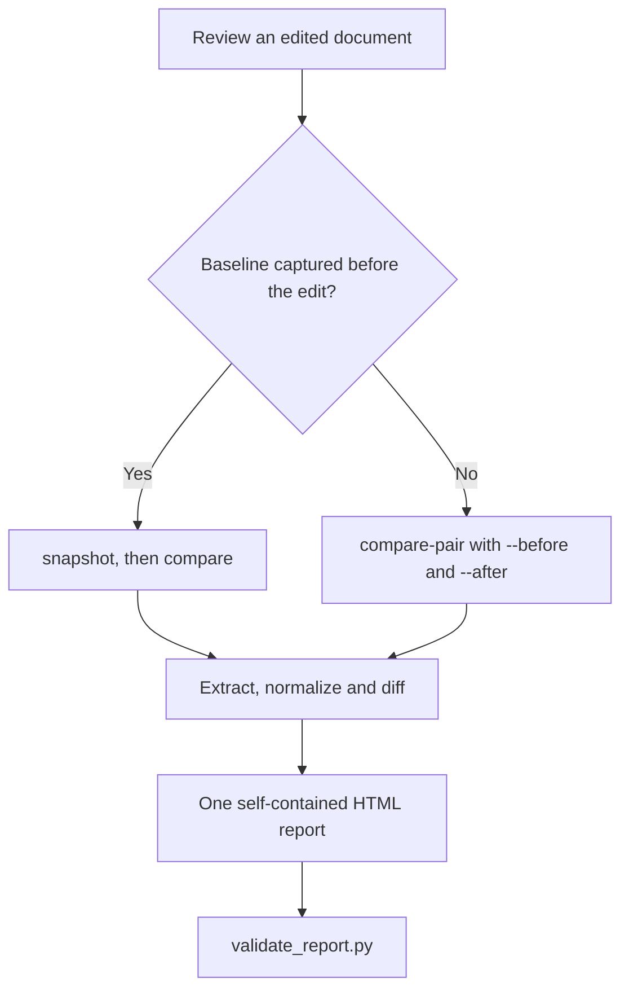

# create-diff

> See exactly what changed in a document through one local HTML report, with no Git repository and no upload.

---

## 1. OVERVIEW

### At a Glance

| Aspect | What you get |
|---|---|
| **Use it for** | Reviewing an edit to a Markdown, text, HTML, DOCX or text-PDF document outside Git |
| **Invoke with** | `/create:diff` or `python3 scripts/create_diff.py <subcommand>` |
| **Works on** | One document or a pre-composed before/after bundle of several files |
| **Produces** | One self-contained HTML report with inlined CSS and no network references |

### What It Does

create-diff compares two states of a document and writes the difference to one HTML file you can open offline in any browser. The engine is `scripts/create_diff.py`. Capture a baseline with `snapshot` before an edit, then run `compare` after it. When no baseline exists, `compare-pair` takes two explicit files instead. Source diffs belong to `sk-git`. A single-document audit belongs to `create-quality-control`.

### Why This Skill Exists

Not every document you edit lives in Git. A Markdown page or a DOCX brief can change outside version control. Reading a whole file to find one changed sentence does not scale. create-diff keeps the comparison on your machine, with no hosted service and no upload.

### The Format Fidelity Layer

A comparison only shows what its extractor can read. Every report states the format and the tier, so a text-only result is never mistaken for a full one.

| Format | What the engine compares |
|---|---|
| **Plain text** | `.txt`, `.log`, `.csv` and other text files at `full` tier, after normalization |
| **Markdown** | `.md`, `.markdown` and `.mdown` at `full` tier, compared as normalized text with headings parsed for structure |
| **HTML** | visible text and `h1` to `h6` headings at `text` tier, with CSS and scripts left out |
| **DOCX** | paragraph text, table text and heading-styled paragraphs at `text` tier |
| **PDF** | the extracted text layer at `text*` tier when a local extractor is installed |

---

## 2. QUICK START

**Step 1: Capture the baseline before the edit.**

```bash
python3 scripts/create_diff.py snapshot path/to/doc.md
```

Prints `Captured baseline for doc.md`, a hash line and the store path. The source file is only read.

**Step 2: After the edit, compare and render the report.**

```bash
python3 scripts/create_diff.py compare path/to/doc.md --report review.html
```

Prints `Compared baseline @ <captured-at> → doc.md (markdown, tier full)`, a `+N −N ~N` count line and `report: review.html`.

**Step 3: Verify the report before you hand it off.**

```bash
python3 scripts/validate_report.py review.html
```

Prints `PASS review.html` and exits 0. A `FAIL` line names the element or reference that broke the report contract.

To see the whole flow without editing anything, run the shipped fixtures:

```bash
python3 scripts/create_diff.py compare-pair \
  --before assets/fixtures/onboarding-before.md \
  --after  assets/fixtures/onboarding-after.md \
  --report /tmp/onboarding-review.html
```

```text
Compared onboarding-before.md → onboarding-after.md (markdown, tier full)
  +4  −0  ~9  moves≈0  unchanged 19
  report: /tmp/onboarding-review.html
```

---

## 3. HOW IT WORKS

The lifecycle has one hard rule: capture the baseline before the edit. Once a file is overwritten, the original is gone and there is nothing to compare against.

`snapshot` copies the current file into a `.create-diff/` store, in a folder keyed by a hash of the absolute path. The copy is written atomically. A manifest beside it records the capture time and a SHA-256 digest. The source is never opened for writing.

`compare` reads the latest baseline for the file and diffs it against the current file. `compare-pair` skips the store and diffs `--before` against `--after` directly. Both paths extract text, normalize it, run a line diff with word-level highlights and render one HTML file with inlined CSS. The report opens in the unified view by default. `--view side-by-side` puts the old and new lines in two columns.

The renderer refuses to overwrite an existing report. Without `--report`, the file lands in the working directory as `<source-slug>.diff.html`, where the slug is lowercase kebab-case derived from the file stem.



### Key Concept: One Report, Many Files

`compare-pair` always receives one before-document and one after-document. To review a bundle of files in one pass, compose both sides with the same markers:

```text
===== BEGIN FILE: docs/first.md =====
[file content]
===== END FILE: docs/first.md =====
===== BEGIN FILE: docs/second.md =====
[file content]
===== END FILE: docs/second.md =====
```

When both sides carry at least two balanced, path-matched file envelopes in the same order, the report renders each transition as a `START FILE` and `END FILE` band. The bands stay visible through collapsed context. A 32px gap opens before each later file. A new file resets the Markdown section label. Markers that fail any of those checks render as ordinary text.

---

## 4. INTEGRATION & NAVIGATION

### When To Use This Skill

- A person or an agent edited a document outside Git and you need a record of what changed.
- You want a baseline captured before a risky edit, so the original survives the edit.
- A bundle of files needs one review where every file transition stays visible.
- Two explicit versions need a unified or side-by-side comparison.

Source diffs belong to `sk-git`. A pixel or layout comparison is out of scope, because the engine compares extracted text only. A single-document audit with no second state belongs to `create-quality-control`.

### Related Skills

| Skill | Relationship |
|---|---|
| `sk-git` | Owns diffs for code and Git-tracked files. |
| `create-quality-control` | Audits one document. create-diff needs two states to compare. |

---

## 5. TROUBLESHOOTING

| What you see | Why | Fix |
|---|---|---|
| Exit `4`, `no baseline snapshot` | `compare` found no stored baseline for the file | Run `snapshot` before the edit or use `compare-pair` with explicit files |
| Exit `3` | The file is not a supported format or the PDF has no extractor | Run `capabilities` to see the format rows and the PDF extractor |
| Exit `3`, `Refusing to overwrite existing report` | A file already sits at the report path | Pass a new `--report` path |
| No `START FILE` bands in a bundle review | The markers differ between the two inputs | Use the same paths in the same order on both sides |
| `FAIL` from `validate_report.py` | The report fails a safety check: a missing doctype, `lang` or CSP, a disallowed element or attribute, or an external reference | Regenerate it and fix the renderer input. Never hand off a failed report |

---

## 6. FAQ

### Why not use `git diff` for this?

`git diff` needs the file inside a Git repository with history. create-diff works on any document on disk, including one that was never committed.

### Does my document leave the machine?

No. The engine runs locally and writes only local files: the report, plus a baseline copy and a manifest under `.create-diff/` when you run `snapshot`. The report has no scripts and no remote references. A local extractor such as `pdftotext`, `pypdf` or `pdfplumber` handles PDF text.

### What happens with a scanned PDF?

A scan has no text layer, so the extraction is empty. The engine warns you in the report. OCR is out of scope. Pre-extract the text and compare the two text files instead.

### Can I compare more than two files at once?

One call takes one before-document and one after-document. Compose each side into a bundle with the `BEGIN FILE` and `END FILE` markers, then pass the two bundles to `compare-pair`.

---

## 7. VERIFICATION

| Check | Result |
|---|---|
| Report validator | `python3 scripts/validate_report.py <report>` prints `PASS <report>` and exits 0 |
| Source file | The source bytes are identical before and after a `compare` or `compare-pair` run |
| Regression suite | `python3 scripts/test_create_diff.py` reports `Ran 59 tests` and `OK` |
| Manual playbook | The [manual testing playbook](./manual-testing-playbook/manual-testing-playbook.md) runs 11 scenarios across the snapshot, comparison and safety categories |

A report that fails the validator is not safe to share, even when the diff looks right.

---

## 8. RELATED DOCUMENTS

| Document | Purpose |
|---|---|
| [`SKILL.md`](./SKILL.md) | Authoritative packet contract and rules |
| [`ROUTER.md`](./ROUTER.md) | Machine router: intent map, resource map and loading levels |
| [`references/README.md`](./references/README.md) | Reference route-map |
| [`references/cli-reference.md`](./references/cli-reference.md) | Full command, flag and exit-code reference |
| [`references/capabilities-and-fidelity.md`](./references/capabilities-and-fidelity.md) | Format support matrix and fidelity tiers |
| [`references/workflow.md`](./references/workflow.md) | Baseline, explicit-pair and snapshot lifecycle |
| [`references/accessibility-contract.md`](./references/accessibility-contract.md) | The report's accessibility guarantees |
| [`references/worked-example.md`](./references/worked-example.md) | End-to-end walkthrough using the shipped fixtures |
| [`assets/fixtures/README.md`](./assets/fixtures/README.md) | Runnable before/after worked example |
| [`scripts/README.md`](./scripts/README.md) | Engine and validator README for the code folder |
| [`feature-catalog/feature-catalog.md`](./feature-catalog/feature-catalog.md) | Canonical capability inventory |
| [`manual-testing-playbook/manual-testing-playbook.md`](./manual-testing-playbook/manual-testing-playbook.md) | Operator-facing validation scenarios |

<!-- readme-check
allow-ref .create-diff/ | the snapshot store a run creates in the working directory, so a checkout holds one only after a snapshot
-->
