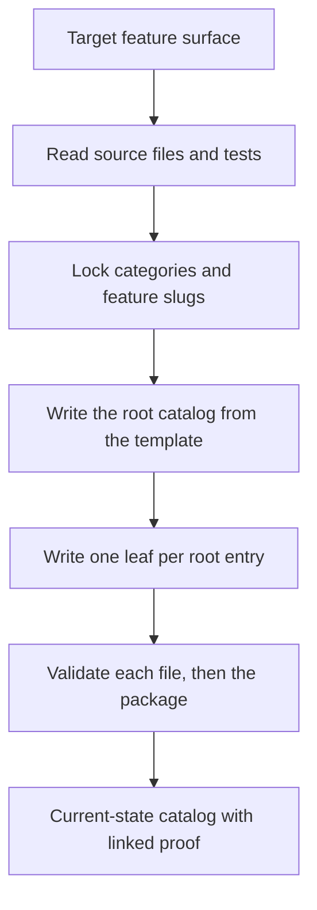

# create-feature-catalog

> Turn a shipped feature surface into one navigable root catalog with a source-anchored file behind every entry.

---

## 1. OVERVIEW

### At a Glance

| Aspect | What you get |
|---|---|
| **Use it for** | One trustworthy inventory of a shipped feature surface too large for a README |
| **Invoke with** | `/create:feature-catalog` or the phrases "feature catalog" and "feature inventory" |
| **Works on** | A skill, system, MCP surface, CLI surface or documentation family |
| **Produces** | A root `feature-catalog.md` with one source-anchored file behind every entry |

### What It Does

`create-feature-catalog` authors a `feature-catalog` package for a system that has outgrown a README summary. The root catalog lists capabilities by category in numbered sections and links each entry to its own file. Each per-feature file carries the implementation and validation anchors that let a reviewer trace a claim back to real code and a real test. The canonical entry point is `/create:feature-catalog`.

### Why This Skill Exists

A README can describe a handful of features accurately. Once a system carries thirty, a flat list goes stale and nobody can tell which claim still matches the code. Feature names drift between documents too, so two readers argue about what one capability is called. One canonical inventory with a proof file behind each entry settles the name and the evidence in the same place.

### The Catalog Package

| Artifact | What the skill knows how to operate |
|---|---|
| **Root catalog** | lists capabilities by category in numbered sections, with one stable link per feature |
| **Per-feature files** | carry implementation truth in source tables and validation anchors for every claim |
| **Category folders** | descriptive kebab-case folders mapped one-to-one to root sections, display order owned by the root index |

---

## 2. QUICK START

**Step 1: Invoke it.**

```text
@markdown /create:feature-catalog <skill-name> create :confirm
```

The command shows its setup dashboard, then runs the workflow. `@markdown` supplies template-first generation and sk-doc validation. The [command router](../../../commands/create/feature-catalog.md) takes `<skill-name> [create|update] [--path <dir>] [:auto|:confirm]`. `:confirm` stops at each checkpoint, while `:auto` runs the same steps without a prompt.

**Step 2: Build the root catalog.** Copy the root scaffold in section 4 of `assets/feature-catalog-template.md` to `<target-skill>/feature-catalog/feature-catalog.md`, then replace each placeholder. The root opens with `## 1. OVERVIEW` and continues with one numbered category section per capability group.

**Step 3: Validate the root and one leaf.**

```bash
python3 .skilled/skills/sk-doc/shared/scripts/validate_document.py <target-skill>/feature-catalog/feature-catalog.md
python3 .skilled/skills/sk-doc/shared/scripts/validate_document.py <target-skill>/feature-catalog/<category-name>/feature-name.md
```

Run both from the repository root. The first prints `✅ VALID` and a `Total issues:` line. The second prints `Document type: feature_catalog` and `Total issues: 0` when the leaf is clean.

**Step 4: Validate the whole package.**

```bash
python3 .skilled/skills/sk-doc/sk-create-feature-catalog/scripts/validate_catalog_package.py --package <package-id>
```

A clean run prints `PACKAGE <package-id>: PASS tier=fail violations=0` and ends with `PASS: 0 violations (all enforced catalog checks).`

---

## 3. HOW IT WORKS

Authoring starts with the target system. Read its source files and tests before drafting, because every claim in the catalog needs a real file behind it. The category taxonomy and the feature slugs are settled next. A published slug is a link target for playbooks and other documents, so a rename after publication needs a migration that updates every referrer.

The root catalog comes from the scaffold in section 4 of `assets/feature-catalog-template.md`. The scaffold supplies the frontmatter and the H1 intro. From there it runs one numbered H2 per category, with `## 1. OVERVIEW` first. Each entry carries an H3 feature title, a Description block, a Current Reality summary and a Source Files callout that links to the leaf. The root stays an index. Source tables belong in the leaf, and execution scenarios belong in a manual testing playbook.

Each leaf comes from `assets/feature-catalog-snippet-template.md` and carries four sections: `## 1. OVERVIEW`, `## 2. HOW IT WORKS`, `## 3. SOURCE FILES`, `## 4. SOURCE METADATA`. The Implementation table gives every file a Layer and a Role. The Validation And Tests table does the same for each test. Leaf frontmatter `title` must equal the root H3. The `description` must match the root description after normalization. Names are contracts here, not labels.



### Key Concept: Orientation and Proof

The root catalog answers what exists and where it lives. A per-feature file answers how a reader knows the claim is true. A root entry with no leaf behind it is an unfinished catalog, not a lightweight one.

### Names Are Link Targets

Category folders and per-feature filenames are bare kebab-case slugs with no numeric prefix. Display order lives in the root index, never in the folder name. Once a feature page is published, its slug is an interface: other documents link to it, so a rename needs a deliberate migration that updates every referrer.

---

## 4. INTEGRATION & NAVIGATION

### When To Use This Skill

Build a catalog when the feature surface is too large for a README to keep accurate. Build one when other documents need one stable list of names and links. Reviewers then have one place to check current behavior. Manual playbooks have a fixed list to cross-reference.

Use a README instead when the system holds a handful of features that fit accurately in one document. Skip the catalog when the product changes too fast for a maintained inventory to stay honest.

The boundary with a testing playbook is worth naming. This skill states what exists today. `create-manual-testing-playbook` states how an operator proves that behavior still works. Catalog entries describe behavior and link out for test steps.

### Related Skills

| Skill | Relationship |
|---|---|
| `create-readme` | Owns the capability summary inside a README. Hand off here once that list outgrows the README. |
| `create-manual-testing-playbook` | Owns manual validation scenarios. The catalog states what exists and links to the playbook for execution steps. |
| `create-quality-control` | Audits an existing document. Use it to score a catalog you already have, not to build one. |

---

## 5. TROUBLESHOOTING

| What you see | Why | Fix |
|---|---|---|
| `missing_leaf_file` or `orphan_leaf_file` from the package validator | Root links and files on disk disagree | For `missing_leaf_file`, add the leaf or remove its root row. For `orphan_leaf_file`, link the leaf from the root or delete it |
| `off_taxonomy_validation_type` from the package validator | A Validation And Tests Type cell uses a value outside the canonical list | Pick a value from the taxonomy in `assets/feature-catalog-snippet-template.md` |
| `root_leaf_title_mismatch` or `root_leaf_description_mismatch` | A leaf title or description drifted from its root H3 | Copy the root H3 into the leaf `title` and align the description |
| The validator applies README rules to a leaf | The path did not classify as a feature-catalog leaf | Run it from the repo root with the full repo-relative path |
| A category folder or filename fails the naming guard | The name contains an underscore | Rename it to kebab-case before publication |
| Catalog prose describes planned behavior | Roadmap wording slipped into a current-state document | Drop the claim or label the rollout as a feature-flag surface |

---

## 6. FAQ

**Q: Why not expand the README instead?**

A: A README that holds thirty feature claims with source anchors stops being readable. The catalog keeps orientation in the root and proof in the leaf files, so each stays useful at its own size.

**Q: Can the catalog describe a planned feature?**

A: Only with an explicit label. A rollout that ships behind a flag can be named as a feature-flag surface. Unlabeled speculation breaks the current-state contract that every other entry depends on.

**Q: Does the validator check that every link resolves?**

A: The package validator checks root links against the files on disk, so a missing leaf or an orphan leaf fails. Links from a leaf to other documents are not part of that root-to-leaf check and need a review pass.

**Q: Is a catalog worth it for every skill?**

A: No. A small surface fits in a README. A volatile product makes a maintained catalog stale. Build one when the surface is large enough that readers need a stable name and a source anchor for each entry.

---

## 7. VERIFICATION

| Check | How to run it | Pass looks like |
|---|---|---|
| Root catalog structure | `python3 .skilled/skills/sk-doc/shared/scripts/validate_document.py <target-skill>/feature-catalog/feature-catalog.md` | `✅ VALID` |
| Leaf structure and taxonomy | Same command against `<target-skill>/feature-catalog/<category-name>/feature-name.md` | `Document type: feature_catalog` and `Total issues: 0` |
| Package rules | `python3 .skilled/skills/sk-doc/sk-create-feature-catalog/scripts/validate_catalog_package.py --package <package-id>` | `PASS: 0 violations (all enforced catalog checks).` |
| Naming guard | `python3 .skilled/skills/sk-doc/shared/scripts/check_no_hyphenated_catalog_content.py <new-content-staging-root>` | `PASS: catalog/playbook content is kebab-case.` |
| Operator scenarios | Run the six scenarios in [`manual-testing-playbook.md`](./manual-testing-playbook/manual-testing-playbook.md) | Each scenario records a `PASS` verdict with its evidence |
| Source anchors | Compare every SOURCE FILES row with the file on disk | Each path exists and supports the claim beside it |

---

## 8. RELATED DOCUMENTS

| Document | Purpose |
|---|---|
| [`SKILL.md`](./SKILL.md) | Packet contract, creation workflow and validation rules |
| [`ROUTER.md`](./ROUTER.md) | Machine router: intent map, resource map and no-match checklist |
| [`references/README.md`](./references/README.md) | Route map for the overflow references |
| [`references/examples.md`](./references/examples.md) | Annotated walkthrough of a shipped catalog package |
| [`references/common-pitfalls.md`](./references/common-pitfalls.md) | Recurring catalog defects with worked fixes |
| [`assets/feature-catalog-template.md`](./assets/feature-catalog-template.md) | Root catalog scaffold |
| [`assets/feature-catalog-snippet-template.md`](./assets/feature-catalog-snippet-template.md) | Per-feature file scaffold |
| [`scripts/validate_catalog_package.py`](./scripts/validate_catalog_package.py) | Package validator: bijection, source paths and parity rules |
| [`scripts/README.md`](./scripts/README.md) | Validator usage and its check list |
| [`manual-testing-playbook/manual-testing-playbook.md`](./manual-testing-playbook/manual-testing-playbook.md) | Operator playbook: six scenarios across package shape, source anchors and validation |
