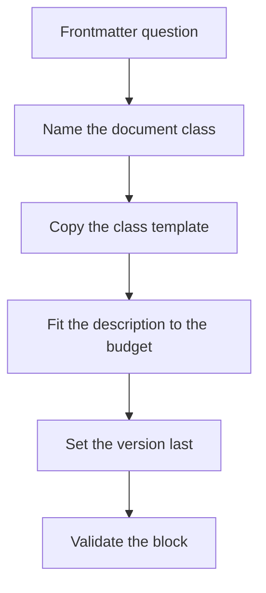

# create-frontmatter

> Give a document the frontmatter block its class requires, so discovery finds it and the version gate accepts it.

Frontmatter is small and load-bearing. It decides whether a skill is found and whether a document's version passes the commit gate.

---

## 1. OVERVIEW

### At a Glance

| Aspect | What you get |
|---|---|
| **Use it for** | Repairing a rejected block or working out the `version` it needs |
| **Invoke with** | A frontmatter question through the hub router, or a direct read of `SKILL.md` |
| **Works on** | The field set for every document class, including classes other skills own |
| **Produces** | A class-correct block and the reason each field belongs |

### What It Does

create-frontmatter is the `sk-doc` mode that owns the frontmatter contract. It gives each document class one field set. It also sets what a description may contain and what a `version` may be, so the validators have one rule to enforce.

It owns the rules, not the enforcement. The versioning engine and the validators stay in the hub's shared tier, because a post-edit hook outside this hub resolves one of them by literal path on every qualifying edit.

You reach the mode with a frontmatter question. The hub router scores the request and selects `sk-create-frontmatter`, then loads `SKILL.md` first. Four sibling modes point their templates at the field reference in `assets/`: `sk-create-skill`, `sk-create-command`, `sk-create-agent` and `sk-create-feature-catalog`.

### Why This Skill Exists

Frontmatter can go wrong without a clear signal. Discovery drops a skill whose description pushes the project over its shared budget, and nothing reports the drop. A version that is present and wrong passes the corpus gate, because the gate checks presence and format only. A block that is right for one class and wrong for another looks correct when you read a single field.

### What The Contract Covers

Four parts decide a block. The class picks the keys. The rest of the contract sets what a description may say and which enum values are legal.

| Part | What it settles |
|---|---|
| **Class field set** | Which keys a class carries, from a manifest's `name` and `allowed-tools` to a reference's five-field block |
| **Description budget** | The per-skill soft target and the project ceiling, plus the trim rules that keep routing tokens |
| **Version field** | The 4-part `X.Y.Z.W` format, the changelog anchor on `SKILL.md` and the own-edition rule for every other doc |
| **Value lists** | The canonical `contextType` and `importance_tier` values plus their aliases in `assets/frontmatter-values.json` |

---

## 2. QUICK START

**Step 1: Name the document class.** Skill manifest, readme, reference, asset, feature catalog, testing playbook, command, agent or spec doc. The class decides the field set, and everything else follows from it.

**Step 2: Copy the class template.**

```bash
cat .skilled/skills/sk-doc/sk-create-frontmatter/assets/frontmatter-templates.md
```

The file prints in full. Section 4 holds one template per class, and section 6 lists the common fixes.

**Step 3: Check the block you wrote.**

```bash
python3 .skilled/skills/sk-doc/shared/scripts/quick_validate.py .skilled/skills/sk-doc/sk-create-frontmatter
```

The run prints `✅ Skill is valid!` and exits 0. It reads the `SKILL.md` in the directory you name, so a reference or asset block needs the packaging gate in VERIFICATION.

---

## 3. HOW IT WORKS

A request reaches the mode through the `sk-doc` hub. `hub-router.json` scores it and `mode-registry.json` maps the winning `workflowMode` to this folder. `SKILL.md` loads first. The field reference in `assets/` loads on every path, because every frontmatter question resolves against a class. The versioning standard loads only when the question is about a `version` or the gate that checks one.

From there the work is a short sequence. Name the class, copy its template, fit the description to the budget and set the version last. Version goes in as the final key before the closing delimiter, so its position stays the same whatever else the block carries.



Two kinds of version come out of this contract. A `SKILL.md` carries the skill edition, which is the higher of its own frontmatter version and the highest changelog filename version, compared as integer tuples. Every other doc carries its own edition. A valid 4-part value is kept. A missing one starts at `1.0.0.0`. A body change raises the third segment and resets the fourth.

When the computed value and the value on disk disagree, the engine reports `skip-conflict` and leaves the human-set number alone. Pass `--update` to override it. A `SKILL.md` reconciles without the flag, because it is the anchor of record.

A rejected block is usually a class mismatch, not a bad value. Read the class row in section 4 of the field reference before the field row in section 3.

### Key Concept: The Class Comes First

`name` and `allowed-tools` belong on a skill manifest and are not part of the five-field block on a reference. Read either field on its own and both files look inconsistent. The class table settles it, which is why the mode's playbook runs class resolution as its first wave.

### Key Concept: A Silent Budget

The description budget is shared across the project. The per-skill soft target is 130 characters and the project ceiling is 6,400 against Claude Code's default 8,000-character budget. Go over the total and Claude Code drops the longest descriptions from the available-skills list. The skills stay invocable by name, and nothing reports the drop.

Trim by dropping product enumerations, stack lists, marketing prose and parenthetical jargon. Keep the skill name, the primary verb, the domain noun and the mode suffixes, because the advisor matches on them. A description trimmed by deleting those tokens is under budget and no longer routes.

---

## 4. INTEGRATION & NAVIGATION

### When To Use This Skill

Reach for create-frontmatter when a document needs a block and its class is unclear, or when a validator rejected a block and named a field rather than a fix. Reach for it too when a description is over budget, or when a `version` needs deriving or reconciling against a changelog entry.

Skip it when the document body needs writing. Skip it when a validator needs changing rather than understanding, or when the question is which skill should handle the request at all.

### Related Skills

| Skill | Relationship |
|---|---|
| `sk-create-skill` | Emits the manifest, reference and asset blocks. Its templates point at this contract. |
| `sk-create-readme` | Owns README prose. This contract defines the block that sits beside a `SKILL.md`. |
| `sk-create-command` | Commands carry frontmatter and sit outside the version standard. |
| `sk-create-agent` | Agents carry frontmatter and no `version`, and the authority key depends on the directory. |
| `sk-create-changelog` | Owns changelog entries. The highest changelog filename version is half of a `SKILL.md` anchor. |
| `sk-create-feature-catalog` | Catalog blocks require `title`, `description`, `trigger_phrases` and `version`. |
| `sk-create-manual-testing-playbook` | Playbook blocks require `title`, `description` and `version`. |
| `sk-create-quality-control` | Blocks a document on required frontmatter during a quality pass. |

---

## 5. TROUBLESHOOTING

| What you see | Why | Fix |
|---|---|---|
| A field is required in one file and rejected in another | The files are different document classes | Read the class row in section 4 of the field reference, not the field row in section 3 |
| A skill stopped appearing in auto-discovery | The project description budget was exceeded and the longest entries were dropped | Trim descriptions to the budget. Nothing reports the drop at the point of failure |
| A trimmed description no longer routes | The trim removed the tokens the advisor matches | Keep the skill name, primary verb, domain noun and mode suffixes. Cut enumerations instead |
| A `version` differs from the computed value and was not overwritten | `skip-conflict` protects a human-set version | Pass `--update`, or reconcile by hand. A `SKILL.md` reconciles without the flag |
| A versioning pass corrupted `trigger_phrases` | A YAML re-serializer reflowed the block list | Edit line-wise. Never re-serialize a frontmatter block |
| The corpus gate skips a file you expected it to fail | Files with no frontmatter block are skipped, not failed | That is intended. A versioning pass never synthesizes a block |
| A description is over the soft target but the validator still passes | The soft target warns and only the 1,536 hard cap fails | Trim to the soft target. The hard cap is not the budget |
| Nothing checks a README block | The advisor's doc-frontmatter checker exempts `README.md`, so the version gate is the only automated check | Check the block by hand against section 4 of the field reference |

---

## 6. FAQ

### Why does frontmatter need its own mode when it is four lines at the top of a file?

Six sibling modes emit frontmatter, and four of them point their templates at one field reference. A contract with many producers and no owner drifts from the validators that enforce it. This mode writes the rules and the shared tier runs them.

### Why are the validators still in the shared tier?

One of them is resolved by literal path from a post-edit hook outside this hub, on every qualifying edit. Moving it would break a live hook. Enforcement serves many skills, which is what the shared tier is for. The rules are this mode's.

### Where are the budget numbers kept?

The numbers live in [the shared skill contract](../shared/assets/skill-contract.json) under `descriptionBudget`. `quick_validate.py` reads them through `skill_contract.py` and falls back to hard-coded literals only when that import fails. A budget change goes in the JSON. The field reference repeats the numbers with the reasoning and a worked trim.

### What does each version segment mean?

A `SKILL.md` carries the skill edition, which equals the higher of its frontmatter version and its newest changelog filename. Every other doc carries its own edition. A new one starts at `1.0.0.0`. A body change raises the third segment and resets the fourth. A frontmatter-only change raises nothing.

### Are commands and agents really out of scope for `version`?

Yes. They carry frontmatter and are governed separately. A command's `version` stays optional, and an agent carries none. The versioning standard states that rather than leaving it to be inferred.

---

## 7. VERIFICATION

| Check | How to run it | What a pass looks like |
|---|---|---|
| README structure | `python3 .skilled/skills/sk-doc/scripts/validate_document.py .skilled/skills/sk-doc/sk-create-frontmatter/README.md --type readme` | `✅ VALID` and `Total issues: 0` |
| Packaging gate | `python3 .skilled/skills/sk-doc/sk-create-skill/scripts/package_skill.py .skilled/skills/sk-doc/sk-create-frontmatter --check --strict` | `Result: PASS` |
| Hub contract | `node .skilled/commands/doctor/scripts/parent-skill-check.cjs .skilled/skills/sk-doc` | Exit 0, every hard invariant `PASS` and no warnings |
| Link integrity | `python3 .skilled/skills/sk-doc/shared/scripts/resolve_skill_markdown_links.py --repo-root . --scope .skilled/skills/sk-doc/sk-create-frontmatter` | `failures=0` |
| Version gate | `bash .skilled/skills/sk-doc/shared/scripts/check-frontmatter-versions.sh --skill sk-doc` | Exit 0. The summary counts `ok` files and `skip-no-frontmatter` files |
| Playbook package | `node .skilled/skills/sk-doc/sk-create-manual-testing-playbook/scripts/validate-playbook-package.cjs --package .skilled/skills/sk-doc/sk-create-frontmatter/manual-testing-playbook` | `PASS` with `violations=0` and `operator=11`. A package filtered out of the contract reports `SKIP` at exit 0 |

---

## 8. RELATED DOCUMENTS

| Document | Purpose |
|---|---|
| [`SKILL.md`](./SKILL.md) | Runtime instructions and the always-and-never rules |
| [`ROUTER.md`](./ROUTER.md) | Machine router: intent map, resource map and loading levels |
| [`references/README.md`](./references/README.md) | Router for the one conditional reference |
| [`assets/frontmatter-templates.md`](./assets/frontmatter-templates.md) | The field reference and the per-class templates |
| [`assets/frontmatter-values.json`](./assets/frontmatter-values.json) | The `contextType` and `importance_tier` values and aliases every checker reads |
| [`assets/fixtures/README.md`](./assets/fixtures/README.md) | The two fixed inputs the description-budget scenarios read |
| [`references/frontmatter-versioning.md`](./references/frontmatter-versioning.md) | The 4-part version standard: scope, format, anchor, bump rule and insertion rule |
| [`manual-testing-playbook/manual-testing-playbook.md`](./manual-testing-playbook/manual-testing-playbook.md) | Operator scenarios for class resolution, the description budget and version derivation |
