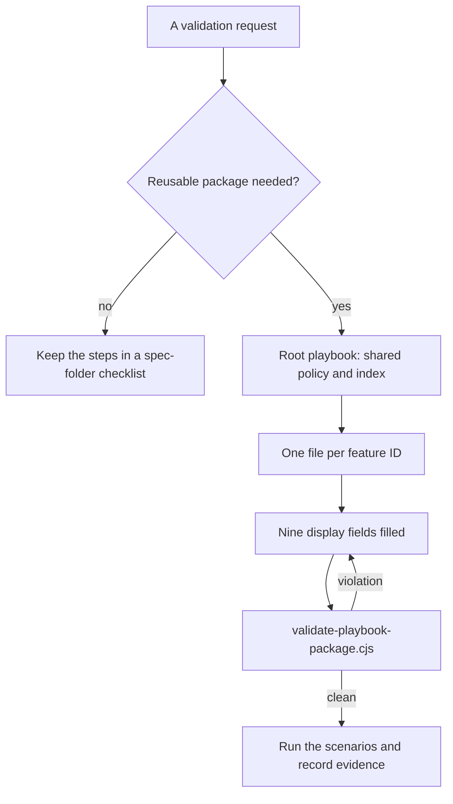

# create-manual-testing-playbook

> Turn a release checklist into a package of deterministic scenarios that another operator can rerun and reach the same verdict.

---

## 1. OVERVIEW

### At a Glance

| Aspect | What you get |
|---|---|
| **Use it for** | Authoring a `manual-testing-playbook/` package: deterministic operator scenarios with captured evidence and a binary verdict |
| **Invoke with** | `/create:manual-testing-playbook`, "manual testing playbook", "deterministic scenario" |
| **Works on** | Skills and systems that need operator-facing manual validation before a release |
| **Produces** | One root `manual-testing-playbook.md` plus one kebab-case file per feature ID in a category folder |

### What It Does

The mode authors a `manual-testing-playbook/` package for a skill or a system that needs repeatable manual validation. The root file `manual-testing-playbook/manual-testing-playbook.md` holds shared policy: the global preconditions, the evidence requirements, the review protocol and the release criteria. Each feature gets one file in a kebab-case category folder. That file is the only home of its execution truth, which covers the exact prompt, the exact command sequence, the expected signals, the evidence to capture and the pass or fail bar. A second operator can rerun the scenario from that file alone.

The entry point is `/create:manual-testing-playbook`. A request for a capability inventory rather than executable scenarios belongs to `create-feature-catalog`. A request to audit or score a playbook that already exists belongs to `create-quality-control`.

### Why This Skill Exists

A release decision often rests on a checklist someone wrote the night before. Nobody can rerun it afterwards. Automated tests cover internals, not what an operator sees after typing a real prompt at a real CLI. Two operators then run "the same" test and reach two verdicts, because the prompt, the command, the expected output and the pass bar were never pinned down.

### The Scenario Contract

Each per-feature file fills the same nine display fields from the root template's 9-column scenario contract. When all nine are filled, a different operator reproduces the run without asking the author a question.

| Contract field | What the field pins down |
|---|---|
| **Feature ID** | a stable `{PREFIX}-{NNN}` label that ties the scenario to one feature file |
| **Feature Name** | the short name a reader can restate |
| **Scenario Name / Objective** | what the scenario proves, in one sentence |
| **Exact Prompt** | the verbatim text an operator or agent sends |
| **Exact Command Sequence** | the ordered commands, with `->` between steps |
| **Expected Signals** | the observable output that shows the scenario progressing |
| **Evidence** | the files, screens or transcripts the operator records |
| **Pass/Fail Criteria** | the binary rule that decides the verdict |
| **Failure Triage** | the ordered checks to run when the scenario fails |

---

## 2. QUICK START

**Step 1: Invoke it.** Run `/create:manual-testing-playbook`. The phrases "manual testing playbook" and "deterministic scenario" reach the same mode.

**Step 2: Scaffold the root file.**

```bash
mkdir -p <skill>/manual-testing-playbook
```

Expected result: no output. Then copy the fenced root scaffold from section 5 of [the playbook template](./assets/manual-testing-playbook-template.md) into `<skill>/manual-testing-playbook/manual-testing-playbook.md`. The template's other sections are the standards to read, not text to copy. The scaffold holds the policy sections, the category sections and the feature index.

**Step 3: Validate the scaffold.**

```bash
python3 .skilled/skills/sk-doc/scripts/validate_document.py \
  <skill>/manual-testing-playbook/manual-testing-playbook.md --type playbook
```

Expected output starts with `✅ VALID`. The report also names `Document type: playbook`, reports `Total issues: 0` and exits 0.

---

## 3. HOW IT WORKS

Authoring runs in a fixed order. Decide the category folders and the `{PREFIX}-{NNN}` feature IDs first, because every later file points at them. Copy the root scaffold. Write the package policy before any scenario exception: the global preconditions, the evidence rules, the review protocol and the release criteria. Write each feature file next, execution truth first. Leave the root summary prose until last, so the summaries describe scenarios that exist.

Per-feature files carry one of two styles. A single prompt sends the Exact Prompt once and the operator judges the answer against the Expected Signals. A conversation carries one `json conversation` block. The shared runner plays each turn into a live runtime session, answers the runtime's questions and runs a shell check after every turn. The ordered test for which style to use is in `SKILL.md` §6, Choosing the Scenario Style.

Then run the operator-contract validator over the whole package. A run is not complete until its verdict, its reason and its evidence paths are recorded in the owning skill's `benchmark/reports/<dated-run-label>/` folder.



### Prompt Synchronization

A scenario's prompt lives in up to four places: the prompt field in `SCENARIO CONTRACT`, the `Exact Prompt` column in the per-feature execution table, any root summary text that previews it and the first `send` of a conversation script. All copies must say the same words. Quotes, backticks, emphasis and spacing are ignored. Any difference in the words is reported as a `PROMPT_UNSYNCED` warning. That warning never fails a run, so an unsynced prompt can ship unless someone reads the report.

### Verdict Discipline

Every scenario ends as PASS, FAIL or SKIP. A `SKIP` row carries the sandbox or runtime blocker that stopped the run. `UNAUTOMATABLE` is not a verdict the package accepts, so a scenario that cannot run still holds its row and keeps the gap visible in the coverage.

---

## 4. INTEGRATION & NAVIGATION

### When To Use This Skill

Reach for this mode when five or more distinct features need manual validation or when several operators or agents must rerun the same scenarios and reach comparable verdicts. Keep the steps in a spec-folder checklist when they fit one row. Leave the package for a validation surface large enough that captured evidence decides the release. A one-off or experimental feature also fits the checklist better.

### Related Skills

| Skill | Relationship |
|---|---|
| `create-feature-catalog` | Owns the capability inventory. A scenario links to its catalog entry when one exists. |
| `create-quality-control` | Audits, scores or optimizes a playbook that already exists, without adding scenarios. |
| `system-spec-kit` | Owns the spec folder and its checklist, which holds validation that does not need a full package. |

---

## 5. TROUBLESHOOTING

| What you see | Why | Fix |
|---|---|---|
| `PROMPT_UNSYNCED` in the validator report | A prompt copy disagrees with the scenario contract | Rewrite every copy with the same words: the contract prompt, the table column, the root summary and the conversation's first `send` |
| `CONVERSATION_SCRIPT_INVALID` | The `json conversation` block carries a key or a shape the parser rejects | The message names the field path. Fix the block against `references/conversation-scenarios.md` |
| Exit status `2` from the operator validator | A usage or boundary error in the arguments | Recheck the `--package` argument and the package root it points at |
| A feature ID in the root index has no file | The root index row points at a file that does not exist | Reconcile the IDs until the root index and the files on disk match one to one |
| A conversation run fails as `REPO_CHANGED` | A file under `specs/` or a watched `.skilled/skills/.state/` subfolder changed during the run | Stop the other writer and rerun. Both repository snapshots stay in the runtime's evidence folder |

---

## 6. FAQ

### Why not add rows to an existing spec-folder checklist?

A checklist row is the cheaper home when the validation is small or one-off. A package earns its cost when the validation surface is release-critical enough that reproducibility and captured evidence matter more than a quick pass line.

### Why is prompt drift only a warning?

The check is advisory on purpose. `PROMPT_UNSYNCED` reports each copy that disagrees with the scenario contract and never becomes a fail-closed violation. A clean run reports `warnings=0`.

### Can a scenario skip its feature-catalog link?

Yes, when no stable catalog exists for the target. The per-feature file states that exception instead of leaving a link silently absent.

### What does a conversation scenario need that a single prompt does not?

Four things:

- a runtime the runner drives
- tmux
- that runtime installed and logged in
- quota to spend

The write sandbox also needs macOS. Elsewhere the run records `sandbox: unavailable` and the subject runs unsandboxed. When a piece is missing, write a single prompt instead. Otherwise keep the conversation and record `SKIP` with the missing piece as its blocker.

---

## 7. VERIFICATION

| Check | How to run it | Pass looks like |
|---|---|---|
| Root playbook structure | `python3 .skilled/skills/sk-doc/scripts/validate_document.py <skill>/manual-testing-playbook/manual-testing-playbook.md --type playbook` | `✅ VALID` with `Total issues: 0` and exit 0 |
| Operator contract | `node .skilled/skills/sk-doc/sk-create-manual-testing-playbook/scripts/validate-playbook-package.cjs --package <skill>/manual-testing-playbook` | One `PASS package=...` line with `violations=0 warnings=0` and exit 0 |

The mode's own package passes the second check:

```bash
node .skilled/skills/sk-doc/sk-create-manual-testing-playbook/scripts/validate-playbook-package.cjs \
  --package .skilled/skills/sk-doc/sk-create-manual-testing-playbook/manual-testing-playbook
```

Expected final line: `PASS package=sk-doc/sk-create-manual-testing-playbook tier=FAIL_CLOSED scenarios=8 categories=4 operator=8 routing_gold_excluded=0 violations=0 warnings=0`, with exit status 0.

---

## 8. RELATED DOCUMENTS

| Document | Purpose |
|---|---|
| [`SKILL.md`](./SKILL.md) | Authoring workflow, scenario design rules and the full validation contract |
| [`ROUTER.md`](./ROUTER.md) | Machine router: intent model, resource map and the fallback checklist |
| [`references/README.md`](./references/README.md) | Reference map for the overflow detail |
| [`references/prompt-voice.md`](./references/prompt-voice.md) | Natural-human and RCAF prompt voice decision table |
| [`references/conversation-scenarios.md`](./references/conversation-scenarios.md) | `json conversation` block schema, turn outcomes and runner evidence |
| [`references/common-pitfalls.md`](./references/common-pitfalls.md) | Recurring package defects and their fixes |
| [`references/examples.md`](./references/examples.md) | A shipped playbook to study and the scaffold templates |
| [`assets/manual-testing-playbook-template.md`](./assets/manual-testing-playbook-template.md) | Root playbook scaffold |
| [`assets/manual-testing-playbook-snippet-template.md`](./assets/manual-testing-playbook-snippet-template.md) | Single-prompt scenario scaffold |
| [`assets/manual-testing-playbook-conversation-snippet-template.md`](./assets/manual-testing-playbook-conversation-snippet-template.md) | Conversation scenario scaffold |
| [`scripts/validate-playbook-package.cjs`](./scripts/validate-playbook-package.cjs) | Operator-contract validator |
| [`scripts/run-conversation-scenario.cjs`](./scripts/run-conversation-scenario.cjs) | Shared conversation runner |
| [`manual-testing-playbook/manual-testing-playbook.md`](./manual-testing-playbook/manual-testing-playbook.md) | The mode's own operator package: eight scenarios across four categories |
