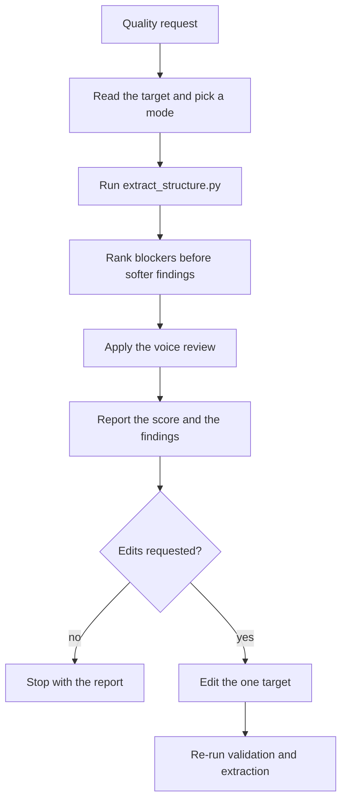

# create-quality-control

> Know whether an existing markdown document is ready to publish, and improve it only when you ask.

---

## 1. OVERVIEW

### At a Glance

| Aspect | What you get |
|---|---|
| **Use it for** | Auditing, scoring or improving one existing markdown document |
| **Invoke with** | "doc quality" or "score this document" through `sk-doc` routing (no slash command) |
| **Works on** | An existing README, `SKILL.md`, command doc, reference, spec file or generic markdown file |
| **Produces** | A DQI score and band, ranked findings and scoped edits only on request |

### What It Does

create-quality-control audits a markdown file that already exists. It runs structure extraction and reports the Document Quality Index with its quality band, using the checklist result as evidence. Then it ranks the findings so blocking issues come before softer warnings. The run is report-only unless you ask for an edit. When an edit is in scope, it improves that same file and re-runs the evidence commands.

The packet declares no slash command. The `sk-doc` hub routes an existing-document quality request here, and the workflow runs from the packet's [runtime contract](./SKILL.md). It never creates an artifact, so new work belongs to the matching creation packet.

### Why This Skill Exists

A document reads fine to the person who wrote it. That is not evidence. Without a scoring pass, "looks fine to me" is the only bar a README ever clears, and missing frontmatter or a broken section order can ship unnoticed. Fixing that by instinct is worse, because a rewrite can change a claim nobody meant to touch. This packet gives the document a number and the evidence behind it before anyone edits a line.

---

## 2. QUICK START

**Step 1: Invoke it.** Ask `sk-doc` to score or audit an existing markdown file. A run needs no reference file to start.

**Step 2: Run the primary workflow.**

```bash
python3 .skilled/skills/sk-doc/shared/scripts/extract_structure.py <file>
```

Expected output: one JSON object. It carries the detected `type`, a `checklist` block, the `metrics`, the `content_issues`, the `style_issues` and a `dqi` block with `total` and `band`. The command exits 0.

**Step 3: Verify before you rely on it.**

```bash
python3 .skilled/skills/sk-doc/shared/scripts/validate_document.py <file> --type <type>
```

Expected output: `✅ VALID: <file>` followed by `Document type: <type>` and `Total issues: 0`, with exit 0. A blocking failure exits 1. The types include `readme`, `skill`, `reference`, `command` and `spec`.

---

## 3. HOW IT WORKS

A run starts by reading the target and choosing a mode. The default is a report-only audit. Extraction comes next, and its JSON is the source of truth for the document type, the metrics, the checklist result and the DQI. Findings are ranked, with blocking structural failures first and the softer warnings behind them. The voice review runs after that. It looks for generic phrasing and padded language, which is why it cannot replace the structural gate.

The audit ends with a fixed report: the path and detected type, the DQI score and band, the filename-case signal, the blocking list and the next steps. When you ask for edits, the packet applies only the transformations the gaps call for and edits the one target. Then it re-runs validation and extraction, so the new score is evidence rather than hope.



### The Four Execution Modes

| Mode | What runs | What you get |
|---|---|---|
| Report-only audit | `extract_structure.py <file>` plus a written read of the JSON | The score, the band and the findings, with no edit |
| Structure validation | `validate_document.py <file> --type <type>` for a document, `quick_validate.py <dir>` for a packet | The checklist result and the blocking list |
| Content optimization | The extraction, edit and re-check sequence | Scoped edits to the one target and post-edit evidence |
| Batch snapshot | `extract_structure.py <file>` per file | One evidence-backed entry per file, with no edits |

### Key Concept: DQI Is Read, Not Guessed

The score comes from `extract_structure.py` against the file on disk. A README can look polished and still fail a checklist item, such as the blockquote a reader scans after the H1. Extraction returns a lower DQI and reports the failed item, and that number is what gets reported. The band follows the score: excellent at 90 and above, good from 75 to 89, acceptable from 60 to 74 and needs work below 60. An edit that changes the score is not finished until extraction has run again.

---

## 4. INTEGRATION & NAVIGATION

### When To Use This Skill

Reach for this packet when an existing document needs a quality gate before publishing. It also fits when a document feels off and nobody has run a structural check. Use it when another packet has just written or changed a file and the result needs re-validation. Skip it when the file does not exist yet. Creation belongs to the matching `sk-doc` creation packet, such as `sk-create-readme` or `sk-create-skill`.

### Related Skills

| Skill | Relationship |
|---|---|
| `sk-doc` hub | Routes an existing-document quality request to this packet |
| `sk-create-readme`, `sk-create-skill` and the rest of the creation family | Write a new artifact. This packet audits one that already exists |
| `sk-create-with-human-voice` | Owns the Human Voice Rules and the voice workflow. This packet applies the rules as a review pass |
| `sk-code` | Owns code review and debugging. This packet reads markdown only |

---

## 5. TROUBLESHOOTING

| What you see | Why | Fix |
|---|---|---|
| `SKILL.md not found` from `quick_validate.py` | The script expects a packet directory and received a file path | Pass the folder, such as `.skilled/skills/sk-doc/sk-create-quality-control` |
| A score with no extraction output behind it | The number came from a guess | Run `extract_structure.py` and cite its JSON |
| The validator reports the wrong document type | The type was auto-detected from the path or the content | Pass `--type` with the correct type. The extractor has no type flag |
| An edit changed a file next to the target | The change left the one document | Revert the other files and keep the edit scoped to the named target |
| Voice findings arrive before the structural check | The review ran out of order | Fix the blocking structure first, then review the voice |

---

## 6. FAQ

### Why is the audit report-only by default?

An unrequested edit can change a product claim or a policy sentence without a decision behind it. The packet reports the score and the evidence first. It edits only when you ask and the scope is clear.

### Why not let each creation packet validate its own output?

A creation packet validates what it just wrote. This packet audits any existing file, whoever wrote it and whenever it landed. That is why it is the right gate for a document that has already shipped, or for work another packet handed over.

### Does it add a table of contents?

No. Adding one needs an explicit project rule that overrides the shared standard.

### What happens when an edit would change a product claim or a policy statement?

The packet escalates instead of editing. A product claim or a policy sentence needs a human decision, and a quality pass is the wrong place for that decision.

---

## 7. VERIFICATION

Run the checks from the repository root. Stop when a blocking check exits non-zero.

| Check | How to run it | What a pass looks like |
|---|---|---|
| Structure and DQI | `python3 .skilled/skills/sk-doc/shared/scripts/extract_structure.py <file>` | JSON with a `dqi` total and band, exit 0 |
| Format | `python3 .skilled/skills/sk-doc/shared/scripts/validate_document.py <file> --type <type>` | `✅ VALID: <file>` and `Total issues: 0` |
| Packet sanity | `python3 .skilled/skills/sk-doc/shared/scripts/quick_validate.py <dir>` | `✅ Skill is valid!` |
| Filename case | `python3 .skilled/skills/sk-doc/shared/scripts/check_authored_name_kebab.py <file>` | One line: `PASS: authored artifact name is kebab-case: <file>`, `PASS: authored artifact name is exempt: <file>` or a `FAIL:` line with exit 1 |

The filename-case check is a signal. It changes no DQI point. The [manual testing playbook](manual-testing-playbook/manual-testing-playbook.md) walks the same behavior by hand across six scenarios in two categories, and each scenario records a verdict with its reason.

---

## 8. RELATED DOCUMENTS

| Document | Purpose |
|---|---|
| [`SKILL.md`](./SKILL.md) | Runtime contract for the audit and optimization workflow |
| [`ROUTER.md`](./ROUTER.md) | Intent map and resource map for the packet |
| [`references/README.md`](./references/README.md) | Route map to the five reference files |
| [`references/workflows.md`](./references/workflows.md) | The four execution modes and how to choose one |
| [`references/validation-and-enforcement.md`](./references/validation-and-enforcement.md) | Validation touchpoints, approval wording and phase chaining |
| [`references/workflow-examples.md`](./references/workflow-examples.md) | Copy-paste recipes and batch processing |
| [`references/optimization.md`](./references/optimization.md) | The optimization procedure and its heuristics |
| [`references/transformation-patterns.md`](./references/transformation-patterns.md) | The 16 transformation patterns with worked examples |
| [`manual-testing-playbook/manual-testing-playbook.md`](manual-testing-playbook/manual-testing-playbook.md) | Six hand-run scenarios for audit, validation and voice |
| [`../shared/references/validation.md`](../shared/references/validation.md) | DQI components, quality bands and gate interpretation |
| [`../sk-create-with-human-voice/references/hvr-rules.md`](../sk-create-with-human-voice/references/hvr-rules.md) | The Human Voice Rules |
