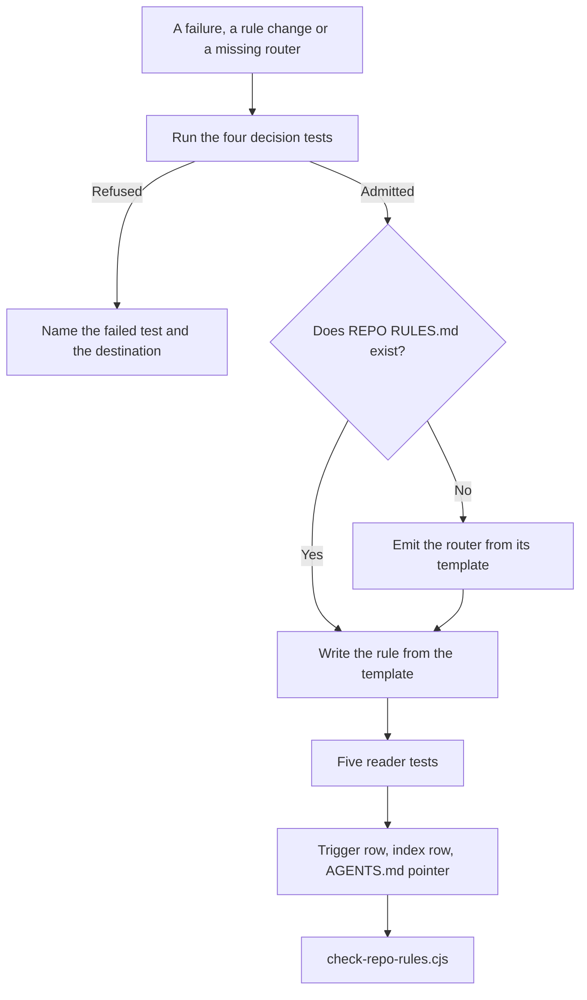

# create-repo-rule

> Turn "this keeps happening" into a rule that loads at the moment it matters or a clear reason it should not exist.

---

## 1. OVERVIEW

### At a Glance

| Aspect | What you get |
|---|---|
| **Use it for** | Writing, changing or retiring a repo rule in the target repository's rules directory |
| **Invoke with** | `/create:repo-rule` or a plain description of the failure that keeps happening |
| **Works on** | A repeated failure, an out-of-date rule or a rule nothing still needs |
| **Produces** | A wired rule file or a refusal naming the failed test and where the content belongs |

### What It Does

create-repo-rule turns a recurring failure into a rule file in the target repository's rules directory. That directory is `.skilled/repo-rules/` where a `.skilled` source root exists, and `repo-rules/` otherwise. The skill wires the file into `REPO RULES.md` and points at it from the `AGENTS.md` section the rule expands. Four decision tests run before anything is written, and most requests end in a refusal that names the failed test and the destination. The entry point is `/create:repo-rule`.

### Why This Skill Exists

Some failures repeat. Someone edits a file they never opened. A green test run gets reported by nobody who watched it finish. A migration disappears with no way back. A rule fires on a topic instead of an action and never loads.

Catching each one in review costs the same amount every time. A written constraint that loads at the moment of the action costs once, and it can be removed when the failure stops. Rule sets rot in the other direction too. They only grow. Every plausible suggestion becomes a file. The set grows until nobody reads any of it, and a set that looks thorough has already failed. This skill holds that line, which is why it refuses most of what it is asked for.

### What A Repo Rule Is

A repo rule constrains how you work. It loads when you are about to act and narrows your options. If the request teaches a capability, it is a skill. If it narrows your options while you work, it is a rule.

A rule ranks below `AGENTS.md` and below a live instruction from the operator. Where they appear to disagree, `AGENTS.md` wins and the rule is wrong. A rule also carries a version, because it changes. Removing one is a normal outcome, and this skill owns removal as much as it owns writing.

---

## 2. QUICK START

**Step 1: Describe the failure, not the file you want.** Run `/create:repo-rule` with the failure in plain words. "We keep deleting a migration with no way back" is the input the tests answer. The vocabulary of the rule set is not required.

**Step 2: Read the test that refuses most requests.**

```bash
sed -n '/^## 2\. THE ALWAYS-LOADED TEST/,/^- \*\*No\*\*/p' .skilled/skills/sk-doc/sk-create-repo-rule/references/decision-tests.md
```

The output prints `## 2. THE ALWAYS-LOADED TEST`, the blockquote that a rule file loads on a trigger, the ask line, then the two branches. The `No` branch names the next test.

**Step 3: Verify the rule set after any write.**

```bash
node .skilled/skills/sk-doc/sk-create-repo-rule/scripts/check-repo-rules.cjs
```

Eleven `PASS` lines print and the final line reads `[repo-rules-check] RESULT: PASSED (11/11 checks)`, with exit 0. A failed check prints `FAIL` on its line and the run exits 1.

---

## 3. HOW IT WORKS

The hub routes a repo-rule request here, and the operation decides which resources load after the decision tests. `references/decision-tests.md` loads first on every path, including retire, because whether a rule should exist and whether it should still exist are the same four questions.



| Request | What loads after the tests |
|---|---|
| Create | `references/rule-anatomy.md` and `assets/repo-rule-template.md` |
| Revise | `references/rule-anatomy.md` and `references/agents-md-integration.md` |
| Retire | `references/agents-md-integration.md` |
| A target repository with no `REPO RULES.md` | `assets/repo-rules-router-template.md` before the rule is written |

Test 1 refuses content that must hold on a turn where no trigger fires, because no rule file loads there. Test 2 refuses routing questions, which belong to `AGENTS.md` §2 and the skills it routes to. Test 3 asks for a trigger-shaped cluster with no existing home, no earlier design refusal and an `AGENTS.md` anchor. Test 4 asks what fails today without the rule. A refusal names the failed test and the destination, and most requests stop there.

A request that survives all four is written from `assets/repo-rule-template.md`. The template fixes ten elements, among them the six-key frontmatter in one order, the `Fires when` list of actions, one bold sentence under `The rule`, an uppercase numbered body with one `---` divider per section, a closing self-check and a resolving link back to the router. A rule aims for 160 lines or fewer. Up to 200 is fine without comment, up to 250 is allowed when the rule can say why it needs the room, and over 250 means split it or cut it.

Then `references/creation-standards.md` asks five questions a reader answers by reading. Does each section name the failure it prevents? Is each trigger phrase something a person types when they have the problem? Does the binding sentence hold one obligation? Does each self-check item trace to an obligation in the body? Could a tired reader use the rule as licence to skip work?

Wiring comes after that. A trigger row in `REPO RULES.md` §2 is what loads the rule. An index row in §3 makes it browsable. A pointer from each governed `AGENTS.md` section makes it findable at the moment of need.

Revise runs the tests again before it touches the rule. A rule that no longer passes them is retired rather than patched. When a change alters when the rule fires, the trigger row changes in the same edit, or the router lies silently. To learn whether a revision changed behaviour, `scripts/measure-rule-compliance.py` reads local session transcripts and reports, as aggregates, delivery receipts by channel and compaction window, the Gate 5 and reply-rule miss rates and the prohibition rates.

### Key Concept: Order Protects The Half-Finished State

Create writes the file first, then the rows. Retire removes them in exactly the reverse order: pointer, index row, trigger row, then the file.

Both orderings answer one question. What does an interrupted run leave behind? A file nothing points at is inert and obvious. A router row pointing at nothing reads as working coverage to anyone who looks. Always leave the safer wreck.

---

## 4. INTEGRATION & NAVIGATION

### When To Use This Skill

Reach for it when a failure keeps repeating and someone wants it stopped, or when an existing rule no longer matches how the work is done. Reach for it when a rule has stopped earning its load, or when a repository has no rule router.

Leave it alone when the request teaches a capability, which belongs to `sk-create-skill`. Content that must bind on every turn belongs in `AGENTS.md`, not behind a trigger. A question about which skill or command to route to belongs to the hub and its routing rule.

### Related Skills

| Skill | Relationship |
|---|---|
| `sk-create-skill` | Owns capability authoring. A skill teaches how, a rule constrains what you may attempt |
| `sk-create-command` | Owns the `/create:repo-rule` command surface that invokes this mode |
| `sk-create-manual-testing-playbook` | Owns the playbook contract this packet's scenarios follow |
| `system-spec-kit` | Owns spec-folder documentation, where a refusal reason is recorded |

---

## 5. TROUBLESHOOTING

| What you see | Why | Fix |
|---|---|---|
| Your request was refused and you disagree | Most requests are refused by design, usually on test 1 | Read the named test and the destination it gives. That destination is usually a better home than a new file |
| A rule was written but never fires | It has no trigger row, or the row names a topic rather than an action | Add a row on the action you are about to take, then rerun the checker |
| The router points at a file that does not exist | A retirement removed the file before the rows | Remove the row and rerun the checker. Rows and files must match |
| A trigger phrase reaches the wrong rule | Two rules claim the same phrase | The checker's phrase check reports collisions. Keep the phrase in one file |
| `validate_document.py --type reference` calls a rule invalid | A rule has no `OVERVIEW` section by design, and that document type requires one | Use `scripts/check-repo-rules.cjs` for a rule, not the reference document type |
| The draft passes every check and still reads as filler | Structure is checkable and it is not the bar | Run the five reader tests in `references/creation-standards.md` |

---

## 6. FAQ

### Why does it refuse so much?

Because the alternative is a set nobody reads. Every rule raises the cost of loading the set and lowers the odds any single rule gets read. "Best practice" and "might need it later" are the phrases that produce unread files.

### My rule is correct. Why does test 1 still refuse it?

Correctness is not what test 1 measures. It asks whether the content must bind when no trigger has fired. A rule that must always hold, filed behind a trigger, stops holding on every turn that trigger misses. It looks present in the repository and is absent in practice.

### Can a rule override `AGENTS.md`?

No. Where they appear to disagree, the rule is wrong. Say so rather than following it.

### What happens if the repository has no `REPO RULES.md`?

The router is emitted first, from `assets/repo-rules-router-template.md`. No router means no rule can load. It is a prerequisite for the request rather than the thing the request asked for, and the run reports it that way.

### Is a refusal a dead end?

No. Every refusal except the restraint one names a destination. The restraint refusal routes nowhere on purpose, and its recorded reason is the deliverable, so the same proposal does not return next quarter with nobody remembering why it was declined.

---

## 7. VERIFICATION

| Check | How to run it | What a pass looks like |
|---|---|---|
| Rule set and router | `node .skilled/skills/sk-doc/sk-create-repo-rule/scripts/check-repo-rules.cjs` | Eleven `PASS` lines, `RESULT: PASSED (11/11 checks)`, exit 0 |
| Playbook package | `node .skilled/skills/sk-doc/sk-create-manual-testing-playbook/scripts/validate-playbook-package.cjs --package .skilled/skills/sk-doc/sk-create-repo-rule/manual-testing-playbook` | One `PASS` line ending `violations=0 warnings=0`, exit 0 |

The checker compares rule files with both router tables, resolves every link it reads and holds the 250-line ceiling. It exits 1 when a check fails and 2 when it receives an unknown flag or a tree with no router. The playbook validator walks the scenario package and counts what it finds, so the package states no count of its own.

---

## 8. RELATED DOCUMENTS

| Document | Purpose |
|---|---|
| [`SKILL.md`](./SKILL.md) | Runtime instructions and the rule for each operation |
| [`ROUTER.md`](./ROUTER.md) | Machine router: intent model, resource map and loading levels |
| [`references/README.md`](./references/README.md) | The index over the four references, in the order the questions arrive |
| [`references/decision-tests.md`](./references/decision-tests.md) | The four tests deciding whether a rule may exist and where refused content goes |
| [`references/rule-anatomy.md`](./references/rule-anatomy.md) | The ten fixed elements, what varies and the length bands |
| [`references/creation-standards.md`](./references/creation-standards.md) | The five reader tests deciding whether a well-formed rule earns its load |
| [`references/agents-md-integration.md`](./references/agents-md-integration.md) | The wiring points, the scope check and the create, revise and retire orderings |
| [`assets/repo-rule-template.md`](./assets/repo-rule-template.md) | The blank a new rule is filled from |
| [`assets/repo-rules-router-template.md`](./assets/repo-rules-router-template.md) | The router for a repository that has none |
| [`scripts/check-repo-rules.cjs`](./scripts/check-repo-rules.cjs) | The eleven-check gate over the rule set and its router |
| [`scripts/measure-rule-compliance.py`](./scripts/measure-rule-compliance.py) | Delivery receipts, miss rates and prohibition rates from local session transcripts, as aggregates |
| [`scripts/rule-experiment.py`](./scripts/rule-experiment.py) | One isolated repository per experiment arm, scored as aggregates |
| [`manual-testing-playbook/manual-testing-playbook.md`](./manual-testing-playbook/manual-testing-playbook.md) | Operator scenarios for decision, authoring, lifecycle and experiments |

<!-- readme-check
allow-count four decision tests | the four decision tests are questions `references/decision-tests.md` defines, not test files in a folder
-->
