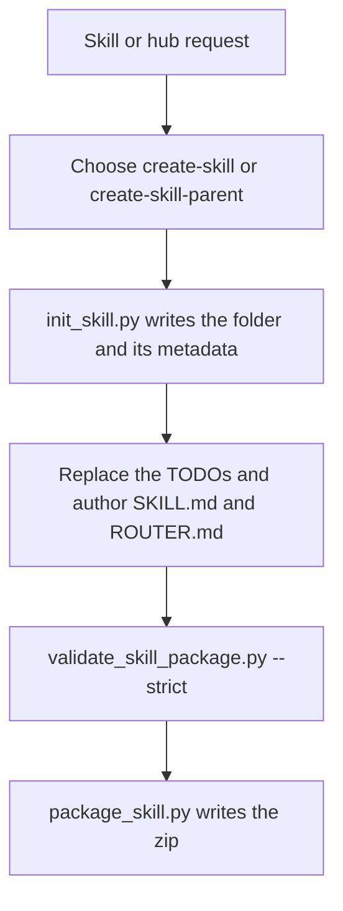

# create-skill

> You walk away with a skill or a parent hub whose files and routing metadata agree, built from templates this repository already proved.

---

## 1. OVERVIEW

### At a Glance

| Aspect | What you get |
|---|---|
| **Use it for** | Authoring a skill under `.skilled/skills/`, as a standalone root or as a parent hub with nested packets |
| **Invoke with** | `/create:skill`, `/create:skill-parent`, "create skill", "parent hub" |
| **Works on** | A new skill folder or an existing root that needs a repair and a fresh validation run |
| **Produces** | `SKILL.md`, `ROUTER.md`, the root JSON files and the scaffolded resource trees, proven by `validate_skill_package.py` |

### What It Does

create-skill turns a described capability into a skill package in this repository's shape. You pick one of two workflow modes. The mode fixes the files the scaffolder writes. Both modes end at the same gate, where `validate_skill_package.py <path> --strict` must exit clean before `package_skill.py` writes a zip. Two sibling packets own adjacent work. `create-readme` writes the README. `create-quality-control` audits a document that already exists.

### Why This Skill Exists

A skill built from a blank file means the frontmatter rules and the section order are invented again each time. The routing metadata is guessed as well. The drift surfaces later, as a missing root JSON file or routing signals the advisor never reads. A parent hub raises the cost, because a registry and a router have to agree with every nested packet. create-skill scaffolds both shapes from templates and proves the result before anyone calls it done.

---

## 2. QUICK START

Run every command from the repository root.

**Step 1: Scaffold the root.** `--path` names the parent directory. The scaffolder creates `<path>/<skill-name>`.

```bash
python3 .skilled/skills/sk-doc/sk-create-skill/scripts/init_skill.py my-skill --path .skilled/skills
```

Expected output:

```text
🚀 Initializing skill: my-skill
   Location: .skilled/skills
✅ Created skill directory: <resolved path>/my-skill
✅ Created manual-testing-playbook/ and benchmark/reports/ with their indexes
✅ Created SKILL.md and ROUTER.md
✅ Created graph-metadata.json and leaf-manifest.config.json
✅ Skill 'my-skill' initialized successfully at <resolved path>/my-skill
```

The run closes with four numbered next steps and leaves the TODOs for you to replace. For a hub, add `--kind parent` and one `--compiled-routing` value.

```bash
python3 .skilled/skills/sk-doc/sk-create-skill/scripts/init_skill.py my-hub --path .skilled/skills --kind parent --compiled-routing legacy
```

Expected output carries these two lines, then three numbered next steps:

```text
✅ Compiled routing: legacy (no manifest)
✅ Parent skill 'my-hub' initialized successfully at <resolved path>/my-hub
```

**Step 2: Fill the content, then run the gate.**

```bash
python3 .skilled/skills/sk-doc/sk-create-skill/scripts/validate_skill_package.py .skilled/skills/my-skill --strict
```

Expected output for a standalone root:

```text
Skill: .skilled/skills/my-skill
Detected kind: standalone
- package_skill.py --check --strict: PASS (exit 0)
```

A hub prints the same report with `Detected kind: parent`, plus one line each for `compiled routing readiness` and `parent-skill-check.cjs`.

**Step 3: Package after the gate passes.**

```bash
python3 .skilled/skills/sk-doc/sk-create-skill/scripts/package_skill.py .skilled/skills/my-skill <output-directory>
```

Expected output closes with:

```text
✅ Successfully packaged <count> files to: <output-directory>/my-skill.zip
```

The packager runs the strict validation again before it writes the zip, so a broken rule stops the run with `❌ Validation failed`.

---

## 3. HOW IT WORKS

Both paths start from concrete examples of the work the skill performs. A standalone skill then settles its purpose, its trigger phrases, its output contract and its boundaries before the first file exists. A parent hub answers one more question first: is this one advisor identity that dispatches to packets or several skills that happen to be related?

On the standalone path, each piece of reusable content gets one home. Deterministic code goes in `scripts/`. Domain knowledge and long workflow guidance go in `references/`. Templates and output resources go in `assets/`. `init_skill.py` scaffolds the folder. You then replace its TODOs with real content. `SKILL.md` is authored as the executable contract. `package_skill.py --check` requires `WHEN TO USE`, `SMART ROUTING`, `HOW IT WORKS`, `RULES` and `REFERENCES`. It warns when `SUCCESS CRITERIA` is absent. The routing detail itself sits in the sibling `ROUTER.md`.

On the parent path, the scaffolder writes the hub root and one `<hub>-primary` workflow packet. The registry holds a single `modes[]` array. Every mode names its `workflowMode` and `packetKind`, and the registry schema lists the rest of the required fields. `routerPolicy.tieBreak` lists each mode once, with workflow modes before surface packets. The root `ROUTER.md` starts at `stage1-only`, with empty stage-two maps. Promotion to `active` is an authored act that fills `INTENT_SIGNALS` and `RESOURCE_MAP` with paths that resolve on disk. No nested packet carries a `graph-metadata.json`.



### What Each Mode Writes

| Mode | What lands on disk |
|---|---|
| **`create-skill`** | `SKILL.md`, `ROUTER.md`, `graph-metadata.json`, `leaf-manifest.config.json`, the generated `leaf-manifest.json` and `leaf-aliases.json`, the corpus trees |
| **`create-skill-parent`** | `SKILL.md`, `README.md`, `ROUTER.md`, `mode-registry.json`, `hub-router.json`, `description.json`, `graph-metadata.json`, the generated `leaf-manifest.json`, `changelog/`, the corpus trees and one `<hub>-primary` packet |

Both scaffolds finish by running `ci-skill-root-metadata.cjs --fix`, scoped to the new root. It writes `leaf-manifest.json`. On a standalone root it writes `leaf-aliases.json` too. Every other root JSON file is authored rather than generated. `--fix` never rewrites one, which is why a `MISSING_REQUIRED_FILE` finding asks you to write it.

### Legacy And Ready Compiled Routing

`--compiled-routing legacy` writes no canonical manifest and prints `✅ Compiled routing: legacy (no manifest)`. `--compiled-routing ready` mints a manifest and checks it against the hub root. On success it prints `✅ Compiled routing: compiled-ready (fresh manifest verified at <path>)`. A failed mint or a stale result ends the run with a non-zero exit and no hand-written digest. Neither state gives the hub compiled serving. A fresh ready manifest records intent to join later.

---

## 4. INTEGRATION & NAVIGATION

### When To Use This Skill

Reach for create-skill when a new capability needs to become a skill this repository can route. It fits a rebuild too, when an existing root has drifted far enough that the templates are the faster path. Choose `create-skill-parent` when one identity has to dispatch to nested workflow or surface packets, not because two skills feel related. Skip it for the README step that `create-readme` owns. Skip it as well for an audit of a skill that already exists, because `create-quality-control` covers that. Application code belongs to `sk-code`.

### Related Skills

| Skill | Relationship |
|---|---|
| `create-readme` | Writes every skill README, including each later refresh. create-skill hands it that step, and create-readme keeps the skill README template in its own packet. |
| `create-quality-control` | Audits and scores an existing document, then improves it only when asked. create-skill writes the package in the first place. |
| `create-manual-testing-playbook` | Owns the scenario corpus layout and the results-storage contract. create-skill scaffolds the folder. |
| `create-benchmark` | Owns the run-folder grammar and the report files that land in `benchmark/`. |
| `sk-code` | Owns application code. create-skill authors the skill package that may describe that work. |

---

## 5. TROUBLESHOOTING

| What you see | Why | Fix |
|---|---|---|
| `Detected kind: unclassified` | The root carries one of `mode-registry.json` or `hub-router.json`, not both | Add the missing file. A root declares both or neither. |
| `NESTED_IDENTITY` on a packet | A nested packet was given its own `graph-metadata.json` or `description.json` | Delete it. Only the root carries an advisor identity. |
| `MISSING_REQUIRED_FILE` | An authored root file is absent: a declaration JSON file or `ROUTER.md` | Write it from the matching template under `assets/`. `--fix` writes generated files only. |
| `STALE_GENERATED_FILE` | A committed generated file no longer matches its regeneration | Run `node .skilled/skills/sk-doc/sk-create-skill/scripts/ci-skill-root-metadata.cjs --fix --skill <skill-name>` |
| A path fails the kebab-case rule under `--strict` | A package path anywhere under the skill root carries another casing | Rename it to kebab-case. Python filenames and tool-mandated names stay as they are. |
| `❌ Validation failed` from `package_skill.py` | The packager validates with strict rules before it writes the zip | Fix the named rule and rerun the command. |
| `--compiled-routing is only valid with --kind parent` | The flag was passed on a standalone scaffold | Drop the flag or add `--kind parent`. |

---

## 6. FAQ

### Why two workflow modes in one packet instead of two skills?

Both modes share the router template and the class gate, while each has its own scaffold templates. Splitting them would duplicate that machinery for one decision: one advisor identity or several packets under one identity.

### When does a request need a parent hub instead of a standalone skill?

Only when one advisor identity has to dispatch to nested packets that each own a workflow or a surface. Two unrelated capabilities stay two standalone skills. A hub built for convenience adds a registry and a router that no request needs.

### What does `--compiled-routing ready` prove?

It proves the hub can mint a canonical manifest and that the manifest is fresh against its own router inputs. It does not give the hub compiled serving. Serving needs a shadow-child router proven against the hub's own legacy routing.

### Does every skill need resource folders?

No. `SKILL.md` is the root marker. The root metadata contract decides which JSON files the root carries. Add `references/` or `assets/` when the skill has material that earns them. Add `scripts/` only for deterministic code.

---

## 7. VERIFICATION

| Check | How to run it | What a pass looks like |
|---|---|---|
| README structure | `python3 .skilled/skills/sk-doc/shared/scripts/validate_document.py .skilled/skills/sk-doc/sk-create-skill/README.md --type readme` | `✅ VALID` and `Total issues: 0` |
| Package gate | `python3 .skilled/skills/sk-doc/sk-create-skill/scripts/validate_skill_package.py <skill-folder> --strict` | A closing `- package_skill.py --check --strict: PASS (exit 0)`, plus the parent checks on a hub |
| Structure report | `python3 .skilled/skills/sk-doc/shared/scripts/extract_structure.py <path/to/SKILL.md>` | A JSON report whose `type` is `skill` and whose `structure.headings` follow the file |
| Leaf-route replay | `node .skilled/skills/sk-doc/sk-create-skill/scripts/leaf-route-replay.cjs` | Exit 0 with seven `hub=` lines, one `total gold=` line, `router reads: not measured` and one `replay verdict:` line |
| Operator scenarios | [the manual testing playbook](./manual-testing-playbook/manual-testing-playbook.md) | Eleven scenarios, seven for the standalone path and four for hubs |

---

## 8. RELATED DOCUMENTS

| Document | Purpose |
|---|---|
| [`SKILL.md`](./SKILL.md) | Runtime contract: activation, routing, both workflows, rules and success criteria |
| [`ROUTER.md`](./ROUTER.md) | Machine router: intent map, resource map and loading levels |
| [`references/README.md`](./references/README.md) | Route map into the `shared/`, `skill/` and `parent-skill/` reference groups |
| [`references/skill/creation-workflow.md`](./references/skill/creation-workflow.md) | The six-step standalone workflow with its frontmatter guidance |
| [`references/shared/skill-root-metadata-contract.md`](./references/shared/skill-root-metadata-contract.md) | The root JSON matrix for each class, with authored and generated ownership |
| [`references/shared/validation-and-packaging.md`](./references/shared/validation-and-packaging.md) | The two validation tiers and the distribution steps |
| [`references/parent-skill/parent-skills-nested-packets.md`](./references/parent-skill/parent-skills-nested-packets.md) | The parent-hub and nested-packet model |
| [`references/parent-skill/parent-hub-router-schema.md`](./references/parent-skill/parent-hub-router-schema.md) | Registry and router schema, mode kinds and the two-state root router |
| [`references/parent-skill/compiled-routing-architecture.md`](./references/parent-skill/compiled-routing-architecture.md) | Which hubs the compiled router serves and what a ready manifest proves |
| [`references/skill/upgrading-a-skill-to-v4.md`](./references/skill/upgrading-a-skill-to-v4.md) | Adopter guide for reconciling a customized skill to the hub format |
| [`assets/skill/skill-scaffold-template.md`](./assets/skill/skill-scaffold-template.md) | The standalone `SKILL.md` the scaffolder renders |
| [`assets/skill/skill-md-template.md`](./assets/skill/skill-md-template.md) | `SKILL.md` section rules and size limits |
| [`assets/skill/skill-router-template.md`](./assets/skill/skill-router-template.md) | Sibling `ROUTER.md` scaffold for a skill or a mode packet |
| [`assets/parent-skill/parent-skill-hub-template.md`](./assets/parent-skill/parent-skill-hub-template.md) | Parent hub `SKILL.md` scaffold |
| [`assets/skill/skill-procedure-template.md`](./assets/skill/skill-procedure-template.md) | Private procedure card scaffold |
| [`scripts/README.md`](./scripts/README.md) | Inventory of the scripts each workflow calls |
| [`scripts/init_skill.py`](./scripts/init_skill.py) | Scaffolds a standalone root or a parent hub |
| [`scripts/validate_skill_package.py`](./scripts/validate_skill_package.py) | Runs the completion gate |
| [`scripts/package_skill.py`](./scripts/package_skill.py) | Validates again and writes the zip |
| [`manual-testing-playbook/manual-testing-playbook.md`](./manual-testing-playbook/manual-testing-playbook.md) | Eleven operator scenarios for both paths |
| [`skill-readme-template.md`](../sk-create-readme/assets/skill-readme-template.md) | The template this file follows, owned by `create-readme` |
