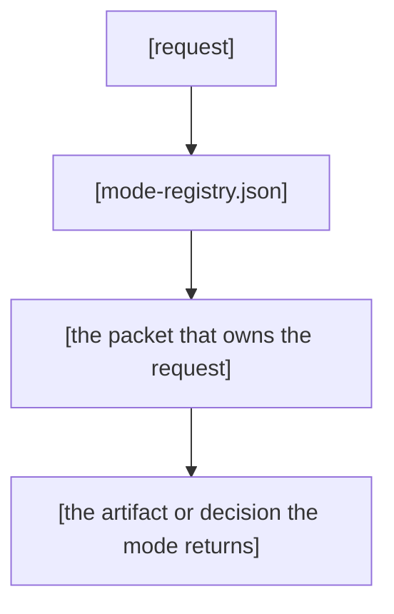

# Parent Skill Hub README Template

> One template that turns any parent hub folder into a readable front door: the pitch, the packet table, the registry links and the validation close.

---

## 1. AT A GLANCE

| Aspect | What you get |
|---|---|
| **Use it for** | A human-facing README at the root of a parent hub folder |
| **Invoke with** | Copy the fillable scaffold into `[hub-name]/README.md` and fill every placeholder from the hub's real files |
| **Covers** | The six hub surfaces: pitch, modes and packets, navigation, changelog, scripts and commands, verification |
| **Produces** | A numbered ALL-CAPS section README that passes the sk-doc readme validator and the Human Voice Rules |

---

## 2. OVERVIEW

### Why This Template Exists

A parent hub routes related packets through one identity. Its README gives people a quick map of modes, files and commands.
Use this template to build that map.

Use this template when you have a hub folder with packets, a registry and a manifest.
It gives you a README structure and stable relative links.

### What It Does

A hub README introduces the hub and lists its modes, navigation, changelog, commands and verification.
Use the two example hubs to check structure.

### When To Write A Hub README

Write a README for every parent hub.
Confirm that it has `mode-registry.json`, `hub-router.json`, `leaf-manifest.json` and packet SKILL files.
Read `mode-registry.json` before building the packet table.
Include every mode listed there.

---

## 3. SECTION MODEL

Use the [Prose Clarity Checklist](../../references/skill/creation-workflow.md#prose-clarity-checklist) when you write hub README prose.

A hub README uses numbered ALL-CAPS H2 sections with `---` dividers between them. The default order:

| # | Section | Purpose | Keep When |
|---|---------|---------|-----------|
| 1 | AT A GLANCE | A four-row table a reader scans in five seconds | Always |
| 2 | OVERVIEW | What the hub is and what it routes first, then the optional problem narrative | Always, it is the only required section |
| 3 | MODES AND PACKETS | One table row per child packet with a pointer | The hub has two or more packets |
| 4 | NAVIGATION | Stable links to the registry and the manifest | The hub is registry-driven |
| 5 | CHANGELOG | The per-release entry convention | The hub keeps a changelog folder |
| 6 | SCRIPTS AND COMMANDS | One-line usage per owned script or command | The hub owns scripts or commands |
| 7 | VERIFICATION | The validator and HVR checks for the README | Always |

`OVERVIEW` is the one section the validator requires. Every other section is optional, but a hub README without MODES AND PACKETS or NAVIGATION misses its job. Those two are the map a reader comes for.

---

## 4. THE SIX HUB SURFACES

### 4.1 Pitch And Purpose-First Overview

Open with a one-line blockquote pitch right after the H1. The pitch states the whole family outcome in plain words. The two example hubs show the shape: mcp-tooling opens with "One advisor identity, seven modes" and system-deep-loop opens with "One skill that routes to every active deep-loop workflow".

Start OVERVIEW with `### What It Does`. Name the hub and the result it gives the reader.
Use `### Why This Hub Exists` only when the reader needs current problem context.

Write two to four short sentences about the current problem and how the hub helps.
Do not recount project history.
Add a short hook after the blockquote only when readers need it.
Add a simple Mermaid diagram when it clarifies multi-step routing.

Emoji use follows the technical register. Semantic emoji only (✅ ❌ ⚠️ 🔒 🚨) for rules and status markers, and sparingly. Decorative section emoji stay on the repository front-page README, never on a hub README.

### 4.2 Modes And Packets

Open MODES AND PACKETS with one or two sentences that frame the table.
Give each child packet one row with its folder, kind, use and relative pointer.
Link to its README when it exists. Otherwise link to the folder with a trailing slash.

The registry is the truth for this table. Read `mode-registry.json` and list every entry in `modes[]`. Do not invent rows. The mcp-tooling README lists all seven packet folders with one bullet each and a per-packet README pointer. The system-deep-loop README uses a layout table for the same job, mapping each mode packet to what it holds.

### 4.3 Navigation

Link `mode-registry.json` and `leaf-manifest.json` with stable relative paths from the hub root.
Use `[mode-registry.json](./mode-registry.json)` and `[leaf-manifest.json](./leaf-manifest.json)`.
Explain each file in one line. The registry is the source of truth for modes.
The manifest lists routed leaves. State that it regenerates when packets change.

The system-deep-loop README links `mode-registry.json` from its RELATED DOCUMENTS table with a purpose note per row. The mcp-tooling README names the registry and the router in its AT A GLANCE table, so a reader finds the routing files in the first scan.

### 4.4 Changelog

Keep one file per release in the hub `changelog/` folder. Name it `v[version].md`.
Open each entry with its release title and a plain-language reason.
Group changes by surface and add a files-changed table.
The newest mcp-tooling entry shows this structure.

### 4.5 Scripts And Commands

List every script and command the hub owns with a one-line usage line. Each row names the script or command, the exact invocation and the expected output, so a reader can tell success from failure. When the hub owns slash commands, list them with their dispatch target. The system-deep-loop hub runs its modes through `/deep:*` commands. Its README names the command and the mode it resolves.

### 4.6 Verification

Close with the checks that prove the README is real. The sk-doc readme validator enforces the numbered ALL-CAPS `OVERVIEW` section. The HVR grep enforces the voice. Show both commands with their expected results. The mcp-tooling README closes with a VERIFICATION section that runs the parent-skill check and states the expected output.

---

## 5. FILLABLE SCAFFOLD

Copy this into `.skilled/skills/[hub-name]/README.md`, fill every placeholder from the hub's real files, then remove sections that do not fit and renumber.

````markdown
---
title: "[hub-name]"
description: "[One sentence: the hub's family and what it routes.]"
trigger_phrases:
  - "[primary routing phrase]"
  - "[secondary routing phrase]"
version: 1.0.0.0
---

# [hub-name]

> [One line. The outcome the hub delivers for its whole family, in plain words a person would say out loud.]

[Optional. Add one or two sentences about the reader's current need before the scan table. AT A GLANCE stays the first numbered section.]

---

## 1. AT A GLANCE

| Aspect | What you get |
|---|---|
| **Use it for** | [The family of problems the hub routes, one line.] |
| **Invoke with** | [Keyword routing, slash commands or the manual read path.] |
| **Routes to** | [The nested packets via mode-registry.json and hub-router.json.] |
| **Produces** | [The artifacts or decisions the modes return.] |

---

## 2. OVERVIEW

### What It Does

[Write two to four short sentences. Say what the hub is and what the reader gets.
Name the registry that resolves modes and the manifest that inventories leaves.
State what the hub does before listing features.]

### Why This Hub Exists

[Optional. In two to four short sentences, name the reader's current problem and how the hub helps.
Name the family and nested packets. Do not add a feature list.]

[Optional Mermaid diagram for a multi-step routing flow. Show request to registry to the packet that owns it.]



---

## 3. MODES AND PACKETS

[One or two sentences that frame the family this table lists, so the table reads as a map. Then the table.]

| Packet | Kind | Use it for | Pointer |
|---|---|---|---|
| `[mode-a]/` | workflow | [What the mode does, one line.] | [`README.md`](./[mode-a]/README.md) |
| `[mode-b]/` | surface | [What the evidence base covers, one line.] | [`README.md`](./[mode-b]/README.md) |
| `[mode-c]/` | transport | [What external tool it bridges, one line.] | [`README.md`](./[mode-c]/README.md) |

[One row per child packet, copied from mode-registry.json. A packet without a README links its folder with a trailing slash. Add a row for every mode the registry lists.]

---

## 4. NAVIGATION

| File | What it holds | Why it matters |
|---|---|---|
| [`mode-registry.json`](./mode-registry.json) | The single source of truth for every mode | Resolve which packet owns a request |
| [`leaf-manifest.json`](./leaf-manifest.json) | The generated inventory of routed leaves | Find the reference and asset files a mode loads |

[Both paths are stable relative links from the hub root. The manifest regenerates when packets change, so read it as a snapshot.]

---

## 5. CHANGELOG

Releases live in `changelog/` with one file per release, named `v[version].md`. Every entry opens with the release title and the reason in plain words, then a what-changed list grouped by surface, then a files-changed table. Link the newest entry:

| Release | Entry |
|---|---|
| [version] | [`changelog/v[version].md`](./changelog/v[version].md) |

---

## 6. SCRIPTS AND COMMANDS

| Script or command | One-line usage | Expected output |
|---|---|---|
| [script path] | [command] | [what a pass looks like] |
| [slash command] | [command] | [what it dispatches to] |

---

## 7. VERIFICATION

Run the sk-doc readme validator on this file:

```bash
python3 .skilled/skills/sk-doc/scripts/validate_document.py README.md --type readme
```

[Expected: zero issues. The validator enforces the numbered ALL-CAPS OVERVIEW section.]

Run this check. It passes when it finds no em dashes or semicolons:

```bash
! rg -n '\x{2014}|\x{3B}' README.md
```

[Keep zero Oxford commas, zero banned words and zero setup phrases in the prose as well. Optional extra: run the parent-skill check to prove the whole hub shape.]

```bash
node .skilled/commands/doctor/scripts/parent-skill-check.cjs .skilled/skills/[hub-name]
```

[Expected: zero invariant failures and zero warnings.]
````

---

## 6. VALIDATION CHECKLIST

- [ ] H1 is followed by a one-line blockquote pitch stating the family outcome.
- [ ] `AT A GLANCE` is the first section and its table is four rows of one-line cells.
- [ ] A numbered `OVERVIEW` section exists and opens value-first: what the hub delivers before any feature list. `### Why This Hub Exists` is optional.
- [ ] H2 sections are numbered, ALL CAPS and separated by `---` dividers.
- [ ] `MODES AND PACKETS` lists every mode from `mode-registry.json` with a relative pointer per row.
- [ ] `NAVIGATION` links `mode-registry.json` and `leaf-manifest.json` with stable relative paths.
- [ ] `CHANGELOG` follows the per-release convention with one file per version.
- [ ] `SCRIPTS AND COMMANDS` lists every owned script and command with a one-line usage and its expected output.
- [ ] `VERIFICATION` names the sk-doc readme validator and the HVR checks.
- [ ] Every linked path resolves from the hub root.
- [ ] HVR passes: zero em dashes, zero semicolons, zero Oxford commas, zero banned words and zero setup phrases.
- [ ] Emoji use stays semantic (✅ ❌ ⚠️ 🔒 🚨) and sparing. No decorative section emoji.
- [ ] `python3 .skilled/skills/sk-doc/scripts/validate_document.py <readme> --type readme` reports zero issues.

> The script above is a floor, not a proxy for this checklist. It enforces the numbered ALL-CAPS `OVERVIEW` header. It does not check the pitch, the `AT A GLANCE` table, the packet table or HVR. A green run means the file cleared the floor, not that it passed the checks above.

---

## 7. RELATED RESOURCES

- [`parent-skill-hub-template.md`](./parent-skill-hub-template.md) - The hub `SKILL.md` scaffold this README template pairs with.
- [`skill-readme-template.md`](../skill/skill-readme-template.md) - The standalone skill README template this hub template extends.
- [`parent-skill-registry-template.json`](./parent-skill-registry-template.json) - The `mode-registry.json` scaffold the packet table mirrors.
- [`parent-skill-hub-router-template.json`](./parent-skill-hub-router-template.json) - The `hub-router.json` scaffold the hub routes with.
- [`hvr-rules.md`](../../../sk-create-with-human-voice/references/hvr-rules.md) - The Human Voice Rules this template writes in.
