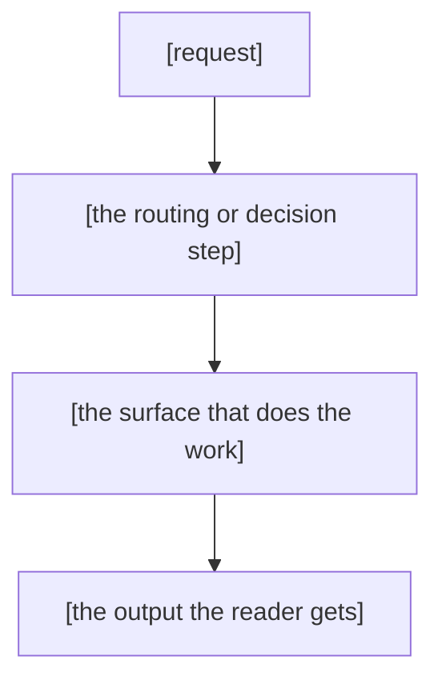

# Skill README Template

Use this template for `.skilled/skills/[skill-name]/README.md`. It writes a skill README in the same narrative voice the repo root `README.md` and the changelogs use: a one-line human pitch, an at-a-glance table near the top, a value-first overview, then quick start, navigation and a verification close.

---

## 1. OVERVIEW

### Purpose

Give a person a fast, honest orientation to a skill before they open `SKILL.md`. The README answers what outcome the skill delivers, when to reach for it, what it does not own and how to navigate its files. `SKILL.md` stays the runtime instruction surface. The README is the front door a person reads.

### Identity Guidance (Purpose First)

The identity of a skill is the outcome it delivers. State that outcome in one plain sentence before naming tools.
Describe CLIs, commands, routing paths and reference files only after the outcome.
A README that opens with a tool name has not stated its identity.

The mcp-obsidian README states the outcome first: it makes AI use inside Obsidian effective.
It names the CLIs and MCP server later as delivery surfaces.
Repeat the outcome in the frontmatter description and the pitch.
The description supports a quick scan. The pitch opens the full README.

### Usage

Copy the fillable scaffold in Section 6 into `.skilled/skills/[skill-name]/README.md`, then replace every placeholder with current behavior taken from the skill's real files. Keep the numbered ALL-CAPS section headers, the house style and the validator both require them. Drop any section that does not earn its place and renumber the rest.

### Template Focus

The README gives people a human entry point, current capabilities and a clear route to supporting files. This template provides:

- A one-line pitch in a blockquote right after the H1, stating the outcome before any tool name.
- An identity guidance block that puts the delivered outcome ahead of the tooling.
- A capability section pattern for a skill's headline strengths, modeled on the pilot's Plugin Knowledge Layer.
- A dedicated HVR enforcement section with the banned forms and the scripted checks.
- Versioning conventions and a validation checklist that matches the pilot's gates.

---

## 2. SECTION MODEL

A skill README uses numbered ALL-CAPS H2 sections with `---` dividers between them. The default order:

| # | Section | Purpose | Keep When |
|---|---------|---------|-----------|
| 1 | AT A GLANCE | Four-row table a reader scans in five seconds | Always |
| 2 | OVERVIEW | What the skill is and what the reader gets first, then the optional problem narrative | Always (required by the validator) |
| 3 | QUICK START | The fastest path to a first result | Skill has commands, scripts or a workflow |
| 4 | HOW IT WORKS | The main workflow in prose, with a small Mermaid diagram for multi-step flows | Skill has non-obvious behavior worth explaining |
| 5 | INTEGRATION & NAVIGATION | When to use it, plus how it hands off to sibling skills | Readers can confuse it with a neighbor |
| 6 | TROUBLESHOOTING | The failure modes operators actually hit | Predictable issues exist |
| 7 | FAQ | The two to five questions readers keep asking | High-value answers exist |
| 8 | VERIFICATION | How you know the skill works | Skill ships a playbook or validation command |
| 9 | RELATED DOCUMENTS | Stable links out, `SKILL.md` first | Always when links exist |

`OVERVIEW` is the one required section. Its normalized name must appear as a numbered header so the validator finds it. Every other section is optional. A small utility skill might run four sections (AT A GLANCE, OVERVIEW, QUICK START, RELATED DOCUMENTS). A large orchestrator might run all nine. Match the count to the skill. Never pad to hit a number.

Inside OVERVIEW, start with `### What It Does`. Say what the skill is and what the reader gets.
Add up to two optional subsections after it.
Use `### Why This Skill Exists` only to name a current reader problem.
Add the capability section below when it earns a table.

### Capability Section Pattern

When a skill has a headline strength, add a named capability section after What It Does.
Use one or two short sentences to say why the strength matters.
Use an analogy only when it clarifies the mechanism.
Name the section after its domain and add one table row per capability.
State the file or data the skill can operate on.
Avoid marketing claims. The prose explains why the capability matters. The table states what it does.

```markdown
### The Plugin Knowledge Layer

| Plugin | What the skill knows how to operate |
|---|---|
| **Beancount Ledger** | append and patch balanced transactions in the structured `.beancount` ledger |
| **Obsidian Tables** | edit `columns`, `rows` and `views` inside `.table.md` JSON payloads |
```

---

## 3. WRITING RULES

- Apply the [Prose Clarity Checklist](../../references/skill/creation-workflow.md#prose-clarity-checklist) to README prose.
- State the outcome before the tooling. The pitch and the identity guidance name what the reader gets. The tool names follow as the means.
- Open OVERVIEW with what the skill is and what the reader gets.
- Use `### Why This Skill Exists` only to explain a current reader problem.
- Add a short context hook after the blockquote only when it helps the reader. Keep AT A GLANCE as the first numbered section.
- Carry the explanation in prose. Reach for a table only when 4 or more parallel items need a lookup grid (skill relationships, CLI flags, a comparison).
- Use semantic emoji only (✅ ❌ ⚠️ 🔒 🚨) for rules and status markers. Decorative section emoji never: that register belongs to the repository front-page README, while a skill README keeps the technical formatting.
- A short, concrete analogy can carry an abstract mechanism better than adjectives (the repo root README uses "like a lab notebook for software"). Use one only where it clarifies, never as decoration.
- Put the AT A GLANCE table first. Four rows, one line each, no prose cells.
- Name the canonical command or entry point in OVERVIEW or QUICK START so a reader knows where to start.
- Link to real files under `references/`, `assets/`, `scripts/`, `feature-catalog/` or `manual-testing-playbook/`. Verify each path resolves.
- State the expected output for every command you show, so a reader can tell success from failure.
- Be honest about boundaries and trade-offs. If the skill does not own something, say which skill does.
- Keep `SKILL.md` as the runtime surface. The README explains why and how to navigate. It does not restate long reference files.
- Follow the Human Voice Rules. Section 4 lists the banned forms and the scripted checks. It links the full ruleset.
- Vary subsection counts rather than defaulting to three.
- Document current behavior. Keep spec history out of the README.
- Use stable paths and commands. Update the README, its version and its changelog entry when behavior changes.

---

## 4. HVR ENFORCEMENT

Every README this template produces must pass the Human Voice Rules. The full ruleset lives at [`hvr-rules.md`](../../../sk-create-with-human-voice/references/hvr-rules.md).

### Banned Forms

The banned forms are: em dashes (U+2014), semicolons (U+003B), Oxford commas (a comma before the final and or or in a list), the hard-blocker words listed below and forced three-item groups.

### Scripted Checks

Run the checks below from the skill root, with the README path as the argument. Each command must return zero matches. The punctuation checks use hex escapes on purpose: the commands stay clean of the characters they enforce.

```bash
rg -n '\x{2014}' README.md
rg -n '\x{3B}' README.md
rg -n ',\s+(and|or)\b' README.md
rg -n '\b(delve|embark|realm|tapestry|illuminate|unveil|elucidate|abyss|revolutionise|game-changer|groundbreaking|cutting-edge|ever-evolving|shed light|dive deep|leverage|foster|nurture|resonate|empower|disrupt|curate|harness|elevate|robust|seamless|holistic|synergy|unpack|landscape|ecosystem|journey|paradigm|enlightening|esteemed|remarkable|skyrocket|skyrocketing|utilize|utilizing)\b' README.md
# Context-dependent words: landscape, ecosystem, journey, unlock, navigating
# Banned as metaphor, allowed in literal use. Judge each hit in context.
```

The word check lists the hard blockers. A hit inside a code sample or a quoted command is exempt. A hit in prose is a violation. Context-dependent words from the full ruleset are banned as metaphor and allowed in literal use. Judge each hit in context.

Forced three-item groups are the fifth banned form. No exactly-three inline enumerations: use 2, 4 or 5 items. Tables and bullet lists are exempt. No exactly-three H3 subsections under every H2: vary the count.

---

## 5. VERSIONING CONVENTIONS

Every skill README carries a version in its frontmatter: `version: X.Y.Z.W`, the same 4-part scheme `SKILL.md` uses. Bump the README version on every release, whether the change touched the README text or the skill it documents. The README states the current state, so a behavior change is a README change even when the prose barely moves.

Every release gets a per-skill changelog entry at `changelog/<version>.md`. The entry follows the shared [changelog template](../../../sk-create-changelog/assets/changelog-template.md) and its message-release shape: NEW covers what arrived, CHANGED covers what moved, NOT CHANGED covers what stayed untouched.

`SKILL.md` and the README carry versions that move together. A skill release bumps both files. The changelog entry records the new version.

---

## 6. FILLABLE SCAFFOLD

Copy this into `.skilled/skills/[skill-name]/README.md`, fill every placeholder from the skill's real files, then remove sections that do not fit and renumber.

````markdown
---
title: "[skill-name]"
description: "[One sentence. The outcome the skill delivers, stated before any tool name, then who reaches for it.]"
trigger_phrases:
  - "[primary routing phrase]"
  - "[secondary routing phrase]"
version: 1.0.0.0
---

# [skill-name]

> [One line. The delivered outcome, in plain words a person would say out loud, stated before any tool name.]

[Optional. Add one or two sentences about the reader's current need before the scan table. Delete this for a small utility skill. AT A GLANCE stays the first numbered section.]

---

## 1. AT A GLANCE

| Aspect | What you get |
|---|---|
| **Use it for** | [The problem it solves, one line.] |
| **Invoke with** | [Trigger keywords, command or routing path.] |
| **Works on** | [Inputs, surfaces or scope.] |
| **Produces** | [The artifacts or decisions it returns.] |

---

## 2. OVERVIEW

### What It Does

[Write two to four short sentences. Say what the skill is and what the reader gets.
Name the canonical command or entry point. If a sibling skill is easy to confuse with this one, explain the boundary.]

### Why This Skill Exists

[Optional. In two to four short sentences, name the reader's current problem and how the skill helps.
Delete this subsection when What It Does already makes the outcome clear.]

### [The [Domain] Knowledge Layer]

[Optional. Present when the skill has a headline strength worth a dedicated table. Name the layer after the domain. Model: the pilot's Plugin Knowledge Layer.]

[Write one or two short sentences about why this strength matters.
Use an analogy only when it clarifies the mechanism.]

[Then the table. One row per capability, each row stating what the skill can actually operate at the file or data level. The table carries the what.]

| [Capability] | What the skill knows how to operate |
|---|---|
| [Name] | [The concrete operation, one line.] |
| [Name] | [The concrete operation, one line.] |

---

## 3. QUICK START

**Step 1: Invoke it.** [Automatic routing, a slash command or the manual read path.]

**Step 2: Run the primary workflow.**

```bash
[command]
```

[What success looks like in one line.]

**Step 3: Verify before you rely on it.**

```bash
[verification-command]
```

[Expected exit code or output.]

---

## 4. HOW IT WORKS

[Narrate the lifecycle or main workflow as prose: the sequence of steps, the decision points and the outputs. A reader should finish this section understanding the shape of the skill.]

[For any skill with a multi-step flow, include a small Mermaid diagram that shows how the pieces connect. Keep it to the boxes a reader needs. Drop the diagram for a genuinely linear one-step skill.]



### [Key Concept]

[Explain one behavior that is not obvious from the name, with a concrete example.]

---

## 5. INTEGRATION & NAVIGATION

### When To Use This Skill

[Two to four real scenarios. Where the boundary with an adjacent skill is fuzzy, say which skill owns what so a reader does not misroute.]

### Related Skills

| Skill | Relationship |
|---|---|
| `[skill]` | [How the two hand off.] |

---

## 6. TROUBLESHOOTING

| What you see | Why | Fix |
|---|---|---|
| [Symptom] | [Cause] | [Action] |

---

## 7. FAQ

**Q: [The question a reader actually asks, including "why this instead of X".]**

A: [A short, direct answer. Link a stable file when it helps.]

---

## 8. VERIFICATION

[For skills that ship a manual testing playbook or validation commands. List the checks that prove the skill works, plus the one command that runs them all. Remove this section for a small skill.]

| Check | Result |
|---|---|
| README structure | [the readme validator command] reports zero issues |
| [Test or gate] | [How to run it. What a pass looks like.] |

---

## 9. RELATED DOCUMENTS

| Document | Purpose |
|---|---|
| [`SKILL.md`](./SKILL.md) | Runtime instructions and routing logic |
| [`references/[name].md`](./references/[name].md) | [Why it matters] |
| [`assets/[name].md`](./assets/[name].md) | [How it is used] |
````

---

## 7. VALIDATION CHECKLIST

Each check has a pass criterion. A check only passes when its criterion holds, not when the file merely looks close.

| # | Check | Pass criterion |
|---|---|---|
| 1 | Pitch | H1 is followed by a one-line blockquote stating the delivered outcome |
| 2 | AT A GLANCE | First section, four rows, one line each |
| 3 | Numbered ALL-CAPS H2 | Every H2 is numbered sequentially with `---` dividers |
| 4 | OVERVIEW required | A numbered OVERVIEW section exists and opens value-first: what the skill delivers before any feature list |
| 5 | Command output expectations | Every command block shows its expected output |
| 6 | Link verification | Every relative link resolves on disk |
| 7 | HVR clean | The four greps in Section 4 return zero matches outside code fences |
| 8 | Validator | `python3 .skilled/skills/sk-doc/scripts/validate_document.py <readme> --type readme` reports zero issues |
| 9 | Optional sections | Sections without real content were removed and the rest renumbered |
| 10 | Optional problem context | When `### Why This Skill Exists` is present, it names the reader's current problem and the skill's outcome |
| 11 | Connection diagram | A multi-step skill includes a small Mermaid diagram of how the pieces connect |

Pass criteria in full:

| # | Pass criterion |
|---|---|
| 1 | A reader can say the outcome aloud from the pitch alone, without reading further. The pitch names no tool before the outcome. |
| 2 | The table has exactly four Aspect rows and no cell wraps to a second line. |
| 3 | `rg -n '^## [0-9]+\. ' README.md` lists every H2 in ascending order. Every title is ALL CAPS. |
| 4 | The validator reports zero issues. The first OVERVIEW paragraph names what the skill delivers before any feature list. |
| 5 | A reader can tell success from failure without running the command. |
| 6 | Each target path exists relative to the README folder. |
| 7 | The em dash, semicolon, Oxford comma and banned-word greps report no prose hits. |
| 8 | The command exits 0 and reports zero issues. |
| 9 | The final section numbers run in order with no gaps. |
| 10 | Optional problem context names the reader's current problem and the skill's outcome in two to four short sentences. |
| 11 | Skills with more than one step in HOW IT WORKS carry a Mermaid diagram. A single-step utility skill is exempt. |

> The validator is a floor, not a proxy for this checklist. It enforces a numbered ALL-CAPS H2 named OVERVIEW and little else. It does not check the pitch, the AT A GLANCE table, command outputs, links or HVR. A green run means the file cleared the floor, not that it passed the nine checks above.

---

## 8. DIRECTIVE CROSS-CHECK

The pilot README work distilled eight writing directives. Every directive has a home in this template. This table maps each one to its location so no pilot lesson goes missing.

| Pilot directive | Template home | What the home says |
|---|---|---|
| Purpose-first identity | Section 1 Identity Guidance, Section 6 pitch and description placeholders | The outcome statement opens the README. The tooling is named after it as the means. |
| Value-first OVERVIEW | Section 2 OVERVIEW row, Section 6 What It Does | What the skill is and what the reader gets come before any feature list, modeled on the root README SUMMARY section. The problem narrative is optional. |
| One-line pitch | Section 3 first bullet, Section 6 blockquote | H1 is followed by a one-line blockquote stating the outcome in plain words. |
| Narrative prose | Section 3 Writing Rules | Prose carries the explanation. Tables appear only for genuine lookups. |
| Template structure | Section 2 Section Model, Section 6 scaffold | Numbered ALL-CAPS H2 with `---` dividers, AT A GLANCE first, OVERVIEW the only required section. |
| Human Voice Rules | Section 4 HVR Enforcement, Section 7 HVR row | Banned forms listed verbatim, scripted checks, link to hvr-rules.md. |
| Honest boundaries | Section 3 boundaries bullet | What the skill does not own is stated, with the sibling skill that owns it. |
| Current state only | Section 3 current-state bullet, Section 5 Versioning | Current behavior with stable paths. Version and changelog move with every release. |

---

## 9. RELATED RESOURCES

- [`readme-template.md`](../../../sk-create-readme/assets/readme-template.md) - General README scaffold this skill template narrows.
- [`creation-workflow.md`](../../references/skill/creation-workflow.md) - Skill creation workflow and lifecycle guidance.
- [`skill-md-template.md`](./skill-md-template.md) - Runtime `SKILL.md` scaffold.
- [`skill-reference-template.md`](./skill-reference-template.md) - Reference-file scaffold.
- [`hvr-rules.md`](../../../sk-create-with-human-voice/references/hvr-rules.md) - Human Voice Rules, the voice this template writes in.
- [`changelog-template.md`](../../../sk-create-changelog/assets/changelog-template.md) - Changelog entry format every skill release follows.
