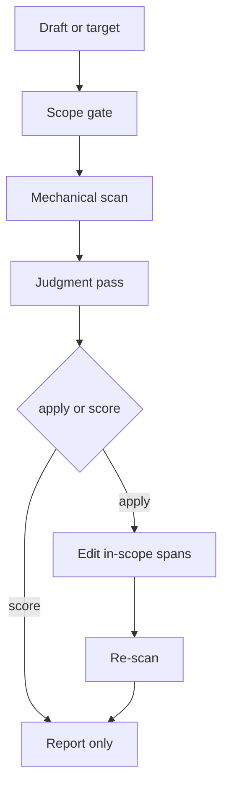

# create-with-human-voice

> Bring a draft up to the Human Voice Rules, or report how far off it is without changing a byte.

---

## 1. OVERVIEW

### At a Glance

| Aspect | What you get |
|---|---|
| **Use it for** | Applying the Human Voice Rules to prose, or scoring it without edits |
| **Invoke with** | `@markdown /create:with-human-voice`, or a routed voice request |
| **Works on** | A file, a passage, a reply or a template payload |
| **Produces** | An edited target with both scan numbers, or a report alone |

### What It Does

`create-with-human-voice` brings a draft up to the Human Voice Rules, or reports how far off it is without an edit.
The command is `@markdown /create:with-human-voice <target>`, and its default operation is `score`.
The standard lives at `references/hvr-rules.md`, and `scripts/hvr_scan.py` parses it on every run, so the packet holds no second copy of the term lists.
Structure, the Document Quality Index, validators and naming checks belong to [the document quality audit](../sk-create-quality-control/SKILL.md).
This mode owns the voice pass.

---

## 2. QUICK START

**Step 1: Invoke it.** `@markdown /create:with-human-voice <target>` starts the command. The default operation is `score`, which reports and never edits. Add `apply` to rewrite in place. The command hard-blocks without the `@markdown` agent.

**Step 2: Scan before you read.**

```bash
python3 .skilled/skills/sk-doc/sk-create-with-human-voice/scripts/hvr_scan.py <target>
```

Expected output: a grouped finding list, the hard-blocker count, the mechanical deductions, a mechanical ceiling and the list of categories the scanner did not check.
Exit 0 means no hard blocker, exit 1 means at least one and exit 2 means the run could not read the standard or the target.

**Step 3: Read the judgment list.** The scanner cannot settle three-item enumerations, triple headers, setup language, synonym cycling, false ranges, fragmented headers, copula avoidance, significance inflation, generic conclusions, sentence rhythm or personality. It prints that list on every run, so a clean mechanical result stays visibly partial.

**Step 4: Re-scan after an edit.** Run the same command on the rewritten text and report both numbers. A run that reports only its final number has proved nothing.

---

## 3. HOW IT WORKS

The scope gate runs first. It asks whether the document's author chose these words and is free to choose different ones. A no on either count puts the span out of scope. The pass names every exempt span in its report, because an exemption nobody recorded reads as an oversight.

The scanner runs next. It parses the term lists out of the standard on every run: the hard words, the phrase blockers, the soft deductions and the punctuation bans. It masks frontmatter, fenced blocks, inline code spans and HTML entities before it looks, so a code sample does not produce findings. Findings are candidates, not verdicts, because the scanner matches spelling and a word's sense decides.

A reader then settles the judgment pass: structure, sentence habits, content habits and voice. Nothing in that list can be checked by a pattern.

Scoring starts at 100. One occurrence costs one penalty and the first match wins. A longer phrase beats a shorter term inside it. A score of 85 or higher is publish-ready. A score from 70 to 84 needs a revision before it ships. Below 70 means a rewrite. For a document past roughly 400 lines, report the hard-blocker count and the deduction density instead of an absolute score.

An `apply` run edits only in-scope spans, fixes hard blockers before soft deductions and leaves every exempt span untouched. It then re-runs the scanner on the new text and reports both numbers.



### A Finding Is a Candidate

Scanning the [two-senses fixture](./scripts/tests/fixtures/voice-two-senses.md) finds two hard blockers. Both are the word `harness`, once as the noun for a test rig and once as the verb the standard bans. The noun is the literal sense the standard permits, so the right result is one recorded exemption and one edit. The scanner over-reports on purpose, because a missed hard blocker costs more than a candidate a reader dismisses in a second.

---

## 4. INTEGRATION & NAVIGATION

### When To Use This Mode

Reach for it when a draft reads as machine-written, when a document is about to ship and needs a voice pass, when someone asks how a passage scores without wanting edits or when a new document should carry the standard from its first sentence.

Skip it when the target needs a structural audit. Skip it when the artifact does not exist yet. Skip it too when the text is code, output, a quotation or a generated file. A request about brand tone belongs elsewhere too. Accuracy outranks the standard. A banned word that carries the claim stays, and the report records why.

### Related Skills

| Skill | Relationship |
|---|---|
| `sk-create-quality-control` | Owns the file-level audit: structure, DQI, validators and naming checks. It links this packet's standard for its own voice review |
| `sk-create-readme` | Owns README structure. Its template points the prose it shapes at this standard |
| `sk-doc` | The parent hub that routes a voice request to this packet |

---

## 5. TROUBLESHOOTING

| What you see | Why | Fix |
|---|---|---|
| A hard blocker on a word used in its literal sense | The scanner matches spelling, not meaning | Record an exemption and leave the sentence alone |
| `exit 2` and a message about a thin parse | The standard's section headings moved and the parser found too few terms | Fix the parser before any scan can be trusted |
| A finding inside a fenced block | `--include-code` was passed, or a template payload fence was read as prose | Drop the flag, or check whether the fence is the template's payload |
| A negative score on a long reference | The 100-point scale assumes a piece, not a reference of several hundred lines | Report hard blockers and deduction density instead |
| Findings on `hvr-rules.md` itself | The file lists every banned term | Report the target as self-referential and never quote a bare score |

---

## 6. FAQ

### Does a clean scan mean the document passes?

No. The scanner covers punctuation and the term lists. Structure, rhythm, synonym cycling, significance inflation and personality need a reader. Every run prints the categories it did not check.

### Why does the scanner flag a word I used correctly?

It matches spelling, not sense. `harness` as a noun for the runtime and `landscape` in photography are the literal senses the standard allows. The finding is a candidate. You decide, and record an exemption when you keep the word.

### What happens when the standard and accuracy disagree?

Accuracy wins. When removing a banned word would change what the sentence claims, the sentence stays and the report records an accepted exception with the reason.

### Can I scan text that is not in a file?

Yes. Pass `-` as the target and pipe the text in on stdin. Frontmatter and fence masking run the same way.

---

## 7. VERIFICATION

Run these from the repository root. Each control is read-only.

| Check | How to run it | What a pass looks like |
|---|---|---|
| Dirty fixture | `python3 .skilled/skills/sk-doc/sk-create-with-human-voice/scripts/hvr_scan.py .skilled/skills/sk-doc/sk-create-with-human-voice/scripts/tests/fixtures/voice-dirty.md` | 6 hard blockers, -33 deductions, 67/100, exit 1 |
| Clean fixture | `python3 .skilled/skills/sk-doc/sk-create-with-human-voice/scripts/hvr_scan.py .skilled/skills/sk-doc/sk-create-with-human-voice/scripts/tests/fixtures/voice-clean.md` | `no mechanical findings`, 100/100, exit 0 |
| Scanner tests | `python3 .skilled/skills/sk-doc/sk-create-with-human-voice/scripts/tests/test_hvr_scan.py` | One `PASS` line per check, then `ALL PASS`, exit 0 |
| Packet contract | `python3 .skilled/skills/sk-doc/sk-create-skill/scripts/package_skill.py .skilled/skills/sk-doc/sk-create-with-human-voice --check --strict` | `Result: PASS`, exit 0 |
| Unreadable standard | `python3 .skilled/skills/sk-doc/sk-create-with-human-voice/scripts/hvr_scan.py .skilled/skills/sk-doc/sk-create-with-human-voice/scripts/tests/fixtures/voice-clean.md --rules /nonexistent-rules.md` | `cannot read the standard`, exit 2 |

---

## 8. RELATED DOCUMENTS

| Document | Purpose |
|---|---|
| [`SKILL.md`](./SKILL.md) | Runtime instructions, the apply and score orderings, the always and never rules |
| [`ROUTER.md`](./ROUTER.md) | Machine router: intent map, resource map and loading levels |
| [`references/README.md`](./references/README.md) | Which reference loads first, and what each one covers |
| [`references/scope-and-exemptions.md`](./references/scope-and-exemptions.md) | Which spans the standard governs and the classes never in scope |
| [`references/scoring-and-verification.md`](./references/scoring-and-verification.md) | Pass order, precedence arithmetic, the bands and the re-scan |
| [`references/hvr-rules.md`](./references/hvr-rules.md) | The standard itself, parsed at run time by the scanner |
| [`references/hvr-publish-supplement.md`](./references/hvr-publish-supplement.md) | Point values, precedence and the pre-publish checklist |
| [`assets/voice-report-template.md`](./assets/voice-report-template.md) | The fixed shape of a voice-pass result |
| [`scripts/hvr_scan.py`](./scripts/hvr_scan.py) | The mechanical pass |
| [`manual-testing-playbook/manual-testing-playbook.md`](./manual-testing-playbook/manual-testing-playbook.md) | Operator scenarios across tell detection, the scope gate and scoring |
