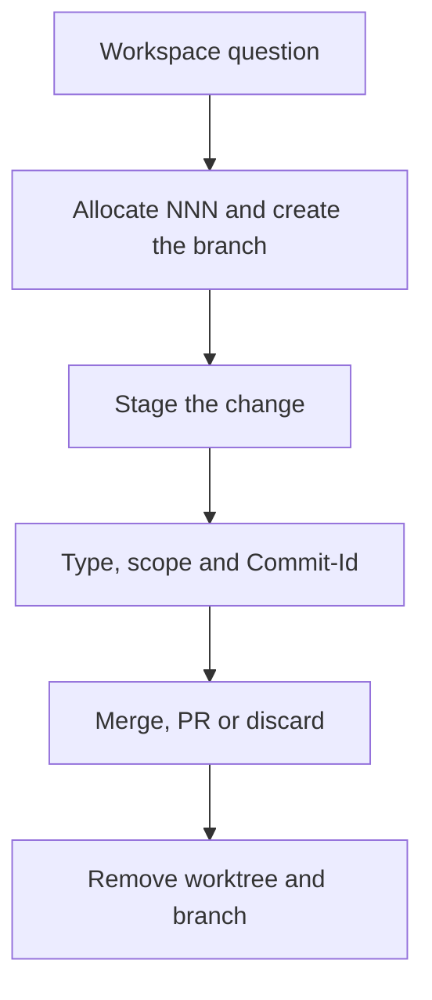

# sk-git

> Go from a clean workspace to a merged pull request, where branch numbers and commit wording follow rules you never have to remember.

---

## 1. OVERVIEW

### At a Glance

| Aspect | What you get |
|---|---|
| **Use it for** | Git work in a shared repository, from setup to a merged or discarded branch |
| **Invoke with** | Git keywords: worktree, commit, pull request, merge, finish |
| **Works on** | A cloned repository, a staged change or finished work |
| **Produces** | A numbered branch, a reproducible commit subject and a clean checkout |

### What It Does

sk-git holds the rules a repository needs when several sessions work in it at once. It asks which workspace you want before it creates anything. Then it names the branch from a locked counter, shapes the commit subject from the staged paths and closes the work with a merge, a pull request or a discard. You keep the decisions a script cannot own. The mechanical parts stop drifting.

The runtime surface is `SKILL.md`. The router beside it decides which reference file loads for the request in front of you.

### What It Does Not Own

sk-git does not write the change or file the paperwork around it. `sk-code` owns the code and its tests. `system-spec-kit` owns the spec folder and the continuity notes inside it. `sk-doc` owns documentation quality, PR wording and release notes.

### The Numbered Workspace Contract

Two flat namespaces replace a hand-picked branch name. `worktrees/` and `branches/` each count on their own and never reuse a number.

| Capability | What the skill does |
|---|---|
| **Numbered names** | `worktrees/NNN-slug` for a branch with a worktree, `branches/NNN-slug` for one without |
| **Locked allocator** | Takes a lock in the shared git directory and seeds the next number from the stored mark, every matching ref and every registered worktree |
| **Ask-first workspace** | Puts the worktree or current-branch choice to you and holds your answer for the session |
| **Launch wrapper** | Puts each opted-in top-level session in its own worktree, on its own branch, with its own MCP databases |
| **Live branch sync** | Publishes each wrapper commit to one shared branch, so your editor follows at commit granularity |
| **Commit contract** | Names the type and scope from the staged paths, then holds subject, body and trailer to the rules |
| **Preflight advisory** | Prints the rule a risky git command would break, at command time and without blocking it |
| **Refusals** | Blocks a hook bypass, a secret in the diff, an amend of published work and a force push to main |

---

## 2. QUICK START

**Step 1: Say what you want.** A request that names a worktree, a commit, a pull request, a merge, GitKraken or GitLens lands here. `references/quick-reference.md` loads first, then the phase reference for the winning intent.

**Step 2: Answer the workspace question.** The skill never picks a workspace for you. Choose an isolated worktree for parallel or long-running work. Stay on the current branch for a small fix. Your answer holds for the rest of the session.

**Step 3: Create the numbered workspace.**

```bash
bash .skilled/skills/sk-git/scripts/worktree-naming.sh create add-oauth-login
```

It prints the new branch and the directory it created, separated by a space, such as `worktrees/007-add-oauth-login /repo/.worktrees/007-add-oauth-login`. The number comes from the allocator, so never type one by hand.

**Step 4: Check a name before you trust the grammar.**

```bash
bash .skilled/skills/sk-git/scripts/worktree-naming.sh validate-branch branches/003-external-dep
```

It prints `ok` and exits 0. A name outside the grammar prints `invalid` and exits 1.

**Step 5: Commit.** The `commit-msg` hook checks the subject, the body and the trailer. The `prepare-commit-msg` hook stamps the `Commit-Id:` line, so leave that line out of the message you write.

---

## 3. HOW IT WORKS

A git task moves through three phases. Setup gives the work a numbered branch and a directory of its own. The work phase turns a staged diff into a message the contract accepts. Finish checks the tests, then merges, opens a pull request or throws the branch away. Cleanup removes what the branch left behind.

Nothing past `references/quick-reference.md` loads until an intent selects a phase reference. A request whose keywords barely score loads the shared patterns and asks a short checklist instead of guessing.



### The Number Allocator

Git cannot hand out a sequential number on its own, so the allocator takes a lock in the shared common git directory. It reads the namespace's stored high-water mark first, then every matching local and remote ref. For `worktrees/` it also reads every registered worktree folder. A second session waits on the lock instead of reading the same maximum. That is why a partial scan cannot reissue a live number. A deleted middle number is never back-filled.

Numbers run 001 to 999 per namespace. The two namespaces count separately. `allocate` reserves a number and `create-branch` reserves one with a branch to match. `create` adds the worktree around it. `next` previews a number without taking the lock.

### The Commit Contract

An authored subject follows `type(scope)[!]: imperative summary`. The type comes from a fixed order that starts with release, then docs, then fix, then feat. The scope comes from the owning path, so a file under `.skilled/skills/sk-git/` takes `sk-git`. The subject targets 80 characters and is refused past 100.

Every authored commit carries a body. Packet work adds a `Spec:` trailer, which the packet query finds by anchoring on that line. The `Commit-Id:` ordinal is stamped, never typed. It survives an amend unless the message is replaced with `-m`. A cherry-pick mints a fresh one.

---

## 4. INTEGRATION & NAVIGATION

### When To Use This Skill

Reach for sk-git when the task touches a branch rather than the code inside it:

- Starting new work that needs an isolated workspace.
- Turning a staged change into a commit that survives review.
- Finishing through a merge, a pull request or a discard.
- Recovering a checkout that is dirty, diverged or stuck.

Use `gh` when you need simple PR creation or CI run status and logs. Use the GitHub MCP when you need structured PR reviews or issue fields. For a remote that is not GitHub, the GitKraken manual covers the same remote calls.

### Related Skills

| Skill | Relationship |
|---|---|
| `system-spec-kit` | Owns the spec folder and continuity. sk-git records the packet in the `Spec:` trailer. |
| `sk-code` | Owns code and tests. sk-git commits and integrates the result. |
| `sk-doc` | Owns documentation quality, PR wording and release notes. |

---

## 5. TROUBLESHOOTING

| What you see | Why | Fix |
|---|---|---|
| `git worktree remove` refuses | A locked directory or a previous worktree left behind | Run `git worktree prune`, then retry |
| A conflict will not resolve | The two sides disagree in a way a person must settle | Escalate. The skill does not settle a semantic conflict for you |
| The GitHub MCP returns an authentication error | The token expired or lacks the scopes the call needs | Regenerate the token with the repo, issues and pull_requests scopes, then update `.utcp_config.json` |
| A branch sits more than 50 commits behind its base | The branch fell behind the base branch | Merge or rebase the base in before you open a PR |
| A bare worktree reports a clean run over zero files | The worktree has no gitignored dependencies, so the run did nothing | Run the toolchain on `main` after the merge |
| A rule the hooks enforce is wrong | The rules live in the repository's own template copies | Run `/doctor:git standards` to change the rule. `/doctor:git hooks` switches a gate |

---

## 6. FAQ

### Why does it ask about the workspace every time?

Workspace strategy has real consequences. An unnecessary worktree adds overhead. Staying in place when parallel work is coming causes conflicts. Context alone does not settle which is right, so the skill asks.

### Why can I not create a branch by hand?

A bare branch has no workspace behind it. A hand-typed branch skips the numbered allocator, so two sessions can claim the same number. Use `create` for a branch with a worktree. Use `create-branch` for a numbered branch without one. For an in-place branch, choose the current-branch option and skip setup.

### Why an allocator instead of the next free number?

Several sessions allocate at the same moment. Picking a number by eye races: two sessions read the same maximum and both claim it. The allocator holds a clone-wide lock and seeds from the high-water mark plus every ref, so a live number is never reissued.

### What happens when published work needs a fix?

Amend only what has not left your clone. Once a commit is pushed or merged, write a new commit or revert it, because a rewrite breaks other clones and any autosynced live branch.

---

## 7. VERIFICATION

The skill ships a manual playbook with a folder per feature area, plus a test suite for the allocator and the message contract.

```bash
python3 .skilled/skills/sk-doc/scripts/validate_document.py .skilled/skills/sk-git/README.md --type readme
```

It prints `✅ VALID` and `Total issues: 0`, then exits 0.

| Check | How to run it | Pass signal |
|---|---|---|
| Allocator grammar | `bash .skilled/skills/sk-git/scripts/tests/worktree-naming.test.sh` | The last line reads `worktree-naming tests: PASS=<n> FAIL=0` |
| Commit ordinals | `bash .skilled/skills/sk-git/scripts/tests/commit-id-naming.test.sh` | The last line reads `commit-id-naming tests: PASS=<n> FAIL=0` |
| Message contract | `bash .skilled/scripts/git-hooks/tests/commit-msg.test.sh` | The last line reads `PASS=<n> FAIL=0` |
| Live behavior | Scenario files under `manual-testing-playbook/` | Each run ends PASS, FAIL or SKIP with a reason |

---

## 8. RELATED DOCUMENTS

| Document | Purpose |
|---|---|
| [`SKILL.md`](./SKILL.md) | Runtime rules and the full contract |
| [`ROUTER.md`](./ROUTER.md) | Intent map, resource map and loading levels |
| [`references/quick-reference.md`](./references/quick-reference.md) | Command cheat sheet that loads on every invocation |
| [`references/worktree-workflows.md`](./references/worktree-workflows.md) | Workspace creation, directory choice and branch strategy |
| [`references/commit-workflows.md`](./references/commit-workflows.md) | Artifact filtering, commit strategy and scoped staging |
| [`references/finish-workflows.md`](./references/finish-workflows.md) | Test gate, merge, PR, cleanup and release notes |
| [`references/continuous-integration.md`](./references/continuous-integration.md) | The shared live branch and its autosync loop |
| [`references/remote-branch-policy.md`](./references/remote-branch-policy.md) | Push allowlist, approval forms and the autosync exemption |
| [`references/shared-patterns.md`](./references/shared-patterns.md) | Commands and conventions shared by every workflow |
| [`references/unstick-dirty-worktree.md`](./references/unstick-dirty-worktree.md) | Recovery for a jammed, dirty or behind checkout |
| [`references/github-mcp-integration.md`](./references/github-mcp-integration.md) | Remote PR, issue and CI calls through Code Mode |
| [`references/gitkraken-mcp-integration.md`](./references/gitkraken-mcp-integration.md) | GitLens AI and non-GitHub provider calls |
| [`references/large-reorg-playbook.md`](./references/large-reorg-playbook.md) | Large renames in a worktree, with the toolchain on main |
| [`assets/commit-message-template.md`](./assets/commit-message-template.md) | Subject, body and trailer shapes the hooks read |
| [`assets/pr-template.md`](./assets/pr-template.md) | The structure every PR description follows |
| [`assets/worktree-checklist.md`](./assets/worktree-checklist.md) | Step-by-step checklist for a safe worktree setup |
| [`scripts/README.md`](./scripts/README.md) | Allocator and validator surface |
| [`scripts/hooks/README.md`](./scripts/hooks/README.md) | How each runtime delivers the message gate and the preflight advisory, which Vibe does not run |
| [`feature-catalog/feature-catalog.md`](./feature-catalog/feature-catalog.md) | Every capability with its entry point |
| [`manual-testing-playbook/manual-testing-playbook.md`](./manual-testing-playbook/manual-testing-playbook.md) | Scenario index for live validation |
| [`../../commands/doctor/git.md`](../../commands/doctor/git.md) | The `/doctor:git` command behind the repository settings |

<!-- readme-check
allow-ref worktrees/ | a git branch namespace, not a folder
allow-ref branches/ | a git branch namespace, not a folder
allow-count zero files | a symptom of a no-op run, not an inventory
-->
