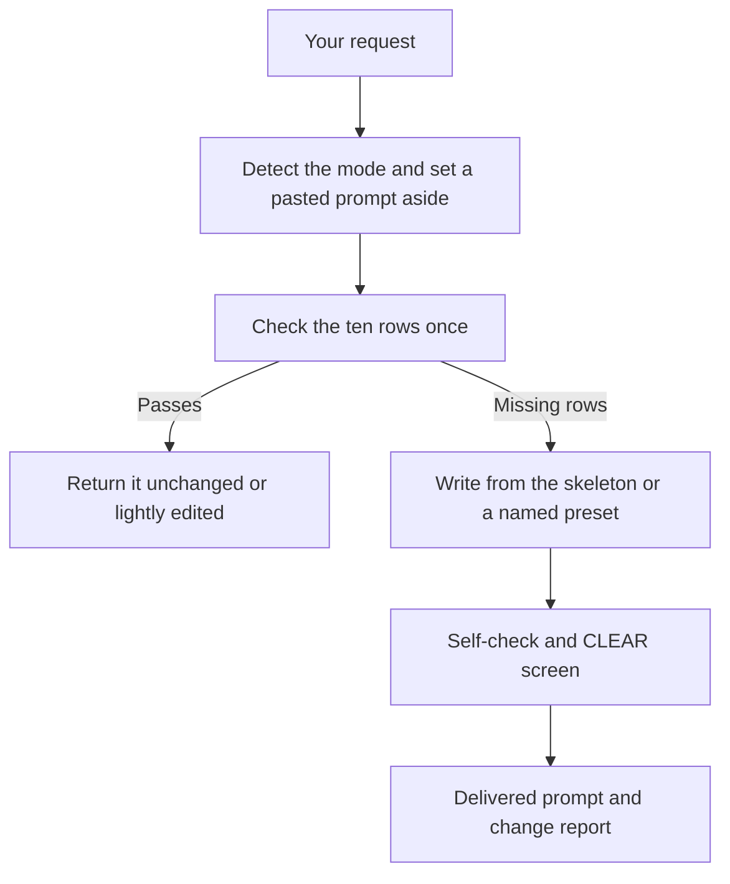

# sk-prompt

> Turn a rough request into a prompt that clears a fixed quality bar, with a short report of what changed and why.

---

## 1. OVERVIEW

### At a Glance

| Aspect | What you get |
|---|---|
| **Use it for** | Turning an under-specified request into a structured prompt that passes a fixed screen |
| **Invoke with** | `/prompt:improve` with a `$` mode prefix or the `@prompt-improver` agent |
| **Works on** | A draft prompt or a raw task, across generation, review, research, editing and analysis |
| **Produces** | The enhanced prompt first, then a transparency report with numbered open items and the change list |

### What It Does

`sk-prompt` improves a prompt in one pass. It reads the request against a ten-row checklist, writes from one component skeleton or an optional framework preset, then screens the draft with the CLEAR rubric. You reach it through the `/prompt:improve` command with a `$` mode prefix or through the `@prompt-improver` agent. It owns the prompt only, so `sk-code` takes code work and `sk-doc` takes documentation output.

### Why This Skill Exists

A vague prompt gets a vague answer. People leave out the audience and the constraints, then read the miss as a model failure. A fixed checklist and one score show the gap before the prompt is sent.

### The Framework Layer

Every prompt starts from one default skeleton: task, context, constraints, output format, optional examples and success criteria. The seven presets below are optional shapes. Apply one when the caller names it or when the task clearly matches its row, then name it in the change report. Nothing is scored to pick a preset.

| Preset | Elements | Best for |
|---|---|---|
| **RCAF** | Role, Context, Action, Format | General tasks and most prompts |
| **COSTAR** | Context, Objective, Style, Tone, Audience, Response | Content where style and audience matter |
| **RACE** | Role, Action, Context, Execute | Urgent tasks and quick iterations |
| **CIDI** | Context, Instructions, Details, Input | Process documentation and tutorials |
| **TIDD-EC** | Task, Instructions, Dos, Don'ts, Examples, Context | Quality-critical or compliance work |
| **CRISPE** | Capacity, Insight, Statement, Personality, Experiment | Strategy and exploration |
| **CRAFT** | Context, Role, Action, Format, Target | Complex projects and planning |

The definitions live in the [framework library](references/patterns-evaluation.md).

---

## 2. QUICK START

**Step 1: Invoke it.** Type `/prompt:improve` with a mode prefix and your prompt.

**Step 2: Run the primary workflow.**

```bash
/prompt:improve $text "Write a cold email for a SaaS CRM targeting mid-market sales leaders"
```

The reply opens with the enhanced prompt. Below it sits a transparency report that names the framework, the mode and effort, the dispatch target, the checklist counts, the quick test result and the five CLEAR scores. A status line closes the report with `STATUS=OK`, the score out of 50 and the framework name.

**Step 3: Pick a faster mode when the task is light.** Add `$short` for the four core checklist rows or `$raw` when the prompt needs no pass at all.

```bash
/prompt:improve $short "Rephrase this PR description for a non-technical reviewer"
```

The report shows `Effort: quick`. The pass then checks the four core rows: task, context, constraints and output format. `$raw` returns the prompt as written, with no checklist and no CLEAR score.

**Step 4: Verify the router before you rely on it.**

```bash
bash .skilled/skills/sk-prompt/benchmark/router/run-fixtures.sh
```

It prints `PASSED 19/19 fixtures` and exits 0.

---

## 3. HOW IT WORKS

A run moves through five stages. The first detects the mode from the command prefix or from your own words. It sets a pasted prompt aside so its text never picks the mode. The request is checked once against the ten rows. A prompt that already passes comes back unchanged or with the smallest edit you asked for. Otherwise the draft is written from the default skeleton or a named preset. The draft is checked once against its own success criteria, screened with CLEAR and delivered with the open items and the change report.



### The One-Pass Checklist

The checklist is a single reading, not a gate that repeats until clean. Each row is marked present or absent. A row that does not apply is marked not needed with a one-line reason. A row marked not needed is never added.

1. Task and requested outcome.
2. Role or audience, only when it changes the response.
3. Context and source facts the model needs.
4. Constraints, priorities and how conflicts between them resolve.
5. Steps, tools or process, only when the task needs them.
6. Output format, schema and length limits.
7. Examples when they help: at least 1, about 3 typical, at most 5, in `<example>` tags with identical formatting.
8. Success criteria, edge cases or a way to verify the answer.
9. Contradictions, assumptions and missing information.
10. Wording: plain instructions with the reason given. Soften CRITICAL and MUST rather than banning capitals.

Effort decides how much of the list runs. Quick checks the four core rows: task, context, constraints and output format. Standard checks all ten. Thorough checks all ten and attempts the quick test. `$raw` runs no pass at all.

### The CLEAR Rubric

CLEAR scores out of fifty points across five dimensions. A total of forty passes. Each dimension also has a floor that blocks a pass on its own.

| Dimension | Max | Floor | What it measures |
|---|---|---|---|
| Correctness | 10 | 7 | Facts, logic, no contradictions |
| Logic | 10 | 7 | Coherent structure and clear reasoning |
| Expression | 15 | 10 | Clarity, conciseness, word choice |
| Arrangement | 10 | 7 | Structure, flow, organization |
| Reusability | 5 | 3 | Fit for a similar task, template ready |

Below forty, the weakest dimension is repaired, up to three cycles. If the score is still short, the best version ships with a note naming the weakest dimension. CLEAR is a structural screen, not proof the prompt works.

### The Operating Modes

The mode comes from the command prefix. With no prefix, the run defaults to the interactive mode at standard effort.

| Mode | Command | Effort | Scoring |
|---|---|---|---|
| Interactive | none | standard | CLEAR |
| Text | `$text` | standard | CLEAR |
| Short | `$short` | quick | CLEAR |
| Improve | `$improve` | standard | CLEAR |
| Refine | `$refine` | thorough | CLEAR |
| JSON | `$json` | standard | CLEAR |
| YAML | `$yaml` | standard | CLEAR |
| Raw | `$raw` | none | none |

The prefix is authoritative. Two prefixes that disagree, such as `$raw` with `$json`, become one question to you rather than a guess.

The `@prompt-improver` agent runs the same rules in a fresh context. It returns a structured block with the framework, the CLEAR score, a rationale, the prompt and the escalation notes. It is read-only and leaf-only, so it never writes files or dispatches another agent.

---

## 4. INTEGRATION & NAVIGATION

### When To Use This Skill

Reach for `sk-prompt` when a prompt you are about to send feels vague, when you need a framework you rarely use, when you want a quality score before dispatch or when you are building a reusable prompt template. Skip it for a one-line fact lookup where structure adds nothing. A design-generation brief belongs here as well, because the brief is built from the framework library and the CLEAR rubric. The measured design-reference extraction stays with `sk-design-md-generator`. This skill does not own the run transport.

### Related Skills

| Skill | Relationship |
|---|---|
| `sk-code` | Takes the code work when a request is really about writing or debugging code |
| `sk-doc` | Takes the documentation output when the result is a spec doc or a README |
| `sk-design-md-generator` | Owns the measured design-reference extraction a design brief starts from |
| `system-skill-advisor` | Routes prompt-engineering requests here at Gate 2 |
| `cli-*` skills | Read the [CLI prompt quality card](assets/cli-prompt-quality-card.md) before dispatch and escalate here when a task crosses the fast-path threshold |

---

## 5. TROUBLESHOOTING

| What you see | Why | Fix |
|---|---|---|
| The `:auto` run stops with `STATUS=FAIL` and `prompt_input required and not provided` | No prompt text reached the command | Rerun with the prompt inline |
| Two mode commands trigger a question instead of a result | `$raw` and `$json` in one request disagree | Rerun with one prefix |
| The CLEAR score stays below 40 after three repair cycles | The weak dimension did not clear its floor | Rework the weakest dimension, then run `$refine` |
| The output is Markdown when you needed JSON | The `$json` prefix was absent, so the default format applied | Add `$json` |
| The checklist checked more rows than the task needed | Standard effort checks all ten rows | Use `$short` for four core rows or `$raw` for no pass |

---

## 6. FAQ

### What is the difference between `$improve` and `$refine`?

Both run all ten checklist rows. `$improve` runs at standard effort. `$refine` runs at thorough effort and attempts the quick test. Use `$refine` for a prompt that is close but still below the bar or for one headed to a high-stakes dispatch.

### Does the skill change the intent I supplied?

No. It preserves your guidelines and examples as closely as it can. It lists every default and assumption as a numbered open item after the prompt. A gap that stays real appears as an open item rather than a silent rewrite.

### What happens when CLEAR cannot reach 40 after three repair cycles?

The best version ships with a note naming the weakest dimension. The open items stay beside it, so the gap that blocked the pass remains visible. If the prompt still matters, add the missing context and run `$refine` again.

---

## 7. VERIFICATION

| Check | How to run it |
|---|---|
| README structure | `python3 .skilled/skills/sk-doc/scripts/validate_document.py .skilled/skills/sk-prompt/README.md --type readme` prints `✅ VALID` and `Total issues: 0` |
| Router fixtures | `bash .skilled/skills/sk-prompt/benchmark/router/run-fixtures.sh` prints `PASSED 19/19 fixtures` |
| Manual testing playbook | 28 scenarios across 7 categories under `manual-testing-playbook/` cover mode detection, routing, the checklist pass, CLEAR scoring, framework selection, escalation and format modes |
| Agent contract | The `@prompt-improver` output block is defined in [the runtime instructions](SKILL.md) Section 7 and exercised by the escalation scenarios |

---

## 8. RELATED DOCUMENTS

| Document | Purpose |
|---|---|
| [`SKILL.md`](./SKILL.md) | Runtime instructions, the mode table and the agent contract |
| [`ROUTER.md`](./ROUTER.md) | Machine router: intent map, resource map and loading levels |
| [`references/improvement-checklist.md`](./references/improvement-checklist.md) | The ten-row checklist, early exit, effort levels, quick test and change report |
| [`references/patterns-evaluation.md`](./references/patterns-evaluation.md) | The default skeleton, the seven framework presets and the CLEAR rubric |
| [`assets/framework-registry.json`](./assets/framework-registry.json) | Machine-readable registry with slot templates for five of the presets |
| [`assets/cli-prompt-quality-card.md`](./assets/cli-prompt-quality-card.md) | The card a CLI orchestrator reads before dispatch |
| [`assets/format-guide-markdown.md`](./assets/format-guide-markdown.md) | Markdown delivery format |
| [`assets/format-guide-json.md`](./assets/format-guide-json.md) | JSON delivery format |
| [`assets/format-guide-yaml.md`](./assets/format-guide-yaml.md) | YAML delivery format |
| [`manual-testing-playbook/manual-testing-playbook.md`](./manual-testing-playbook/manual-testing-playbook.md) | 28 manual scenarios across seven categories |
