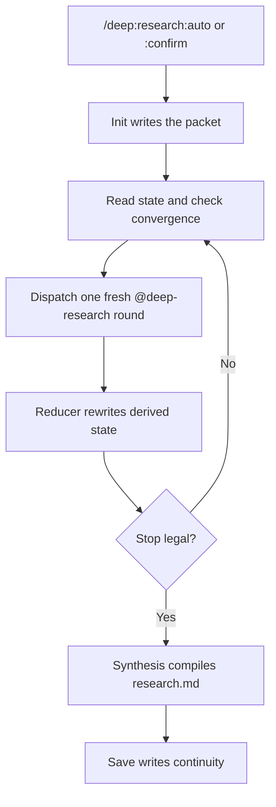

# deep-research

> Investigate a broad question over many rounds, keep every finding on disk and stop when new evidence runs out.

The run leaves a packet on disk, so you can resume it later or audit how each finding arrived.

---

## 1. OVERVIEW

### At a Glance

| Aspect | What you get |
|---|---|
| **Use it for** | A broad question that needs several rounds, where each round builds on the last |
| **Invoke with** | `/deep:research:auto "topic"` or `/deep:research:confirm "topic"` or prose that names autoresearch |
| **Works on** | Web sources and repo files, read through the LEAF agent's tools |
| **Produces** | `research/research.md`, an iteration trail, a findings registry and a convergence dashboard |

### What It Does

`deep-research` runs one question through repeated rounds until the evidence stops growing. Every round starts a fresh `@deep-research` agent that reads the packet from disk, investigates one focus and writes its findings back. The workflow then reduces the state, scores novelty against the accumulated record and decides whether to continue. Start an unattended run with `/deep:research:auto "topic"`. Use `/deep:research:confirm "topic"` when you want an approval point before the first round and before synthesis.

It does not run a single-pass codebase lookup (`@context` does that) or audit code (`deep-review` does that).

### Why This Skill Exists

A long investigation inside one conversation loses detail as findings fill the context window. Pruning to keep the window small removes the early evidence. Reading prior results again costs the next round its working room. This skill writes every finding to disk, starts each round clean and stops on a measure of new information instead of a hunch.

---

## 2. QUICK START

**Step 1: Invoke it.** Auto resolves setup from the arguments and runs without approval prompts. Confirm asks for approval at setup and after each round. It also holds synthesis behind a gate.

```bash
/deep:research:auto "WebSocket reconnection strategies across browsers"
/deep:research:confirm "Distributed cache invalidation patterns"
```

Expected output: auto resolves setup without a prompt, writes the first packet files under `{spec_folder}/research/` and starts the loop. It asks one targeted question only when the spec folder is ambiguous. Confirm shows the consolidated setup prompt first and waits for your answers.

**Step 2: Run the primary workflow.** Bound the run with flags.

```bash
/deep:research:auto "API backpressure patterns" --max-iterations 6 --convergence 0.03
```

Expected output: the loop stops at the six-round cap or when the legal-stop gates pass, then writes `{spec_folder}/research/research.md` with the synthesized findings. The iteration trail sits under `{spec_folder}/research/iterations/`.

`--executor=<kind>` selects the executor kind. The native kind dispatches the agent. The CLI kinds dispatch each round through `dispatch-iteration.cjs`. `cli-mistral-vibe` runs only as a fan-out lineage, so its inline branch fails closed. `--dry-run` previews setup and focus selection, then halts before the first write.

**Step 3: Rebuild the derived files.**

```bash
node .skilled/skills/system-deep-loop/deep-research/scripts/reduce-state.cjs <spec-folder>
```

Expected output: a JSON summary that names the files it rewrote and reports the iteration and corruption counts. Exit 0 means the derived files are current. Exit 2 means the reducer refused the state, usually because the log holds corruption. The resource-map fields stay null unless you add `--emit-resource-map`.

---

## 3. HOW IT WORKS

The workflow runs four phases: initialization, iteration, synthesis and save. Initialization classifies the packet as fresh, resume, completed-session or invalid-state, then writes the config and the strategy. It seeds the state log with its first line through the append gateway. The iteration phase repeats until a stop is legal: read state, check the pause sentinel, dispatch one fresh agent, validate its outputs and run the reducer. Synthesis compiles the iteration trail into `research.md`. Save writes continuity through `generate-context.js`.



### The Packet Files

Every run keeps continuity under `{spec_folder}/research/`. A root spec writes there directly. A child-phase target writes flat on a first run and adds a `{basename(spec_folder)}-pt-{NN}` folder only when prior content exists for a different target.

| File | Owner | What it holds |
|---|---|---|
| `deep-research-config.json` | Workflow | Loop parameters and lineage. Read-only after init, apart from the terminal status flip, an `--extend=N` rewrite and the derived expansive budget |
| `deep-research-state.jsonl` | Append gateway | Config record, iteration records and typed events |
| `deep-research-strategy.md` | Reducer | Key questions, next focus, what worked and what failed |
| `findings-registry.json` | Reducer | Question state, key findings, ruled-out directions and blocked-stop history |
| `deep-research-dashboard.md` | Reducer | Iteration table, trend, dead ends and active risks |
| `iterations/iteration-NNN.md` | Agent | One round of cited findings |
| `deltas/iter-NNN.jsonl` | Agent | The structured delta for that round |
| `research.md` | Workflow | The canonical synthesis of the run |
| `resource-map.md` | Workflow | The optional evidence-derived map of cited files |
| `.deep-research-pause` | Operator | The pause sentinel checked before each dispatch |
| `frontier-nodes.jsonl` | Frontier admission | The node store an expansive run keeps, absent on a default run |
| `frontier-seed.json` | Workflow | The seed step's depth-1 sub-questions, the input `frontier-admit.cjs seed` reads, absent on a default run |
| `frontier-focus.txt` | Workflow | The one-line focus the workflow writes before each dispatch for `frontier-admit.cjs block --focus-file`, absent on a default run |
| `frontier-graph-events.json` | Workflow | The frontier graph events each expansive iteration mirrors into the coverage graph, absent on a default run |

The workflow owns the config and the synthesis. The agent writes its iteration file and delta, plus any progressive synthesis contribution the config allows. The reducer owns the strategy sections and the registry. It redraws the dashboard. Because every artifact is on disk, a crashed run resumes from the packet files.

### Convergence

A low novelty score only nominates STOP.

| Signal | Weight | Votes STOP when |
|---|---|---|
| Rolling average | 0.30 | The last three ratios average below `convergenceThreshold` |
| MAD noise floor | 0.35 | The latest ratio sits at or below `MAD * 1.4826` |
| Question entropy | 0.35 | Evidence-backed coverage reaches 0.85 |

A normalized score above 0.60 nominates STOP. The legal-stop gates then check that low novelty held for the required rounds, that every key question has an evidence-backed answer, that sources are diverse and that research stayed aligned with the key questions. A reserved single-weak-source entry reports `notEvaluated` and never blocks a stop. A failed quality guard returns CONTINUE with `qualityGuardFailed` and records no event. A missing graph decision blocks every non-terminal STOP, and a graph `STOP_BLOCKED` records `blocked_stop` and continues with a recovery focus.

The shipped config floors convergence at 3 rounds, sets `stuckThreshold` to 3 and caps a run at 10 rounds and 120 minutes. Lower `--convergence` asks for more rounds. Raise it when the loop should finish sooner.

`--convergence-mode` changes the stop path. `off` disables convergence STOP while the hard caps stay active. `sliding-window` scores novelty over a bounded window. `divergent` sends an eligible legal stop into one bounded pivot round instead of synthesis, then returns to the loop.

`--depth-mode=expansive` lets a run grow its own questions. A seed step writes 3 to 6 depth-1 nodes before iteration 1. The leaf may propose children only when its prompt carries a frontier block. The nodes live in `research/frontier-nodes.jsonl`, which a default run never creates.

An admission step runs before the reducer. It applies seven checks in order: relevance, dedupe, depth, fan-out, the run-wide node cap, budget and cycle. The first failure prunes the proposal. Next Focus reads the shallowest open node first and writes it as a frontier line, so visiting a node does not read as answering it.

While a node stays open, the frontier vetoes a soft convergence stop. The veto never outranks the iteration cap or the other hard stops. The caps are `maxDepth` 3, `maxChildrenPerNode` 6, a `0.5/0.35/0.15` budget split and `maxFrontierNodes`, which defaults to half of `maxIterations`.

When `--max-iterations` is left at its default, the run sizes its budget from the seed. The budget is `min(24, max(10, 2 × (S + maxDepth − 1)))` iterations for S seeded depth-1 nodes, 16 at the full six seeds. The seed step prints the derived budget. A fan-out lineage with no matrix `iterations` value is sized the same way from its own round-robin share of the seed, with a floor of 12 for a native lineage and 10 for a CLI one, and a lineage dealt no seed node runs at that floor.

The node cap stays half the budget, which leaves room for at least two nodes past depth 1. An explicit `--max-iterations`, marker, setup answer or fan-out matrix `iterations` value always wins, even below the derived value. The seed warns when it leaves no room past depth 1.

### Stop Reasons

The workflow persists one `stopReason` value when the loop ends or pauses.

| Value | Meaning |
|---|---|
| `converged` | A legal stop passed and the run may exit |
| `maxIterationsReached` | The round cap was hit |
| `blockedStop` | A gate blocked a STOP candidate |
| `stuckRecovery` | Stuck detection triggered or recovery failed |
| `error` | An unrecoverable workflow or state error |
| `manualStop` | The operator asked the run to stop |
| `userPaused` | A pause sentinel halted the run |
| `maxDurationReached` | The wall-clock limit was hit |

### Fresh Context Per Iteration

Each dispatch starts a new agent with no memory of prior rounds. The agent reads the strategy and the state log, picks the next focus and returns after one round. Nothing carries over in context. Everything carries over in files. A crashed run therefore resumes from the packet files instead of starting over.

---

## 4. INTEGRATION & NAVIGATION

### When To Use This Skill

Run `deep-research` when a question needs several rounds and each round should shape the next. Run it when the work is unattended, such as an overnight investigation. Run it when you want the loop to stop on a measured signal instead of your judgment call.

Skip it for a single lookup, where a direct web search or the `@context` agent is faster. Skip it for implementation planning, where `/speckit:plan` owns the plan once context is in hand. Skip it for a code audit, where `deep-review` owns the pass.

### Related Skills

| Skill | Relationship |
|---|---|
| `deep-review` | Audits the code a research run points at. The two share `runtime/` and keep separate convergence thresholds |
| `system-spec-kit` | Owns the spec folder, its validation and the continuity save that closes a run |

`/speckit:plan` and `/speckit:implement` consume the report. `/speckit:resume` rebuilds context before you extend a completed run. `/speckit:save` writes a manual memory save, though a research run already saves at the end.

---

## 5. TROUBLESHOOTING

| What you see | Why | Fix |
|---|---|---|
| The loop stops before the topic is covered | The threshold is loose for the breadth of the question | Lower `--convergence` to 0.03 or raise `--max-iterations` |
| The loop runs to the cap without converging | The weighted score stays under 0.60 or a legal-stop gate keeps blocking it | Read the dashboard for `BLOCKED STOPS` and the current focus, then narrow the focus or raise the threshold |
| The reducer exits 2 | The state log holds corruption and the reducer fails closed | Repair the bad line or rerun with `--lenient` to accept it |
| Derived files lag the last round | The reducer did not run after the write-back | Run the reducer command from QUICK START |
| A new run resumes an old packet | The config still holds an active lineage | Pass `--restart` or archive the packet and start again |
| The loop will not continue after a pause | `.deep-research-pause` is still in the packet | Remove `{spec_folder}/research/.deep-research-pause` and invoke the command again |
| Every round hits the tool-call cap | The focus is too wide for one round | Narrow `Next Focus` in `deep-research-strategy.md` to one sub-question |

---

## 6. FAQ

**Q: How does convergence decide to stop?**

A: A low novelty score only nominates STOP. The weighted score must clear 0.60 before a STOP is nominated. Then the legal-stop gates check novelty over the required rounds, question coverage, source diversity, focus alignment and graph evidence. A failed quality guard continues the loop with `qualityGuardFailed` and writes no event. A graph block writes a `blocked_stop` event and the loop continues with a recovery focus. The full decision order is in [the convergence reference](./references/convergence/convergence.md).

**Q: Why does each iteration start a fresh agent?**

A: A shared context window fills with stale findings. Later rounds read the same material through more clutter. A fresh LEAF agent per round plus state on disk means every round reads only what the packet holds. The agent never dispatches a sub-agent or nests another loop.

**Q: Where are the findings kept?**

A: Each round writes `{spec_folder}/research/iterations/iteration-NNN.md` and a delta file under `deltas/`. Synthesis compiles the trail into `research.md`. The reducer indexes the finding set in `findings-registry.json` and draws the trend in `deep-research-dashboard.md`.

**Q: What is the difference between resume and restart?**

A: `resume` keeps the same `sessionId` and appends a `resumed` event. `restart` archives the current `research/` tree under `research_archive/`, mints a fresh `sessionId`, increments `generation` and appends a `restarted` event. `completed-continue` comes from `--extend=N`, with `--extend-minutes=M` for the minutes added to the later of the prior duration budget and the time already elapsed. It reopens a completed run in the same session, raises the cap to the runs so far plus N, snapshots the prior synthesis and appends an `extended` event. A fan-out config refuses it, because `--extend` extends a single-executor run only.
`fork` is declared in the lifecycle vocabulary but not wired.

**Q: Can I run each iteration through a CLI executor?**

A: Yes. Pass `--executor=<kind>`. The workflow owns executor selection. The LEAF limits still apply, including the per-round tool-call cap.

---

## 7. VERIFICATION

The skill ships a feature catalog and a manual testing playbook. The checks below cover the part a machine can settle.

### Feature Catalog

`feature-catalog/` groups 30 live features by loop lifecycle, state management, convergence and research output. Each file explains how the feature works and lists the implementation and validation files behind it. Start at the [feature catalog index](./feature-catalog/feature-catalog.md).

### Manual Testing Playbook

`manual-testing-playbook/manual-testing-playbook.md` holds 74 deterministic scenarios across 9 categories. The playbook states the global preconditions, and each scenario names its expected signals and its verdict rule. Release readiness depends on complete coverage and no unresolved blocking contradiction.

| Check | Result |
|---|---|
| README structure | `python3 .skilled/skills/sk-doc/scripts/validate_document.py .skilled/skills/system-deep-loop/deep-research/README.md --type readme` prints `✅ VALID` and `Total issues: 0` |
| Workflow script paths | `bash .skilled/skills/system-deep-loop/deep-research/scripts/verify-yaml-script-paths.sh` prints `PASS checked 27 script references across 2 workflow YAMLs` |
| Packet contract parity | `deep-research-contract-parity.vitest.ts` checks that the primary docs name the canonical state log, the findings registry, the pause sentinel and `completed-continue`, and that both runtime mirrors name all of them except the pause sentinel |
| Manual scenarios | Every scenario in the playbook returns PASS |

---

## 8. RELATED DOCUMENTS

| Document | Purpose |
|---|---|
| [`SKILL.md`](./SKILL.md) | Runtime instructions and the operating contract |
| [`ROUTER.md`](./ROUTER.md) | Intent map, resource map and loading levels |
| [`references/guides/quick-reference.md`](./references/guides/quick-reference.md) | Commands, defaults, state files and the convergence decision tree |
| [`references/protocol/loop-protocol.md`](./references/protocol/loop-protocol.md) | Four-phase lifecycle, dispatch rules and error handling |
| [`references/protocol/spec-check-protocol.md`](./references/protocol/spec-check-protocol.md) | Bounded `spec.md` anchoring and generated-fence write-back |
| [`references/convergence/convergence.md`](./references/convergence/convergence.md) | Stop contract, convergence modes and legal-stop gates |
| [`references/convergence/convergence-signals.md`](./references/convergence/convergence-signals.md) | How `newInfoRatio`, the three signals and the stuck count are scored |
| [`references/convergence/convergence-recovery.md`](./references/convergence/convergence-recovery.md) | Stuck recovery, recovery strategy selection and escalation |
| [`references/convergence/convergence-graph.md`](./references/convergence/convergence-graph.md) | Graph-aware stop gates and coverage-graph fallback |
| [`references/state/state-format.md`](./references/state/state-format.md) | Packet files, ownership rules and the location rules |
| [`references/state/state-jsonl.md`](./references/state/state-jsonl.md) | Config, iteration, event and blocked-stop record types |
| [`references/state/state-outputs.md`](./references/state/state-outputs.md) | Strategy, iteration, report and dashboard output shapes |
| [`references/state/state-reducer-registry.md`](./references/state/state-reducer-registry.md) | Reducer ownership, registry validation and reconstruction |
| [`references/guides/capability-matrix.md`](./references/guides/capability-matrix.md) | The runtime capability matrix, which holds the parity rules for every supported mirror |
| [`scripts/reduce-state.cjs`](./scripts/reduce-state.cjs) | The reducer that rewrites the registry, dashboard and strategy |
| [`scripts/runtime-capabilities.cjs`](./scripts/runtime-capabilities.cjs) | Machine-readable capability lookup for the active runtime |
| [`scripts/verify-yaml-script-paths.sh`](./scripts/verify-yaml-script-paths.sh) | Checks that workflow YAML script paths exist |
| [`assets/deep-research-config.json`](./assets/deep-research-config.json) | Config template with the shipped defaults |
| [`assets/deep-research-strategy.md`](./assets/deep-research-strategy.md) | Strategy template with key questions and next focus |
| [`assets/deep-research-dashboard.md`](./assets/deep-research-dashboard.md) | Dashboard template with the convergence trend |
| [`assets/prompt-pack-iteration.md.tmpl`](./assets/prompt-pack-iteration.md.tmpl) | Per-round prompt template dispatched to the agent |
| [`assets/runtime-capabilities.json`](./assets/runtime-capabilities.json) | Declared capability manifest checked at runtime |
| [`feature-catalog/`](./feature-catalog/) | 30 features across four categories |
| [`manual-testing-playbook/`](./manual-testing-playbook/) | 74 scenarios with expected signals and verdict rules |
| [`behavior-benchmark/`](./behavior-benchmark/) | Behavior benchmark for the command surface under realistic prompts |
| [`research.md`](../../../commands/deep/research.md) | The command entry that resolves setup and loads the workflow |
| [`deep-research.yaml`](../../../commands/deep/assets/deep-research.yaml) | The workflow that owns init, dispatch, convergence and synthesis |

A feature change touches at least the router, the owning reference, the feature catalog entry and the matching playbook scenario.

<!-- readme-check
allow-ref research/research.md | a research packet writes it inside its own spec folder
allow-ref research.md | the workflow writes it inside a run's research packet
allow-ref findings-registry.json | the reducer creates it inside a run's research packet
allow-ref iterations/iteration-NNN.md | a round writes it inside a run's research packet
allow-ref frontier-seed.json | the seed step of an expansive run writes it inside the run's research packet
allow-ref frontier-focus.txt | the block step of an expansive run reads the focus line from inside the run's research packet
allow-ref frontier-graph-events.json | the graph upsert of an expansive run writes it inside the run's research packet
-->
