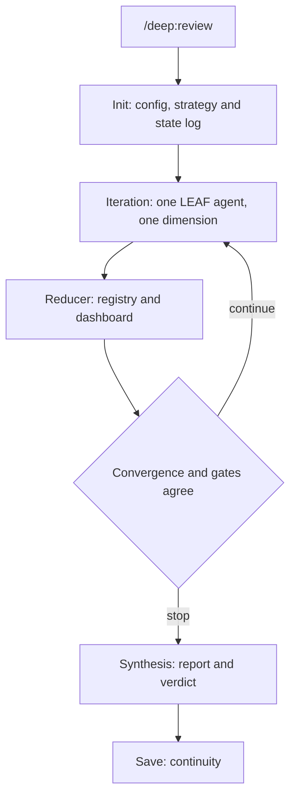

# deep-review

> Audit code across correctness, security, traceability and maintainability, plus any custom dimension you configure, in separate passes and end with a release-readiness verdict you can act on.

---

## 1. OVERVIEW

### At a Glance

| Aspect | What you get |
|---|---|
| **Use it for** | A multi-pass audit where each dimension is read by its own agent and a gated stop decides when the loop ends |
| **Invoke with** | `/deep:review:auto` for an unattended run, `/deep:review:confirm` for approval gates or bare `/deep:review` to be asked which |
| **Works on** | A spec folder, a skill package, a named agent, a spec track or an explicit file set |
| **Produces** | A release-readiness verdict, a nine-section report, a finding registry, a dashboard and an iteration audit trail |

### What It Does

`deep-review` audits code in repeated passes and ends with a verdict. The `/deep:review` command runs the loop with one review dimension per iteration and a fresh agent each time. Every finding is written to disk before the next pass begins. Synthesis compiles a nine-section report and derives the verdict from the finding registry.

A one-pass review belongs to `sk-code`'s code-review mode. Outward investigation belongs to `deep-research`. This skill audits code and never modifies the files it reads.

### Why This Skill Exists

A single-pass review reads the diff once and calls it done. Whatever the reviewer was not thinking about that day ships unreviewed. Holding correctness, security, maintainability and spec alignment in one context window leaves the later dimensions with a worse read than the first. A long session also has no honest stop condition, so you keep reading past the last new finding or stop early and miss a blocker.

This skill splits the audit by dimension and puts the stop decision on a weighted signal rather than a hunch. Each pass starts from a clean context window. The verdict is the point. The command, the reducer, the state files and the report are how it arrives.

### The Review Dimensions

The four canonical dimensions are configured by default. Every configured dimension is required for coverage, so the loop can stop clean only after each one has been audited. A custom dimension you configure, such as `performance`, is reviewed after the canonical four. A subset or a custom dimension applies to a single-executor run only: a fan-out run binds `all` in every lineage, so each lineage reviews the canonical four. Correctness and security are the two the mode contract marks as required for severity coverage.

| Dimension | What the skill audits |
|---|---|
| **Correctness** | Logic, invariants, state transitions and edge cases against observable intent |
| **Security** | Trust boundaries, auth behavior, input handling, secrets exposure and exploit paths |
| **Traceability** | Spec alignment, checklist evidence and cross-reference integrity across linked artifacts |
| **Maintainability** | Codebase patterns, documentation quality, clarity and the ease of safe follow-on changes |

---

## 2. QUICK START

**Step 1: Pick a mode.** `:auto` runs without questions. `:confirm` asks for approval at the iteration gate. A bare `/deep:review` asks which mode you want.

```bash
/deep:review:auto "skill:deep-research"
```

Expected result: the loop starts on the named target and asks nothing.

**Step 2: Add flags when the shipped defaults miss the target.**

```bash
/deep:review:auto "specs/sk-doc/document-standards/006-readme-template-conformance" --max-iterations=5 --convergence=0.05
```

Expected result: one `iteration-NNN.md` file per pass and then `review-report.md`, both under `{spec_folder}/review/`. The report's first section carries the verdict, and the rest follow the nine-section list in `references/protocol/quick-reference.md`.

**Step 3: Rebuild the derived state and read the summary.**

```bash
node .skilled/skills/system-deep-loop/runtime/scripts/reduce-state.cjs <spec-folder>
```

Expected output: one JSON object carrying `registryPath`, `dashboardPath`, `strategyPath`, `openFindingsCount`, `resolvedFindingsCount`, `convergenceScore` and `corruptionCount`, with exit status 0. A malformed line in the state log stops the reducer with exit status 2 unless you pass `--lenient`.

---

## 3. HOW IT WORKS

`/deep:review` owns the loop. Its YAML workflow owns the state and every dispatch, and it decides the stop. Initialization writes the packet. The loop then repeats a fixed cycle: check convergence, dispatch one `@deep-review` LEAF agent for one dimension, wait for the write-back, run the reducer and decide whether to continue. Synthesis compiles the report, and the save phase writes continuity.



### The Iteration Lifecycle

Each pass reads the packet rather than the conversation. The agent opens the strategy to see the next focus, then the state log and the registry that record what earlier passes found. It audits one dimension and writes `iteration-NNN.md`. Its record reaches the state log through the append gateway, the only writer of that file. The agent stays LEAF. It dispatches no sub-agents, asks no questions, fetches nothing from the web and changes none of the reviewed files.

The reducer then derives the finding registry and the dashboard from that delta, and the strategy picks up the new next focus. The stuck count and the consecutive failure count rebuild from the state log on every pass, so a resumed run counts the same as one that never paused. Three failed iterations in a row stop the loop with stop reason `error`. In `:confirm` mode the workflow asks the operator before that stop.

### Severity and Verdicts

Every finding carries one severity. A P2 rides along as an advisory rather than blocking anything.

| Severity | Weight | Meaning |
|---|---|---|
| **P0** | 10 | Correctness failure, security vulnerability or spec contradiction. Blocks PASS |
| **P1** | 5 | Degraded behavior, incomplete implementation or missing validation. Forces CONDITIONAL |
| **P2** | 1 | Style, naming or documentation gap. Recorded as an advisory |

Synthesis derives one verdict from the active findings.

| Verdict | Condition | Next command |
|---|---|---|
| **PASS** | No active P0 or P1 and no open search debt | `/create:changelog` |
| **CONDITIONAL** | No active P0 and no required gate failing, but P1 findings or open search debt remain | `/speckit:plan` |
| **FAIL** | An active P0 remains or a required quality gate still fails at the terminal stop | `/speckit:plan` |

A P0 is not written on trust. The agent re-reads the cited code and tries to disprove the blocker before the label holds. At synthesis on a single-executor run, each self-check is recorded as a `claim_adjudication` row with its `findingId` and `finalSeverity`, and the reducer applies that row before the verdict is derived. A downgrade therefore lowers the counts the report and the closeout use.

### State on Disk

The packet lives under `{spec_folder}/review/`. A root-spec target writes there directly. A child-phase target writes flat on its first run and gets a `pt-NN` sibling packet only when prior content for a different target already exists.

| File under `{spec_folder}/review/` | Role |
|---|---|
| `deep-review-config.json` | Run settings. Immutable after init, apart from the terminal status flip, an `--extend=N` rewrite and the derived expansive budget |
| `deep-review-state.jsonl` | Append-only log of iterations, events and stop decisions |
| `deep-review-findings-registry.json` | Reducer-owned index of every finding and its state |
| `deep-review-strategy.md` | Dimension coverage, findings and the next audit focus |
| `deep-review-dashboard.md` | Reducer-generated convergence trend |
| `.deep-review-pause` | Operator-owned pause sentinel |
| `resource-map.md` | Emitted at synthesis unless the run passes `--no-resource-map` |
| `review-report.md` | The nine-section report, written at synthesis |
| `iterations/iteration-NNN.md` | One write-once file per iteration |
| `frontier-nodes.jsonl` | Node store an expansive run keeps, absent on a default run |
| `frontier-seed.json` | The seed step's depth-1 sub-targets, the input `frontier-admit.cjs seed` reads, absent on a default run |

The lineage block carries `sessionId`, `parentSessionId`, `lineageMode`, `generation`, `continuedFromRun` and `releaseReadinessState`. A first run is mode `new`. `resume` continues the same lineage without changing generation. `restart` opens a new generation and archives the prior packet. `completed-continue` is set by `--extend=N`, which reopens a completed run in the same session and generation and records `continuedFromRun`. `--extend-minutes=M` sets the minutes the extension adds to the later of the prior duration budget and the time already elapsed. An extension is single-executor only, since `--extend` refuses fan-out, and it keeps the stop policy and convergence mode the run was created with. Under `stopPolicy: convergence` an extension with nothing new can re-stop on `all_dimensions_clean` at its first convergence check, so create a run you mean to extend with `--convergence-mode=off` or `--stop-policy=max-iterations`.
`fork` is reserved and deferred, so the runtime neither emits nor accepts it. `releaseReadinessState` starts at `in-progress`. It moves to `release-blocking` while any unresolved P0 remains. It moves to `converged` when the run stops converged with a PASS or CONDITIONAL verdict.

### Convergence and the Stop Gates

Convergence is a weighted vote over three signals.

| Signal | Weight | What it measures |
|---|---|---|
| **Rolling average** | 0.30 | Recent severity-weighted finding yield across the last two evidence-bearing iterations |
| **MAD noise floor** | 0.25 | The latest ratio measured against statistical noise |
| **Dimension coverage** | 0.45 | Configured dimensions plus the required traceability protocols are covered, after at least one stabilization pass |

The weighted score has to reach `compositeStopScore`, which defaults to 0.60, before the loop may consider a stop. Clearing the threshold is not enough on its own. Nine binary gates have to pass as well, and a failure writes a `blocked_stop` event with `blockedBy` and a per-gate `gateResults` record. The gate list and its criteria live in `references/convergence/convergence.md`.

Any new P0 forces another iteration. The override sets `newFindingsRatio` to at least 0.50, so a fresh blocker cannot be averaged away. The shipped config adds `antiConvergence.minIterations` of 2 and a `stopPolicy` of `fail-closed`, and the runtime capability loader rejects a missing or permissive stop policy. The floor holds a review run at `CONTINUE` with reason `minIterationsNotReached` until its iteration count reaches `minIterations`, even when every dimension is clean.

`--depth-mode=expansive` changes the stop path so that a run grows its work instead of ending it. A seed step writes the depth-1 sub-target nodes before iteration 1. The active node's next uncovered dimension steers each iteration.

An admission step runs before the reducer. It applies six checks in order: relevance, dedupe, depth, fan-out, budget and cycle. The first failure prunes the proposal. Node status lives in `review/frontier-nodes.jsonl`, which no default run creates. An open node is filed as open search debt, so the run spends the iteration that node still needs.

The frontier veto never outranks the iteration cap, consecutive failures, stuck recovery, pause, the max-duration stop, `--convergence-mode=off`, `--stop-policy=max-iterations` or the floor above. Stuck recovery closes the active node as `exhausted`. Once every node is closed and at least one was answered, a run that forms no other stop candidate gets `frontier_drained`. The legal-stop gates still decide it, so a run whose frontier work is done stops before its cap.

The caps are `maxDepth` 3, `maxChildrenPerNode` 6, a `0.5/0.35/0.15` budget split and `maxFrontierNodes`, which defaults to half of `maxIterations`. When `--max-iterations` is left at its default, the run sizes its budget from the seed. The budget is `min(24, max(7, 2 × D × (S + maxDepth − 1)))` iterations for S seeded depth-1 nodes and D the four canonical dimensions plus each custom name the config's `reviewDimensions` list adds, each counted once. The seed step prints the derived budget.

Since D is never below four, the ceiling of 24 binds from the first seed. One run then cannot fund every node at every depth of a wide review. Split a wide review with fan-out, where each lineage with no matrix `iterations` value sizes its own budget from its share of the seed, with D fixed at the canonical four because a lineage reviews only those. A lineage dealt no seed node, or a run whose seeds were all pruned, runs at its loop default instead. That is 12 iterations for a native lineage and 7 for a CLI one or a single run.

The node cap stays half the budget, which leaves room for at least two nodes past depth 1. An explicit `--max-iterations`, marker, setup answer or fan-out matrix `iterations` value always wins, even below the derived value. The seed warns when it leaves no room past depth 1. At about seven to eight minutes an iteration, a 24-iteration review can reach `maxDurationMinutes` (120) before its iteration cap.

### Fan-out and Merged Verdicts

One run can spread the loop across executor lineages. Pass `--executor` once per lineage, or pass an `--executors` matrix. Cap the pool with `--concurrency`. The merged verdict is strongest restriction: any lineage with an active P0, or a required gate still failing at its stop, turns the merged verdict into FAIL.

---

## 4. INTEGRATION & NAVIGATION

### When To Use This Skill

Use it before a release, when you want a verdict rather than a list of impressions. Use it for a spec folder whose documents have to be checked against the code that ships. Use it for an unattended overnight audit or when each dimension's findings should inform the next pass.

Skip it for a quick one-file check or for a single-pass review of a pull request. `sk-code`'s code-review mode covers those cases faster.

### Related Skills

The `system-deep-loop` hub routes a review-mode request to this packet, and its registry also carries the `research` mode.

| Skill | Relationship |
|---|---|
| `sk-code` | Its code-review mode runs a single-pass review. This skill runs the multi-iteration loop with convergence gating |
| `deep-research` | Investigates outward knowledge with web access. `deep-review` audits code with no web access |
| `system-spec-kit` | Owns the spec folder, its validation, its continuity save and the `/speckit:resume` path |

For a one-shot retrieval pass before the review, reach for the `@context` agent rather than this skill.

---

## 5. TROUBLESHOOTING

| What you see | Why | Fix |
|---|---|---|
| The loop stops earlier than you expected | The weighted score cleared the threshold and every gate passed | Lower `--convergence` from 0.10 to 0.05 or pass `--stop-policy=max-iterations` |
| The loop reaches the iteration ceiling without converging | The threshold demands more passes than the target can absorb | Raise `--convergence` or raise `--max-iterations` |
| One P0 keeps blocking the stop | Expected behavior. A new P0 forces `newFindingsRatio` to 0.50 or more | Read the adversarial re-read in the iteration file. Clear the P0 or accept a FAIL verdict |
| The same dimension comes up again and again | The strategy next focus is not advancing | Open `deep-review-strategy.md` and check the next focus rotation |
| The reducer exits 2 and names state corruption | A malformed line in `deep-review-state.jsonl` | Repair the line or pass `--lenient` so the derived state is written anyway |
| The run resumes when you wanted a fresh one | An active lineage sits in the packet | Pass `--restart` to archive the prior `review/` tree and open a new session |
| The loop will not continue after a pause | `{spec_folder}/review/.deep-review-pause` is still present | Delete the sentinel and invoke the command again |

---

## 6. FAQ

### Does this replace `sk-code`'s code-review mode?

No. That mode reads a diff once and reports what it finds, which suits a quick pull-request check. This skill runs multiple passes and gives each dimension its own agent. It stops only when the convergence signal and the gates agree. The extra passes buy coverage and a verdict you can release against.

### What comes after a FAIL verdict?

A FAIL means an active P0 survived the adversarial re-read or a required gate still failed at the terminal stop. The report groups the active findings into remediation workstreams. Run `/speckit:plan` against those workstreams and fix the blockers before you run the loop again.

### How can I pause a run and pick it up later?

Create `{spec_folder}/review/.deep-review-pause` between iterations with `touch`. The loop checks for the file before each dispatch and halts with a `userPaused` event. Delete the sentinel and invoke the command again. The resume reads the packet, so it continues from the last completed iteration rather than from the first.

### Why does each pass start a new agent?

A shared context window fills with stale findings, and that drags on reasoning as the session grows. Each pass reads the packet from disk and writes its own iteration file back. Nothing carries over in the window itself, which is why one dimension cannot bias the next.

---

## 7. VERIFICATION

The skill ships a feature catalog and a manual testing playbook. The catalog groups its inventory by loop lifecycle, state management, review dimensions and the severity system. Every entry names the files that implement it. The playbook carries 70 deterministic scenarios across ten categories. Each scenario maps to a feature file with a stated objective, a canonical prompt, expected signals and live source anchors.

| Check | How to run it | A pass looks like |
|---|---|---|
| README structure | `python3 .skilled/skills/sk-doc/scripts/validate_document.py .skilled/skills/system-deep-loop/deep-review/README.md --type readme` | Exit status 0, document type `readme` and a final `Total issues: 0` line |
| Reducer regressions | `node --test .skilled/skills/system-deep-loop/deep-review/scripts/tests/` | A summary reading `pass 5` and `fail 0` |
| Loop scenarios | The scenarios under `manual-testing-playbook/`, run one at a time | Each scenario ends PASS, FAIL or SKIP with a recorded reason |

---

## 8. RELATED DOCUMENTS

| Document | Purpose |
|---|---|
| [`SKILL.md`](./SKILL.md) | Runtime instructions and the full operating contract |
| [`ROUTER.md`](./ROUTER.md) | Machine router: intent map, resource map and loading levels |
| [`references/protocol/quick-reference.md`](./references/protocol/quick-reference.md) | One-page operator cheat sheet with commands, defaults, dimensions and verdicts |
| [`references/protocol/loop-protocol.md`](./references/protocol/loop-protocol.md) | Four-phase lifecycle, dispatch contract and executor invariants |
| [`references/protocol/loop-state-and-gates.md`](./references/protocol/loop-state-and-gates.md) | State transitions, error handling and the stop-decision gates |
| [`references/protocol/completion-criteria.md`](./references/protocol/completion-criteria.md) | The loop-completion and quality-gate checklist |
| [`references/convergence/convergence.md`](./references/convergence/convergence.md) | Stop algorithms, the nine gates and recovery strategies |
| [`references/convergence/convergence-signals.md`](./references/convergence/convergence-signals.md) | Three-signal weighted vote and the severity-weighted ratio |
| [`references/convergence/convergence-recovery.md`](./references/convergence/convergence-recovery.md) | Stuck recovery, recovery strategy selection and escalation |
| [`references/state/state-format.md`](./references/state/state-format.md) | Packet file schemas, owners and mutability rules |
| [`references/state/state-jsonl.md`](./references/state/state-jsonl.md) | Config, iteration, event and blocked-stop record types |
| [`references/state/state-outputs.md`](./references/state/state-outputs.md) | Strategy, iteration, report, dashboard and resource-map outputs |
| [`references/state/state-reducer-registry.md`](./references/state/state-reducer-registry.md) | Reducer ownership, findings registry and reconstruction |
| [`assets/review-mode-contract.yaml`](./assets/review-mode-contract.yaml) | Source of truth for target types, dimensions, severities, verdicts, gates and lifecycle modes. The severity meanings come from [`review-core.md`](../../sk-code/sk-code-review/references/review-core.md) |
| [`assets/deep-review-config.json`](./assets/deep-review-config.json) | Config template with defaults for iterations, thresholds, anti-convergence and executor |
| [`assets/prompt-pack-iteration.md.tmpl`](./assets/prompt-pack-iteration.md.tmpl) | The per-iteration prompt rendered for the LEAF agent |
| [`assets/runtime-capabilities.json`](./assets/runtime-capabilities.json) | Capability manifest checked at runtime for parity validation |
| [`../runtime/scripts/reduce-state.cjs`](../runtime/scripts/reduce-state.cjs) | The state reducer that writes the registry, the dashboard and the strategy updates |
| [`../runtime/scripts/convergence.cjs`](../runtime/scripts/convergence.cjs) | The stop decision, computed once per pass from config, log, registry and coverage graph |
| [`scripts/runtime-capabilities.cjs`](./scripts/runtime-capabilities.cjs) | Capability lookup bound to this packet |
| [`feature-catalog/`](./feature-catalog/) | Feature inventory by category, with implementation and validation anchors |
| [`manual-testing-playbook/`](./manual-testing-playbook/) | Deterministic scenarios with preconditions and expected signals |
| [`behavior-benchmark/`](./behavior-benchmark/) | Scenario set that measures what an executor does at the `/deep:review` surface |

<!-- readme-check
allow-ref iteration-NNN.md | a review pass writes it inside the run's review folder under the target spec folder
allow-ref iterations/iteration-NNN.md | one write-once file per pass inside the run's review folder under the target spec folder
allow-ref resource-map.md | the synthesis writes it inside the run's review folder under the target spec folder
allow-ref frontier-seed.json | the seed step of an expansive run writes it inside the run's review folder under the target spec folder
-->
