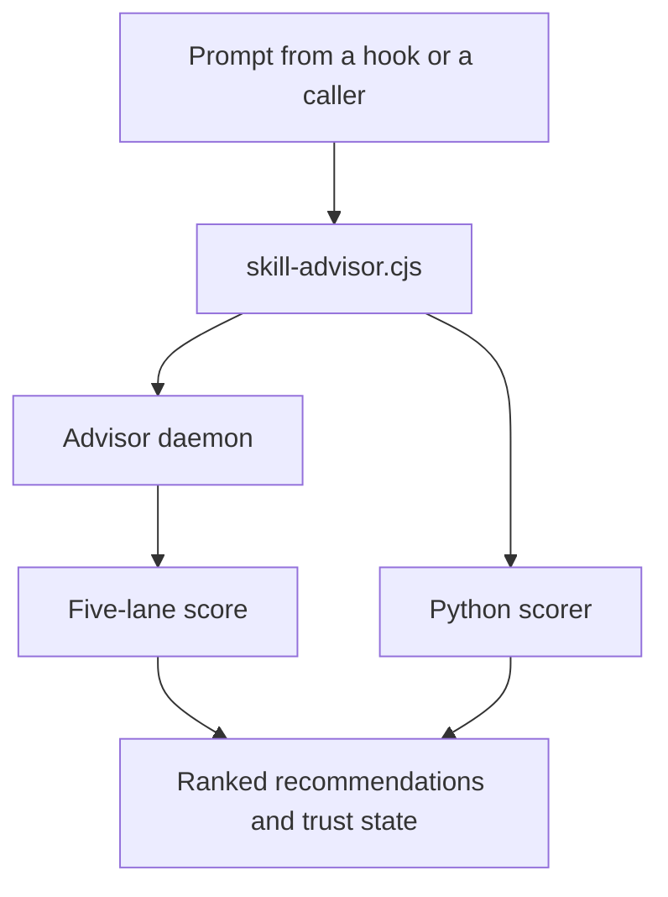

# system-skill-advisor

> Tells a runtime which skill should handle a non-trivial prompt, with a score you can check and a trust state you can act on.

---

## 1. OVERVIEW

### At a Glance

| Aspect | What it gives you |
|---|---|
| **Use it for** | Choosing the skill that should handle a non-trivial prompt, with a score and a trust state attached |
| **Invoke with** | `advisor_recommend` through the CLI or automatic Gate 2 routing from a prompt hook |
| **Works on** | Prompts, skill metadata under `.skilled/skills/` and the package-local SQLite skill graph |
| **Produces** | Ranked recommendations with a score and a trust state |

### What It Does

system-skill-advisor is the routing skill for Gate 2. It scores a prompt against the metadata of every installed skill and returns the candidates in rank order through `advisor_recommend`, one of nine CLI commands behind `node .skilled/bin/skill-advisor.cjs`.

The skill runs as a resident daemon behind that one CLI. Routing state lives in this package and memory lives in `system-spec-kit`, so the advisor can be restarted or retuned on its own. The responses that read the index, such as status and recommend, carry a trust state. `includeAttribution` also adds a per-lane breakdown with no raw prompt text. The skill stops at the recommendation, because `sk-code`, `sk-doc`, `sk-git`, `mcp-code-mode` or another target owns the work once routing lands.

### The Scoring Lanes

Five lanes score every prompt. `runtime/lib/scorer/lane-registry.ts` holds the live weights that set how much each lane adds to the final score.

| Lane | Live weight | What it reads |
|---|---|---|
| `explicit_author` | 0.42 | Hand-tuned token and phrase matches for high-confidence routing |
| `lexical` | 0.28 | Token overlap with skill name, description, domains, keywords and intent signals |
| `graph_causal` | 0.13 | Typed edges in the skill graph, such as `depends_on` and `enhances` |
| `derived_generated` | 0.12 | Derived trigger metadata from prior extraction runs |
| `semantic_shadow` | 0.05 | Embedding cosine similarity, the lowest fusion weight |

Attribution names the lane that dominated each result, so a surprising score can be traced without printing the prompt.

---

## 2. QUICK START

**Step 1: Check advisor health.**

```bash
node .skilled/bin/skill-advisor.cjs advisor_status --workspace-root "$PWD" --format json
```

Expected output: a `status: ok` envelope with `trustState.state`, `skillCount` and `laneWeights`. A `live` state means the index matches the skill files on disk.

**Step 2: Ask for a recommendation.**

```bash
node .skilled/bin/skill-advisor.cjs advisor_recommend --json '{"prompt":"create a new agent"}' --format json
```

Expected output: `data.recommendations[]` in rank order, each with `skillId`, `score`, `confidence` and `uncertainty`, plus `effectiveThresholds` for the call. The prompt text does not appear in the response.

**Step 3: Rebuild when the index is not live.**

```bash
node .skilled/bin/skill-advisor.cjs advisor_rebuild --trusted --force true --format json
```

Expected output: freshness and generation values from before and after the rebuild, the skill count, an indexing summary and any warnings. A live index is skipped unless `--force true` is present.

Mutating commands require `--trusted` or `SYSTEM_SKILL_ADVISOR_CLI_TRUSTED=1`. Read commands never need either.

---

## 3. HOW IT WORKS

A prompt reaches the advisor by one of two routes. A prompt hook calls the CLI before the agent starts. A caller can also run the CLI by hand. Both go through the same CLI and daemon, so a manual check reads the same index that a hook reads.

The CLI resolves the built server, checks that the build is current and reaches the daemon over a unix socket. It starts the daemon when the socket is cold. The daemon holds the scorer, the embedder, the command handlers and the SQLite skill graph.

The daemon watches every `SKILL.md`, `ROUTER.md` and `graph-metadata.json` under `.skilled/skills/`. A source change moves the trust state from `live` to `stale`. A new generation clears the recommendation cache. `advisor_rebuild` returns the state to `live`.

When the daemon cannot be reached, the CLI calls the Python scorer at `runtime/scripts/skill_advisor.py`, marks the answer degraded and returns it. A degraded answer is stale, not missing. The prompt still proceeds.



### Trust States

The responses that read the index, such as status and recommend, report one of four states. The degraded local fallback marks itself `degraded` and carries none.

| State | Meaning | What a caller does |
|---|---|---|
| `live` | The index is fresh | Use the recommendation |
| `stale` | Source files changed since the last build | Use the result with a caveat, then rebuild |
| `absent` | The database file is missing | Rebuild before acting on a result |
| `unavailable` | The daemon cannot be reached | The CLI answers from the local scorer. Treat that answer as stale |

### The Skill Graph

The graph is a package-local SQLite file at `runtime/database/skill-graph.sqlite`. `skill_graph_scan` fills it from every skill's `graph-metadata.json`. `skill_graph_query` traverses it through ten query types that answer dependency, enhance, family, conflict, path, hub, orphan and subgraph questions. `skill_graph_validate` checks schema drift, broken edges, weight bands, reciprocal symmetry, dependency cycles and derived-freshness warnings.

---

## 4. INTEGRATION & NAVIGATION

### When To Use This Skill

- A runtime needs a skill chosen for a prompt that names no skill.
- A prompt hook wants a routing brief before the agent starts work.
- You need to inspect or repair graph freshness, lane weights, command behavior or hook output.
- You are changing advisor code and need the command contract first.

### Related Skills

| Skill | Relationship |
|---|---|
| `system-spec-kit` | Owns memory, spec folders and continuity. The advisor uses its shared embeddings stack and IPC bridge |
| `sk-code`, `sk-doc`, `sk-git`, `mcp-code-mode` | Target skills the advisor recommends. Each one owns the work after routing |

---

## 5. TROUBLESHOOTING

| What you see | Why | Fix |
|---|---|---|
| `trustState` reads `absent` | The SQLite database file is missing | Run `advisor_rebuild --trusted`. If that fails, delete the `skill-graph.sqlite` database and its two sidecar files under `runtime/database/`, then rebuild with `--trusted --force` |
| The CLI exits 64 on a mutation | The trusted gate fails closed | Add `--trusted` or set `SYSTEM_SKILL_ADVISOR_CLI_TRUSTED=1` |
| The CLI exits 69 with a stale-build message | The `dist` build is older than its source | Run `npm --prefix .skilled/skills/system-skill-advisor/runtime run build`, then retry |
| A skill you just added never appears | The daemon has not seen the new file yet | Run `advisor_rebuild --trusted` or wait for the watcher |
| The top two candidates sit within 0.05 on score or confidence | The prompt fits two skills | Show both candidates instead of routing silently |
| `advisor_validate` moves outside the dated gate | Scorer behavior or fixtures changed | Compare `perSkill[]` and `slices.corpus` against the [validation baselines](./references/scoring/validation-baselines.md) |

---

## 6. VERIFICATION

| Check | Command | A pass looks like |
|---|---|---|
| README structure | `python3 .skilled/skills/sk-doc/scripts/validate_document.py .skilled/skills/system-skill-advisor/README.md --type readme` | `VALID` and zero issues |
| TypeScript build | `npm --prefix .skilled/skills/system-skill-advisor/runtime run build` | Exit 0 and a fresh `dist` |
| Typecheck | `npm --prefix .skilled/skills/system-skill-advisor/runtime run typecheck` | Exit 0 |
| Validation battery | `node .skilled/bin/skill-advisor.cjs advisor_validate --confirm-heavy-run true --format json` | Accuracy slices inside the dated bounded-delta gate |
| Operator scenarios | The scenarios under `manual-testing-playbook/` | Each scenario passes in a live session |

---

## 7. RELATED DOCUMENTS

| Document | Purpose |
|---|---|
| [Runtime instructions](./SKILL.md) | The `SKILL.md` routing surface and its invariants |
| [Machine router](./ROUTER.md) | Intent map, resource map and loading levels |
| [Architecture](./ARCHITECTURE.md) | Package topology, data flow and subsystem boundaries |
| [Install guide](./INSTALL-GUIDE.md) | Install, build, hook setup and rollback |
| [CLI front-door contract](./references/runtime/cli-front-door-contract.md) | Command ids, output envelope and exit codes |
| [Advisor scorer](./references/scoring/advisor-scorer.md) | Lane model, fusion and confidence calibration |
| [Lane weight tuning](./references/scoring/lane-weight-tuning.md) | The measured workflow for a weight change |
| [Validation baselines](./references/scoring/validation-baselines.md) | Baseline metrics and slice troubleshooting |
| [Freshness contract](./references/runtime/freshness-contract.md) | Trust states and caller obligations |
| [Hook reference](./hooks/skill-advisor-hook.md) | Prompt-time adapters across runtimes |
| [Skill graph query cookbook](./references/graph/skill-graph-query-cookbook.md) | Worked examples for all ten query types |
| [Goal plugin reference](./feature-catalog/hooks-and-plugin/goal-opencode-plugin.md) | The `/goal` plugin on the same OpenCode surface |
| [Feature catalog](./feature-catalog/feature-catalog.md) | Current feature inventory |
| [Manual testing playbook](./manual-testing-playbook/manual-testing-playbook.md) | Operator validation scenarios |
| [Release changelogs](./changelog/) | Versioned release entries |
