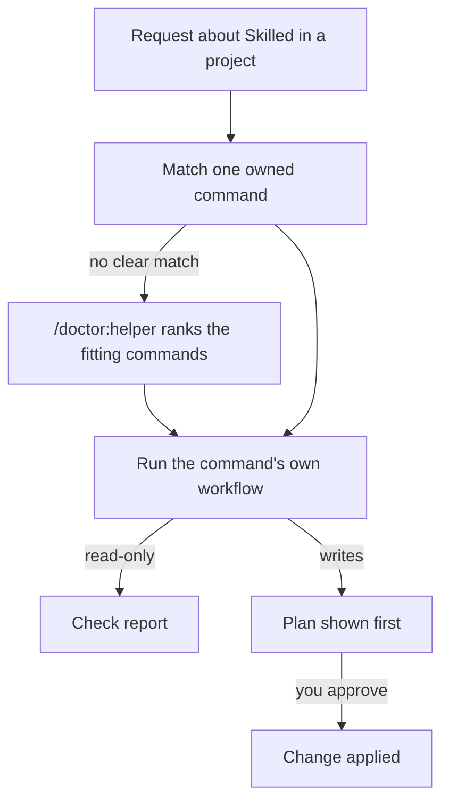

# system-skilled-doctor

> Get Skilled into your own project and keep it working and current there.

---

## 1. OVERVIEW

### At a Glance

| Aspect | What you get |
|---|---|
| **Use it for** | Installing, linking, updating and checking Skilled in a project repository, including a vendored copy |
| **Invoke with** | The doctor commands below, or a request such as "put Skilled into my project repo" |
| **Works on** | A project repository and the Skilled checkout or release it uses |
| **Produces** | Check reports and plans that change nothing until you approve them |

### What It Does

This skill owns eleven doctor commands about supporting and integrating Skilled into a project. Each command keeps its own workflow in `.skilled/commands/doctor/`, so the skill's job is to say which command fits and to run it. When you are not sure which one, `/doctor:helper` takes the problem in your words and ranks the commands that fit.

Doctor commands about a single skill's own checks stay with that skill, such as `/doctor:git` with `sk-git`.

### The Owned Commands

| Command | What it does |
|---|---|
| `/doctor:install` | Walks a first install into your own project repo. It checks the builds and runs the symlink check, then prints the ordered setup commands for you to run, writing nothing itself |
| `/doctor:symlink` | Checks, links or unlinks the `.skilled` folder and the chosen runtime folders in another project repo, as a whole-folder link or a real folder holding one link per entry, writing only after you approve the printed plan and its digest |
| `/doctor:update` | Moves a checkout to a newer spec-kit release: `check`, `align`, a gated `apply`, `rollback`, `record-base` and `compat`, which moves a v3 spec layout to v4 behind two approvals |
| `/doctor:agents-md` | Checks the sections Skilled ships in a project's `AGENTS.md`, and embeds or restores them after showing the plan |
| `/doctor:runtime-mirrors` | Checks the agent, command, prompt and hook mirrors each runtime directory derives from `.skilled` and names the repair command |
| `/doctor:env` | Shows the switches documented in `.skilled/skills/system-spec-kit/runtime/ENV-REFERENCE.md` and every other setting in the root `.env.example`, with where each is set. It saves a preference after you approve the exact line |
| `/doctor:setup` | Lists every doctor command and target, runs five read-only setup checks, names the repair command for each failing one and shows the last session hop, any unclaimed handoff note and the orphaned processes still running |
| `/doctor:helper` | Takes a described problem and ranks the doctor commands that fit, with why, ready to run |
| `/doctor:speckit` | Checks that the trigger index is fresh and that its lookup and the ripgrep recipes return results |
| `/doctor:mcp` | Installs or debugs Code Mode with its UTCP configuration and runtime registration |
| `/doctor:overlay` | Keeps a vendored Skilled copy's own changes. `status` reports every overlay that is out of sync and the fix. `apply` puts the overlays back after showing what will change. `repin` moves the copy to a newer upstream commit with a backup it can roll back |

---

## 2. QUICK START

**Step 1: Name the job.** Ask in your own words, for example "put Skilled into my project repo", or run a command from the table.

**Step 2: Run the command.**

```text
/doctor:install
```

It prints the ordered steps for your project and writes nothing itself.

**Step 3: Check the result.**

```text
/doctor:setup
```

Each failing check names the command that repairs it.

---

## 3. HOW IT WORKS

A request reaches this skill when it is about Skilled inside a project. The skill matches it to one command from the table, and when nothing matches clearly, `/doctor:helper` ranks the commands that fit. That command runs its own workflow and shows its result. A command that writes shows its plan first and changes nothing until you approve it.



### Where the Scripts Live

The scripts some commands call stay with the skill that owns them. `/doctor:speckit` runs `system-spec-kit`'s trigger-index lookup, and `/doctor:env` reads its `ENV-REFERENCE.md`. Moving a command's owner did not move the code it runs.

---

## 4. INTEGRATION & NAVIGATION

### When To Use This Skill

Reach for it when you add Skilled to a project, link a local checkout into another repository, move a project to a newer release, embed the shipped `AGENTS.md` sections or keep a vendored copy's own changes across a new copy. It also fits when something about Skilled in a project looks wrong and you want the check that names the repair.

A check of one skill's own surface belongs to that skill. `/doctor:git` stays with `sk-git`, `/doctor:sk-code` and `/doctor:ci` with `sk-code`, `/doctor:sk-skill` with `sk-doc`, `/doctor:skill-advisor` with `system-skill-advisor` and `/doctor:deep-loop` with `system-deep-loop`.

### Related Skills

`system-spec-kit` owns the trigger index, its retrieval recipes, the runtime-mirror generators and the environment reference, and a doctor command here checks each of them. `mcp-code-mode` owns Code Mode itself, which `/doctor:mcp` installs and debugs in a project.

---

## 5. FAQ

**Q: Did any `/doctor:*` command change when it moved to this skill?**

A: No. Each command file stayed in `.skilled/commands/doctor/` and changed one line, the tag that names its owner. It runs exactly what it ran before.

**Q: Why does `/doctor:git` not live here?**

A: It switches `sk-git`'s own hook gates and rules, so it belongs with the skill whose settings it changes. This skill owns the commands about Skilled in a project as a whole.

**Q: What happens when a re-pin goes wrong?**

A: The live run backs up every path it touches before its first write. When it fails after that, it prints a `repin --rollback <run-id>` line that puts those bytes back. `references/overlays.md` has the full steps.

---

## 6. VERIFICATION

Run the doctor contract tests from the repository root:

```bash
node --test .skilled/commands/doctor/scripts/tests/*.test.cjs
```

A pass prints `fail 0` in the summary. Then confirm the advisor credits each owned command to this skill by running `node .skilled/skills/system-skill-advisor/runtime/scripts/command-bridges/derive-command-bridges.cjs --check`, which prints `"changed": []` when the bridges are current.

---

## 7. RELATED DOCUMENTS

| Document | Purpose |
|---|---|
| [`SKILL.md`](./SKILL.md) | Runtime instructions |
| [`ROUTER.md`](./ROUTER.md) | Machine router: the intent map and the resource map |
| [`references/overlays.md`](./references/overlays.md) | The overlay sync states and what the engine refuses, plus the re-pin and rollback steps |
