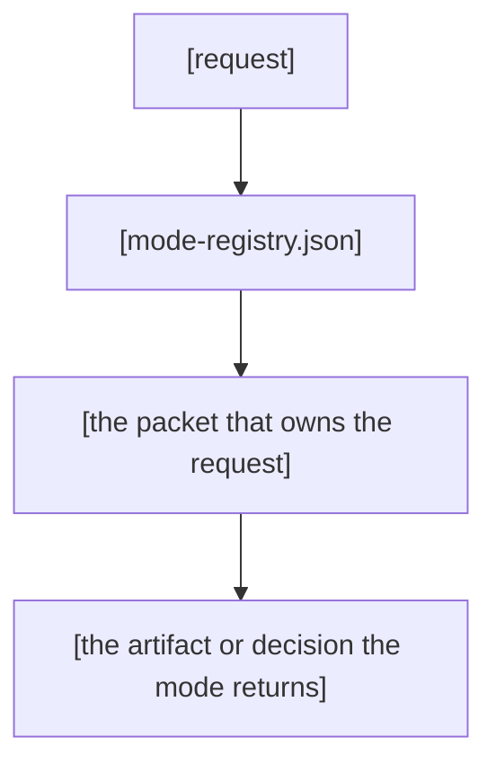

# Approved code blocks

Blocks the orchestrator read and approved: the init example now lists what `init_skill.py` writes.

```bash
# Create skill in .skilled/skills/ directory
scripts/init_skill.py markdown-optimizer --path .skilled/skills

# Creates:
# .skilled/skills/markdown-optimizer/
# ├── SKILL.md (with TODO placeholders and a link to ./ROUTER.md)
# ├── ROUTER.md (the seeded machine router)
# ├── graph-metadata.json
# ├── leaf-manifest.config.json
# ├── leaf-manifest.json and leaf-aliases.json (generated by the class gate)
# ├── manual-testing-playbook/manual-testing-playbook.md
# └── benchmark/README.md and benchmark/reports/README.md
```

````markdown
---
title: "[hub-name]"
description: "[One sentence: the hub's family and what it routes.]"
trigger_phrases:
  - "[primary routing phrase]"
  - "[secondary routing phrase]"
version: 1.0.0.0
---

# [hub-name]

> [One line. The outcome the hub delivers for its whole family, in plain words a person would say out loud.]

[Optional. Add one or two sentences about the reader's current need before the scan table. AT A GLANCE stays the first numbered section.]

---

## 1. AT A GLANCE

| Aspect | What you get |
|---|---|
| **Use it for** | [The family of problems the hub routes, one line.] |
| **Invoke with** | [Keyword routing, slash commands or the manual read path.] |
| **Routes to** | [The nested packets via mode-registry.json and hub-router.json.] |
| **Produces** | [The artifacts or decisions the modes return.] |

---

## 2. OVERVIEW

### What It Does

[Write two to four short sentences. Say what the hub is and what the reader gets.
Name the registry that resolves modes and the manifest that inventories leaves.
State what the hub does before listing features.]

### Why This Hub Exists

[Optional. In two to four short sentences, name the reader's current problem and how the hub helps.
Name the family and nested packets. Do not add a feature list.]

[Optional Mermaid diagram for a multi-step routing flow. Show request to registry to the packet that owns it.]



---

## 3. MODES AND PACKETS

[One or two sentences that frame the family this table lists, so the table reads as a map. Then the table.]

| Packet | Kind | Use it for | Pointer |
|---|---|---|---|
| `[mode-a]/` | workflow | [What the mode does, one line.] | [`README.md`](./[mode-a]/README.md) |
| `[mode-b]/` | surface | [What the evidence base covers, one line.] | [`README.md`](./[mode-b]/README.md) |
| `[mode-c]/` | transport | [What external tool it bridges, one line.] | [`README.md`](./[mode-c]/README.md) |

[One row per child packet, copied from mode-registry.json. A packet without a README links its folder with a trailing slash. Add a row for every mode the registry lists.]

---

## 4. NAVIGATION

| File | What it holds | Why it matters |
|---|---|---|
| [`mode-registry.json`](./mode-registry.json) | The single source of truth for every mode | Resolve which packet owns a request |
| [`leaf-manifest.json`](./leaf-manifest.json) | The generated inventory of routed leaves | Find the reference and asset files a mode loads |

[Both paths are stable relative links from the hub root. The manifest regenerates when packets change, so read it as a snapshot.]

---

## 5. CHANGELOG

Releases live in `changelog/` with one file per release, named `v[version].md`. Every entry opens with the release title and the reason in plain words, then a what-changed list grouped by surface, then a files-changed table. Link the newest entry:

| Release | Entry |
|---|---|
| [version] | [`changelog/v[version].md`](./changelog/v[version].md) |

---

## 6. SCRIPTS AND COMMANDS

| Script or command | One-line usage | Expected output |
|---|---|---|
| [script path] | [command] | [what a pass looks like] |
| [slash command] | [command] | [what it dispatches to] |

---

## 7. VERIFICATION

Run the sk-doc readme validator on this file:

```bash
python3 .skilled/skills/sk-doc/scripts/validate_document.py .skilled/skills/[hub-name]/README.md --type readme
```

[Expected: zero issues. The validator enforces the numbered ALL-CAPS OVERVIEW section.]

Run this check. It passes when it finds no em dashes or semicolons:

```bash
! rg -n '\x{2014}|\x{3B}' README.md
```

[Keep zero Oxford commas, zero banned words and zero setup phrases in the prose as well. Optional extra: run the parent-skill check to prove the whole hub shape.]

```bash
node .skilled/commands/doctor/scripts/parent-skill-check.cjs .skilled/skills/[hub-name]
```

[Expected: zero invariant failures and zero warnings.]
````

````markdown
---
title: "[hub-name]"
description: "[One sentence: the hub's family and what it routes.]"
trigger_phrases:
  - "[primary routing phrase]"
  - "[secondary routing phrase]"
version: 1.0.0.0
---

# [hub-name]

> [One line. The outcome the hub delivers for its whole family, in plain words a person would say out loud.]

[Optional. Add one or two sentences about the reader's current need before the scan table. AT A GLANCE stays the first numbered section.]

---

## 1. AT A GLANCE

| Aspect | What you get |
|---|---|
| **Use it for** | [The family of problems the hub routes, one line.] |
| **Invoke with** | [Keyword routing, slash commands or the manual read path.] |
| **Routes to** | [The nested packets via mode-registry.json and hub-router.json.] |
| **Produces** | [The artifacts or decisions the modes return.] |

---

## 2. OVERVIEW

### What It Does

[Write two to four short sentences. Say what the hub is and what the reader gets.
Name the registry that resolves modes and the manifest that inventories leaves.
State what the hub does before listing features.]

### Why This Hub Exists

[Optional. In two to four short sentences, name the reader's current problem and how the hub helps.
Name the family and nested packets. Do not add a feature list.]

[Optional Mermaid diagram for a multi-step routing flow. Show request to registry to the packet that owns it.]


---

## 3. MODES AND PACKETS

[One or two sentences that frame the family this table lists, so the table reads as a map. Then the table.]

| Packet | Kind | Use it for | Pointer |
|---|---|---|---|
| `[mode-a]/` | workflow | [What the mode does, one line.] | [`README.md`](./[mode-a]/README.md) |
| `[mode-b]/` | surface | [What the evidence base covers, one line.] | [`README.md`](./[mode-b]/README.md) |
| `[mode-c]/` | transport | [What external tool it bridges, one line.] | [`README.md`](./[mode-c]/README.md) |

[One row per child packet, copied from mode-registry.json. A packet without a README links its folder with a trailing slash. Add a row for every mode the registry lists.]

---

## 4. NAVIGATION

| File | What it holds | Why it matters |
|---|---|---|
| [`mode-registry.json`](./mode-registry.json) | The single source of truth for every mode | Resolve which packet owns a request |
| [`leaf-manifest.json`](./leaf-manifest.json) | The generated inventory of routed leaves | Find the reference and asset files a mode loads |

[Both paths are stable relative links from the hub root. The manifest regenerates when packets change, so read it as a snapshot.]

---

## 5. CHANGELOG

Releases live in `changelog/` with one file per release, named `v[version].md`. Every entry opens with the release title and the reason in plain words, then a what-changed list grouped by surface, then a files-changed table. Link the newest entry:

| Release | Entry |
|---|---|
| [version] | [`changelog/v[version].md`](./changelog/v[version].md) |

---

## 6. SCRIPTS AND COMMANDS

| Script or command | One-line usage | Expected output |
|---|---|---|
| [script path] | [command] | [what a pass looks like] |
| [slash command] | [command] | [what it dispatches to] |

---

## 7. VERIFICATION

Run the sk-doc readme validator on this file:

```bash
python3 .skilled/skills/sk-doc/scripts/validate_document.py .skilled/skills/[hub-name]/README.md --type readme
```

[Expected: zero issues. The validator enforces the numbered ALL-CAPS OVERVIEW section.]

Run this check. It passes when it finds no em dashes or semicolons:

```bash
! rg -n '\x{2014}|\x{3B}' .skilled/skills/[hub-name]/README.md
```

[Keep zero Oxford commas, zero banned words and zero setup phrases in the prose as well. Optional extra: run the parent-skill check to prove the whole hub shape.]

```bash
node .skilled/commands/doctor/scripts/parent-skill-check.cjs .skilled/skills/[hub-name]
```

[Expected: zero invariant failures and zero warnings.]
````

```bash
.skilled/skills/sk-doc/sk-create-skill/scripts/validate_skill_package.py <path/to/skill>
```

```bash
.skilled/skills/sk-doc/sk-create-skill/scripts/package_skill.py <path/to/skill> --check
```

```bash
.skilled/skills/sk-doc/shared/scripts/extract_structure.py .skilled/skills/my-skill/SKILL.md
# AI evaluates the JSON output and provides quality assessment
```

```bash
.skilled/skills/sk-doc/sk-create-skill/scripts/package_skill.py <path/to/skill> <output-directory>
```

```text
skill-name/
├── SKILL.md
├── ROUTER.md                      # sibling machine router
├── graph-metadata.json
├── leaf-manifest.config.json
├── leaf-scopes.json                # optional: narrows the leaf roots to scopes
├── leaf-manifest.json              # generated
├── leaf-aliases.json               # generated identity projection
├── README.md
├── references/
├── assets/
├── scripts/
├── manual-testing-playbook/          # the scenario corpus — an input
│   └── manual-testing-playbook.md    # the index; per-feature files in category folders
└── benchmark/                        # what running that corpus produced — output
    ├── README.md                     # layout and how to run
    └── reports/
        ├── README.md                 # run index, appended by the harness
        └── <YYYY-MM-DD>--<subject>--<variant>/
```

```text
parent-hub/
├── SKILL.md
├── README.md
├── mode-registry.json
├── hub-router.json
├── ROUTER.md                   # stage-two control; stage1-only on a fresh scaffold
├── description.json
├── graph-metadata.json
├── command-metadata.json          # optional; only when the hub owns slash commands
├── leaf-manifest.json              # generated
├── changelog/
├── manual-testing-playbook/          # the scenario corpus — an input
│   └── manual-testing-playbook.md    # the index; per-feature files in category folders
├── benchmark/                        # what running that corpus produced — output
│   ├── README.md                     # layout and how to run
│   └── reports/
│       ├── README.md                 # run index, appended by the harness
│       └── <YYYY-MM-DD>--<subject>--<variant>/
├── workflow-packet/
│   ├── SKILL.md
│   ├── ROUTER.md
│   ├── README.md
│   ├── procedures/       (optional - only if the packet has multiple distinct, triggered procedures)
│   └── changelog/
└── surface-packet/
    ├── SKILL.md
    ├── ROUTER.md
    ├── README.md
    ├── references/
    ├── assets/
    └── changelog/
```

```
pdf-editor/
├── SKILL.md
├── ROUTER.md
├── scripts/
│   ├── rotate_pdf.py
│   ├── crop_pdf.py
│   └── merge_pdfs.py
└── references/
    └── pdf-operations.md
```

```
brand-guidelines/
├── SKILL.md
├── ROUTER.md
├── assets/
│   ├── logo.png
│   ├── logo-dark.png
│   └── color-palette.json
└── references/
    └── brand-guidelines.md
```

```
database-query/
├── SKILL.md
├── ROUTER.md
└── references/
    ├── schema.md
    └── common-queries.md
```

```
pdf-editor/
├── SKILL.md
├── ROUTER.md
├── scripts/
│   ├── rotate_pdf.py
│   ├── crop_pdf.py
│   └── merge_pdfs.py
└── references/
    ├── pdf-operations.md
    └── procedures/
        ├── sensitive-field-redaction.md
        ├── digital-signature-verification.md
        └── batch-annotation-cleanup.md
```

````markdown
---
name: [parent-skill-name]
description: "[Unified skill that routes workflow and surface packets through mode-registry.json; holds no packet-local logic.]"
allowed-tools: [<exact union of every mode's toolSurface.allowed — checker rule 3j; e.g. Read, Write, Edit, Bash, Grep, Glob, Task>]
version: 1.0.0.0
---

<!-- Keywords: [parent-skill-name], mode-registry, hub-router, workflowMode, packetKind, [workflow-mode-a], [surface-name], [domain keywords] -->

# [Parent Skill Title]

[One sentence: one public skill identity, [workflow-count] workflow packet(s), and [surface-count] optional surface evidence packet(s).] This hub holds no packet-local logic. It routes by `workflowMode` through `mode-registry.json` and uses `hub-router.json` for router policy, signals, and bundle outcomes.

---

## 1. WHEN TO USE

Use this skill when the request belongs to the [family/domain] family and should route to one of these packets:

| Packet | Kind | Use it for | Tool posture |
|--------|------|------------|--------------|
| `[workflow-mode-a]` | workflow | [process outcome] | [mutating/read-only] |
| `[workflow-mode-b]` | workflow | [process outcome] | [mutating/read-only] |
| `[surface-name]` | surface | [read-only evidence domain] | read-only evidence-base |

### When NOT to Use

- Requests outside [family/domain].
- Direct runtime/backend maintenance unless that is an explicit workflow packet.
- Mutating work inside a surface packet, because surfaces are read-only evidence bases.

---

## 2. SMART ROUTING

`hub-router.json` scores the request and selects a `workflowMode`.
`mode-registry.json` maps that mode to its packet.
The root [`ROUTER.md`](./ROUTER.md) selects the first resources the packet loads.
`packetKind` identifies each packet as `workflow`, `surface` or `transport`.
`routerPolicy` defines the available outcomes.
It returns `single` when one workflow mode wins.
It returns `orderedBundle` when several workflow modes match.
It returns `surfaceBundle` for one workflow mode with read-only surfaces.
It returns `defer` when modes tie or conflict.
Ask which mode the reader means when the router returns `defer`.
When no mode matches, return `UNKNOWN_FALLBACK`.
You run the compiled-routing directive in [`ROUTER.md`](./ROUTER.md) first.

---

## 3. HOW IT WORKS

### Layout

| Path | Purpose |
|---|---|
| `[parent-skill-name]/SKILL.md` | Hub instructions |
| `[parent-skill-name]/README.md` | Hub overview |
| `[parent-skill-name]/mode-registry.json` | Packet registry |
| `[parent-skill-name]/hub-router.json` | Routing policy |
| `[parent-skill-name]/ROUTER.md` | Stage-two control document and the hub's routing prose |
| `[parent-skill-name]/description.json` | Hub-doctor metadata |
| `[parent-skill-name]/graph-metadata.json` | Hub identity |
| `[parent-skill-name]/command-metadata.json` | Optional command metadata |
| `[parent-skill-name]/leaf-manifest.json` | Generated leaf inventory |
| `[parent-skill-name]/changelog/` | Hub changelogs |
| `[parent-skill-name]/manual-testing-playbook/` | Manual test cases |
| `[parent-skill-name]/benchmark/` | Benchmark baseline (parent-skill-check 9b warns if absent) |
| `[parent-skill-name]/[workflow-packet-a]/SKILL.md` | Workflow instructions |
| `[parent-skill-name]/[workflow-packet-a]/ROUTER.md` | Workflow packet router |
| `[parent-skill-name]/[workflow-packet-a]/README.md` | Workflow overview |
| `[parent-skill-name]/[workflow-packet-a]/changelog/` | Workflow changelogs |
| `[parent-skill-name]/[surface-name]/SKILL.md` | Surface instructions |
| `[parent-skill-name]/[surface-name]/ROUTER.md` | Surface packet router |
| `[parent-skill-name]/[surface-name]/README.md` | Surface overview |
| `[parent-skill-name]/[surface-name]/references/` | Surface evidence |
| `[parent-skill-name]/[surface-name]/assets/` | Surface assets |
| `[parent-skill-name]/[surface-name]/changelog/` | Surface changelogs |

### Companion Metadata

- `mode-registry.json` owns `workflowMode`, `packetKind`, `backendKind`, `toolSurface`, packet folder identity, alias phrases, and `advisorRouting`.
- `hub-router.json` owns `routerPolicy`, `routerSignals`, `vocabularyClasses`, and bundle rules.
- `ROUTER.md` is the stage-two control document.
  - `router_state: active` declares non-empty equal-key `INTENT_SIGNALS`/`RESOURCE_MAP`.
  - `router_state: stage1-only` keeps all stage-two collections empty and delegates to stage one.
  - Promote to `active` only after authoring concrete, resolvable leaf paths, never placeholder intents.
  - Its final `## MACHINE ROUTER` section holds the compiled-routing directive and the fallback checklist, so the hub `SKILL.md` never repeats them.
- `description.json` owns hub-doctor metadata fields and optional hub-specific arrays.
- `graph-metadata.json` owns the one skill-graph identity node.

### Optional Extensions

Use top-level `extensions` in `mode-registry.json` only when the hub needs extra machinery:

- `runtime-loop`: activates per-mode `runtimeLoopType` and convergence backend fields.
- `advisor-projection`: declares the drift-guard path for lexical or alias-fold routes.
- `transform-verbs`: declares verb-transform routing for design-like hubs.
- `deprecated-modes`: documents retired modes kept as shims.
- `surface-axis`: declares that the hub includes `packetKind: "surface"` packets.
- `transport-axis`: declares that the hub includes `packetKind: "transport"` packets.

These extensions activate in-place fields. They do not move `advisorRouting` data and do not create a third physical tier.

### Terms

This is the hub's only glossary. Packets link here instead of defining routing terms of their own.

| Term | Meaning |
|------|---------|
| [routing term] | [one-line meaning] |
| [routing term] | [one-line meaning] |

---

## 4. RULES

### ALWAYS

- Resolve packets through `mode-registry.json`. Never hardcode packet roots in prose-only logic.
- Keep `SKILL.md` thin: routing, invariants, and navigation only.
- Keep every packet in `modes[]` and give every packet a `packetKind`.
- Keep surfaces read-only with `backendKind: "evidence-base"` and `routingClass: "metadata"`.
- Keep exactly one `graph-metadata.json`, at the hub root.
- Keep `hub-router.json` signal keys and registry `workflowMode` values bidirectionally aligned.

### NEVER

- Never add `surfacePackets[]` or any second packet array.
- Never put mutating tools on a surface packet.
- Never add packet-local `graph-metadata.json` files.
- Never infer extension-only fields from `workflowMode`. Declare the extension and field explicitly.
- Never move `advisorRouting` fields away from mode entries.

### ESCALATE IF

- A packet cannot be classified as `workflow` or `surface`.
- A surface needs mutation, so it is no longer a surface evidence base.
- A lexical or alias-fold route lacks a drift guard.
- Router signals, vocabulary classes, and registry modes cannot be made bidirectionally consistent.

---

## 5. REFERENCES

- Registry: `mode-registry.json`.
- Router: `hub-router.json`.
- Root router: [`ROUTER.md`](./ROUTER.md).
- Hub-doctor metadata: `description.json`.
- Skill graph identity: `graph-metadata.json`.
- Workflow packets: `[workflow-packet-a]/SKILL.md`, `[workflow-packet-b]/SKILL.md`.
- Surface packets: `[surface-name]/SKILL.md`, `[surface-name]/references/`, `[surface-name]/assets/`.

---

````

