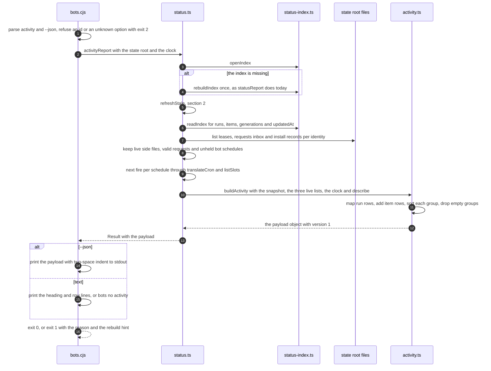
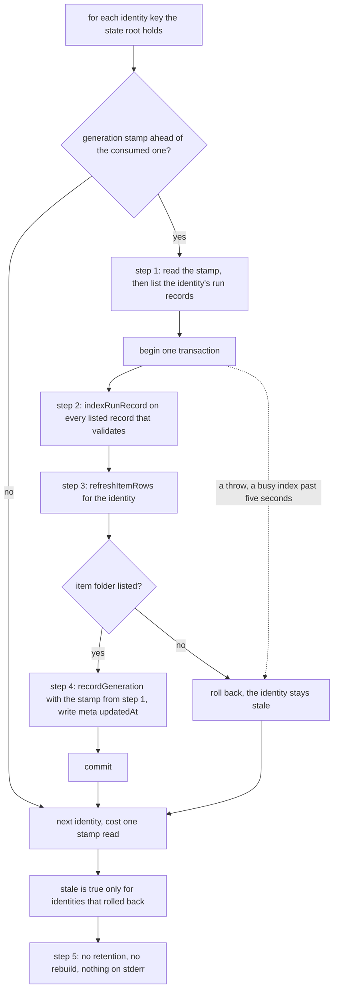
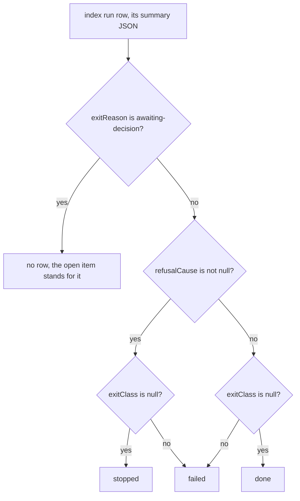
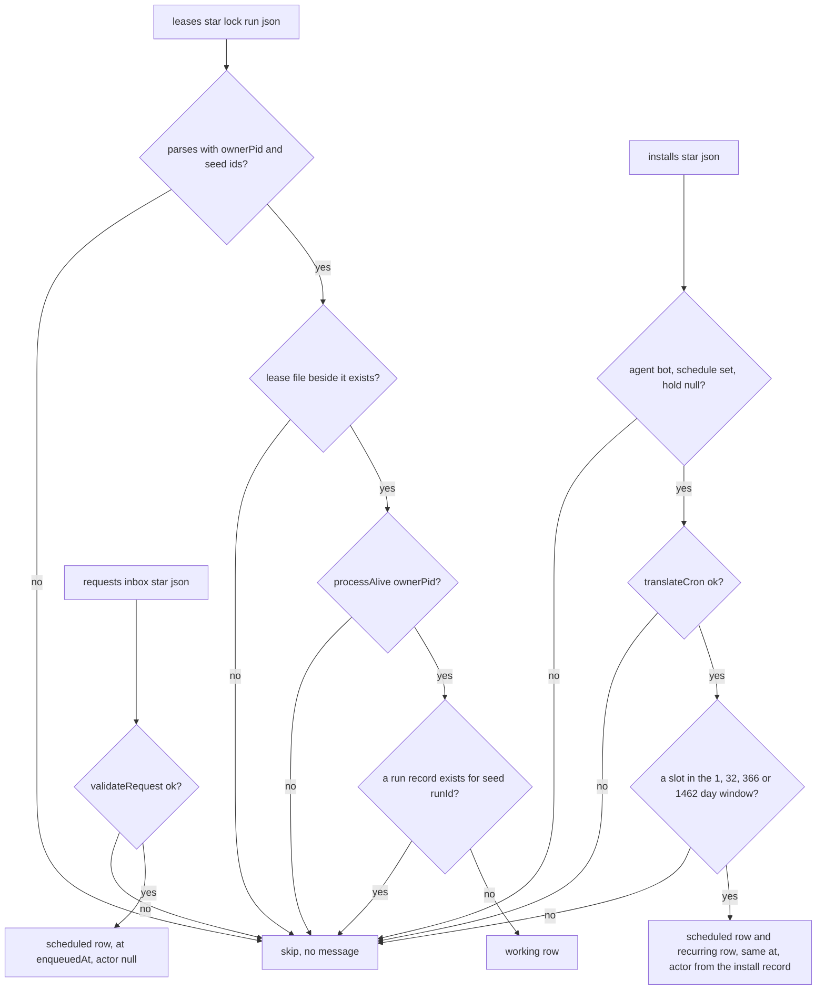
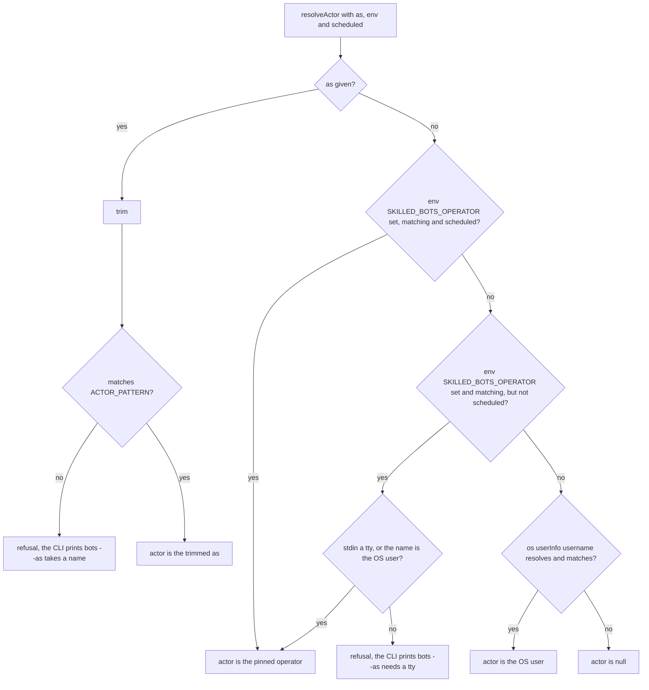
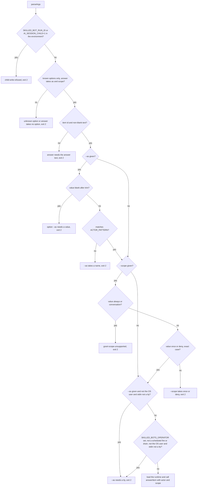
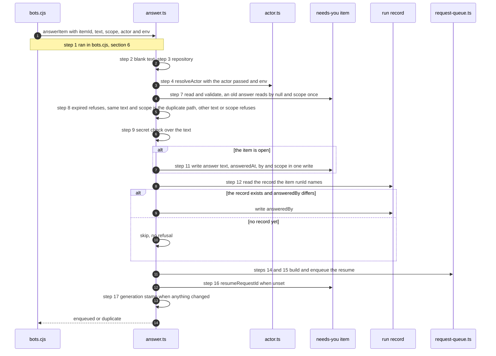
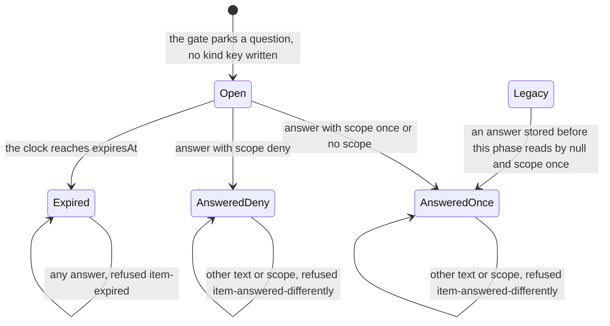
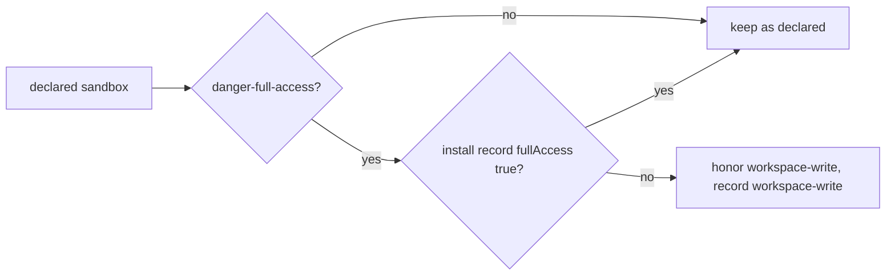

# Activity and actor sequences and state machines

Each diagram draws a rule [data-model.md](data-model.md) states in prose. Where the two disagree the prose wins and the diagram is fixed. The whole answer path after every phase is `contracts/answer-seam.md`, and section 7 here draws only the steps this phase owns.

---

## 1. THE ACTIVITY READ

---

## 2. THE REFRESH ON READ

One pass per call, shared by `statusReport` and `activityReport`. The five steps are the screen contract's section 10.

---

## 3. A RUN ROW'S GROUP

Item rows give `needs_you` only while open. An answered or expired item gives no row.

---

## 4. THE LIVE SOURCES

---

## 5. THE ACTOR

`env` is the environment the run or the answer executes under, never `resolveEnv`. [data-model.md](data-model.md) section 8 says why. `scheduled` is true on a scheduled fire or a scheduled drain, so a shell that exports the pinned name takes the tty rule instead of the name.

---

## 6. THE ANSWER VERB'S CHECK ORDER

Every check here runs in `bots.cjs` before the runtime loads, so each refusal exits 2 and touches no file. The messages are [refusals.md](refusals.md) section 1.

`bots run --as` takes the same `--as` branch and the same tty check. `bots schedule install --full-access` takes the tty check alone, with the message `bots: --full-access needs a tty`. `bots enable` takes the child check alone, because it writes the fatigue item's answer and takes no `--as`.

---

## 7. THIS PHASE'S SLICE OF THE ANSWER SEAM

Step numbers are `contracts/answer-seam.md` section 1. Steps this phase does not touch are drawn as one line each.

---

## 8. THE ANSWER'S STATES

This phase's view of `contracts/answer-seam.md` section 2. The grant columns land with 006.

---

## 9. THE SANDBOX CAP

| Declared sandbox | Install record `fullAccess` | Honored and recorded as `posture.sandbox` |
|------------------|-----------------------------|--------------------------------------------|
| `read-only` | either | `read-only` |
| `workspace-write` | either | `workspace-write` |
| `danger-full-access` | `false`, or no install record | `workspace-write` |
| `danger-full-access` | `true` | `danger-full-access` |
| none declared | either | unchanged from today's rule |

