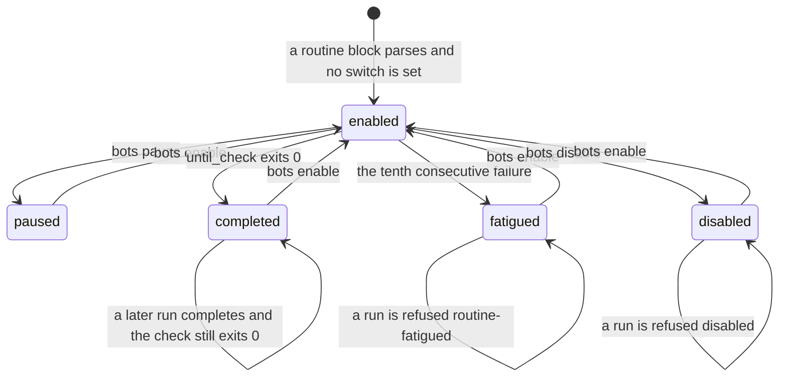
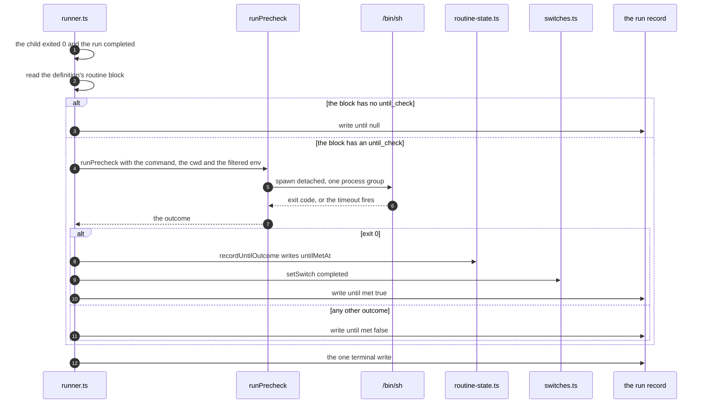
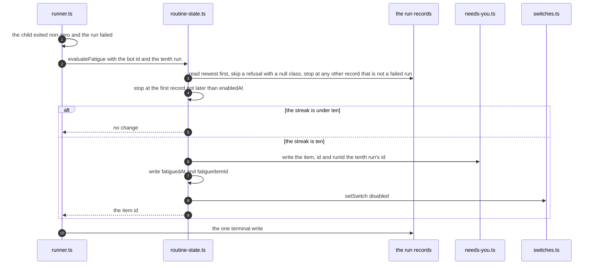
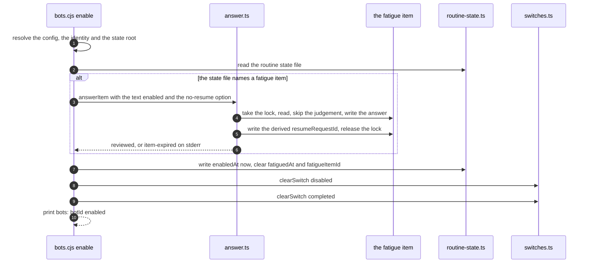
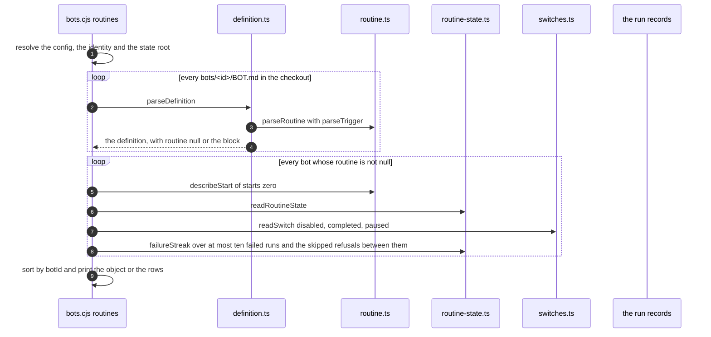

# Routine state machines, sequences and the transition contract

Two writers change a routine bot's state: the runner after a failed run, and `bots enable`. They write the same three things, the needs-you item, the routine state file and the `disabled` switch, and neither had a stated order or a rule for a stop between two writes. This file fixes both, so a builder writes a sequence rather than choosing one.

The record shapes are `design/records.md`. The refusal names are `design/refusals.md`. The packet contracts own the answer seam and the switch kinds, and this file cites them. [SOURCE: specs/system-skilled-bots/003-openbot-parity-build/contracts/answer-seam.md, section "1. THE SEQUENCE", row 8] [SOURCE: specs/system-skilled-bots/003-openbot-parity-build/contracts/runtime-architecture.md, section "2.1 The user state root"]

---

## 1. THE ROUTINE LIFECYCLE

Five states, and `bots routines --json` prints the first that applies in the order `fatigued`, `disabled`, `completed`, `paused`, else `enabled`. [SOURCE: specs/system-skilled-bots/003-openbot-parity-build/003-terminal-screen/002-architecture-and-contracts/design/contracts.md:584]



| State | The switch that carries it | The state file field that carries it | What a run does |
|-------|---------------------------|--------------------------------------|-----------------|
| `enabled` | none set | none | dispatches |
| `paused` | `paused` | none | refused `paused` |
| `completed` | `completed` | `untilMetAt` non-null | refused `routine-completed` |
| `disabled` | `disabled` | `fatiguedAt` null | refused `disabled` |
| `fatigued` | `disabled` | `fatiguedAt` non-null | refused `routine-fatigued` |

**Why `fatigued` is not its own switch.** The `disabled` switch already stops the bot, and a fourth switch kind would mean two switches could disagree about one bot. The state file's `fatiguedAt` is what tells the runtime's stop from the operator's stop, and the `disabled` check reads it to name the refusal. [SOURCE: specs/system-skilled-bots/003-openbot-parity-build/contracts/refusals.md, section "5. DECISIONS TAKEN"]

**The `completed` switch is checked beside `disabled`.** Both are read before the lease, so a stopped bot never takes one. A run stopped by `completed` is refused `routine-completed`, class `null`, and enters `REFUSAL_CAUSES`. [SOURCE: specs/system-skilled-bots/003-openbot-parity-build/contracts/refusals.md, section "5. DECISIONS TAKEN"]

---

## 2. THE FATIGUE TRANSITION CONTRACT

The runner evaluates the rule after a failed run. Three writes, in this order, and each one is safe to repeat.

| Step | Write | Why it is here and not earlier |
|------|-------|-------------------------------|
| 1 | The needs-you item, id and `runId` both the tenth failed run's id | The item is the operator's record of what happened. Writing it first means a stop leaves something the operator can see and act on |
| 2 | The routine state file, `fatiguedAt` and `fatigueItemId` | The `disabled` check reads `fatiguedAt` to name `routine-fatigued`. It must be on disk before the switch that makes the check run |
| 3 | The `disabled` switch | The only step that changes what a run does. Setting it before step 2 would make the next run refuse `disabled` and lose the name the phase requires |

**Each step is safe to repeat.** The item's id is the tenth run's id, so a second evaluation writes the same file with the same content. The state file is one whole-object write. `setSwitch` on a switch already set rewrites the same instant. A second evaluation therefore converges on the same three files.

**The streak is derived, never stored.** `failureStreak` reads the identity's run records newest first. It skips a refusal whose `exit.class` is null and keeps counting, so a `precheck-silent`, `lease-held`, `paused` or `disabled` refusal between two failures leaves both failures counted. It stops at the first other record that is not a failed run, which is a completed run, a parked run or a refusal whose `exit.class` is not null, and it stops once it has counted ten. A failed run is a dispatched run whose record carries a non-null `exit.class`, no `exit.refusal` and an `exit.reason` other than `awaiting-decision`. [SOURCE: .skilled/skills/system-skilled-bots/runtime/lib/run-record.ts:134-138] [SOURCE: .skilled/skills/system-skilled-bots/runtime/lib/run-record.ts:273-277] The count also stops at the first record whose `dispatch.dispatchedAt` is not later than the state file's `enabledAt`, which is the restart rule `contracts/decisions.md` D9 takes. [SOURCE: specs/system-skilled-bots/003-openbot-parity-build/contracts/decisions.md, D9]

**The rule fires once.** It fires when the streak reaches ten. A second evaluation on the same ten failed runs finds the item already written and the switch already set, so nothing changes. The bot is not switched off twice and no second item appears.

---

## 3. THE ENABLE TRANSITION CONTRACT

`bots enable` is the one recovery. Three steps, in this order, and each one is safe to repeat.

| Step | Write | Why it is here and not earlier |
|------|-------|-------------------------------|
| 1 | The fatigue item, answered through `answerItem` with the no-resume option and the fixed text `enabled` | The item holds the bot's unattended runs. Answering it first means a stop leaves the bot still stopped by the switch, which is the safe direction |
| 2 | The routine state file, `enabledAt` set to now, `fatiguedAt` and `fatigueItemId` cleared | `enabledAt` is what restarts the streak. It must be on disk before the switch is cleared, or the next failure would count the ten old ones |
| 3 | The `disabled` switch and the `completed` switch, both cleared | The last step, so a stop before it leaves the bot stopped rather than running on a stale record |

**The text is `enabled`.** `answerItem` derives the scope from the text: `deny`, `no` or `n` in any case after trim gives `deny`, and anything else gives `once`. [SOURCE: specs/system-skilled-bots/003-openbot-parity-build/contracts/answer-seam.md, section "1. THE SEQUENCE", row 8] `enabled` is not in the NO set, so the answer records the scope `once` and the grant is written in the same atomic write as the answer. The no-resume option then skips the resume, so no request is queued and the tenth failed run is never re-run.

**The option is `resume`.** `AnswerInput` gains `resume?: boolean`, defaulting to `true`, and `bots enable` passes `resume: false`. [SOURCE: .skilled/skills/system-skilled-bots/runtime/lib/answer.ts:35-45] The branch reads `input.resume === false`, skips the `enqueue` call and writes `resumeRequestId` from `requestIdFor(item.botId, item.id)`, which is the id the skipped request would have carried. [SOURCE: .skilled/skills/system-skilled-bots/runtime/lib/request-record.ts:126] [SOURCE: .skilled/skills/system-skilled-bots/runtime/lib/request-record.ts:167] The field name is fixed here because `tasks.md` T021 and `acceptance-criteria.md` AC-006 both grep `input.resume`.

**The item is best effort.** Three outcomes, and none of them fails the enable:

| The item's state | What step 1 does | What the operator sees |
|------------------|------------------|------------------------|
| `open` | answers it with `enabled`, no resume | `bots: <botId> enabled` on stdout |
| `answered` | the no-resume option skips the answer-identity judgement, goes to step 16 and writes the derived `resumeRequestId` | `bots: <botId> enabled` on stdout |
| `expired` or absent | nothing to answer | `bots: <botId> enabled` on stdout, and `bots: item <id> expired; not answered` on stderr |

The expired case is why the item is best effort. An expired item refuses every answer with `item-expired`, and a recovery that refused would leave the bot stopped with no way back except editing files by hand. [SOURCE: specs/system-skilled-bots/003-openbot-parity-build/contracts/answer-seam.md, section "2. ITEM STATE TRANSITIONS"]

**Each step is safe to repeat.** Step 1 on an answered item writes the same derived id. Step 2 is one whole-object write. `clearSwitch` on a switch already clear returns without writing. A second `bots enable` therefore converges on the same three files, and it is also the repair for a stop after step 1 or step 2.

---

## 4. THE TRANSITION MATRIX

Four rows. Each names what is on disk if the process stops, what the next run does, and the one action that repairs it.

| # | Scenario | What is on disk if it stops | The next run | The repair |
|---|----------|-----------------------------|--------------|------------|
| 1 | `bots enable` runs while a failing run is in flight | The item answered, `enabledAt` written, `fatiguedAt` cleared, both switches cleared. The in-flight run has not written its record | The in-flight run finishes and evaluates fatigue. Its `dispatch.dispatchedAt` is older than `enabledAt`, so it is not counted and the streak is 0. No item is raised | None. The operator re-enabled after the failure started, so that failure belongs to the previous era |
| 2 | A stop after the fatigue item write | An open `decision` item with the tenth run's id, no `fatiguedAt`, no `disabled` switch | Held by the open item, not refused. `bots inbox` lists it under the bot | The next failed run re-runs the evaluation, rewrites the same item file, writes `fatiguedAt` and sets the switch. Or `bots enable` answers the item and clears nothing |
| 3 | A stop after the fatigue state file write | The item, `fatiguedAt` and `fatigueItemId`, no `disabled` switch | Held by the open item, not refused | The next failed run re-runs the evaluation and sets the switch. Or `bots enable` answers the item, writes `enabledAt` and clears the record |
| 4 | A stop after the enable's answer write | The item answered with `enabled`, `resumeRequestId` null, `enabledAt` not written, `fatiguedAt` still recorded, the `disabled` switch still set | Refused `routine-fatigued`, because the switch is set and `fatiguedAt` is recorded | `bots enable` again. The no-resume option on an answered item skips the judgement, writes the derived `resumeRequestId`, then the state file and the switch |

**The enable's state-file stop.** A stop after step 2 leaves the item answered, `enabledAt` written, `fatiguedAt` cleared and the `disabled` switch still set. The next run is refused `disabled`, because the switch is set and `fatiguedAt` is null. `bots enable` again repairs it: step 1 writes the same derived id, step 2 rewrites the same state, step 3 clears the switch.

**Why row 1 is not a race.** The two writers never write the same file in an order that matters. `bots enable` writes the item, the state file and the switches. The failing run writes the item, the state file and the switch. Whichever finishes last leaves a consistent set, because every write is a whole-object write of a value derived from the records on disk. The one value that decides the outcome is `enabledAt`, and it is written before the switch is cleared, so a failure that started before the enable is never counted after it.

---

## 5. THE `until_check` OUTCOME

The check runs after a run that completed, through the precheck helper, in the checkout the bot is bound to or in the identity's state root when it binds none. [SOURCE: .skilled/skills/system-skilled-bots/runtime/lib/runner.ts:535]

| The check's outcome | The run record's `until` | The state file | The `completed` switch | The bot |
|---------------------|--------------------------|----------------|------------------------|---------|
| exit 0 | `{met: true}` | `untilMetAt` set to the instant | set | stops, refused `routine-completed` on the next run |
| exit non-zero | `{met: false}` | unchanged | not set | stays enabled |
| timed out | `{met: false}` | unchanged | not set | stays enabled |
| cannot spawn | `{met: false}` | unchanged | not set | stays enabled |
| the bot has no `until_check` | `null` | unchanged | not set | stays enabled |
| the run did not complete | `null` | unchanged | not set | unchanged |

**The timeout.** The check uses the precheck helper's own bound, `PRECHECK_TIMEOUT_MS`, which is 60,000 ms, and the helper's 2,000 ms kill grace. [SOURCE: .skilled/skills/system-skilled-bots/runtime/lib/runner.ts:155] [SOURCE: .skilled/skills/system-skilled-bots/runtime/lib/runner.ts:157] The helper signals the whole process group, so a check that leaves a background process behind cannot outlive it. [SOURCE: .skilled/skills/system-skilled-bots/runtime/lib/runner.ts:528-534]

**The working directory.** The bound checkout when the bot binds one, else `identityStatePaths(stateRoot, identity).base`, which `ensureIdentityState` creates at 0700. [SOURCE: .skilled/skills/system-skilled-bots/runtime/lib/state-root.ts:148-163]

**The environment.** The same filtered environment the precheck gets, never the shell's. [SOURCE: specs/system-skilled-bots/003-openbot-parity-build/002-routine-layer/spec.md, NFR-S01]

---

## 6. SEQUENCES

### 6.1 A completed run's `until_check`



### 6.2 The tenth consecutive failure



### 6.3 `bots enable`



### 6.4 `bots routines`



---

## 7. DECISIONS TAKEN

| Decision | Why |
|----------|-----|
| The fatigue order is item, state file, switch | The switch is the only write that changes what a run does, and the `disabled` check needs `fatiguedAt` on disk to name `routine-fatigued`. Setting the switch first would make the next run refuse `disabled` and lose the name the phase requires [SOURCE: specs/system-skilled-bots/003-openbot-parity-build/contracts/refusals.md, section "5. DECISIONS TAKEN"] |
| The enable order is answer, state file, switch | A stop before the switch leaves the bot stopped, which is the safe direction. A stop after the switch with the record unwritten would let the next failure count the ten old ones |
| `bots enable` treats the fatigue item as best effort | An expired item refuses every answer, and a recovery that refused would leave the bot stopped with no way back except editing files by hand [SOURCE: specs/system-skilled-bots/003-openbot-parity-build/contracts/answer-seam.md, section "2. ITEM STATE TRANSITIONS"] |
| The enable's answer text is `enabled` | `answerItem` derives `deny` only from `deny`, `no` or `n`, so `enabled` records the scope `once` and the grant is written with the answer. The text is fixed here because `contracts/answer-seam.md` leaves it to this phase [SOURCE: specs/system-skilled-bots/003-openbot-parity-build/contracts/answer-seam.md, section "4. DECISIONS TAKEN"] |
| The streak is derived and never stored | A stored count would be a second truth beside the run records, and a stop between the record write and the count write would leave them disagreeing |
| `enabledAt` is written before the switch is cleared | The streak reads it, so a failure that started before the enable must not be counted after it. `contracts/decisions.md` D9 takes the field and this file fixes where in the order it lands [SOURCE: specs/system-skilled-bots/003-openbot-parity-build/contracts/decisions.md, D9] |
| The `until_check` uses the precheck helper's own timeout | The helper already owns a process group, a timeout and a kill grace, and a second timeout constant would be a second policy [SOURCE: .skilled/skills/system-skilled-bots/runtime/lib/runner.ts:535] |

---

## 8. CHECK THIS FILE

Each command prints the number on the line after it.

```bash
rg -c '^(sequenceDiagram|stateDiagram-v2)$' specs/system-skilled-bots/003-openbot-parity-build/002-routine-layer/design/state-machines.md
# prints 5
rg -c '^\| [1-4] \| [^|]* \| [^|]* \| [^|]* \| [^|]* \|$' specs/system-skilled-bots/003-openbot-parity-build/002-routine-layer/design/state-machines.md
# prints 4
```
