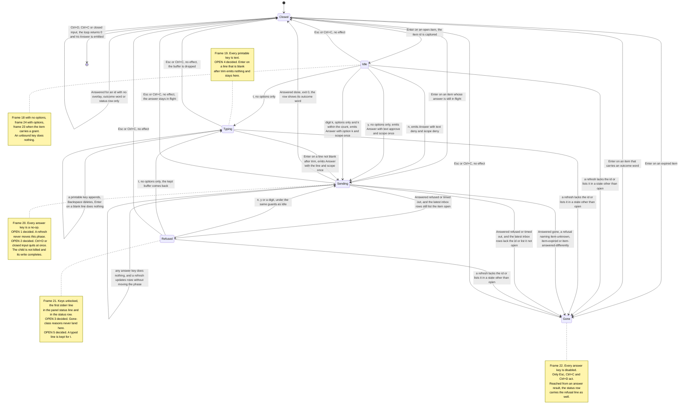
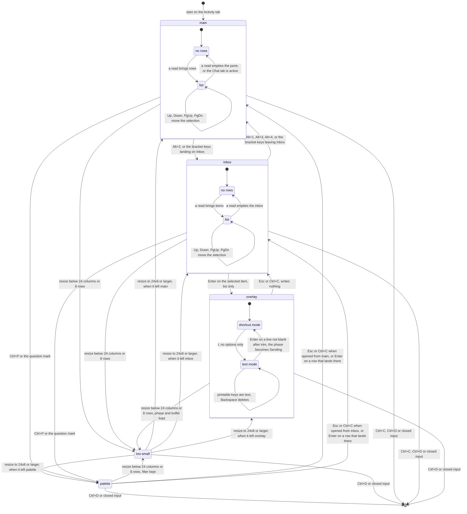
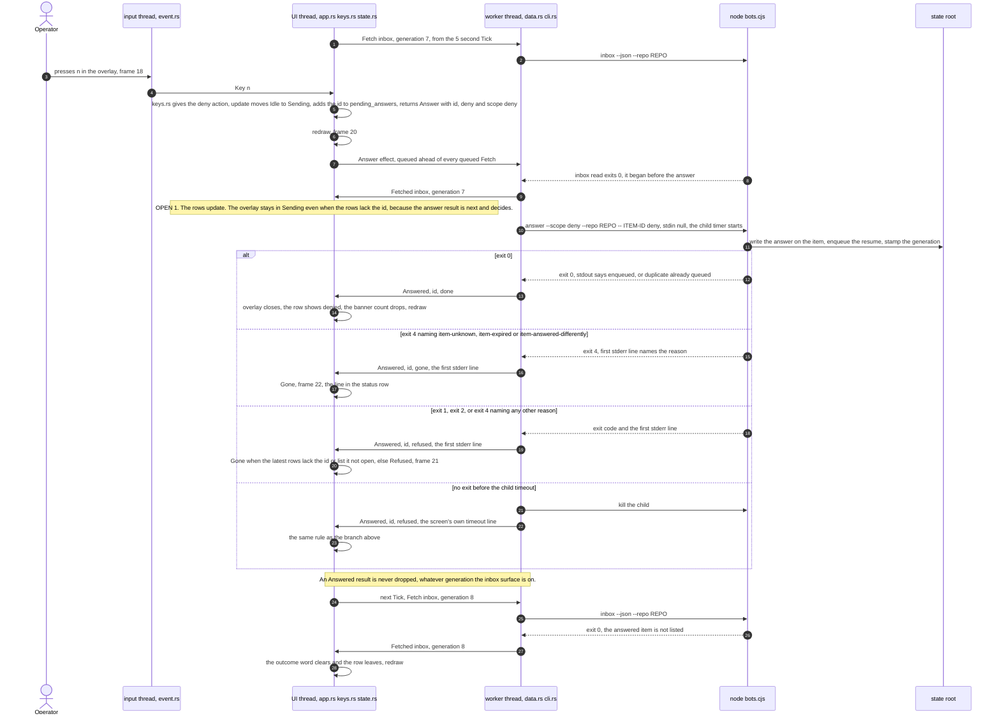

# Answer flow state machines and answer contract

This note closes review item R6, the answer contract, and draws the three diagrams the review asks for: the overlay and answer machine, the key-context machine and the answer-flow sequence. [SOURCE: specs/system-skilled-bots/003-openbot-parity-build/003-terminal-screen/research/fable-review-1.md:64-73] [SOURCE: specs/system-skilled-bots/003-openbot-parity-build/003-terminal-screen/research/fable-review-1.md:157-166]

Paths are relative to the phase folder `003-terminal-screen/` unless they start with `specs/` or `.skilled/`. The names are the ones the child specs and the key map already use: the six contexts `main`, `inbox`, `list`, `overlay`, `palette` and `too-small`, the effects `Fetch` and `Answer`, the overlay phases, and `Remote<T>`. [SOURCE: 001-ux-and-component-map/design/key-map.md:21-34] [SOURCE: 002-architecture-and-contracts/spec.md:196] The message names `Key`, `Resize`, `InputClosed`, `Tick`, `Fetched` and `Answered` come from the review's Draft A. `002-architecture-and-contracts/design/architecture.md` owns the final type names, and where it names one differently, it wins and this note follows. [SOURCE: specs/system-skilled-bots/003-openbot-parity-build/003-terminal-screen/research/fable-review-1.md:213-227]

A claim marked **inferred** rests on a spec for code not built yet. Every other runtime claim was read in the code at the cited line.

---

## 1. THE OVERLAY AND ANSWER STATE MACHINE

This is the review's Draft B, adopted, with the five OPEN cases decided and four missing edges added. [SOURCE: specs/system-skilled-bots/003-openbot-parity-build/003-terminal-screen/research/fable-review-1.md:244-306]

`Typing` is a phase, not a flag on `Idle`. The inventory lists `typing` as a state and frame 19 draws it, and a flag would allow a typing and sending overlay, which no frame draws. [SOURCE: 001-ux-and-component-map/design/component-inventory.md:32] [SOURCE: 001-ux-and-component-map/design/mockups.md:65]

Ctrl+D quits from every phase, and a closed input does the same. Both are left off the inner edges to keep the picture readable, as Draft B did, and both emit no `Answer`. [SOURCE: 001-ux-and-component-map/design/key-map.md:70] [SOURCE: 005-answer-flow/spec.md:149] [SOURCE: 005-answer-flow/spec.md:152]

### 1.1 The OPEN cases, decided

| Case | Decision | Why, in one line |
|------|----------|------------------|
| OPEN 1, a refresh drops the id while `Sending` | The phase does not move. The rows update, and the `Answered` result decides. When that result is a refusal or a timeout that is not gone-class, the reducer re-tests the latest inbox rows and goes to `Gone` if the item is missing or not open. | With one serial worker, any read result that lands during `Sending` began before the answer child started, so it can never be our own answer landing, and the answer's own exit is the next result and is authoritative. [SOURCE: 002-architecture-and-contracts/spec.md:190] |
| OPEN 2, Ctrl+D or a closed input while `Sending` | Quit at once with exit 0. The child is not killed and the screen does not wait for it. | Dropping a Rust `Child` does not kill it, and the runtime writes the item atomically before it prints, so quitting cannot cut the write in half. [SOURCE: .skilled/skills/system-skilled-bots/runtime/lib/answer.ts:92-97] [SOURCE: .skilled/bin/bots.cjs:298-300] |
| OPEN 3, refusals that cannot be retried | `item-unknown`, `item-expired` and `item-answered-differently` move `Sending` to `Gone`, never to `Refused`. | A retry of any of the three is refused again for the same reason, so unlocking the keys would offer an answer that cannot land. [SOURCE: .skilled/skills/system-skilled-bots/runtime/lib/answer.ts:75-86] |
| OPEN 4, Enter on an empty typed line | Enter on a line that is empty or only whitespace emits nothing and stays in `Typing`. The test is a trim, not a length. | The CLI refuses whitespace-only text as a usage error, so sending it would only produce a refusal. [SOURCE: .skilled/bin/bots.cjs:161] |
| OPEN 5, a refused typed line | The buffer is kept. `Refused` is shortcut mode, and `t` returns to `Typing` with the kept text. The buffer is dropped only when the overlay closes. | `answer-secret` is fixed by editing the line, and making the operator retype a long answer to fix one word is hostile. [SOURCE: .skilled/skills/system-skilled-bots/runtime/lib/answer.ts:88-89] |

### 1.2 Edges added to Draft B

| Edge | Why |
|------|-----|
| `Closed --> Sending` on Enter over an item whose answer is still in flight | Esc during `Sending` closes the overlay while the answer runs, so without this edge a reopen would land in `Idle` and a second press would write twice. The reducer keeps `pending_answers`, the item ids with an answer in flight, outside the overlay, adds the id when it emits `Answer` and removes it on `Answered`. [SOURCE: 005-answer-flow/spec.md:152] |
| `Sending --> Gone` on a gone-class refusal | OPEN 3. |
| The `t` edges carry the guard "no options only" | The key map binds `t` only on an item with no options, so `t` from `Refused` on a choice item does nothing. [SOURCE: 001-ux-and-component-map/design/key-map.md:59] |
| The gone test is "id absent, or listed in a state other than `open`" | `bots inbox --json` lists expired items, so absence alone never catches an item that expires while the overlay is open. [SOURCE: .skilled/bin/bots.cjs:465] [SOURCE: specs/system-skilled-bots/003-openbot-parity-build/001-activity-and-actor/spec.md:153] |

Esc in text mode closes the whole overlay. It does not step back to shortcut mode. [SOURCE: 001-ux-and-component-map/design/key-map.md:98]

### 1.3 The test this machine gives

One table with a row per phase and key, giving the expected next phase and the expected effects, run through `update` alone. It belongs in `005-answer-flow/tasks.md` T006 as `overlay_transition_table`. Its rows are the edges above, plus one row per answer key in `Sending` and `Gone` that asserts no `Answer` effect. [SOURCE: specs/system-skilled-bots/003-openbot-parity-build/003-terminal-screen/research/fable-review-1.md:306]

---

## 2. THE KEY-CONTEXT STATE MACHINE

The six contexts are the key map's, verbatim. `list` is not a peer of the others. It is the part of `main` or `inbox` where a pane has rows, so it is drawn as a sub-state inside each. That is how the key map's "a context is exclusive" applies: at any moment the screen is in exactly one of `main`, `inbox`, `overlay`, `palette` or `too-small`, and `list` keys are live on the Activity, Routines and Inbox tabs, with rows or without, and move nothing on an empty list. [SOURCE: 001-ux-and-component-map/design/key-map.md:23-34]

What the picture fixes, beyond the key table:

- Alt+1, Alt+3, Alt+4 and the bracket pair also move between Activity, Routines and Chat inside `main`. That stays in `main` and is not drawn as an edge. [SOURCE: 001-ux-and-component-map/design/key-map.md:42-47]
- `palette` and `too-small` remember the context they left, so Esc and a resize return there. An `overlay` left for `too-small` keeps its phase, its buffer and any answer in flight, and an `Answered` result that lands in `too-small` is reduced as usual and drawn on return. **Judgment**: the key map says nothing about a resize under an open overlay, and losing a typed line to a window drag would be a defect.
- `palette` Enter runs the selected row's action as its key would in the context the palette was opened from. The palette lists the rows of `main`, `inbox` and `list`, one per label, so an overlay row is never listed. A listed row bound in another context, such as `Enter open` when the palette was opened from `main`, does nothing, like an unbound key. [SOURCE: 003-shell-and-navigation/spec.md:138] [SOURCE: 001-ux-and-component-map/design/component-inventory.md:74]
- In `palette`, the question mark and every letter are filter text, so single-key shortcuts pause while the filter holds text. [SOURCE: 003-shell-and-navigation/spec.md:138]
- `too-small` binds Ctrl+D only. [SOURCE: 001-ux-and-component-map/design/key-map.md:30]

---

## 3. THE ANSWER-FLOW SEQUENCE

Six lanes: the operator, the input thread, the UI thread, the worker thread, the runtime process and the state root. The worker is one thread that runs one child at a time and sends every result over one channel. [SOURCE: 002-architecture-and-contracts/spec.md:190] The sequence opens with a refresh already in flight when the key lands, which is the OPEN 1 case.

Rules the sequence fixes:

- Only the worker starts a process, and the loop hands it the `Answer` effect the reducer returned. `app.rs` never sets a phase itself. [SOURCE: 002-architecture-and-contracts/spec.md:190] [SOURCE: specs/system-skilled-bots/003-openbot-parity-build/003-terminal-screen/research/fable-review-1.md:62]
- An `Answer` effect jumps ahead of queued fetches, and its result is never dropped. Both are review rules R5.2 and R5.3. [SOURCE: specs/system-skilled-bots/003-openbot-parity-build/003-terminal-screen/research/fable-review-1.md:57-58]
- The timeout value is the child timeout `002-architecture-and-contracts/design/architecture.md` fixes for every child. This note picks no number. [SOURCE: specs/system-skilled-bots/003-openbot-parity-build/003-terminal-screen/research/fable-review-1.md:59]
- Exit 0 issues no extra read. The row keeps its outcome word until the first successful inbox read issued after the `Answered` message, which is the next tick's. An immediate read would drop the item at once, because `bots inbox` filters answered items out, so the word would only flash. This is default A7. [SOURCE: .skilled/bin/bots.cjs:465] [SOURCE: 005-answer-flow/spec.md:163]
- A row that carries an outcome word is not counted as open, so the banner drops at once. [SOURCE: 005-answer-flow/spec.md:159]

---

## 4. THE ANSWER CONTRACT

### 4.1 The argv per answer kind

`<program>` is `node <skilled-tree>/.skilled/bin/bots.cjs` by default and `bash <crate>/tests/fixtures/bots` in tests. [SOURCE: 005-answer-flow/spec.md:146] Each element below is one OS argument passed to `Command::arg`, never a shell string, so spaces in the text need no quoting. `<repo>` is the same value every read passes.

| Answer kind | Key | Argv after `<program>` |
|-------------|-----|------------------------|
| Approve once | `y`, no options only | `answer` `--scope` `once` `--repo` `<repo>` `--` `<item-id>` `approve` |
| Deny | `n` | `answer` `--scope` `deny` `--repo` `<repo>` `--` `<item-id>` `deny` |
| Choice | digit `k`, options only, `k` within the count | `answer` `--scope` `once` `--repo` `<repo>` `--` `<item-id>` `<options[k-1]>` |
| Free text | Enter in `Typing`, line not blank after trim | `answer` `--scope` `once` `--repo` `<repo>` `--` `<item-id>` `<typed line, sent as typed>` |

Why each part is there:

- **`--` before the two positionals.** The parser treats every token that starts with `-` as an option until it meets `--`, and after that every token is a positional. Without it, a typed answer such as `-1` or `--no`, or an option text that starts with a dash, is refused `unknown option` with exit 2. [SOURCE: .skilled/bin/bots.cjs:117-137] The verb `answer` is also a positional, so the parsed list is `answer`, `<item-id>`, `<text>`, which is the three the answer branch expects. [SOURCE: .skilled/bin/bots.cjs:139] [SOURCE: .skilled/bin/bots.cjs:159-163]
- **Options before `--`.** `--scope` and `--repo` after the terminator would be read as positionals and refused `unexpected argument`. [SOURCE: .skilled/bin/bots.cjs:119-122] [SOURCE: .skilled/bin/bots.cjs:162]
- **`--repo` on the write.** Identity and the state root resolve from the checkout, and without `--repo` the CLI falls back to the working directory, so the write must name the checkout the reads named. [SOURCE: .skilled/bin/bots.cjs:171-175] [SOURCE: .skilled/bin/bots.cjs:424]
- **No `--as`, stdin null, no added environment.** The screen claims no actor beyond the OS user, and the binary passes no variable to its child. [SOURCE: specs/system-skilled-bots/003-openbot-parity-build/003-terminal-screen/research/fable-review-1.md:201] [SOURCE: 003-shell-and-navigation/spec.md:210]
- **The typed line is sent untrimmed.** The trim only decides whether Enter sends. The runtime stores the text it is given. [SOURCE: 005-answer-flow/spec.md:151]

`--scope` is **inferred**: packet phase 001 adds it, and today the parser refuses it as `bots: unknown option: --scope` with exit 2, because `scope` is not a known option and `answer` declares none. [SOURCE: .skilled/bin/bots.cjs:73] [SOURCE: .skilled/bin/bots.cjs:79] [SOURCE: .skilled/bin/bots.cjs:126] [SOURCE: specs/system-skilled-bots/003-openbot-parity-build/001-activity-and-actor/spec.md:156]

### 4.2 What `bots answer` can return

Every refusal of the answer verb prints `bots: <reason>` or `bots: <reason>: <detail>` and exits 4. There is no `answer refused:` prefix. [SOURCE: .skilled/bin/bots.cjs:208-214] [SOURCE: .skilled/bin/bots.cjs:292-297] A usage error prints `bots: <message>` and then the usage text, so the first-line rule gives the message alone. [SOURCE: .skilled/bin/bots.cjs:94-98] `cli.rs` reads the reason token on the worker and returns it as `AnswerError.refusal` with the first stderr line, so the loop never parses a message. `overlay_on_answered` classes `item-unknown`, `item-expired` and `item-answered-differently` as gone and every other refusal, an unknown one included, as refused.

| Exit | First line, or class | Source | Evidence | Retryable | Overlay phase and what it draws |
|------|----------------------|--------|----------|-----------|--------------------------------|
| 0 | stdout `bots: item <id> answered`, then `resume request <rid> enqueued` | answer written, resume queued | Confirmed [SOURCE: .skilled/bin/bots.cjs:298-301] | Not needed | `Closed`. The row shows `approved`, `denied` or `answered` until the next successful inbox read |
| 0 | stdout ends `duplicate: already queued` | the item was already answered with the same text | Confirmed [SOURCE: .skilled/skills/system-skilled-bots/runtime/lib/answer.ts:84] [SOURCE: .skilled/skills/system-skilled-bots/runtime/lib/request-queue.ts:141] [SOURCE: .skilled/bin/bots.cjs:299] | Not needed | `Closed`, as above. This is what makes a retry after a timeout safe |
| 4 | `bots: item-unknown: <id>` | no item file, or an unsafe id | Confirmed [SOURCE: .skilled/skills/system-skilled-bots/runtime/lib/answer.ts:75-78] | No | `Gone`, frame 22, the line in the status row |
| 4 | `bots: item-expired: expired at <t>` | the item passed its expiry | Confirmed [SOURCE: .skilled/skills/system-skilled-bots/runtime/lib/answer.ts:83] | No | `Gone`, frame 22, the line in the status row |
| 4 | `bots: item-answered-differently: answered at <t>` | answered elsewhere with other text, and after packet phase 006 the loser of two racing answers | Confirmed now [SOURCE: .skilled/skills/system-skilled-bots/runtime/lib/answer.ts:84-86], inferred for the race [SOURCE: specs/system-skilled-bots/003-openbot-parity-build/006-approval-grants/spec.md:102] | No | `Gone`, frame 22, the line in the status row |
| 4 | `bots: answer-secret: the answer holds a literal of <kind> <name>` | the text holds a known secret value | Confirmed [SOURCE: .skilled/skills/system-skilled-bots/runtime/lib/answer.ts:88-89] | Yes, after editing the line | `Refused`, frame 21, the typed line kept for `t` |
| 4 | `bots: answer-not-approver` | a present roster names neither the owner nor the actor | Inferred, packet phases 006 and 011 [SOURCE: specs/system-skilled-bots/003-openbot-parity-build/006-approval-grants/spec.md:103] [SOURCE: specs/system-skilled-bots/003-openbot-parity-build/011-messaging-channels/003-link-roster-and-answer-gate/spec.md, REQ-005] | Yes, once the roster changes | `Refused`, frame 21 |
| 4 | `bots: identity-unknown: this repository has no identity`, then a fix hint, `bots: config-unreadable: <code>`, `bots: config-invalid: <detail>`, `bots: unknown-key: <key>` | the checkout's config or identity | Confirmed [SOURCE: .skilled/bin/bots.cjs:210-212] [SOURCE: .skilled/skills/system-skilled-bots/runtime/lib/request-queue.ts:162-171] [SOURCE: .skilled/skills/system-skilled-bots/runtime/lib/repo-config.ts:240] [SOURCE: .skilled/skills/system-skilled-bots/runtime/lib/repo-config.ts:247] | Yes, once the config is fixed elsewhere | `Refused`, frame 21 |
| 4 | `bots: item-unreadable: <code>`, `bots: item-invalid: not valid JSON`, `bots: item-field-invalid: <key>` and the other item validation reasons | the item file is damaged | Confirmed [SOURCE: .skilled/skills/system-skilled-bots/runtime/lib/needs-you.ts:180-187] [SOURCE: .skilled/skills/system-skilled-bots/runtime/lib/needs-you.ts:100-124] | No, until the file is repaired | `Refused`, frame 21. The inbox drops an unreadable item, so the next refresh moves it to `Gone` [SOURCE: .skilled/bin/bots.cjs:472] |
| 4 | `bots: seen-marker-failed: <code>`, `bots: enqueue-rename-failed: <code>` | the resume request could not be queued | Confirmed [SOURCE: .skilled/skills/system-skilled-bots/runtime/lib/request-queue.ts:142] [SOURCE: .skilled/skills/system-skilled-bots/runtime/lib/request-queue.ts:148-150] | Retry is allowed but not a fix: after `enqueue-rename-failed` the seen marker stays, so a retry returns exit 0 `duplicate` while the request stays lost | `Refused`, frame 21 |
| 4 | `bots: resume-...` and the request-record reasons | an internal request-shape fault | Confirmed [SOURCE: .skilled/skills/system-skilled-bots/runtime/lib/request-record.ts:150-157] | No | `Refused`, frame 21 |
| 4 | `bots: answer-empty` | blank text | Unreachable from the CLI: the parser refuses blank text first with exit 2 [SOURCE: .skilled/skills/system-skilled-bots/runtime/lib/answer.ts:69] [SOURCE: .skilled/bin/bots.cjs:161] | No | Never sent, by OPEN 4 |
| 2 | `bots: unknown option: --scope`, or `bots: answer takes no --scope` | a runtime older than packet phase 001 | Confirmed [SOURCE: .skilled/bin/bots.cjs:126] [SOURCE: .skilled/bin/bots.cjs:144] [SOURCE: 005-answer-flow/spec.md:74-80] | No, the same argv fails again | `Refused`, frame 21. The line tells the operator the runtime is older than the screen |
| 2 | `bots: grant-scope-unsupported`, `bots: --scope takes once or deny` | a scope the screen never sends | Inferred [SOURCE: specs/system-skilled-bots/003-openbot-parity-build/001-activity-and-actor/spec.md:156] | No | `Refused`, frame 21. Reaching it is a screen defect |
| 2 | `bots: answer needs the answer text`, `bots: unexpected argument: <token>` | a malformed argv | Confirmed [SOURCE: .skilled/bin/bots.cjs:160-162] | No | `Refused`, frame 21. Reaching it is a screen defect |
| 1 | `bots: <error message>` | an uncaught throw: the atomic state write, the exclusive temp write, an unsafe path segment or the runtime loader | Confirmed [SOURCE: .skilled/bin/bots.cjs:542-545] [SOURCE: .skilled/skills/system-skilled-bots/runtime/lib/request-queue.ts:133] [SOURCE: .skilled/skills/system-skilled-bots/runtime/lib/state-root.ts:171] [SOURCE: .skilled/bin/bots.cjs:184] | Yes. The answer is idempotent for the same text | `Refused`, frame 21 |
| none | screen line `bots-ui: answer timed out after 30s, it may have landed` | the worker killed the child at the child timeout | Screen-side rule | Yes. The same key returns exit 0 `duplicate` if the write landed. Another key gets `item-answered-differently` and goes to `Gone` | `Refused`, frame 21, unless the latest rows say gone |
| none | screen line `bots-ui: could not start <program>: <os error>` | the spawn failed | Screen-side rule | Yes, once the program is found | `Refused`, frame 21 |
| 3, 5 or any other | the first stderr line, or `bots-ui: answer exited <code>` when stderr is empty | not produced by the answer verb today | Confirmed absent [SOURCE: .skilled/bin/bots.cjs:292-302] | No | `Refused`, frame 21 |

`channel-roster-missing` never reaches the screen: packet phase 011 raises it for a channel answer only, and a terminal answer on an absent roster is not refused. [SOURCE: specs/system-skilled-bots/003-openbot-parity-build/011-messaging-channels/003-link-roster-and-answer-gate/spec.md, REQ-021]

Every refusal, gone-class or not, puts its first line in the status row through `theme::printable`, and `Refused` also draws it on the panel's status line, as frame 21 does. [SOURCE: 003-shell-and-navigation/spec.md:149] [SOURCE: 001-ux-and-component-map/design/mockups.md:67]

---

## 5. DECISIONS TAKEN

| Decision | Why, in one line |
|----------|------------------|
| Adopt Draft B with `Typing` as its own phase | The inventory and frame 19 treat typing as a state, and a flag would allow a phase pair no frame draws. |
| OPEN 1: a refresh never moves `Sending`, and a non-gone result re-tests the latest rows | One serial worker means a read landing during `Sending` predates the answer, and the answer's exit is authoritative. |
| OPEN 2: Ctrl+D and a closed input quit at once during `Sending` | The child is not killed and the runtime writes the item before it prints, so the write completes. |
| OPEN 3: `item-unknown`, `item-expired` and `item-answered-differently` go to `Gone` | None of the three can succeed on retry. |
| OPEN 4: Enter on a blank line after trim sends nothing | The CLI refuses blank text with exit 2. |
| OPEN 5: a refused typed line is kept | `answer-secret` is fixed by editing, not retyping. |
| The gone test is "absent, or not `open`" | The inbox lists expired items, so absence alone misses an expiry. |
| `pending_answers` outside the overlay | Esc then Enter on the same item would otherwise write twice. |
| `cli.rs` extracts the reason token on the worker, and the reducer classes it | The loop stays free of message parsing, which the plan's Data Flow promises. |
| argv `answer --scope <s> --repo <repo> -- <item-id> <text>` | The parser stops reading options only at `--`, and the write must name the checkout the reads name. |
| The typed line is sent as typed | The runtime stores what it is given, and the trim only decides whether to send. |
| Exit 0 issues no extra read, and the outcome word clears on the next tick's successful inbox read | An immediate read would drop the item at once and the word would only flash (default A7). |
| A line that wraps the runtime's own stderr starts `bots: <verb> --json exited <code>:`, and every other line the screen writes starts `bots-ui:` | The operator must tell a line the screen wrote from one the runtime wrote, and frames 8, 12 and 16 draw the wrapped form |
| `palette` and `too-small` return to the context they left, and `overlay` keeps its phase through `too-small` | A window resize must not lose a typed answer or an answer in flight. |
| `palette` Enter runs a row only in the context it was opened from | A listed overlay row would otherwise answer with no overlay open. |

---

## 6. EDITS THE OTHER DOCS NEED

The edits inside this phase were applied in commit cf6bb92a5ce. Line numbers are the pre-edit lines and are kept as a record.

Parallel writers may shift line numbers, so each row gives the line as read on 2026-11-25 and the exact text to find. Text to find and replacement text sit in double-backtick spans, so a single backtick inside a span is part of the text. A row that says "replace" swaps only the quoted text, and the rest of the line stays.

Where a row below edits a file the owner map in `002-architecture-and-contracts/design/architecture.md` section 3 gives to 002, that row is superseded. `cli.rs`, `model.rs`, `app.rs` and `tests/fixtures/bots` are 002's, so the rows that edit them are not applied, and the argv form they carry lives in the plan's Data Flow and Testing sections instead.

### 6.1 `005-answer-flow/spec.md`

| Line | Edit |
|------|------|
| 33 | Replace `` answer <item-id> <text> --scope once\|deny `` with `` answer --scope once\|deny --repo <repo> -- <item-id> <text> `` |
| 43 | Replace `` bots answer <item-id> <text> --scope once\|deny `` with `` bots answer --scope once\|deny --repo <repo> -- <item-id> <text> `` |
| 148 | REQ-003: the same replacement as line 43, then append `` The two positionals follow a `--` terminator, so a text that starts with a dash is sent as text. `` |
| 149 | REQ-006: the same replacement as line 43 |
| 153 | REQ-014: append `` Enter on a line that is blank after trimming whitespace sends nothing and stays in text mode, because the CLI refuses blank text as a usage error. Esc in text mode closes the overlay. A refused typed line is kept, and `t` returns to it. `` |
| 154 | REQ-015: append `` The reducer keeps the item ids with an answer in flight outside the overlay, so Enter on such an item reopens the overlay in its sending state and cannot write twice. A refresh that lands while sending never moves the phase. Ctrl+D or a closed input while sending quits at once with exit 0, and the child is left to finish its write. `` |
| 155 | REQ-016: replace the whole requirement cell with `` A `bots answer` that exits non-zero, or that the worker stops at the child timeout, puts the first line of its stderr, or the screen's own `bots-ui:` line, in the status row. A refusal naming `item-unknown`, `item-expired` or `item-answered-differently` moves the overlay to gone, because a retry cannot succeed. Any other refusal keeps the overlay open on the same item in refused, with the keys unlocked, unless the latest inbox rows no longer list the item open, which moves it to gone. `cli.rs` maps the reason to that class on the worker, so the loop never parses a message. `design/state-machines.md` section 4 is the full table. `` |
| 162 | REQ-017: replace `` An item that a refresh no longer lists is drawn as gone `` with `` An item that a refresh no longer lists, or lists in a state other than `open`, is drawn as gone, except while the overlay is sending, where the answer's own result decides `` |
| 175 | SC-001: replace `` answer <item-id> deny --scope deny `` with `` answer --scope deny --repo <repo> -- <item-id> deny `` |
| 178 | SC-004: replace `` answer <item-id> hold --scope once `` with `` answer --scope once --repo <repo> -- <item-id> hold `` |
| after 232 | Insert the edge case line `` - Text that starts with a dash: the typed line `-1` follows the `--` terminator, so the CLI reads it as text and not as an option. `` |

### 6.2 `005-answer-flow/plan.md`

| Line | Edit |
|------|------|
| 27 | Replace `` bots answer <item-id> <text> --scope once\|deny `` with `` bots answer --scope once\|deny --repo <repo> -- <item-id> <text> `` |
| 31 | Replace `` idle, sending, refused and gone `` with `` idle, typing, sending, refused and gone ``, and replace `` builds exactly `answer <item-id> <text> --scope once|deny` `` with `` builds exactly `answer --scope once|deny --repo <repo> -- <item-id> <text>` `` |
| 47 | Replace `` the thirteen tests `` with `` the eighteen tests `` |
| 63 | Replace `` where `phase` is `Idle`, `Sending`, `Refused(String)` or `Gone`, plus the lock that makes a key a no-op while `phase` is `Sending` `` with `` where `phase` is `Idle`, `Typing`, `Sending`, `Refused(String)` or `Gone`, plus the set of item ids with an answer in flight, held outside the overlay, that makes a key a no-op while `phase` is `Sending` and reopens an in-flight item in `Sending`. `design/state-machines.md` section 1 draws every transition `` |
| 64 | Replace `` The typing mode is a property of the row, not a branch in the loop, so one flag pauses every single-key binding at once. `` with `` Text mode is the `Typing` phase, and `keys.rs` reads it as the overlay's mode, so one phase pauses every single-key binding at once. `` |
| 65 | Replace the sentence that starts `` It builds `answer <item-id> <text> --scope <scope>` `` and ends at the end of the bullet with `` It builds `answer --scope <scope> --repo <repo> -- <item-id> <text>`, each element one argument and `--` before the two positionals, and returns the answer class, `done`, `gone` or `refused`, with the first stderr line. It maps the `bots: <reason>` token to the class on the worker, so the status row reads one string and the loop never parses a message. `` |
| 69 | Replace the sentence that starts `` It sets `Sending`, calls `cli.rs` once `` and ends `` while leaving the item in place. `` with `` It hands the `Answer` effect to the worker, which runs it through `cli.rs` once and ahead of any queued fetch. The reducer, not `app.rs`, moves the phase. `` |
| 73 | Replace `` spawns `<program> answer <id> <text> --scope <scope>` `` with `` spawns `<program> answer --scope <scope> --repo <repo> -- <id> <text>` ``. Then replace the sentence that starts `` Exit 0 closes the overlay and triggers one refresh `` and ends `` leaves the overlay open. `` with `` Exit 0 closes the overlay and marks the row with its outcome word until the next tick's successful inbox read. A gone-class refusal moves the overlay to `Gone`, and any other non-zero exit or a timeout moves it to `Refused`, or to `Gone` when the latest inbox rows no longer list the item open. `design/state-machines.md` section 3 draws the sequence. `` |
| 83 | Replace `` node .skilled/bin/bots.cjs answer <id> deny --scope deny `` with `` node .skilled/bin/bots.cjs answer --scope deny -- <id> deny `` |
| 90 | Replace `` bash crates/bots-tui/tests/fixtures/bots answer item-1 deny --scope deny `` with `` bash crates/bots-tui/tests/fixtures/bots answer --scope deny -- item-1 deny `` |
| 97 | Replace `` only while the phase is `Idle` `` with `` only while the phase is `Idle`, `Typing` or `Refused`, never for an id already in flight `` |
| 163 | Replace every `` answer item-1 deny --scope deny `` with `` answer --scope deny -- item-1 deny ``, which also fixes the expected `tail -1` output |
| 179 | Replace `` all thirteen tests `` with `` all eighteen tests `` |

### 6.3 `005-answer-flow/tasks.md`

| Line | Edit |
|------|------|
| 72 | T006: replace `` the overlay state - `Idle`, `Sending`, `Refused(String)` and `Gone` - the free-text buffer and the lock that refuses a second press `` with `` the overlay state - `Idle`, `Typing`, `Sending`, `Refused(String)` and `Gone` - the free-text buffer and the in-flight set that refuses a second press, per `design/state-machines.md` section 1 ``, and append to its Verify `` , and names `overlay_transition_table`, one row per phase and key run through `update` alone `` |
| 74 | T008: replace `` asserts the built argv is `answer <id> <text> --scope once` and `--scope deny` `` with `` asserts the built argv is `answer --scope once --repo <repo> -- <id> <text>` and the same with `--scope deny` `` |
| 75 | T009: replace every `` answer item-1 deny --scope deny `` with `` answer --scope deny -- item-1 deny `` |
| 79 | T013: after `` `ctrl_c_closes_overlay_and_writes_nothing` `` insert `` , `refresh_while_sending_keeps_sending`, `reopen_while_in_flight_stays_locked`, `blank_line_sends_nothing`, `gone_class_refusal_moves_to_gone`, `dash_led_text_follows_the_terminator` `` so the list names eighteen tests |
| 104 | Replace `` all thirteen tests `` with `` all eighteen tests `` |
| 158 | CHK-020: replace `` all thirteen tests `` with `` all eighteen tests `` |

### 6.4 `005-answer-flow/acceptance-criteria.md`

| Line | Edit |
|------|------|
| 57 | AC-001: replace `` answer <item-id> deny --scope deny `` with `` answer --scope deny --repo <repo> -- <item-id> deny ``, and `` answer <item-id> approve --scope once `` with `` answer --scope once --repo <repo> -- <item-id> approve `` |
| 58 | AC-002: replace `` bots answer <item-id> hold --scope once `` with `` bots answer --scope once --repo <repo> -- <item-id> hold `` |
| 62 | AC-006: the same replacement as line 58 |
| after 68 | Insert AC-013, REQ-015: `` Given the overlay sending, When an inbox refresh that no longer lists the item lands before the answer result, Then the overlay stays sending and the answer result alone decides the next phase ``. Verification: `` `cargo test --manifest-path crates/bots-tui/Cargo.toml --test answer_flow` names `refresh_while_sending_keeps_sending` ``. Status `Unmet`, waiver `-` |
| after 68 | Insert AC-014, REQ-016: `` Given the fixture refuses `item-answered-differently` with exit 4, When the overlay sends, Then the overlay is gone, the status row carries the line and no answer key is live ``. Verification names `gone_class_refusal_moves_to_gone`. Status `Unmet`, waiver `-` |
| after 68 | Insert AC-015, REQ-014: `` Given text mode with a line of spaces, When Enter is pressed, Then no `answer` argv is recorded and the overlay stays in text mode ``. Verification names `blank_line_sends_nothing`. Status `Unmet`, waiver `-` |
| after 68 | Insert AC-016, REQ-015: `` Given an answer in flight and the overlay closed with Esc, When Enter reopens the same item, Then the overlay opens sending and a key press records no second `answer` argv ``. Verification names `reopen_while_in_flight_stays_locked`. Status `Unmet`, waiver `-` |
| after 68 | Insert AC-017, REQ-003: `` Given text mode, When `-1` is typed and sent, Then the recorded argv is exactly `answer --scope once --repo <repo> -- <item-id> -1` ``. Verification names `dash_led_text_follows_the_terminator`. Status `Unmet`, waiver `-` |
| after 68 | Insert AC-018, REQ-015: `` Given the overlay sending, When Esc or Ctrl+C is pressed, Then the overlay closes, the item id stays in `pending_answers` and the answer result still writes the status row ``. Verification names `close_while_sending_keeps_the_answer`. Status `Unmet`, waiver `-` |
| after 68 | Insert AC-019, REQ-020: `` Given a successful answer, When the result lands, Then the overlay closes, the row carries its outcome word and no read is issued, and the word stays until the next successful inbox read ``. Verification names `outcome_word_stays_until_the_next_poll`. Status `Unmet`, waiver `-` |

Each new row's Verification cell follows AC-013's form: the `--test answer_flow` command, `test result: ok`, and the one test name. AC-018 and AC-019 are reducer claims, so their cell names the `--lib state` command instead.

### 6.5 `001-ux-and-component-map/design/`

| File and line | Edit |
|---------------|------|
| `key-map.md` 32 | Append `` `../../005-answer-flow/design/state-machines.md` section 2 draws the contexts and every key that moves between them. `` |
| `key-map.md` 57 | Replace `` Send the typed answer `` with `` Send the typed answer. A line blank after trimming sends nothing `` |
| `component-inventory.md` 28 | Row 4, States cell: replace `` `loading`, `empty`, `rows`, `stale`, `error` `` with `` `loading`, `empty`, `rows`, `stale`, `error`, and a row in `answered` that draws its outcome word until the next successful inbox read ``. The new `answered` row state needs one frame added to the state index in `mockups.md` |
| `component-inventory.md` 32 | Row 8, States cell: append `` . Transitions: `../../005-answer-flow/design/state-machines.md` section 1 `` |
| `component-inventory.md` 33 | Row 9, States cell: the same append as row 8 |
| `component-inventory.md` 74 | Replace `` A refresh that closes the item under the overlay is detected, and the overlay says so instead of writing `` with `` A refresh that closes the item under the overlay is detected, and the overlay says so instead of writing, except while sending, where the answer's own result decides `` |
| `mockups.md` 1625 | Frame 21 at 80x24: replace the line with `` │ status   bots: answer-not-approver                                         │ ``, one leading space, 79 characters, the border column unmoved |
| `mockups.md` 1628 | Frame 21 at 80x24: replace the line with `` bots: answer-not-approver `` |
| `mockups.md` 1662 | Frame 21 at 120x40: replace the line with `` │ status   bots: answer-not-approver                                                               │ `` after ten leading spaces, 110 characters, the border column unmoved |
| `mockups.md` 1673 | Frame 21 at 120x40: replace the line with `` bots: answer-not-approver `` |

Before this edit frame 21 drew `bots: answer refused: item-answered-differently` in the refused state. The runtime prints no such prefix, and that reason now goes to gone, so the frame would assert a string no build produces in a phase it cannot reach. `bots: answer-not-approver` is the refusal SC-005 already names. [SOURCE: 001-ux-and-component-map/design/mockups.md:1626] [SOURCE: 005-answer-flow/spec.md:178]

### 6.6 Parent, 002 and 003

| File and line | Edit |
|---------------|------|
| `spec.md` 176 | REQ-003: replace `` bots answer <item-id> <text> --scope once\|deny `` with `` bots answer --scope once\|deny --repo <repo> -- <item-id> <text> `` |
| `spec.md` 178 | REQ-006: the same replacement as line 176 |
| `002-architecture-and-contracts/spec.md` 187 | REQ-003: the same replacement as the parent's line 176 |
| `002-architecture-and-contracts/plan.md` 95 | Replace `` node .skilled/bin/bots.cjs answer <id> deny --scope deny `` with `` node .skilled/bin/bots.cjs answer --scope deny -- <id> deny `` |
| `002-architecture-and-contracts/design/architecture.md`, when written | The `State` struct carries `pending_answers` and `answered`, the outcome word per item. The overlay phase enum has five members, `Idle`, `Typing`, `Sending`, `Refused` and `Gone`. The `Answered` message carries the item id, the class and the first line, and is never dropped |
| `002-architecture-and-contracts/design/contracts.md`, when written | The answer section links to section 4 of this note as the source of the argv and the refusal table, rather than keeping a second copy |
| `003-shell-and-navigation/spec.md` 138 | REQ-015: append `` Enter runs the selected row only when the row is bound in the context the palette was opened from, and a row bound elsewhere does nothing. Esc and Ctrl+C return to that context. `` |
| `005-answer-flow/plan.md` section 3 | Add `` `design/state-machines.md` holds the overlay machine, the key-context machine and the answer sequence. `` as the first line under the Pattern heading, so the diagrams have one home and are not copied |
