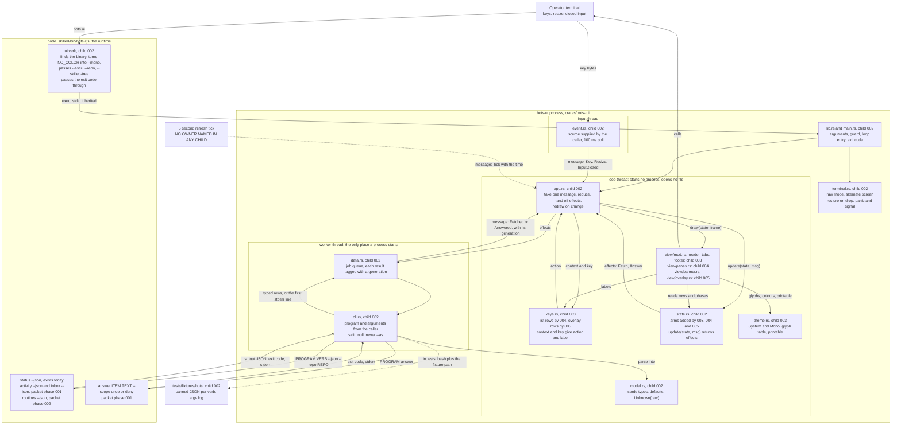
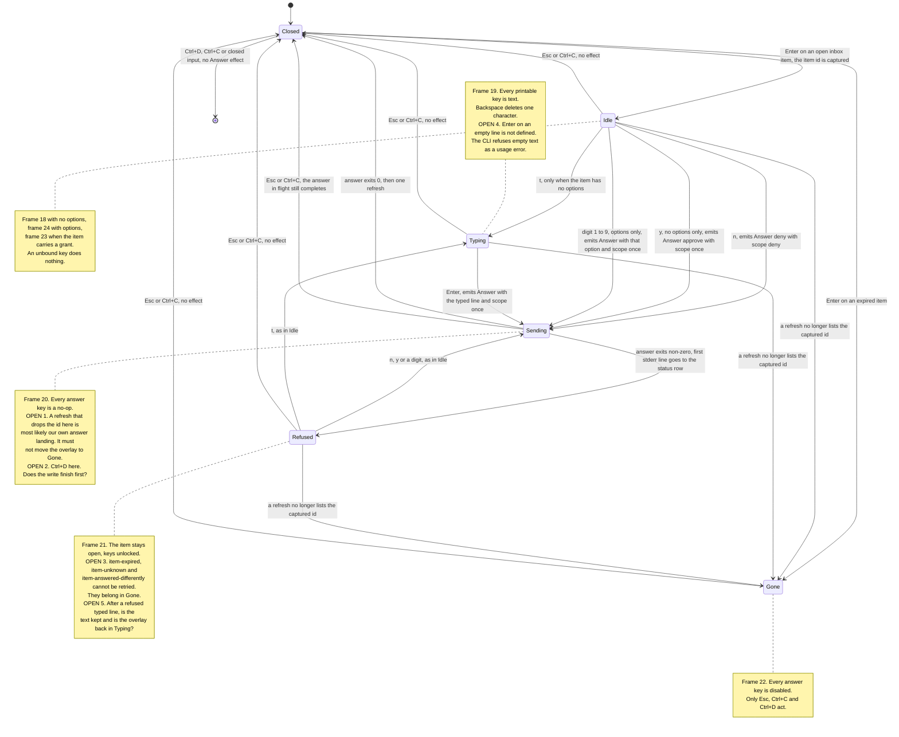

# Fable review 1: architecture, diagrams and context for the terminal screen plan

**Verdict: not ready for a one-shot build.** The six children and their order are sound, and the UX side (frames, keys, glyphs, states) is close to complete.
The gap is one level up: no document freezes the shared types, the payload fields, the worker rules or the answer contract, so three children would each invent their half of the same seam.
Four items block a one-shot build (R1 to R4), ten more force a builder decision, and one runtime fact (R3) means the Activity tab would pass every gate and still not update while the operator watches.

This review is fresh and read-only. It ran against the working tree at commit 69ecfd0b1f9 on 2026-11-25 while six writers were applying `ui-review-2.md`, so child line numbers may have moved since. Paths are relative to this phase folder unless they start with `specs/` or `.skilled/`. Nothing here repeats a finding from `ui-review-2.md`.

What was checked and how: the three parent documents in full, the 002 spec, plan and tasks in full, the scope and requirement sections of the other five child specs, the plans of 003 to 005 in part, `key-map.md` and `component-inventory.md` in full, `mockups.md` in part (sections 1, 2, 4, 5 and 6 and the frames for Activity and Routines), the four research files, the screenshot index, three reference images, two openhuman demo captures, and the runtime sources the screen will call. `glyph-table.md` was not opened. No cargo build ran and no bot ran. A claim marked **judgment** is my reading, not something a file states.

---

## 1. Is the phase split right?

Yes, keep the six children and their order. **Judgment.** The split follows real seams (design, skeleton, shell, panes, answer flow, gates) and each child closes on its own evidence. Three things about the split need repair, and each is a recommendation below.

- **002 is named "architecture and contracts" and freezes neither.** It names two effects and one wrapper type, and leaves the message list, the state fields and the payload fields open (R1, R2).
- **Seven files are edited by three or four children with no owner map.** `state.rs`, `keys.rs`, `app.rs`, `cli.rs`, `model.rs`, `view/mod.rs` and the fixture are each touched by several children, and some work is claimed twice (R7).
- **Two operator steps sit in the middle of the chain.** The key map approval gates 002 and the hand proof gates 006, so the build cannot run unattended from 002 to 006 (R4).

---

## 2. Ranked recommendations

### P0: blocks a one-shot build

**R1. Freeze the shared vocabulary before any module is written.**

- **Change:** write one architecture file that fixes, by name and field, the types every child shares. It needs the full `State` struct, the full `Msg` list, the `Effect` list, `Action`, `Tab`, `Surface`, the row key each pane selects by, `Remote<T>`, the `Overlay` struct and its phases, and the signature of the loop entry with its four injected seams (event source, backend, program plus arguments, clock). Later children then add reducer arms and table rows, never types.
- **Where:** new file `002-architecture-and-contracts/design/architecture.md`, copied into `crates/bots-tui/design/` by the same task that copies 001's four files. `002-architecture-and-contracts/tasks.md` T012 and T016 cite it. `spec.md` section 3 links it.
- **Why:** the plan names `update(state, msg) -> Vec<Effect>` with `Fetch` and `Answer` and nothing else. [SOURCE: 002-architecture-and-contracts/spec.md:196] No child lists the messages. 003 says it reads `active_tab`, `status`, `last_error` and `now` from the state and adds no field, but 002 never promises those fields. [SOURCE: 003-shell-and-navigation/plan.md:81] [SOURCE: 003-shell-and-navigation/spec.md:249] The palette needs an open flag, a filter string and a selection, and 003 writes that logic into `view/mod.rs` and `keys.rs` while leaving `state.rs` and `app.rs` unchanged, so palette state has no home in the reducer. [SOURCE: 003-shell-and-navigation/tasks.md:60] [SOURCE: 003-shell-and-navigation/plan.md:82] `keys.rs` returns an action and "the loop runs the action", yet no child says how an action becomes a message or who writes the tab-switch arm. [SOURCE: 003-shell-and-navigation/plan.md:61] The build runs as parallel lanes of external workers that each hold one file, so two lanes cannot agree on a type by reading each other. [SOURCE: 002-architecture-and-contracts/plan.md:145] The drift has already started outside this phase: packet phase 010 plans edits to `src/ui_state.rs` and `src/render/panes.rs`, two files this phase does not create. [SOURCE: specs/system-skilled-bots/003-openbot-parity-build/010-conversations/spec.md:126-127]

**R2. Pin the four payloads as literal JSON with a field table, and make that one file feed the fixture and a runtime test.**

- **Change:** write a contracts file with one sample payload per verb and a table per payload: key, type, nullable or not, format (for example ISO 8601 UTC for every time), and the screen cell that draws it. Store the samples as files the fixture prints, and add one vitest case in the runtime that checks the real verb's output against the same samples once packet phases 001 and 002 land.
- **Where:** new file `002-architecture-and-contracts/design/contracts.md`. New files `crates/bots-tui/tests/fixtures/payloads/{status,activity,inbox,routines}.json`. `002-architecture-and-contracts/tasks.md` T010 changes from "payloads inline in the script" to "the script prints the payload files". One new test in `.skilled/skills/system-skilled-bots/runtime/tests/`, owned by packet phases 001 and 002.
- **Why:** three of the four read verbs do not exist yet, so the fixture is written from prose. [SOURCE: spec.md:75-77] [SOURCE: .skilled/bin/bots.cjs:31-54] Packet phase 001 names the activity and inbox keys but not their types, and says nothing on whether `actor` or `runId` can be null on a scheduled row. [SOURCE: specs/system-skilled-bots/003-openbot-parity-build/001-activity-and-actor/spec.md:152-153] Packet phase 002 gives the routines payload no key names at all for three fields: "rendered starts", "failure streak" and "switch state". [SOURCE: specs/system-skilled-bots/003-openbot-parity-build/002-routine-layer/spec.md:173] The frames draw values with no named source key: `in 3h` on a scheduled row and `every 6h` on a recurring row, where the activity row carries only `botId`, `identity`, `state`, `at`, `actor` and `runId`. [SOURCE: 001-ux-and-component-map/design/mockups.md:97] [SOURCE: 001-ux-and-component-map/design/mockups.md:105] The plan keeps the payloads inline in a bash script, so nothing can compare them with the runtime. [SOURCE: 002-architecture-and-contracts/plan.md:182] The parent says a phase that changes a payload updates the fixture in the same change, but nothing fails when that step is skipped. [SOURCE: spec.md:184]

**R3. Decide who refreshes the status index while the screen is open.**

- **Change:** pick one of three and write it into the contract. Packet phase 001 makes `bots activity` index new runs on read. Or the screen calls `bots status --json --rebuild` when the payload says `stale`. Or the screen draws a rebuild key. Then add a criterion that proves a run finished after the screen opened appears without leaving it.
- **Where:** `spec.md` section 7 for the decision, `002-architecture-and-contracts/design/contracts.md` for the call, and `specs/system-skilled-bots/003-openbot-parity-build/001-activity-and-actor/spec.md` if the runtime takes it.
- **Why:** status never rebuilds an existing index. "An existing index is not rebuilt: its run rows stay as they are, so a stale one says so instead of being quietly re-derived." [SOURCE: .skilled/skills/system-skilled-bots/runtime/lib/status.ts:364-366] Only the item rows of a stale identity are refreshed, and "its runs still wait for a rebuild". [SOURCE: .skilled/skills/system-skilled-bots/runtime/lib/status.ts:335-338] The only caller that indexes a run record is the rebuild. [SOURCE: .skilled/skills/system-skilled-bots/runtime/lib/status-index.ts:688] `bots activity` is specified to read that index. [SOURCE: specs/system-skilled-bots/003-openbot-parity-build/001-activity-and-actor/spec.md:151] The screen polls every 5 seconds, so it would re-read the same frozen run rows and show a stale flag. [SOURCE: 002-architecture-and-contracts/spec.md:202] No file in this phase mentions a rebuild. **Evidence level:** confirmed by reading the status code. It is inferred for `bots activity`, which is not built. Running one bot and then calling `bots status --json` twice without `--rebuild` would confirm it.

**R4. Move the two operator steps out of the middle of the chain.**

- **Change:** the operator approves the key map once, before the build starts and after the `ui-review-2.md` fixes land. The hand proof moves from the 005 to 006 handoff to a final operator acceptance step after 006. A scripted run of the real binary in a pseudo-terminal joins 006 so the build proves a real answer without a person (R8).
- **Where:** `spec.md` Phase Handoff Criteria rows for 001 and 005, `005-answer-flow/tasks.md` T019, `006-hardening-and-proof/tasks.md`, `goal.md` criteria.
- **Why:** the approval is still unmet and it is 001's exit, so 002 cannot start. [SOURCE: 001-ux-and-component-map/design/key-map.md:128] [SOURCE: spec.md:252] The 005 to 006 handoff requires that "the operator answers one item from the overlay by hand". [SOURCE: spec.md:256] That hand step also needs a live open item and the real `inbox --json` and `--scope` from packet phase 001, which do not exist today. [SOURCE: 005-answer-flow/tasks.md:92] [SOURCE: .skilled/bin/bots.cjs:73]

### P1: a builder would have to decide

**R5. Specify the worker thread: what a generation is, what may be dropped, the queue order, the timeout and who owns the tick.**

- **Change:** state these five rules in the architecture file.
  1. A generation is per surface, and a fetch result is dropped only when a newer fetch of the same surface was issued.
  2. An answer result is never dropped.
  3. An answer jumps ahead of queued fetches.
  4. Every child process has a timeout, is killed when it passes, and reports as a failed read.
  5. One named source sends a tick message that carries the time, so the reducer stays pure and a test sets the clock.
- **Where:** `002-architecture-and-contracts/design/architecture.md`, `002-architecture-and-contracts/spec.md` REQ-006 and REQ-013, `005-answer-flow/plan.md` data flow.
- **Why:** REQ-006 says the loop "drops a result whose generation is not the current one" and does not say current for what. [SOURCE: 002-architecture-and-contracts/spec.md:190] If one counter moves on every refresh or tab switch, a slow answer result would be dropped and the overlay would stay in sending. **Judgment.** 005 says `app.rs` "sets `Sending`, calls `cli.rs` once", which reads as a spawn on the loop thread and a state change outside the reducer, against REQ-006 and against the reducer moving the phase "in the same step". [SOURCE: 005-answer-flow/plan.md:69] [SOURCE: 005-answer-flow/plan.md:73] No child names a timeout, and one worker thread means one hung child stops every later read and every answer. The measured read takes 0.18 to 0.34 s and a refresh issues up to three in a row. [SOURCE: spec.md:218] The 5-second poll has no owner: the inventory calls the refresh timer "a loop concern" and no child names the message it sends. [SOURCE: 001-ux-and-component-map/design/component-inventory.md:100]

**R6. Complete the answer contract: the argv form, the refusal classes, the stderr rule and the race with a refresh.**

- **Change:** write these into the contracts file and into 005's requirements.
  1. The argv is `answer --scope <scope> --repo <repo> -- <item-id> <text>`, with `--` before the two positionals.
  2. A table maps each refusal name and exit code to an overlay phase: retry stays in refused, and `item-expired`, `item-unknown` and `item-answered-differently` go to gone.
  3. While the phase is sending, a refresh that no longer lists the item does not move the overlay to gone.
  4. Enter on an empty typed line sends nothing.
  5. A read that exits 0 with text on stderr shows that first line in the status row.
- **Where:** `002-architecture-and-contracts/design/contracts.md`, `005-answer-flow/spec.md` REQ-014 to REQ-017, `005-answer-flow/tasks.md` T008 and T013, `spec.md` REQ-003.
- **Why:** the CLI parser treats every token that starts with `-` as an option unless `--` came first, so a typed answer that starts with a dash, such as `-1` or `--no`, is refused as an unknown or misplaced option and can never be sent. [SOURCE: .skilled/bin/bots.cjs:118-131] The planned argv puts the text before `--scope` with no terminator. [SOURCE: 005-answer-flow/plan.md:65] The runtime already names five refusals, and two more arrive with packet phases 006 and 011. [SOURCE: .skilled/skills/system-skilled-bots/runtime/lib/answer.ts:61-63] The plan treats every non-zero exit as retryable and keeps the overlay open on the same item. [SOURCE: 005-answer-flow/spec.md:155] A scope error exits 2 and a refusal exits 4. [SOURCE: specs/system-skilled-bots/003-openbot-parity-build/001-activity-and-actor/spec.md:156] [SOURCE: .skilled/bin/bots.cjs:292-297] The gone rule fires when "a refresh no longer lists" the item, and the screen's own successful answer also removes the item from the list, so a refresh that lands before the answer result would tell the operator the item closed under them. [SOURCE: 005-answer-flow/spec.md:162] **Judgment** on the race, since no file describes the order. Empty text is a usage error in the CLI. [SOURCE: .skilled/bin/bots.cjs:161] `bots inbox` exits 0 and writes "did not read" lines to stderr for unreadable items, which the plan's non-zero rule hides. [SOURCE: .skilled/bin/bots.cjs:472] [SOURCE: 002-architecture-and-contracts/spec.md:203]

**R7. Add an owner map for the shared files and remove the double claims.**

- **Change:** give the parent file table two columns, "created by" and "extended by, and what part". Then settle four double claims.
  1. 002 owns the whole process boundary: the answer call, the fixture's answer branch and the complete model with `options` and the optional `grants`.
  2. 002 owns argument parsing, including `--mono` and `--ascii`.
  3. 002 owns the closed-input exit.
  4. No view module calls `cli.rs`. The header reads status from the state.
- **Where:** `spec.md` section 3 Files to Change, then `002-architecture-and-contracts/spec.md`, `003-shell-and-navigation/plan.md` and `tasks.md`, `005-answer-flow/spec.md` and `tasks.md`.
- **Why:** 002 already tests `answer_argv_carries_scope` and an argv log that holds two answers. [SOURCE: 002-architecture-and-contracts/tasks.md:59] [SOURCE: 002-architecture-and-contracts/tasks.md:61] 005 then lists the answer call in `cli.rs`, the fixture's answer branch and argv log line, and the closed-input exit in `app.rs` as its own changes. [SOURCE: 005-answer-flow/spec.md:128-131] [SOURCE: 005-answer-flow/tasks.md:75] 005 adds `options` to the model, but 004 runs first and its detail column draws the options of an inbox item. [SOURCE: 005-answer-flow/spec.md:129] [SOURCE: 001-ux-and-component-map/design/mockups.md:203] 002 says `lib.rs` parses `--mono` and `--ascii`, and 003 has a task that adds the same parsing. [SOURCE: 002-architecture-and-contracts/spec.md:157] [SOURCE: 003-shell-and-navigation/tasks.md:62] 003 says the header "reads `bots status --json` through 002's `cli.rs`", which breaks decision D2 if a builder takes it literally. [SOURCE: 003-shell-and-navigation/plan.md:64] [SOURCE: goal.md:48]

**R8. Make the frames the test expectation, and add one test that runs the whole path.**

- **Change:** snapshot tests load the expected frame from `design/mockups.md` by heading and size, and compare every cell. One canonical data set (the bots, items and routines the frames draw, plus one fixed clock) is written once and used by the fixture payload files and by every snapshot. One end-to-end test drives the loop with a scripted event source and the fixture, and asserts frame 1. One scripted pseudo-terminal run starts the release binary against the fixture, sends keys and reads the screen.
- **Where:** `003-shell-and-navigation/tasks.md` T011, `004-panes/tasks.md` T014, `005-answer-flow/tasks.md` T013, `006-hardening-and-proof/tasks.md` for the pseudo-terminal run, and a new helper `crates/bots-tui/tests/common/frames.rs`.
- **Why:** 001 calls each frame a contract and says later children "assert their buffers against these frames". [SOURCE: 001-ux-and-component-map/spec.md:192] 004's snapshot table checks only "the expected first body line and the expected marker", so a pane that is wrong below line one passes. [SOURCE: 004-panes/plan.md:113] [SOURCE: 004-panes/tasks.md:64] 003 compares the buffer to "a block held in the test file", which the builder types and can type from the output. [SOURCE: 003-shell-and-navigation/plan.md:165] No test goes from the fixture through the worker and the reducer to a drawn frame: 002 proves an empty frame and each later child builds its state by hand. [SOURCE: 002-architecture-and-contracts/tasks.md:66] [SOURCE: 003-shell-and-navigation/tasks.md:36] The real binary is never started by any gate, because every criterion avoids a tty by design. [SOURCE: goal.md:119]

**R9. Give each test its own fixture log and scenario through arguments, not a shared file and an environment variable.**

- **Change:** the fixture takes `--fixture-log <path>` and `--fixture-scenario <name>` as leading arguments. Each test passes a temp path and a scenario through the program-plus-arguments seam `cli.rs` already has. Scenarios cover ok, empty, read failure, refusal by name, slow, and warning on stderr. Every no-write test first asserts that the same log recorded the reads.
- **Where:** `002-architecture-and-contracts/spec.md` REQ-008, `002-architecture-and-contracts/tasks.md` T010, `005-answer-flow/plan.md` testing section, `005-answer-flow/tasks.md` T009.
- **Why:** the log is one fixed file in the source tree, `tests/fixtures/bots.argv`. [SOURCE: 005-answer-flow/tasks.md:75] Cargo runs tests in parallel, so two tests append to one log and a "recorded no answer" check can pass or fail by timing. **Judgment.** The refusal switch is the environment variable `BOTS_FIXTURE_ANSWER_EXIT`, but the binary adds no variable to the child it spawns, so a test would have to change the whole test process's environment. [SOURCE: 005-answer-flow/plan.md:225] [SOURCE: 002-architecture-and-contracts/spec.md:251] The caller already supplies the program and its arguments, which is the seam this needs. [SOURCE: spec.md:176]

**R10. Fill the state model: selection key per pane, scroll, size, time and the sizes between the floor and 80x24.**

- **Change:** state these in the architecture file and the design files.
  1. Each data pane keeps its own selection, and the file names the key for each: the item `id` for the inbox, `botId` for routines, and a named composite for activity rows.
  2. Each pane keeps a scroll offset, and the reducer learns the body height from the resize message so a page move is defined.
  3. Time arrives as ISO 8601 text, and the file says how it is parsed with no time crate, or names the crate to add.
  4. A rule covers every size between the too-small floor and 80x24.
- **Where:** `002-architecture-and-contracts/design/architecture.md`, `001-ux-and-component-map/design/mockups.md` section 1, `003-shell-and-navigation/spec.md` REQ-016, `004-panes/spec.md` REQ-022.
- **Why:** the plan has one `Option<ItemId>` selection, named after inbox items, for three panes whose rows have three kinds of identity. [SOURCE: 002-architecture-and-contracts/spec.md:196] [SOURCE: 004-panes/spec.md:157] The frames say "the list scrolls, and the selection stays visible" and no child holds a scroll offset or a body height in the state. [SOURCE: 001-ux-and-component-map/design/mockups.md:2006] The header and rows draw ages such as `12s ago` from ISO strings, and the six dependencies include no time crate, while the reference uses `chrono`. [SOURCE: 002-architecture-and-contracts/plan.md:196-197] [SOURCE: specs/system-skilled-bots/context/openhuman-main/crates/openhuman-tui/Cargo.toml:75] The too-small floor is 24 columns by 8 rows, a number taken from openhuman. [SOURCE: 003-shell-and-navigation/spec.md:86] The inbox footer line is 67 columns wide by my count of the label string in the key map, so between 24 and 66 columns the frame cannot draw every bound key, which REQ-010 requires. [SOURCE: 001-ux-and-component-map/design/key-map.md:73] [SOURCE: spec.md:179] The layout rules cover exactly two sizes. [SOURCE: 001-ux-and-component-map/design/component-inventory.md:83-89]

**R11. Change the signal rule from "restore inside the handler" to "set a flag, exit through the guard".**

- **Change:** the `SIGTERM` and `SIGHUP` handler sets an atomic flag. The event source turns the flag into a terminate event, the loop returns and the guard's drop restores the terminal. The test raises the signal and asserts the event, not a restore run from inside a handler. State that the crate targets macOS and Linux only.
- **Where:** `002-architecture-and-contracts/spec.md` REQ-005, `002-architecture-and-contracts/tasks.md` T029.
- **Why:** REQ-005 has the handler run "the same restore". [SOURCE: 002-architecture-and-contracts/spec.md:189] A restore writes to stdout and changes terminal modes, and a handler that does that while the loop is in the middle of a draw can deadlock on the output lock. **Judgment**, from how signal handlers work, not from a file here. The plan adds `libc` for this and names no platform, and no child mentions Windows. [SOURCE: 002-architecture-and-contracts/plan.md:197] A builder should also check whether ratatui 0.30's own init and restore helpers cover the guard and the panic hook, which would remove the need to follow a GPL file's shape. **Judgment**, to verify against the ratatui 0.30 docs before writing.

**R12. Keep GPL sources out of the briefs of the workers that write the matching modules.**

- **Change:** add a clean-room rule to the dispatch doctrine. A worker that writes `terminal.rs`, `theme.rs`, the overlay keys or the overlay view gets our design files and MIT or Apache references only. openhuman and tinychannels paths appear in design documents as provenance, never in a worker brief. The orchestrator compares the finished guard and overlay with the openhuman files by eye and records that it did.
- **Where:** the "What every dispatch carries" section in each child `plan.md`, `002-architecture-and-contracts/spec.md` risk row, `006-hardening-and-proof/tasks.md` audit table.
- **Why:** the only automated proof is that `rg -n 'openhuman' crates/bots-tui/src` prints comment lines and that no GPL header text appears. [SOURCE: goal.md:87] Copied code would contain neither string, so the check passes on a copy. **Judgment.** The current mitigation is that "no openhuman file is opened while writing code except to read the shape", and 002's plan cites `terminal.rs:75-118` as the shape of the module a worker is about to write. [SOURCE: 002-architecture-and-contracts/spec.md:234] [SOURCE: 002-architecture-and-contracts/plan.md:69] A second reference repo, tinychannels, is also GPL. [SOURCE: specs/system-skilled-bots/context/tinychannels-main/LICENSE:1]

**R13. Make the plan work in a checkout that has no `context/` folder.**

- **Change:** see section 5 for the full context plan. In short: commit a manifest and no third-party image, cite references by upstream URL at a pinned commit, and make the pointer check print a named skip when the reference folder is absent.
- **Where:** new file `research/ui-reference-manifest.md`, `006-hardening-and-proof/tasks.md` T018, `001-ux-and-component-map/design/mockups.md` sections 5 and 6.
- **Why:** `specs/**/context/` is gitignored. [SOURCE: .gitignore:421] T018 prints `DANGLING` for every pointer whose file is missing, so the gate fails in any fresh worktree. [SOURCE: 006-hardening-and-proof/tasks.md:118] The mockups say "every pointer below resolves in this checkout", which is true only on this machine. [SOURCE: 001-ux-and-component-map/design/mockups.md:2032] The crate will ship those four files with pointers that no outside reader can follow. [SOURCE: 002-architecture-and-contracts/spec.md:205] Six of the seven reference folders I checked carry no git metadata, so their line numbers are tied to no recorded commit. I ran `test -e .git` in each of them. Only `openhuman-full` is a git clone.

**R14. Add the parent-level pieces no child owns: install, version match, CI shape and rollback.**

- **Change:** add four short items to the parent.
  1. Install: who runs `cargo build --release`, on which platforms, and what a non-source install sees.
  2. Version match: `bots-ui --version` prints the crate version and a contract number, and the `ui` verb refuses a binary whose contract number differs.
  3. CI: every cargo command uses `--locked`, the job adds a release build, and the job names its runner, cache and timeout.
  4. Rollback: one parent paragraph that names the single revert and what stays.
- **Where:** `spec.md` (a new section after section 3), `002-architecture-and-contracts/spec.md` REQ-001 and REQ-009.
- **Why:** the `ui` verb resolves one path, `<skilled-tree>/crates/bots-tui/target/release/bots-ui`, and refuses otherwise, so the screen exists only where someone built it. [SOURCE: 002-architecture-and-contracts/spec.md:185] Nothing detects a binary built before the last payload change. The lock file is committed "because a floating dependency graph would make the CI job's result depend on the day it ran", and no cargo command in the plan passes `--locked`. [SOURCE: 002-architecture-and-contracts/spec.md:289] I searched the six children for `--locked` and found none. The CI requirement names three commands and a toolchain pin, and no runner, cache or timeout. [SOURCE: 002-architecture-and-contracts/spec.md:193] CI never builds the release profile, which is the only one the verb starts. Rollback exists per child and not at the parent, where the operator would look. [SOURCE: 002-architecture-and-contracts/plan.md:208-209]

### P2: improves quality

**R15. Replace the wall-clock budget test with a count, and keep the timing as a local check.**

- **Change:** the pane draw returns or records how many rows it visited, and the test asserts that 2,000 rows cost at most the body height. The 16 ms timing moves to an ignored test the operator can run.
- **Where:** `004-panes/spec.md` REQ-025, `004-panes/tasks.md` T016, `spec.md` handoff row for 004.
- **Why:** the child itself lists the test as a flake risk on a loaded runner. [SOURCE: 004-panes/spec.md:194] The real requirement is already stated as a count: "a pane draws only the rows that fit its body". [SOURCE: 004-panes/spec.md:206] The timing test also passes on a pane that draws nothing. **Judgment.**

**R16. Trace the ten "Adopt" items from the reference sweep to a requirement or a recorded no.**

- **Change:** add a small table: adopt item, the requirement that carries it, or "declined" with a date.
- **Where:** `research/ui-references.md` section 3.
- **Why:** the sweep lists ten things to adopt. [SOURCE: research/ui-references.md:97-106] At least one has no carrier: "the outcome word on the row after an answer, until the next refresh". I searched the six child specs and the four design files for it and found nothing. [SOURCE: research/ui-references.md:100]

**R17. Keep one copy of the design files after 002 copies them.**

- **Change:** after 002's copy task, the crate copy is the source and the packet copy becomes a pointer, or a CI step runs the `diff -r` that today only 002 and 006 run by hand.
- **Where:** `002-architecture-and-contracts/spec.md` REQ-016, the `bots-tui` CI job.
- **Why:** two tracked copies stay equal only through "a later edit is made in 001's copy and copied again". [SOURCE: 002-architecture-and-contracts/spec.md:205] Packet phases 006 and 010 will change frames later and are not told about the rule. [SOURCE: specs/system-skilled-bots/003-openbot-parity-build/006-approval-grants/spec.md:139]

---

## 3. Diagram plan

Six diagrams would make the plan buildable and reviewable. All are Mermaid in markdown except the layout grid, which is ASCII so it lines up with the frames. None needs an SVG. **Judgment** on form and placement.

1. **Module and data-flow graph.** New file `002-architecture-and-contracts/design/architecture.md`, Mermaid flowchart. It must show every module, the child that creates it, the three threads, the one channel, the one process boundary and what crosses it. Drafted in full below.
2. **Overlay and answer state machine.** `005-answer-flow/plan.md` section 3, with a copy in `001-ux-and-component-map/design/component-inventory.md` beside rows 8 and 9. Mermaid state diagram. It must show every phase, every key that leaves it, the effect each edge emits, and the frame number that draws each phase. Drafted in full below.
3. **Key-context state machine.** `001-ux-and-component-map/design/key-map.md` section 1, Mermaid state diagram. It must show the six contexts, the key that moves between each pair, and that Ctrl+D leaves from all of them. It replaces the sentence "a context is exclusive" with a picture a builder can turn into one enum.
4. **Answer-flow sequence.** `002-architecture-and-contracts/design/contracts.md`, Mermaid sequence diagram with five lanes: operator, loop thread, worker thread, `bots answer`, state root. It must show the lock, the argv, the three outcomes (exit 0, refusal, timeout) and the refresh that follows.
5. **Refresh timeline.** Same file as diagram 1, Mermaid sequence diagram. It must show one 5-second cycle: tick, the three reads in order with the inbox first, the in-flight rule, a tab switch in mid cycle and which result is dropped.
6. **Layout grid per size.** `001-ux-and-component-map/design/mockups.md` section 1, ASCII. It must show row and column numbers for the seven bands at 80x24 and 120x40, the 72 plus 1 plus 47 split, the overlay box at both sizes, and the rule for sizes in between (R10).

### Draft A: module and data-flow graph

Built from the parent file table, 002's component list and data flow, and the Files to Change tables of 003 to 005. [SOURCE: spec.md:130-163] [SOURCE: 002-architecture-and-contracts/plan.md:67-80] [SOURCE: 003-shell-and-navigation/spec.md:112-119] [SOURCE: 004-panes/spec.md:131-136] [SOURCE: 005-answer-flow/spec.md:122-133] The dotted tick node is the one piece the docs do not assign.

Rules the graph implies, to print under it in the architecture file:

- Only `cli.rs` starts a process, and only on the worker thread. [SOURCE: goal.md:48] [SOURCE: 002-architecture-and-contracts/spec.md:190]
- `state.rs` imports `model.rs` and nothing that draws or spawns. `view/*` imports `state.rs`, `keys.rs`, `theme.rs` and `model.rs`, and never `cli.rs` or `data.rs`. **Judgment**, taken from "pure state, one renderer, one process boundary". [SOURCE: 002-architecture-and-contracts/plan.md:65]
- The module order for building is `model`, `event` and `terminal` first, then `cli` and `state`, then `data`, then `app`. [SOURCE: 002-architecture-and-contracts/plan.md:147]

What the graph could not show because no file decides it: who sends the tick, whether the generation is one counter or one per surface, whether an answer result can be dropped, the child timeout, and how an action becomes a message. Those are R1 and R5.

### Draft B: overlay and answer state machine

Built from 005's requirements and data flow, the key map and inventory rows 8 and 9. [SOURCE: 005-answer-flow/spec.md:152-165] [SOURCE: 005-answer-flow/plan.md:63-73] [SOURCE: 001-ux-and-component-map/design/key-map.md:56-69] [SOURCE: 001-ux-and-component-map/design/component-inventory.md:32-33] Frame numbers are from the state index. [SOURCE: 001-ux-and-component-map/design/mockups.md:64-70] The notes marked OPEN are the cases the docs leave undecided.

Ctrl+D quits from every state and is left off the edges to keep the picture readable. [SOURCE: 001-ux-and-component-map/design/key-map.md:69] The two `Refused` edges that reuse the Idle keys are my reading of "the keys unlocked" in the frame index, not a stated rule. [SOURCE: 001-ux-and-component-map/design/mockups.md:67]

A test that follows from this picture and cannot pass by accident: one table with a row per state and key, giving the expected next state and the expected effects, run through `update` alone. It belongs in `005-answer-flow/tasks.md` T006.

---

## 4. Checks that can pass by accident today

Each of these is green on a wrong build. The fix column of most is one of the recommendations above.

- **The pane snapshots** check a first line and a marker. [SOURCE: 004-panes/plan.md:113] Fix: R8.
- **The no-write tests** read a shared log. A wrong path or another test's timing gives "no answer recorded". [SOURCE: 005-answer-flow/tasks.md:75] Fix: R9, with a positive control in the same log.
- **The copy check** `rg -n 'openhuman' crates/bots-tui/src` prints nothing on copied code, and nothing on an empty folder. [SOURCE: goal.md:87] Fix: R12.
- **The CI check** greps the workflow file for a job name and two path lines. [SOURCE: goal.md:90] That proves the text, not a green run. Fix: require the run's conclusion for the commit, read with `gh run list`.
- **The budget test** passes on a pane that draws nothing. [SOURCE: 004-panes/spec.md:165] Fix: R15.
- **The handoff from 002** says "CI green on an empty frame" and the verification column names only local commands. [SOURCE: spec.md:235] [SOURCE: spec.md:253] Fix: same as the CI check.

---

## 5. Context plan

**What a builder needs.** Nothing in `context/`. The frames, the key map, the glyph table and the inventory are tracked and are the contract. [SOURCE: 001-ux-and-component-map/design/mockups.md:15] State that in the parent in one sentence, so a builder in a fresh checkout does not stop to look for images. The references explain why a frame looks the way it does. They are for a reviewer and for the operator.

**What to commit.** No third-party image, and no openhuman capture. **Judgment.**

- The local index counts 112 downloaded images from 31 apps (`context/screenshots/INDEX.md` line 5, gitignored), with mixed terms: MIT, Apache-2.0, AGPL-3.0, GPL-3.0, source-available and no licence at all. [SOURCE: research/ui-references.md:13-41] One rule for all of them is simpler and safer than a per-file notice.
- The openhuman demo captures are 56 files, a `.txt` and an `.ansi` for each of 28 frames, and they carry that program's own interface text. [SOURCE: 001-ux-and-component-map/design/mockups.md:2024-2026] I counted the files in `context/screenshots/openhuman-demo/`. They stay local.
- Commit one new file, `research/ui-reference-manifest.md`. It lists each image that a frame leans on: upstream URL at a pinned commit, licence, sha256, the local file name and the frame it informed. Today the only full URL list is `context/screenshots/INDEX.md`, which is gitignored, so a fresh clone loses it. [SOURCE: .gitignore:421] The tracked `ui-references.md` has one to five URLs per project and they point at `main` or `HEAD`, which move. [SOURCE: research/ui-references.md:15]
- Commit one short script beside the manifest that downloads the listed files into `context/screenshots/web/` and checks each sha256. A reviewer can then rebuild the folder in one command.
- Add to the same manifest one row per reference repo: its URL, and the commit or the download date. Six of the seven repos I checked are plain folders with no git metadata.

**How specs should cite.** Three forms, one per kind of source.

- Our own files: `[SOURCE: path:line]` as now.
- Reference code: the upstream permalink at a pinned commit, with the local path second and marked "local, optional". Then a pointer survives a fresh clone and survives the reference repo moving.
- Reference images: the rank number in `ui-references.md` section 1, which is tracked, with the local file name second. Never a bare `context/screenshots/...` path, which is what the mockups use now. [SOURCE: 001-ux-and-component-map/design/mockups.md:2020-2024]

**Should each frame link to its references? Yes, one line per frame group.** Add a "Reference" line under each frame heading in `mockups.md`. These are the pairings I would write, from the sweep and the images I opened.

- Frames 1 and 5 to 8 (Activity): rank 1, the Codex agent overview snapshots, for group order, counts and the selection rule. [SOURCE: research/ui-references.md:15]
- Frames 3 and 13 to 16 (Routines): rank 5, claude-tasks. I opened the image: it shows Name, Schedule, Status, Next Run and Last Run columns, with `in 56s` for a near run, a date for a far one and `-` for none. [SOURCE: research/ui-references.md:19] Also rank 17, rakazo.
- Frames 18 to 24 (overlays): rank 2, the Codex approval overlay, and rank 3, the Claude Code prompt. I opened the Claude Code image: title, description, the command between two rules, the question, numbered options, a key line. [SOURCE: research/ui-references.md:16-17] Both preselect yes, which our overlay must not.
- Frame 25 (palette): the local capture `openhuman-demo/80x24-06-palette.txt`, layout only, plus rank 10, gh-dash, for help in columns. [SOURCE: research/ui-references.md:24]
- Frames 6, 10 and 14 (empty states): rank 9, posting. [SOURCE: research/ui-references.md:23]
- Glyph and word columns in every list: rank 7, process-compose. I opened the image: a glyph column beside a status word column, with an exit code column. [SOURCE: research/ui-references.md:21]

**Which reference code to read first, per child.** The line ranges below come from the source tables in the design files. I checked that each file exists, not each line. [SOURCE: 001-ux-and-component-map/design/mockups.md:2034-2058] [SOURCE: 001-ux-and-component-map/design/key-map.md:140-155]

- **002.** Read the runtime before any reference: `.skilled/bin/bots.cjs` (the parser at 113 to 148, the answer verb at 292 to 301, the inbox listing at 461 to 473), `.skilled/skills/system-skilled-bots/runtime/lib/status.ts` lines 68 to 114 for the status payload, `needs-you.ts` lines 24 to 60 for the item, and `answer.ts` lines 58 to 95 for the refusals. For the closed-input rule, `specs/system-skilled-bots/context/turnstone-main/turnstone/cli.py` lines 431 to 447 (Apache-2.0). For the guard, the ratatui panic and popup examples named at rank 24 (MIT), not the openhuman guard (R12).
- **003.** `specs/system-skilled-bots/context/turnstone-main/turnstone/ui/colors.py` lines 4 to 6 for the control-character filter (Apache-2.0). The two local captures `80x24-01-start.txt` and `80x24-06-palette.txt` for the shape of a header, a status line and a palette. gh-dash at rank 10 for the `[` and `]` pair.
- **004.** `specs/system-skilled-bots/context/OpenBot-main/app/src/lib/bot-lifecycle/activity-groups.ts` lines 17 to 41 for group order (MIT). `OpenMausBot-main/src/components/ActivityPanel.tsx` lines 34 to 50 for rows and the error state (Apache-2.0). `OpenBot-main/app/src/components/routines/routines-list.tsx` lines 57 to 61 and `rakazo-main/apps/web/src/pages/routines/RoutineList.tsx` lines 15 to 30 for the routine sentence. `OpenBot-main/app/src/components/needs-you/board.tsx` line 161 for the inbox row.
- **005.** `specs/system-skilled-bots/context/OpenGhost-main/approval-card.js` lines 129 to 140 and 182 to 190 for deny first and the key lock, and `ask-card.js` lines 264 to 268 for digits (both MIT). `OpenBot-main/app/src/components/approvals/inline-approval.tsx` lines 77 to 81 for the item that folds away. `OpenMausBot-main/src/components/ApprovalCard.tsx` lines 93 to 95 for the expired card. `turnstone-main/turnstone/cli.py` lines 476 to 487 for the default deny we do not copy.
- **006.** No reference code. The README names openhuman as the design reference and its licence. [SOURCE: 006-hardening-and-proof/spec.md:142]

---

## 6. Builder's reading order

1. `spec.md` sections 3 and 4, then `goal.md` decisions D1 to D7. [SOURCE: goal.md:45-53]
2. `decision-record.md` rows Q002 to Q009. [SOURCE: decision-record.md:41-48]
3. `001-ux-and-component-map/design/component-inventory.md`, then `key-map.md`, then `glyph-table.md`, then `mockups.md` sections 1 and 2.
4. The two new files from R1 and R2: `002-architecture-and-contracts/design/architecture.md` and `contracts.md`.
5. The child at hand: its `goal.md`, `spec.md`, `plan.md`, `tasks.md` and `acceptance-criteria.md`, in that order, then the frames its components name in the inventory.

A builder opens the runtime files listed under 002 in section 5 only when writing `cli.rs`, `model.rs` or the fixture. A builder does not open `context/` at all.

---

## 7. Definition of done per child

These add to each child's own criteria. Each line is something a gate can show. **Judgment** throughout.

- **001.** The operator's approval is recorded with its date. Every frame parses to exactly its stated width and height. Every value a frame draws maps to one payload key in the contracts file.
- **002.** `cargo build --release --locked` passes. Every type in the architecture file exists with the listed fields, and a compile-only test names them. The fixture prints the payload files, and a shape test reads all four. One scripted run goes from the fixture to an empty frame. The CI job is green on a real run for the commit.
- **003.** The shell rows of frames 1 to 4, and frames 25 and 26 whole, match the mockups cell for cell at both sizes. The palette's open flag, filter and selection live in the state and are driven through `update`.
- **004.** All 32 pane frames match the mockups cell for cell. The reorder test, the scroll rule and the per-pane selection hold through `update`. The row count bound from R15 holds.
- **005.** The transition table from Draft B passes. The recorded argv matches exactly, with the `--` terminator. Frames 18 to 24 match at both sizes. The race in OPEN 1 has its own test.
- **006.** Every gate passes, the pseudo-terminal run answers one fixture item, and the README is written. The operator's hand proof follows as the acceptance step, not as a gate inside the build.

---

## 8. Risks and mitigations

- **The fixture and the runtime disagree, and nobody sees it until the hand proof.** The verbs are not built. Mitigation: R2, and question 1 below.
- **Parallel workers produce modules that do not fit.** Mitigation: R1 and R7 before the first dispatch.
- **The screen is green and useless for watching.** Mitigation: R3.
- **A worker reproduces GPL code.** Mitigation: R12.
- **A gate fails only because the build ran in a fresh worktree.** Mitigation: R13, and question 3 below.
- **A hung child freezes every read.** Mitigation: the timeout in R5.

---

## 9. Questions only the operator can answer

1. **Build order.** Are packet phases 001 and 002 built and merged before this phase starts, or is the screen built first against the fixture? If the screen goes first, the hand proof and the runtime contract test must wait for them.
2. **Index freshness.** Who refreshes the status index while the screen is open: the runtime on read, the screen through `status --json --rebuild`, or the operator with a drawn key? (R3)
3. **Where the build runs.** In this worktree, where `context/` exists, or in a fresh one? If fresh, the pointer checks must skip by name instead of failing. (R13)
4. **The two operator steps.** Will you approve the key map before the build starts, once the `ui-review-2.md` fixes are in, and take the hand proof as the last step after 006? (R4)
5. **Install.** Is "source checkout plus a local `cargo build --release`" the accepted way to get the screen, with a Rust toolchain as a stated prerequisite and macOS and Linux as the only platforms? (R14)
6. **Dependencies.** `insta` was refused. May the crate add a small time crate or a signal crate, or must ISO time parsing and signal handling be written by hand on `libc`? (R10, R11)
7. **Third-party images.** Do you agree to commit none and to commit a manifest and a fetch script instead? (R13)
8. **After an answer.** Should the row show the outcome word until the next refresh drops it, as the reference sweep proposes, or should the item just leave the list? (R16)
