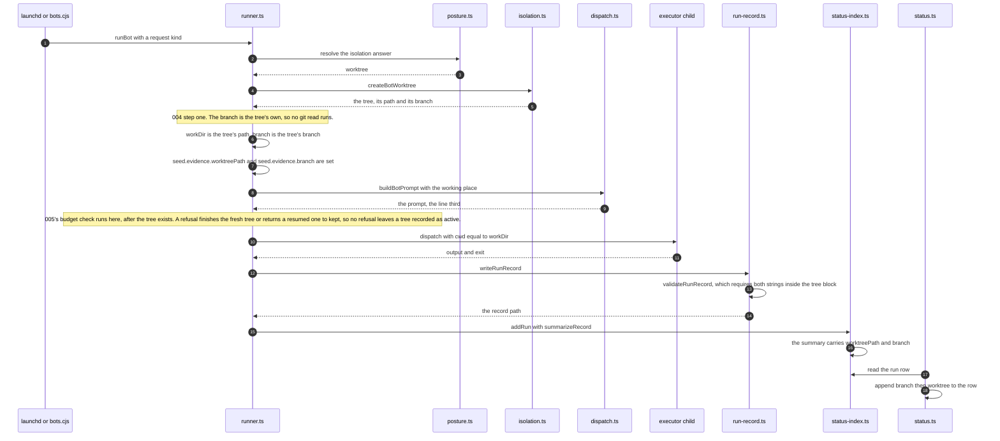
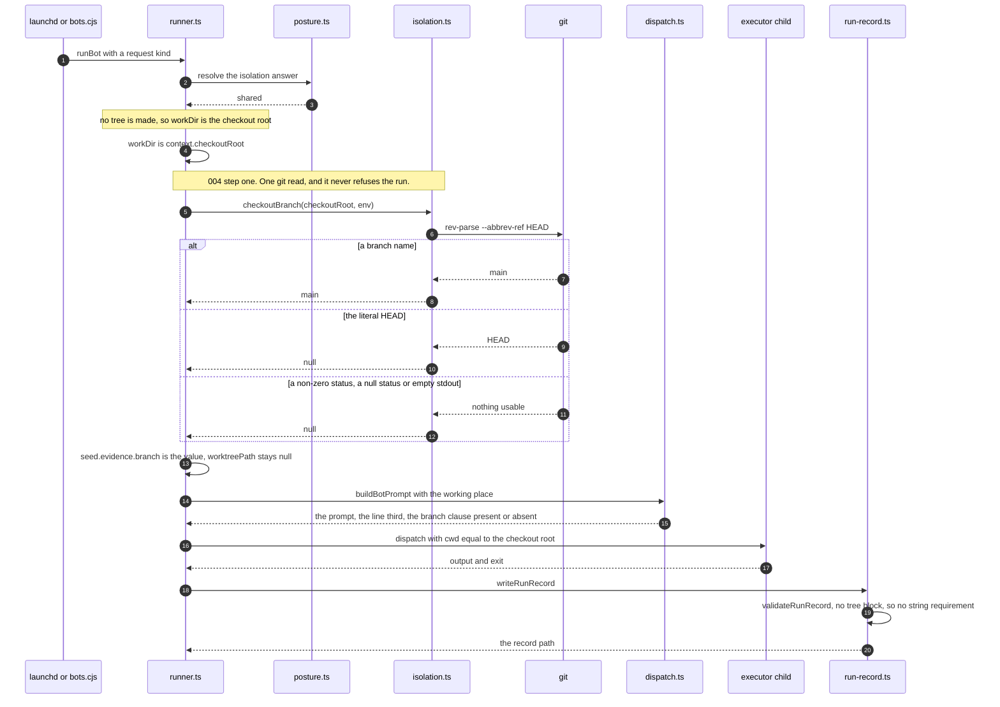
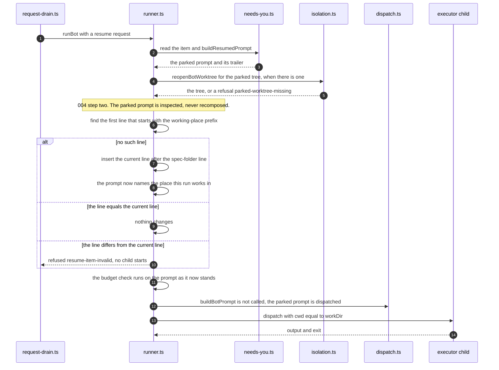
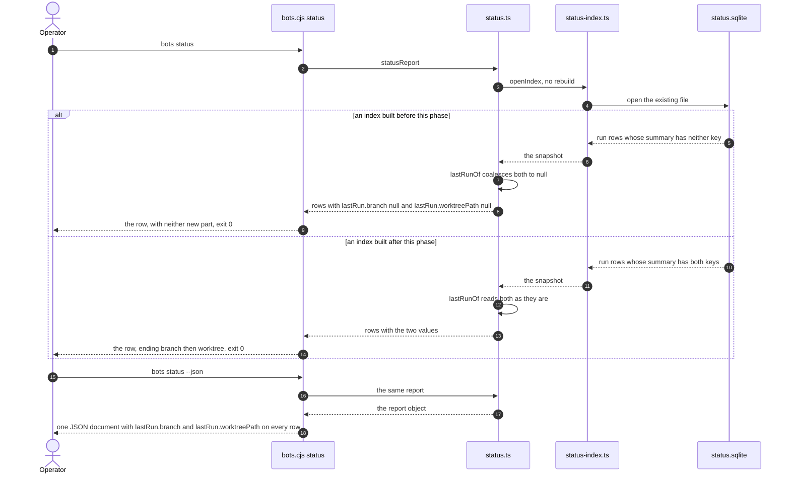

# The four sequences

Each diagram covers one path this phase touches, from the caller to the file on disk. The participants are the real modules. The order is the order the code runs in, and where this phase inserts a step the diagram says so.

The run's own fixed order is [`contracts/runtime-architecture.md`](../../contracts/runtime-architecture.md) section 3.1 and these diagrams are the same run with this phase's two steps marked. [SOURCE: specs/system-skilled-bots/003-openbot-parity-build/contracts/runtime-architecture.md, section "3.1 A run"]

---

## 1. A WORKTREE RUN

The tree is made, its branch is already known and no git read happens. The line and the record take the same value.

**What the diagram fixes.** The branch is read from the tree and never from git, so a rebase between the tree's creation and the dispatch cannot make the prompt and the record disagree. The validator's string requirement is satisfied because the tree block is present.

---

## 2. A SHARED RUN

No tree is made, so the branch comes from one git read. This is the path the phase exists for: today it records null and the prompt names nothing.

**What the diagram fixes.** The git read sits after the posture resolves and before the builder runs, so a shared run pays for it once and a worktree run never pays. The three git answers are the three edges of the branch resolution machine, and none of them refuses the run.

---

## 3. A RESUMED RUN WHOSE PARKED PROMPT LACKS THE LINE

The parked prompt was composed before this phase, so it names no working place. The runner inserts the current line before the budget check.

**What the diagram fixes.** The builder is not called on a resume, so the line cannot be recomposed and the parked prompt's other blocks stay as they were parked. The insertion is a position in the parked prompt, and the budget check runs after it.

---

## 4. A STATUS READ, OVER AN OLD INDEX AND A NEW ONE

Two reads of the same verb. The first meets an index built before this phase, the second an index built after it. Both exit 0 and both print the two keys.

**What the diagram fixes.** No `--rebuild` is needed and no schema version moves. The coalescing happens in `lastRunOf`, which is the only place that turns a summary into a payload, so the text row and the JSON row cannot disagree about a missing key.

---

## 5. WHERE THIS PHASE SITS IN THE RUN

| Step of the run | This phase's part |
|-----------------|-------------------|
| Approval, switches, holds, lease, pause, precheck | None |
| Posture | Read, never decided here |
| Secret check | None. The check never sees the composed prompt |
| Isolation | Read. A tree's branch is taken, a shared run's branch is read |
| Prompt build | The line is emitted, third |
| Prompt budget | 005's check, after the build and before dispatch. A refusal finishes the tree it made |
| Dispatch | `cwd` is the same value the line names |
| Record write | `evidence.branch` is filled for every dispatched run |
| Index write | The summary carries both fields |
| Status read | The row appends both parts and the payload carries both keys |
