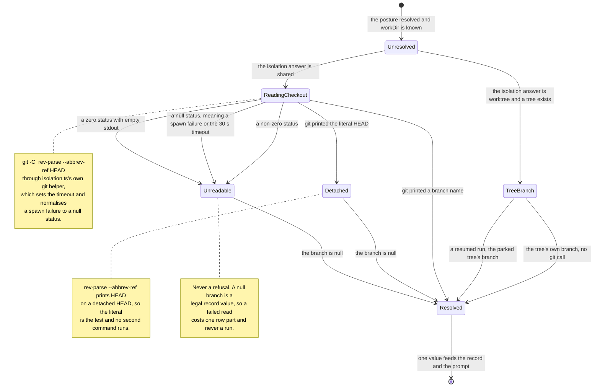
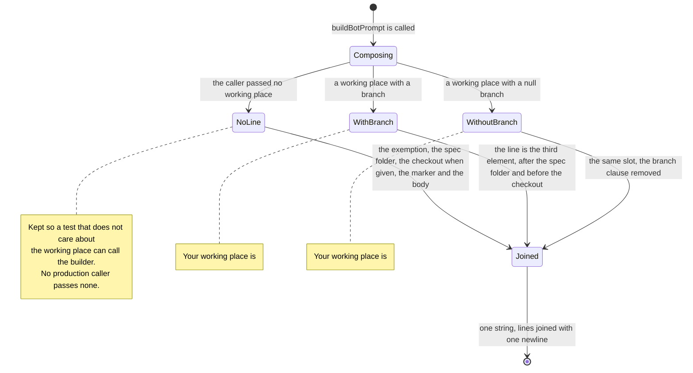
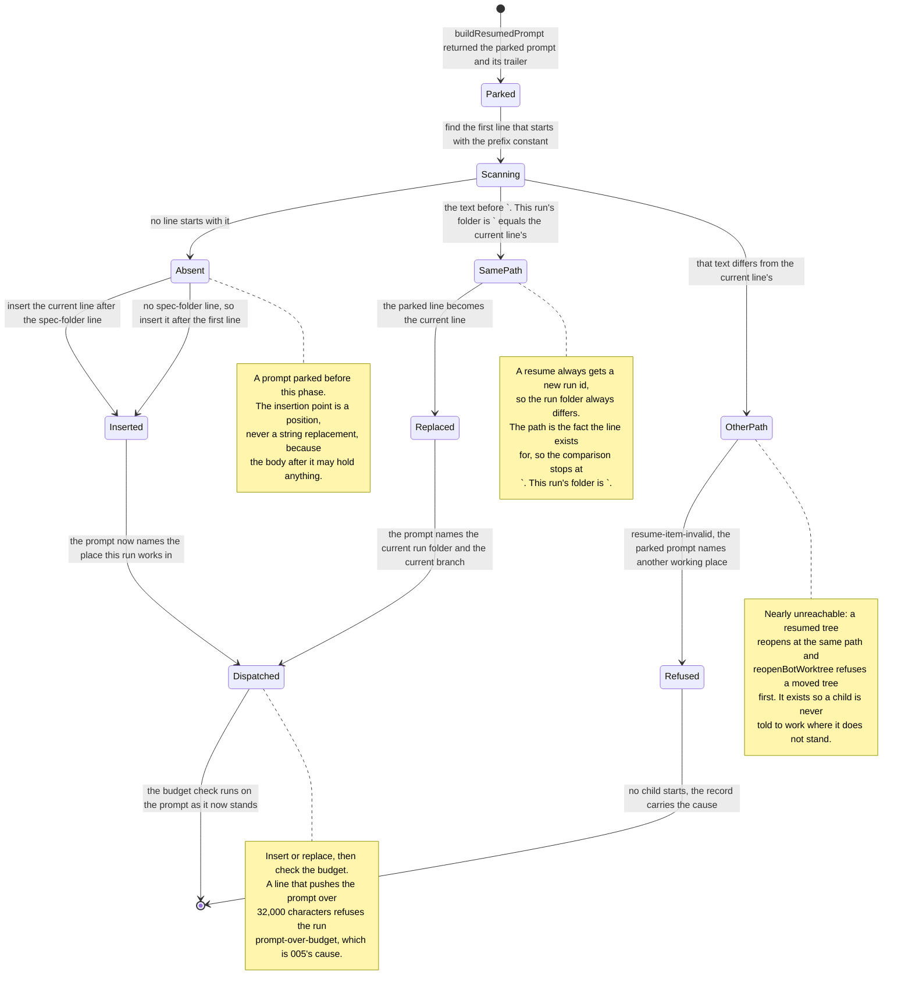
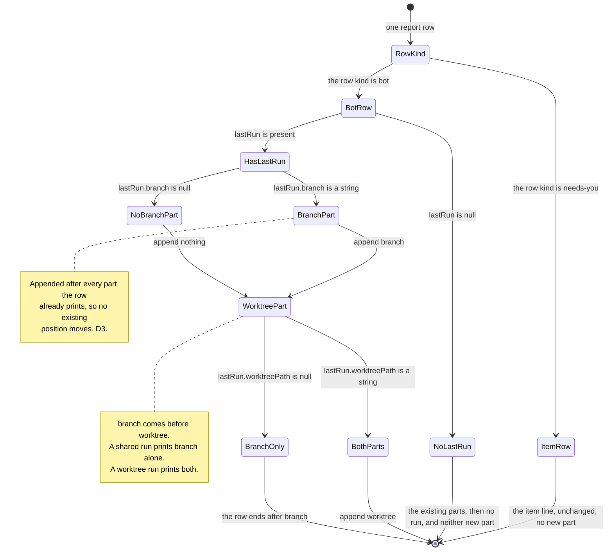
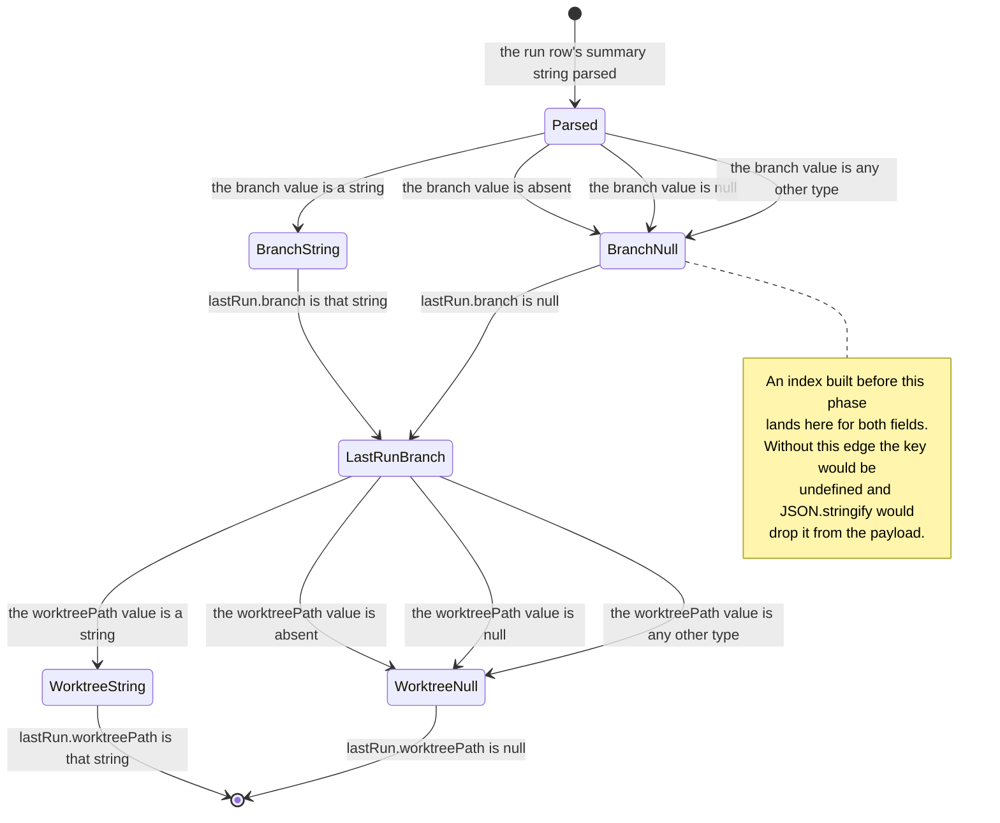

# The four state machines

Four machines decide what this phase writes. Each one is small, and each one has a case the prose in `spec.md` leaves to a builder. The machines below decide those cases.

The field names are [`records.md`](records.md)'s. The literal prompt text is [`prompt-line.md`](prompt-line.md)'s. The row grammar is [`status-row.md`](status-row.md)'s. Nothing here restates a contract.

---

## 1. THE BRANCH RESOLUTION MACHINE

One value, resolved once per dispatched run, from two inputs: the isolation answer and what git says. The machine runs after the posture resolves and before the record is written.

**The one case the prose left open.** A zero status with empty stdout. Git does not produce it for this command on a real repository, and the machine still routes it to `Unreadable` rather than to a branch named by an empty string, because an empty string would print as `branch ` on a status row and read as a branch with no name.

**The guard the machine does not have.** There is no edge from `Unresolved` to a refusal. A branch read can never refuse a run, which is D2 and NFR-R01.

---

## 2. THE FRESH PROMPT LINE MACHINE

`buildBotPrompt` is a pure function of its inputs, so this machine has no I/O and no failure edge. It decides only whether the line is emitted and in which shape.

**Why `NoLine` exists.** The builder is called by tests that assert the exemption line, the spec-folder line and the decision marker, and by the resume path's own tests. Making the working place a required input would force every one of them to invent a path. The absent case is therefore a legal input and it emits nothing, which is the absent-block rule of [`contracts/prompt-sections.md`](../../contracts/prompt-sections.md) section 5 applied to this block alone.

---

## 3. THE RESUMED PROMPT MACHINE

A resumed run is dispatched with the parked prompt, so the line may be absent, present or wrong. This machine runs before the budget check and before dispatch.

**The guard on `SamePath`.** The comparison is on the text before `. This run's folder is `, not on the whole line. A parked prompt whose line names the same path is the same working place even though the run folder differs, because the run folder is the parked run's and a resume continues that run. The parked line is then replaced with the current line, so the prompt names the current run folder and the current branch. A test asserts this by parking a prompt, resuming it and asserting the line appears exactly once.

**A shared run whose operator switched branch.** The path is the checkout in both lines, so the machine takes `SamePath` and replaces the line. The replacement carries the branch the checkout is on now, which is the branch the child edits and the branch `evidence.branch` records. A worktree run cannot reach the case, because `reopenBotWorktree` refuses a tree that moved and the tree's branch is the one it was made on.

---

## 4. THE STATUS ROW PART MACHINE

`formatStatus` builds one row as a list of parts joined by a tab. This machine decides which of the two new parts a row carries. It runs per row, after every existing part is decided.

**The case the prose left open.** A row whose last run recorded a tree and no branch. The machine prints `worktree <path>` alone, because the two parts are decided independently. It cannot happen for a tree this runtime made, since a tree is always made on a branch, and the machine still has the edge so a hand-edited record cannot produce a row with a dangling `branch ` part.

**The item row.** A needs-you row is a different line with its own fixed parts and it gains neither part. [SOURCE: .skilled/skills/system-skilled-bots/runtime/lib/status.ts:479-486]

---

## 5. THE INDEX SUMMARY READ MACHINE

The summary is a JSON string. A summary written before this phase has neither key, and `JSON.parse` yields `undefined` rather than `null`. This machine is the coalescing rule of [`records.md`](records.md) section 2.1 drawn out.

**Why the third edge on each pair.** A summary is a JSON column, so a hand-edited or a newer runtime's value can be a number or an object. The machine reads any non-string as null rather than passing it through, which keeps `LastRun`'s type true and keeps `bots status --json` printable.

---

## 6. THE TESTS THESE MACHINES GIVE

| Machine | Test | File |
|---------|------|------|
| Branch resolution | A shared run on a branch records it | `tests/runner.vitest.ts` |
| Branch resolution | A detached HEAD records null and the run still dispatches | `tests/runner.vitest.ts` |
| Branch resolution | A git read that fails records null and the run still dispatches | `tests/isolation.vitest.ts` |
| Fresh prompt line | Both shapes and the slot assertions | `tests/dispatch.vitest.ts` |
| Fresh prompt line | No working place given emits no line | `tests/dispatch.vitest.ts` |
| Resumed prompt | Absent, so the line is inserted and appears once | `tests/runner.vitest.ts` |
| Resumed prompt | The same path, so the parked line is replaced and appears once | `tests/runner.vitest.ts` |
| Resumed prompt | Another path, so the run is refused `resume-item-invalid` | `tests/runner.vitest.ts` |
| Status row parts | Both parts, branch alone, neither | `tests/status.vitest.ts` |
| Index summary read | A summary with neither key reads back as two nulls | `tests/status-index.vitest.ts` |
