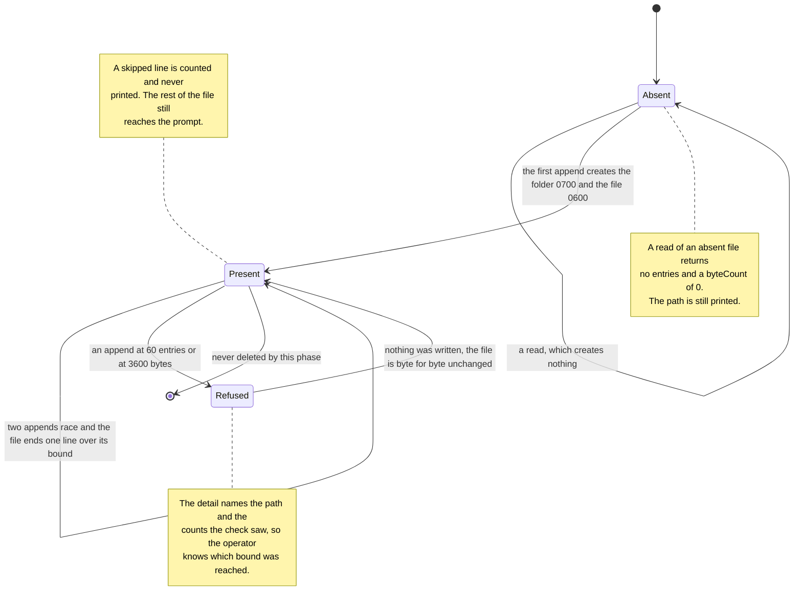
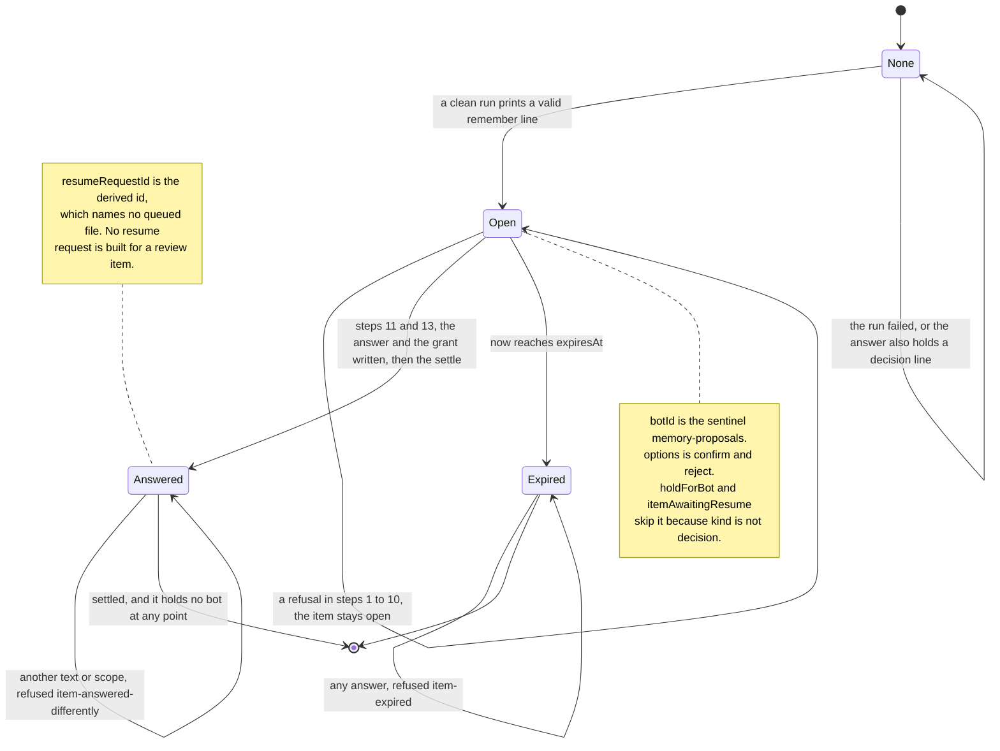
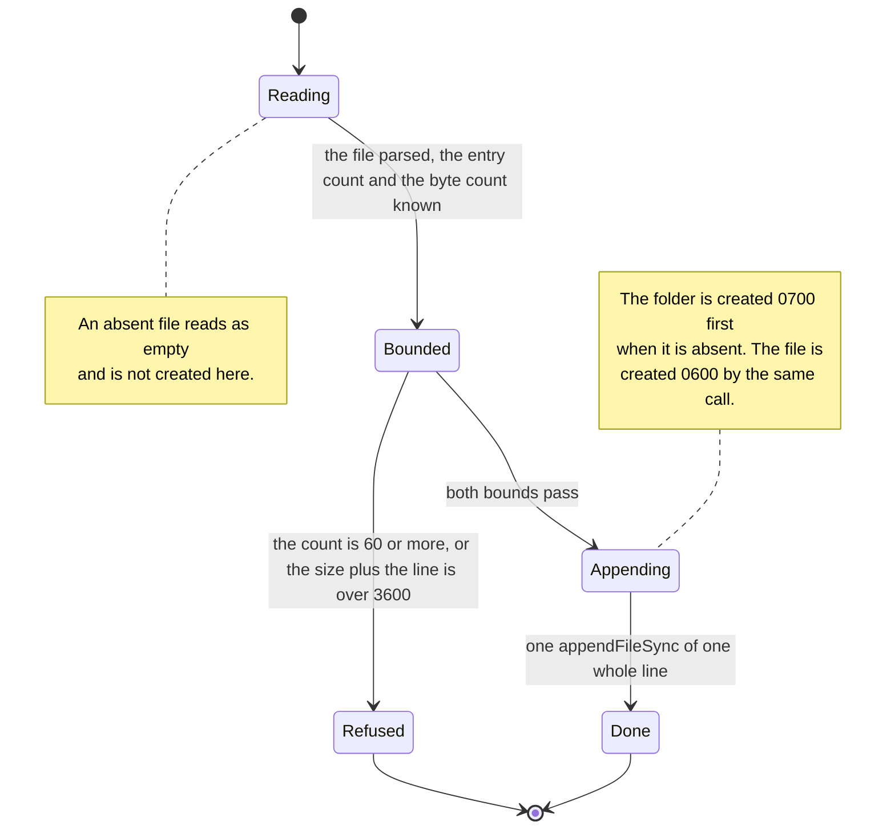
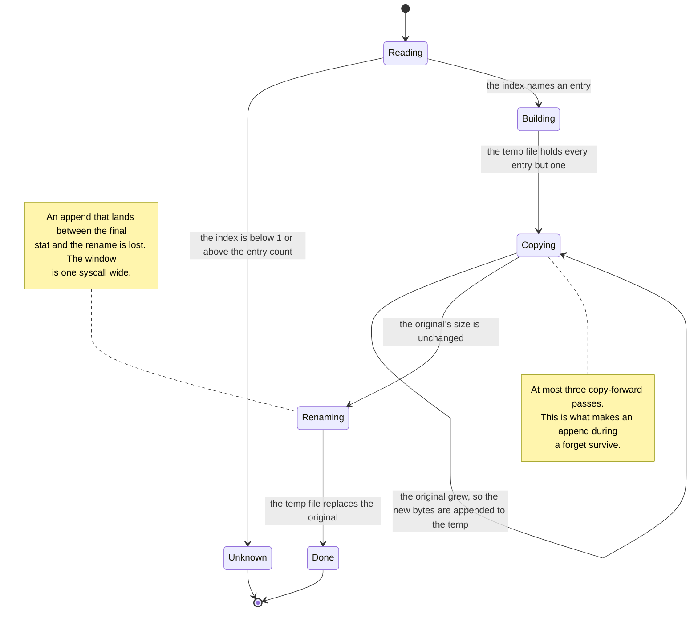
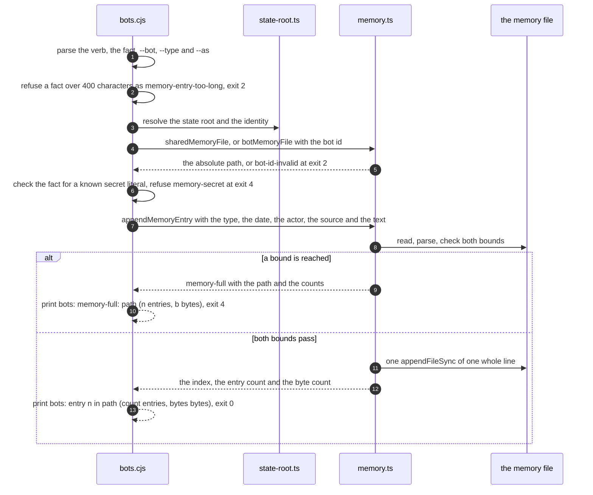
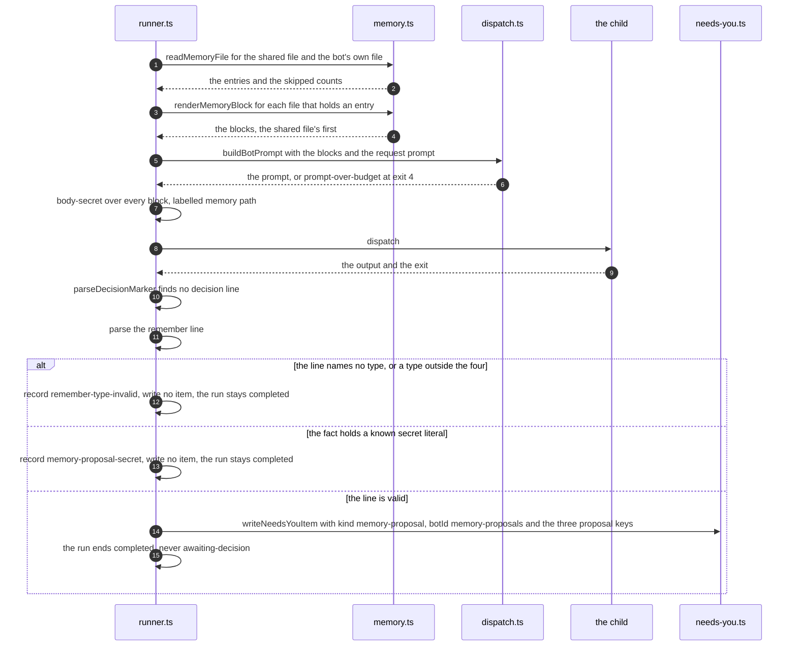

# Memory state machines and sequences

Three machines and four sequences. Each one is drawn from the contracts rather than invented here, and each one names the test that proves it. The item's own transitions are the packet's, so this note draws only the part this phase adds and cites the rest. [SOURCE: specs/system-skilled-bots/003-openbot-parity-build/contracts/answer-seam.md:38]

---

## 1. THE MEMORY FILE STATE MACHINE

A file is absent, present or over its bound. Nothing in this phase deletes one.



| From | Event | To | Writer | Test |
|------|-------|----|--------|------|
| Absent | A read | Absent | none | `memory.vitest.ts`, `absent file` |
| Absent | The first append | Present | `appendMemoryEntry` | `memory.vitest.ts`, `owner-only` |
| Present | An append under both bounds | Present | `appendMemoryEntry` | `memory.vitest.ts`, `shared append` |
| Present | A forget of an entry that exists | Present | `forgetMemoryEntry` | `memory.vitest.ts`, `forget` |
| Present | A hand edit that leaves a bad line | Present | the operator | `memory.vitest.ts`, `torn line` |
| Present | An append at a bound | Refused | none | `memory.vitest.ts`, `bound` |
| Present | Two appends at once | Present, one line over | `appendMemoryEntry` twice | `memory.vitest.ts`, `two appends` |

The over-bound state is the one the protocol accepts rather than prevents. Section 4 of [`module-contract.md`](module-contract.md) states the bound and the reason.

---

## 2. THE PROPOSAL ITEM STATE MACHINE

The item's states are the packet's three, derived on every read and never stored. [SOURCE: specs/system-skilled-bots/003-openbot-parity-build/contracts/answer-seam.md:38] This machine draws the `memory-proposal` kind only.



| From | Event | To | Writer | Holds the bot's unattended runs |
|------|-------|----|--------|---------------------------------|
| None | A clean run prints `[REMEMBER] <type> <fact>` | Open | `runner.ts` | No |
| None | The line names no type or a type outside the four | None | `runner.ts` records `remember-type-invalid` | No |
| None | The fact holds a known secret literal | None | `runner.ts` records `memory-proposal-secret` | No |
| None | The answer also holds a `[NEEDS-DECISION]` line | None | the runner's gate parks the run instead | Yes, as a decision item |
| Open | A refusal in steps 1 to 10 | Open | none | No |
| Open | Steps 11 and 13 | Answered, settled | `answerItem` | No |
| Open | `now` reaches `expiresAt` | Expired | none, derived | No |
| Answered | The same text and scope again | Answered | `answerItem`, duplicate path | No |
| Answered | Another text or scope | Answered | none, refused `item-answered-differently` | No |
| Expired | Any answer | Expired | none, refused `item-expired` | No |

The two filters are what keep the bot free. `holdForBot` and `itemAwaitingResume` both skip every item whose `kind` is not `decision`, so the sentinel never has to be special-cased and a later review kind inherits the same rule. [SOURCE: specs/system-skilled-bots/003-openbot-parity-build/contracts/answer-seam.md:38]

---

## 3. THE WRITE PROTOCOL MACHINES

### 3.1 The append



### 3.2 The forget



---

## 4. THE SEQUENCES

### 4.1 `bots remember`



### 4.2 A run that proposes a fact



### 4.3 `bots answer confirm`

```mermaid
sequenceDiagram
  autonumber
  participant Cl as bots.cjs
  participant An as answer.ts
  participant It as the item and its lock
  participant Mm as memory.ts
  participant Fs as the memory file
  Cl->>An: answerItem with the text confirm
  An->>It: take the lock, read the item, judge the state
  An->>An: the secret check over the answer text
  An->>An: the review claim, which refuses any text but confirm or reject
  An->>It: one write of the answer and the grant
  An->>An: stamp answeredBy on the run record
  An->>An: the review settle
  An->>Fs: read the target file and look for the source bot:botId (run runId)
  alt the source is already there
    An->>An: the effect already landed, so append nothing
  else the source is absent
    An->>An: check the fact for a known secret literal, refuse memory-secret at exit 4
    An->>Mm: appendMemoryEntry with the operator as actor and the run source
    Mm->>Fs: one appendFileSync of one whole line
  end
  An->>It: write the derived resumeRequestId, stamp the generation, release the lock
  An-->>Cl: reviewed
  Cl-->>Cl: print bots: item id answered; memory-proposal review recorded, exit 0
```

### 4.4 `bots answer reject`

```mermaid
sequenceDiagram
  autonumber
  participant Cl as bots.cjs
  participant An as answer.ts
  participant It as the item and its lock
  participant Fs as the memory file
  Cl->>An: answerItem with the text reject, or with deny, no or n
  An->>It: take the lock, read the item, judge the state
  An->>An: the review claim reads a NO as reject with the scope deny
  An->>It: one write of the answer and the grant, scope deny
  An->>An: stamp answeredBy on the run record
  An->>An: the review settle appends nothing and touches no file
  An->>It: write the derived resumeRequestId, stamp the generation, release the lock
  An-->>Cl: reviewed
  Cl-->>Cl: print bots: item id answered; memory-proposal review recorded, exit 0
```

The reject path reads the file only to confirm the fact is not already there, and it writes nothing either way. A reject is the operator saying the fact is wrong, so the file must be byte for byte unchanged.

---

## 5. THE TESTS THESE MACHINES GIVE

| Machine | Test | What it asserts |
|---------|------|-----------------|
| The file machine | `memory.vitest.ts`, `absent file` | A read of an absent file returns no entries, a byte count of 0 and creates nothing |
| The file machine | `memory.vitest.ts`, `owner-only` | The first append makes the folder 0700 and the file 0600 |
| The file machine | `memory.vitest.ts`, `bound` | An append at 60 entries or 3,600 bytes refuses `memory-full` and leaves the bytes unchanged |
| The file machine | `memory.vitest.ts`, `two appends` | Two appends at 59 entries both succeed and the file ends at 61 |
| The item machine | `needs-you.vitest.ts`, `proposal` | `holdForBot` and `itemAwaitingResume` both return null for a `memory-proposal` item |
| The item machine | `runner.vitest.ts`, `remember` | A clean run with a valid line writes one open item with the three keys and the sentinel |
| The item machine | `runner.vitest.ts`, `remember type` | A line naming no type writes no item and records `remember-type-invalid` |
| The append machine | `memory.vitest.ts`, `shared append` | One append writes one line and returns index 1 |
| The forget machine | `memory.vitest.ts`, `forget` | Entry 1 is gone, entry 2 keeps its text and its index becomes 1 |
| The forget machine | `memory.vitest.ts`, `append during forget` | An append that lands during a forget survives the rename |
| The confirm sequence | `answer.vitest.ts`, `proposal` | The fact lands in `proposalBotId`'s file with the operator as actor and the run source |
| The confirm sequence | `answer.vitest.ts`, `proposal settle twice` | A second confirm appends nothing, because the source is already there |
| The reject sequence | `answer.vitest.ts`, `proposal` | A reject appends nothing and the file is unchanged |

---

## 6. DECISIONS TAKEN

| Decision | Why |
|----------|-----|
| The settle's idempotency check is the entry's source, `bot:<botId> (run <runId>)` | The source is already unique per proposing run, so no extra key and no extra file is needed to tell whether the effect landed |
| A reject reads the file and writes nothing | The check costs one read and makes the "unchanged" claim testable |
| The over-bound state is drawn rather than hidden | Two racing appends can produce it, and a builder who does not know will add a lock the protocol forbids |
| The item machine draws only the `memory-proposal` kind | The `decision` and `skill-proposal` kinds are the packet's, and 009 draws its own |
