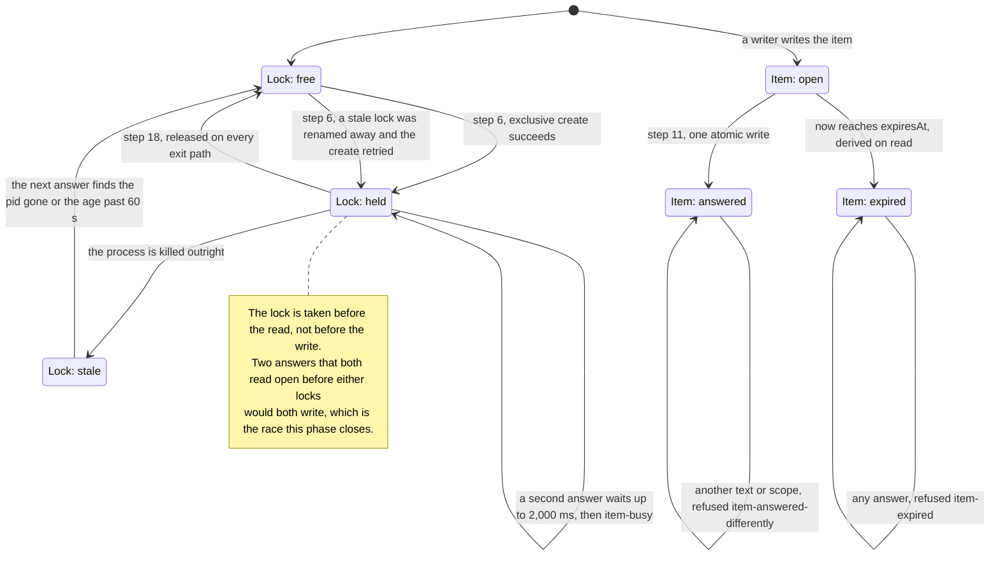
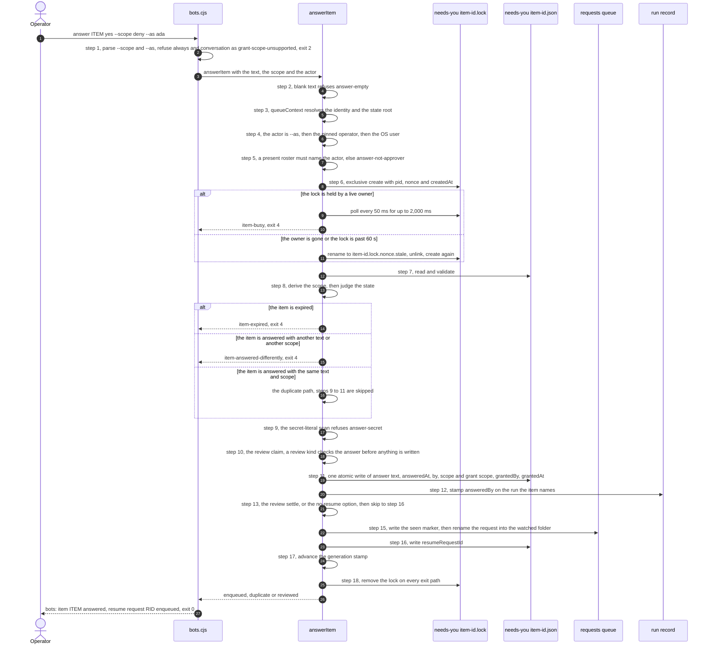
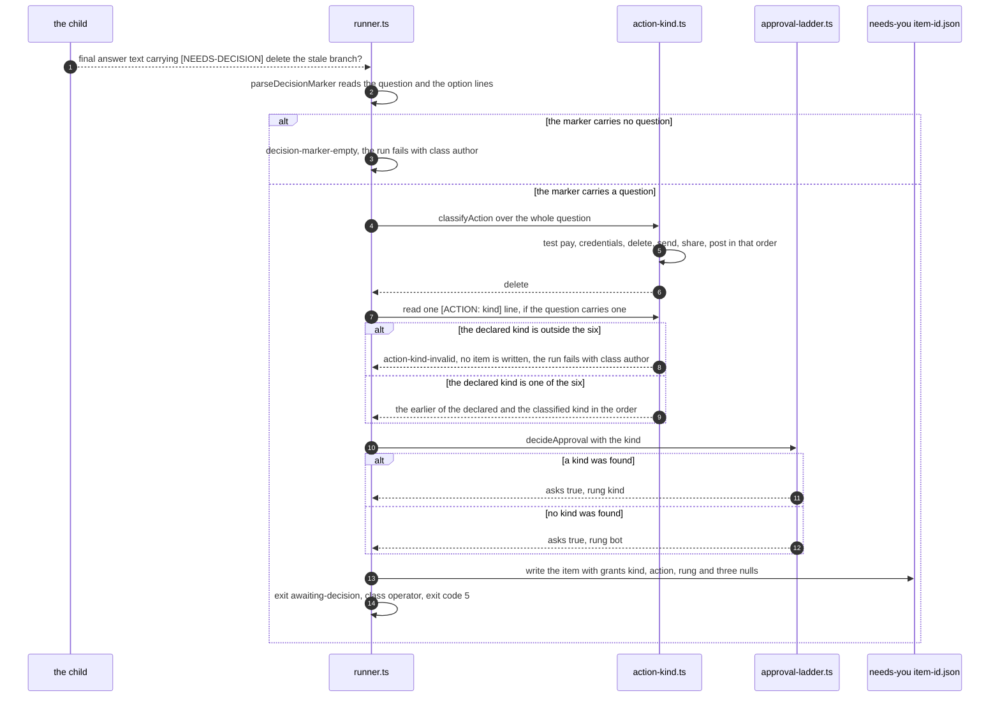
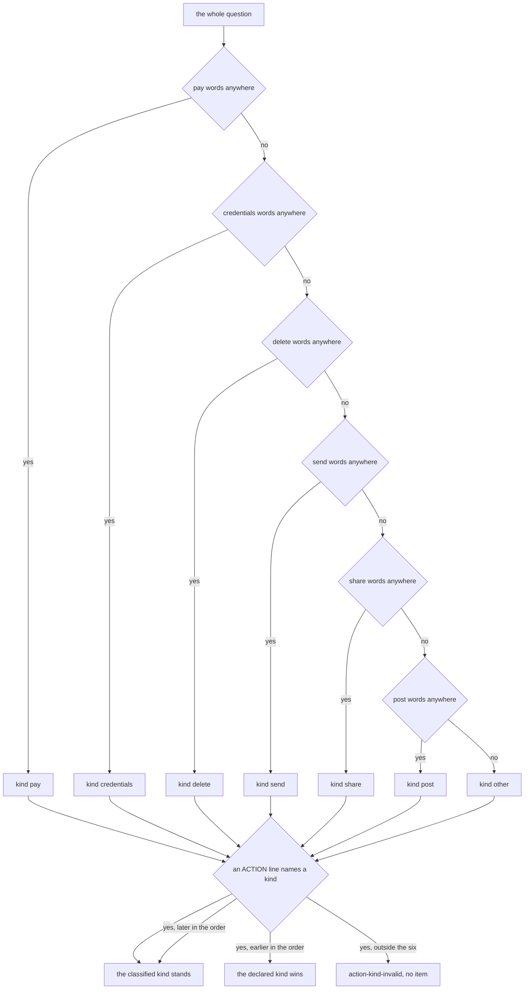
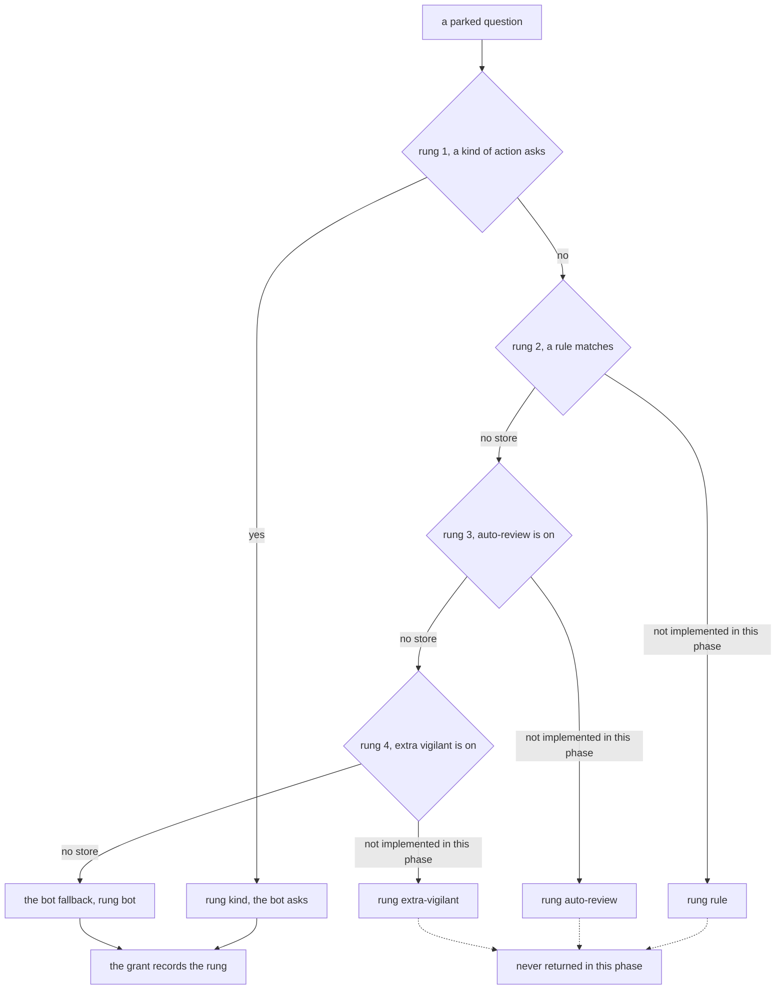

# State machines and sequences of the approval grant

Six diagrams. The first two are state machines, the next two are sequences and the last two are decision flows. Each one closes a question the phase documents leave open: what a grant's states are, what the lock does to the item's states, which write happens in which order, and which of the six kinds wins when a question names more than one.

The step numbers in the answer sequence are `contracts/answer-seam.md` section 1's and are not renumbered here. [SOURCE: specs/system-skilled-bots/003-openbot-parity-build/contracts/answer-seam.md, section "1. THE SEQUENCE"] The item's own transitions are `contracts/answer-seam.md` section 2's. [SOURCE: specs/system-skilled-bots/003-openbot-parity-build/contracts/answer-seam.md, section "2. ITEM STATE TRANSITIONS"]

---

## 1. THE GRANT LIFECYCLE

Four states and no fifth. A grant is never a standing allow in this packet, so there is no `allowed-always` state and no transition to one. [SOURCE: specs/system-skilled-bots/003-openbot-parity-build/contracts/answer-seam.md, section "3. GRANT LIFECYCLE"]

```mermaid
stateDiagram-v2
  [*] --> BornOpen: the item is written, by the gate, the memory-proposal branch, the skill proposal or the fatigue item
  BornOpen --> Granted: step 11, scope once
  BornOpen --> Denied: step 11, scope deny, given or derived from a NO
  BornOpen --> ExpiredWithItem: now reaches expiresAt with no answer
  Granted --> Granted: the same text and scope again, the duplicate path
  Denied --> Denied: the same text and scope again, the duplicate path
  Granted --> Granted: another text or scope, refused item-answered-differently, nothing written
  Denied --> Denied: another text or scope, refused item-answered-differently, nothing written
  ExpiredWithItem --> ExpiredWithItem: any answer, refused item-expired, nothing written
  Granted --> [*]
  Denied --> [*]
  ExpiredWithItem --> [*]

  state BornOpen {
    scope: null
    grantedBy: null
    grantedAt: null
  }
  state Granted {
    scope: once
    grantedBy: the actor
    grantedAt: the answer's answeredAt
  }
  state Denied {
    scope: deny
    grantedBy: the actor
    grantedAt: the answer's answeredAt
  }
  state ExpiredWithItem {
    scope: null
    grantedBy: null
    grantedAt: null
  }
```

Rules the diagram fixes:

- `kind`, `action` and `rung` are set at birth and never change. No transition above touches them.
- A refused answer is a self-transition that writes nothing, so a refusal can never move a grant out of `BornOpen`.
- `ExpiredWithItem` is derived on read and never stored, the same way the item's `expired` state is. [SOURCE: .skilled/skills/system-skilled-bots/runtime/lib/needs-you.ts:135]
- There is no `Revoked` state. A grant lives and dies with its item, and the packet records no standing allow to revoke.

---

## 2. THE ITEM AND THE LOCK

The item's state is derived and the lock is stored, so they are two machines that meet at one point: the lock is held across the read, the judgement and the write.



Rules the diagram fixes:

- The lock is taken at step 6 and released at step 18, so it spans the read at step 7, the judgement at step 8 and the write at step 11. [SOURCE: specs/system-skilled-bots/003-openbot-parity-build/contracts/answer-seam.md, section "1. THE SEQUENCE"]
- A stale lock never blocks the next answer. The reclaim in `design/records.md` section 3.2 is the only edge out of `Stale`.
- The item's three states are derived on every read and never stored, so a lock cannot leave an item in a fourth state.
- `item-busy` is the only refusal the lock itself raises, and a retry with the same text and scope is safe because the answer is idempotent for one text and one scope.

---

## 3. THE ANSWER SEQUENCE

Seven lanes. The operator, the CLI, `answerItem`, the lock file, the item file, the request queue and the run record. The sequence opens on an open item whose grant is born open.



Rules the sequence fixes:

- The scope is derived at step 8 and written at step 11, so a refusal at steps 1 to 10 leaves the grant born open.
- The grant and the answer are one write. A stop between them is impossible, which is why `grantedAt` can equal `answeredAt` without a second read.
- The lock is released at step 18 on every path, including the three refusals drawn above and a throw.
- A refusal at steps 1 to 10 writes nothing, so the item stays open and the bot stays held.
- The duplicate path skips steps 9 to 11 and still reaches step 15, which returns `duplicate` because the seen marker exists.

---

## 4. THE GATE SEQUENCE

Five lanes. The child, the runner, the classifier, the ladder and the item file. The sequence opens after the child has exited and the runner has read its final answer text.



Rules the sequence fixes:

- The classifier reads the question the runner already holds, so the gate adds no file read and no process.
- The `[ACTION: <kind>]` line is read after the classification and never instead of it, which is what makes it a floor.
- `decideApproval` is called with the kind and returns rung 1 or the `bot` fallback. It is never called with a rule, an auto-review switch or an extra-vigilant switch, because no store supplies them.
- A refused `[ACTION: <kind>]` line writes no item, so the run cannot park and the failure is the run's own.

---

## 5. THE CLASSIFIER

The six kinds in OpenBot's order, then the declaration floor, then `other`. [SOURCE: specs/system-skilled-bots/context/OpenBot-main/docs/approvals.md:5]



Rules the flow fixes:

- The first match wins, so a payment that also deletes reads as `pay`.
- The scan is over the whole question, so a benign first sentence cannot hide a delete in the second.
- The declaration is compared after the scan and can only move the kind earlier in the order.
- `other` is a result and never a declaration.

---

## 6. THE LADDER

Four rungs and a fallback. Only rung 1 and the fallback are implemented, and the diagram marks the three that are not. [SOURCE: specs/system-skilled-bots/context/OpenBot-main/docs/approvals.md:3]



Rules the flow fixes:

- The first answer wins, so a kind beats a rule and a rule beats auto-review.
- Rungs 2 to 4 are drawn so the order is readable and marked so no builder implements them.
- The fallback is `bot` and not a fifth rung. The `rung` enum holds five values and the ladder holds four rungs, which is one list read two ways.
- `decideApproval` returns `kind` or `bot` and nothing else, so a test can assert the closed set.

---

## 7. DECISIONS TAKEN

| Decision | Why |
|----------|-----|
| The grant's lifecycle is four states with no `Revoked` | The packet records no standing allow, so there is nothing to revoke [SOURCE: specs/system-skilled-bots/003-openbot-parity-build/contracts/answer-seam.md, section "3. GRANT LIFECYCLE"] |
| The lock is drawn as its own machine rather than as a fourth item state | The item's state is derived and the lock is stored, so one machine cannot hold both without storing a derived value |
| The answer sequence draws the lock before the read | Two answers that both read `open` before either locks would both write, which is the race this phase closes |
| The gate sequence reads the declaration after the classification | Reading it first would make it an override rather than a floor |
| The ladder draws rungs 2 to 4 and marks them | A reader must see the order OpenBot uses, and a builder must not implement what no store supplies |
| The classifier's flow ends at one kind and never at a set | The grant holds one `kind`, so a question naming two kinds must resolve to one |
