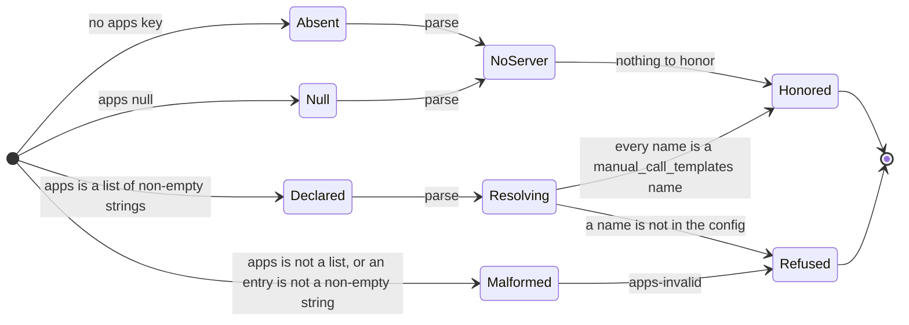
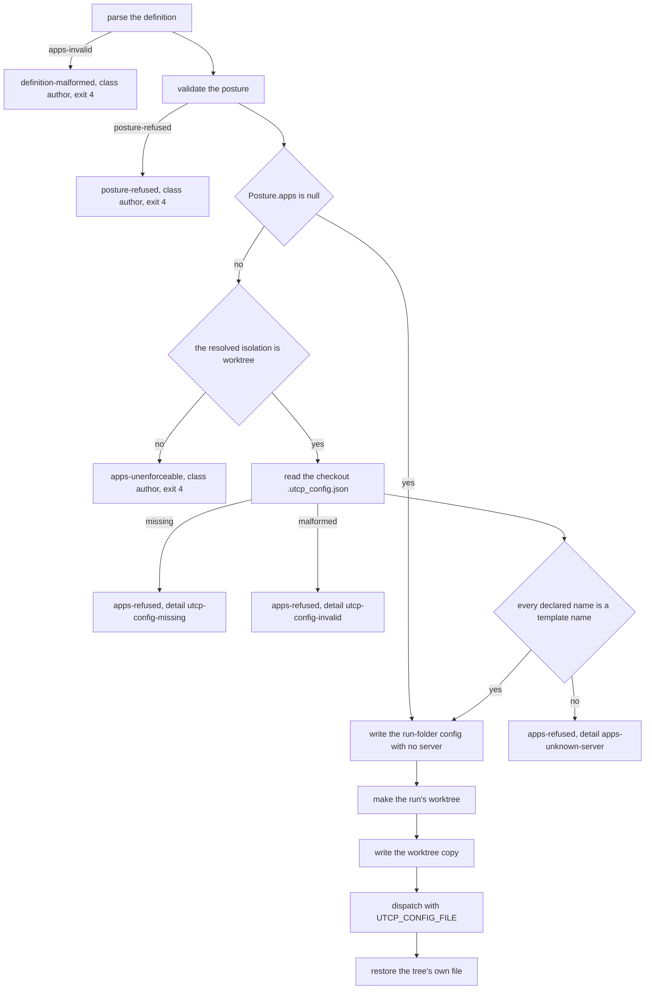
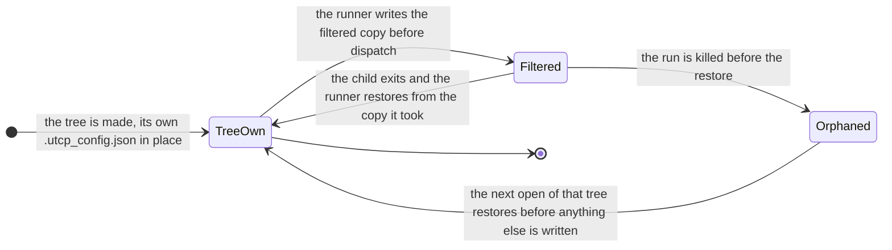
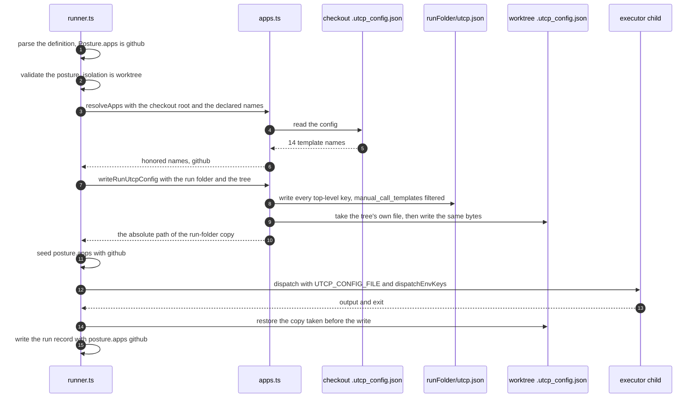
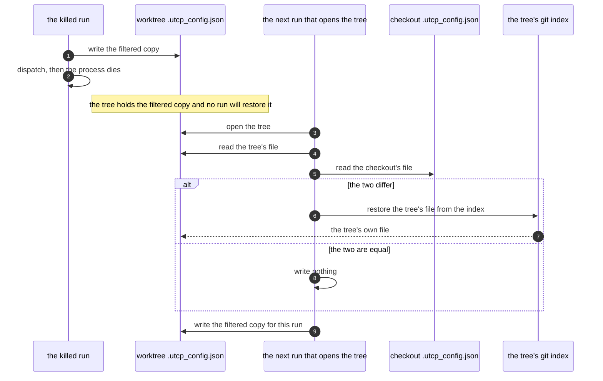
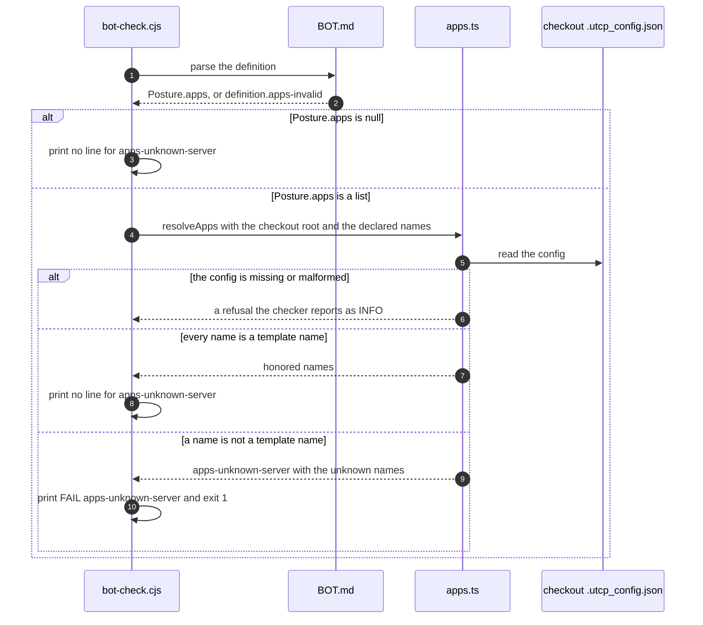

# The apps gate, the worktree file lifecycle and three sequences

The runner's fixed order is approval, disable switch, needs-you hold, lease, pause switch, precheck, posture, secret check, dispatch, result. [SOURCE: .skilled/skills/system-skilled-bots/runtime/lib/runner.ts:5] This phase inserts its checks inside that order and adds none before approval. The packet's run sequence draws the whole order and this file draws only the part this phase owns. [SOURCE: specs/system-skilled-bots/003-openbot-parity-build/contracts/runtime-architecture.md, section "3.1 A run"]

---

## 1. THE DECLARATION LIFECYCLE

One `BOT.md` key, four legal inputs and two outcomes. The parse is section 1 of `records.md`.

| State | `Posture.apps` | What the run does next |
|-------|----------------|------------------------|
| `Absent` | `null` | writes a config with no server and records `[]` |
| `Null` | `null` | the same as `Absent` |
| `Declared` | the list as written | resolves each name against the config |
| `Malformed` | none, the definition is refused | nothing, the run is refused `definition-malformed` with `apps-invalid` as its detail |
| `Honored` | the list as written | writes the filtered config and records the resolved names |
| `Refused` | the list as written | nothing, the run is refused `apps-refused` |

`Malformed` is a parse refusal, so the runner folds it into `definition-malformed` and the checker prints it as `definition.apps-invalid`. That is the packet's rule for every parse name and this phase adds no exception. [SOURCE: specs/system-skilled-bots/003-openbot-parity-build/contracts/refusals.md, section "2. LAYERS AND THE EXIT RULE"]

---

## 2. THE RUN'S GATE ORDER

Eleven steps, each with the refusal it can raise. A step that refuses writes no filtered config and starts no child.

| Step | Reads | Writes | Refusal |
|------|-------|--------|---------|
| A | `BOT.md` | nothing | `definition-malformed`, detail `apps-invalid` |
| B | the definition and the repository config | nothing | `posture-refused` |
| C | `Posture.apps` | nothing | none |
| D | the resolved isolation | nothing | `apps-unenforceable` |
| E | `<checkout>/.utcp_config.json` | nothing | `apps-refused`, detail `utcp-config-missing` or `utcp-config-invalid` |
| F | the declared names and the config's template names | nothing | `apps-refused`, detail `apps-unknown-server` |
| G | the source config | `<runFolder>/utcp.json` | none, the write is atomic |
| H | the isolation | the tree | the existing worktree causes |
| I | `<runFolder>/utcp.json` | `<worktree>/.utcp_config.json` | none, the write is atomic |
| J | the run folder path | the child environment | the existing dispatch causes |
| K | the copy taken before step I | `<worktree>/.utcp_config.json` | none |

Step D comes before step E on purpose. A shared run that declares `apps` is refused without reading the config, so the refusal names the reason the operator can act on, which is the isolation, and not a config problem the operator cannot see.

Step G runs for every run, including a shared run that declares nothing. That is this phase's decision G7 in `../goal.md`.

---

## 3. THE WORKTREE CONFIG FILE LIFECYCLE

The one file this phase writes outside the run folder. It has four states and one edge that only a killed run takes.

| State | The tree's `.utcp_config.json` holds | Who put it there |
|-------|--------------------------------------|------------------|
| `TreeOwn` | the tree's own file, the repository config at the tree's base commit | git, when the tree was made, or the runner's restore |
| `Filtered` | the filtered copy, byte-identical to `<runFolder>/utcp.json` | the runner, before dispatch |
| `Orphaned` | the filtered copy, and no run is going to restore it | the runner, before a dispatch that never returned |

The `Orphaned` to `TreeOwn` edge is the rule this phase adds for a run killed between the write and the restore. The next open of that tree compares the tree's `.utcp_config.json` with the checkout's. When the two differ, the tree's file is not the repository config, so the runner restores it from the tree's own git index before it writes anything. When the two are equal, the runner writes nothing.

The comparison is what makes the rule need no marker file. A killed run leaves no record the next run can trust, and a marker written beside the file would be a second thing to leave behind. The index is already the tree's own answer to what that file should hold.

A commit the child made during the run is not rewritten, because the restore writes the working tree and never a commit. A child that committed the filtered file leaves the index holding it, so the next open restores the filtered file and the tree stays narrowed. That is the bounded impact the risk table names, and it narrows a later run rather than leaking one.

A shared run never enters this machine. It has no tree, so it writes only the run-folder copy.

---

## 4. SEQUENCES

### 4.1 A worktree run that declares `apps: [github]`

The child's working directory is the tree, so the project pin's relative `.utcp_config.json` resolves to the file step 9 wrote. That is why the pin needs no change and the doctor check keeps passing.

### 4.2 A run killed before the restore, and the next open

The restore runs before the next run writes anything, so the filtered copy is never the base a later run copies from. Without it, a second run would read the first run's narrowed file as the repository config and honor a subset of the servers the bot declared.

### 4.3 The checker over one definition

The checker imports the same predicate the runner calls, so a name the runner would refuse fails the check first. A checkout with no `.utcp_config.json` is not a definition defect, so the checker reports it as `INFO` and does not fail the invariant. The runner refuses that case as `apps-refused`, because a run cannot honor a declaration it cannot check.

---

## 5. DECISIONS TAKEN

| Decision | Why |
|----------|-----|
| The isolation check runs before the config read | A shared run that declares `apps` is refused for the reason the operator can act on, and the refusal needs no config |
| The run-folder copy is written before the tree is made | The copy is the run's evidence and the file `UTCP_CONFIG_FILE` names, so a run refused at the tree still leaves the file its record points at |
| The worktree copy is written after the tree exists and before dispatch | The tree is the only place the pin looks, and a copy written earlier would be overwritten by the tree's own checkout |
| The next-open restore compares the tree's file with the checkout's | A killed run leaves no record to trust and a marker file would be a second thing to leave behind, while the comparison needs nothing new |
| The next-open restore reads the tree's index and not the checkout | The index is the tree's own answer to what the file should hold, so a child's committed change is left alone |
| The checker reports a missing config as `INFO` and not as a failure | The invariant is about a name the config does not hold, and a config that is not there holds no name to compare |
