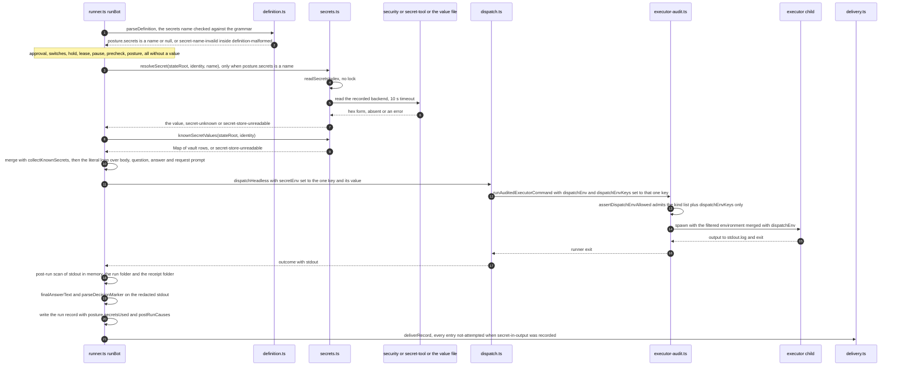

# Run-time injection sequence

The packet's run sequence places the secret resolve after posture and before the prompt, and the post-run scan after the child. [SOURCE: specs/system-skilled-bots/003-openbot-parity-build/contracts/runtime-architecture.md:186-216] This note zooms in on the vault's part of that sequence and does not redraw the rest. The fixed order today is approval, disable switch, needs-you hold, lease, pause switch, precheck, posture, secret check, dispatch, result. [SOURCE: .skilled/skills/system-skilled-bots/runtime/lib/runner.ts:5-6] The vault adds no step before the precheck, so a precheck never sees a value.

---

## 1. THE SEQUENCE

---

## 2. STEP BY STEP

| # | Step | Function and change | Refusal or cause | Value held where |
|---|------|---------------------|------------------|------------------|
| 1 | Parse the name | `parseDefinition`, the grammar check after `optionalString` [SOURCE: .skilled/skills/system-skilled-bots/runtime/lib/definition.ts:263-267] | `definition-malformed` with `secret-name-invalid`, exit 4 | nowhere |
| 2 | The checks before posture | unchanged | today's | nowhere |
| 3 | Posture | `validatePosture`, unchanged [SOURCE: .skilled/skills/system-skilled-bots/runtime/lib/runner.ts:936-940] | `posture-refused` | nowhere |
| 4 | Resolve | `resolveSecret` in `secrets.ts`, called right after `seed.posture` is set | `secret-unknown`, class `operator`, or `secret-store-unreadable`, class `environment`, exit 4, written through `refusalRecord` like every refusal | the runner's memory |
| 5 | Known map | `knownSecretValues`, merged into the map at runner.ts:942 [SOURCE: .skilled/skills/system-skilled-bots/runtime/lib/runner.ts:942] | `secret-store-unreadable` | the runner's memory |
| 6 | Literal loop | unchanged loop, wider map [SOURCE: .skilled/skills/system-skilled-bots/runtime/lib/runner.ts:948-953] | `body-secret` | the runner's memory |
| 7 | Dispatch input | `DispatchInput` gains `secretEnv?: Record<string, string>`. `dispatchInLineage` passes `dispatchEnv: { ...built.env, ...secretEnv }` and `dispatchEnvKeys: Object.keys(secretEnv)` where it passes `built.env` today [SOURCE: .skilled/skills/system-skilled-bots/runtime/lib/dispatch.ts:612] | none | the dispatch input |
| 8 | Gate | `RunAuditedExecutorCommandInput` gains `dispatchEnvKeys?: string[]`. `assertDispatchEnvAllowed` accepts a key that is in `DISPATCH_ENV_KEYS[kind]` or in `dispatchEnvKeys` [SOURCE: .skilled/skills/system-deep-loop/runtime/lib/deep-loop/executor-audit.ts:1507-1516] | a throw naming the key, which the runner records as today's dispatch failure | the audit input |
| 9 | Spawn | unchanged merge after the per-kind filter [SOURCE: .skilled/skills/system-deep-loop/runtime/lib/deep-loop/executor-audit.ts:1611] | none | the child's environment |
| 10 | Post-run scan | new, in `runBot` before `finalAnswerText` [SOURCE: .skilled/skills/system-skilled-bots/runtime/lib/runner.ts:1092] | `secret-in-output` on `postRunCauses`, the run's own exit | the runner's memory until `runBot` returns |
| 11 | Record | `posture.secretsUsed: [name]`, or `[]` for a bot with no `secrets` | none | never: names only |
| 12 | Delivery | `deliverRecord` reads `postRunCauses` | entries `not-attempted`, `withheld: secret-in-output` | never |

**What the runner never does with the value.** It never puts it in the prompt, the precheck environment, the run record, a needs-you item, a log line, an error detail or the environment of `runBot`'s own process. The value lives in local variables of `runBot` and in the `DispatchInput` object, and both go out of scope when `runBot` returns.

**A bot with no `secrets`.** Steps 4 and 7 are skipped, `secretEnv` is absent, `dispatchEnvKeys` is absent and `secretsUsed` is `[]`. Step 5 still runs, because the known map guards every bot's body against every stored value.

---

## 3. VERIFY

| Claim | Command | Prints |
|-------|---------|--------|
| The gate admits only the per-kind list today | `rg -n 'is not allowed for' .skilled/skills/system-deep-loop/runtime/lib/deep-loop/executor-audit.ts` | one line, 1513 |
| `dispatchEnv` merges after the filter | `rg -n '\.\.\.input.dispatchEnv' .skilled/skills/system-deep-loop/runtime/lib/deep-loop/executor-audit.ts` | one line, 1611 |
| The dispatch passes only the builder's keys today | `rg -n 'dispatchEnv: built.env' .skilled/skills/system-skilled-bots/runtime/lib/dispatch.ts` | one line, 612 |
| No module resolves the field today | `rg -n 'posture\.secrets' .skilled/skills/system-skilled-bots/runtime/lib; echo "exit=$?"` | `exit=1` |
