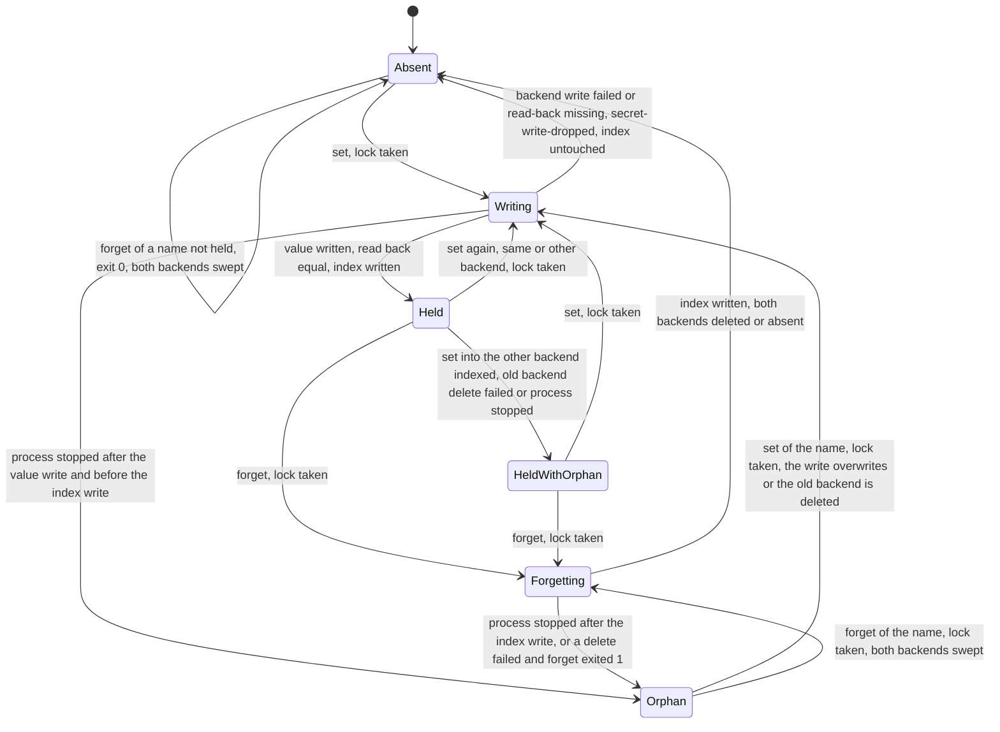

# The lifecycle of one secret name

One name, in one identity's store under one state root. The write order and the lock behind each edge are `index-and-writes.md` section 2. The backend calls are `backends.md`. The states are named for what is on disk, so every state can be told apart by reading the index and the two backends.

| State | Index entry | Value in the recorded backend | Value in the other backend |
|-------|-------------|-------------------------------|----------------------------|
| `Absent` | none | none | none |
| `Writing` | unchanged, and the lock is held | being written | unchanged |
| `Held` | names backend B | present | none |
| `HeldWithOrphan` | names backend B | present | present, an orphan |
| `Forgetting` | being removed, and the lock is held | present | maybe |
| `Orphan` | none | not applicable | a value is present in one or both backends |

---

## 1. THE STATE MACHINE

Two edges need a note.

- **`Held` through `Writing` back to `Held` on a dropped write.** When a `set` of a name already held in the same backend reports `secret-write-dropped`, the index still names the old entry, but `-U` may already have replaced or damaged the old value. The next run then resolves whatever the backend holds, or refuses `secret-unknown`. The refusal tells the operator to set the name again, and a successful `set` is the only repair.
- **A stale lock.** A stop inside `Writing` or `Forgetting` leaves the lock file. It never blocks a run, which takes no lock, and the next `set` or `forget` reclaims it once its owner is gone (`index-and-writes.md` section 2.1).

---

## 2. WHAT A RUN SEES IN EACH STATE

A run of a bot whose `BOT.md` names this secret, at the resolve step of `injection-sequence.md`.

| State | Resolve result | Exit |
|-------|----------------|------|
| `Absent` | `secret-unknown`, class `operator` | 4 |
| `Writing` | the previous state's result, because the index is unchanged until the commit point | as that state |
| `Held` | the value, injected | the run's own |
| `HeldWithOrphan` | the indexed value, injected. The orphan is not on the known-secret map | the run's own |
| `Forgetting` | the value when the index write has not happened, else `secret-unknown` | the run's own, or 4 |
| `Orphan` | `secret-unknown` | 4 |
| any state, index unreadable or keychain locked | `secret-store-unreadable`, class `environment` | 4 |

---

## 3. VERIFY

Each row is a test in `tests/secrets.vitest.ts` once it exists, so this table names the test titles the builder writes. Until then the test file does not exist and `rg` exits 2 on each.

| Edge | Test title | Command once built |
|------|------------|--------------------|
| `Writing` to `Orphan` | `set stopped after the value write leaves an orphan` | `rg -c 'leaves an orphan' .skilled/skills/system-skilled-bots/runtime/tests/secrets.vitest.ts` prints `1` |
| `Forgetting` to `Orphan` | `forget stopped after the index write leaves an orphan` | covered by the same count, which then prints `2` |
| `Orphan` to `Absent` | `forget removes an orphan the index does not name` | `rg -c 'removes an orphan' .skilled/skills/system-skilled-bots/runtime/tests/secrets.vitest.ts` prints `1` |
| `Held` to `HeldWithOrphan` | `set into the other backend keeps the new value when the old delete fails` | `rg -c 'old delete fails' .skilled/skills/system-skilled-bots/runtime/tests/secrets.vitest.ts` prints `1` |
