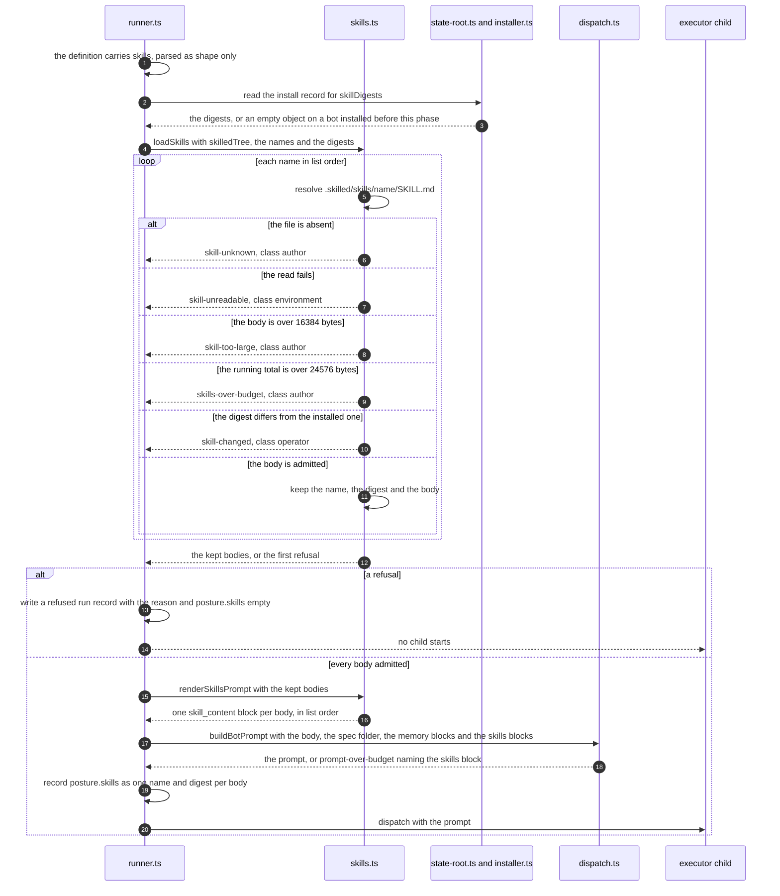
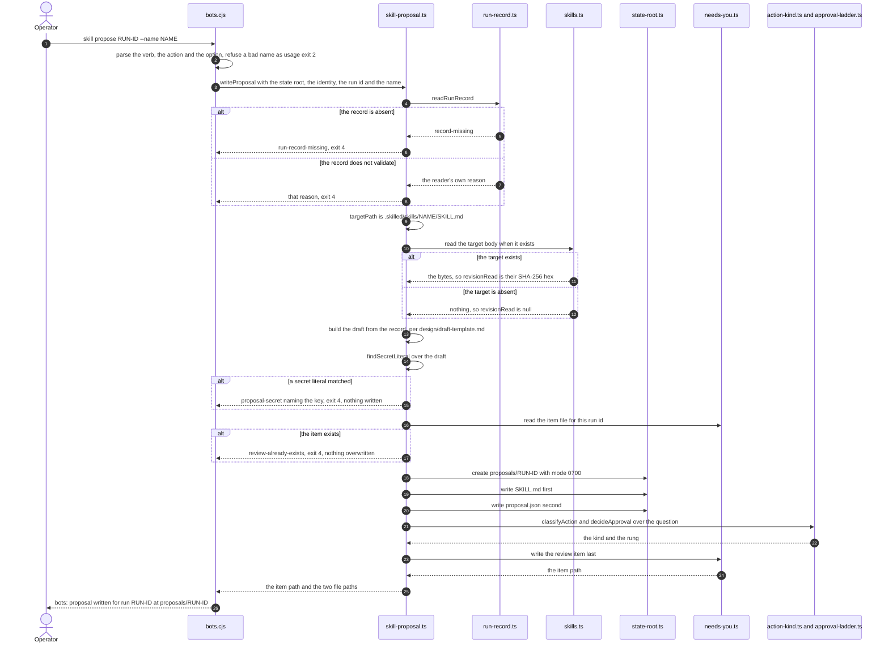
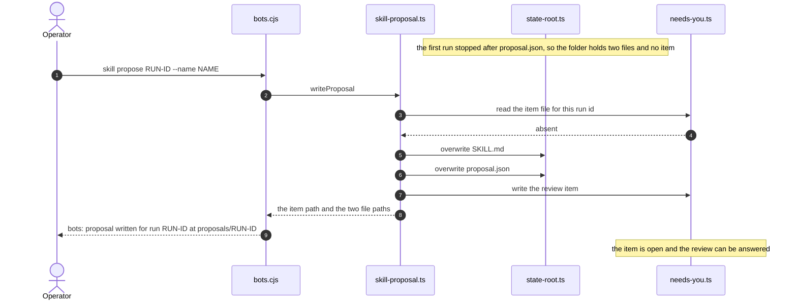

# The four sequences phase 9 adds

Each diagram names the module that owns each step, so a builder reads the call order rather than inferring it. The packet's own run and answer sequences are `contracts/runtime-architecture.md` section 3 and are cited, never copied. [SOURCE: specs/system-skilled-bots/003-openbot-parity-build/contracts/runtime-architecture.md, section "3. SEQUENCES"]

Paths are relative to the repository root. `$R` is `.skilled/skills/system-skilled-bots/runtime`.

---

## 1. A RUN THAT LOADS SKILL BODIES

The loader runs inside the runner's existing order, after the posture and the secret resolve and before the prompt is built. It adds no check before approval. [SOURCE: specs/system-skilled-bots/003-openbot-parity-build/contracts/runtime-architecture.md, section "3.1 A run"]



**Why the install record is read before the loader.** The digest comparison is the loader's fifth check and it needs the installed value in hand. A bot installed before this phase has no `skillDigests`, so the object reads as `{}` and every name refuses `skill-changed` until the bot is reinstalled. [SOURCE: specs/system-skilled-bots/003-openbot-parity-build/contracts/records.md, section "Install record addition", row `skillDigests`]

**Why a refusal writes a record.** A refused run is a run the operator can see in `bots status`, and the record's `exit.refusal` names the cause. [SOURCE: .skilled/skills/system-skilled-bots/runtime/lib/run-record.ts:142-148]

---

## 2. `bots skill propose`

The verb reads one run record and writes three things. The order is the draft, then `proposal.json`, then the item.



**Why the secret check runs before any write.** A draft that quotes a run's stdout can carry a stored value, and the state root must never hold one. The refusal names the key and never the value. [SOURCE: specs/system-skilled-bots/003-openbot-parity-build/009-skills/spec.md:173]

**Why the item check runs before the writes.** A re-run with an item present must overwrite nothing, so the check has to precede the first write rather than follow it. A re-run with files present and no item overwrites both files, which is the repair path.

---

## 3. AN ANSWER TO THE REVIEW

The claim runs before the write and the settle after it. `contracts/answer-seam.md` owns the whole numbered sequence, and this diagram draws only the steps this phase fills. [SOURCE: specs/system-skilled-bots/003-openbot-parity-build/contracts/answer-seam.md, section "1. THE SEQUENCE"]

```mermaid
sequenceDiagram
  autonumber
  actor Op as Operator
  participant Cl as bots.cjs
  participant An as answer.ts
  participant It as needs-you.ts and the item lock
  participant Sp as skill-proposal.ts
  participant Sr as state-root.ts

  Op->>Cl: answer RUN-ID confirm
  Cl->>An: answerItem with the text and the scope
  An->>It: take the lock, read the item, judge the state and the answer identity
  An->>An: the secret check over the answer
  An->>Sp: the review claim for this item
  alt the item's kind is not skill-proposal
    Sp-->>An: not a proposal, so the next review kind is asked
  else proposal.json is absent, unreadable or invalid
    Sp-->>An: not a proposal, so the existing path runs
  else the text is not confirm, reject or a NO
    Sp-->>An: review-answer-invalid, exit 4, the item stays open
  else the target digest differs from revisionRead
    Sp-->>An: proposal-stale, exit 4, the item stays open
  else the digest matches
    Sp-->>An: claimed, with the decision word and the scope
    An->>It: one write of the answer and the grant
    An->>An: stamp answeredBy on the run record
    An->>Sp: the review settle
    Sp->>Sr: write answer.json beside proposal.json
    An->>It: write resumeRequestId as the id the resume would have had
    An->>It: stamp the generation and release the lock
    An-->>Cl: reviewed
    Cl-->>Op: bots: item RUN-ID answered; skill-proposal review recorded
  end
```

**Why no resume is queued.** A review is a repository change awaiting a decision, not a decision the bot needs to continue. The item's `resumeRequestId` is written as the id the resume would have had, so `itemAwaitingResume` does not treat the item as waiting. [SOURCE: specs/system-skilled-bots/003-openbot-parity-build/contracts/answer-seam.md, section "4. DECISIONS TAKEN"]

**Why the settle is a second call.** A stop between the write and the settle must not lose the decision, and a second send of the same answer re-runs the settle, which finds `answer.json` absent and writes it.

---

## 4. THE REPAIR RE-RUN

An interrupted proposal leaves files and no item. The re-run overwrites both files and writes the item, so the operator's next command is the same command.



**Why the same command.** The repair path adds no verb and no flag. A second command would be a second thing to remember, and the run id and the name already identify everything the re-run needs.

**Why the files are overwritten rather than kept.** The interrupted run's files were built from the same record and the same name, so the second build produces the same draft unless the record changed. Overwriting is the only way to be sure the item names a draft that matches the `proposal.json` beside it.

---

## 5. DECISIONS TAKEN

| Decision | Why |
|----------|-----|
| The loader is called from the runner, not from `dispatch.ts` | `dispatch.ts` composes rendered blocks and imports neither `memory.ts` nor `skills.ts`, which keeps the budget check in one function. [SOURCE: specs/system-skilled-bots/003-openbot-parity-build/contracts/runtime-architecture.md, section "4. DECISIONS TAKEN"] |
| The verb reads the install record through the runner's existing path, not a second reader | One reader for one file, and the loader takes the digests as an argument so it stays pure apart from the body reads |
| The claim and the settle are two exported functions, not one | The seam calls them at two different steps with a write between them, and one function could not refuse after the write. They are `claimProposalAnswer` and `settleProposalAnswer` |
| The repair path is the same command with no flag | The run id and the name already identify the proposal, so a second command would be a second thing to remember |
