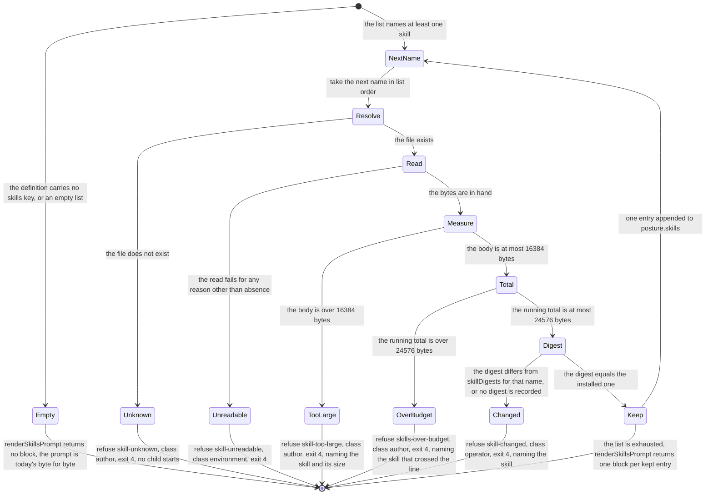
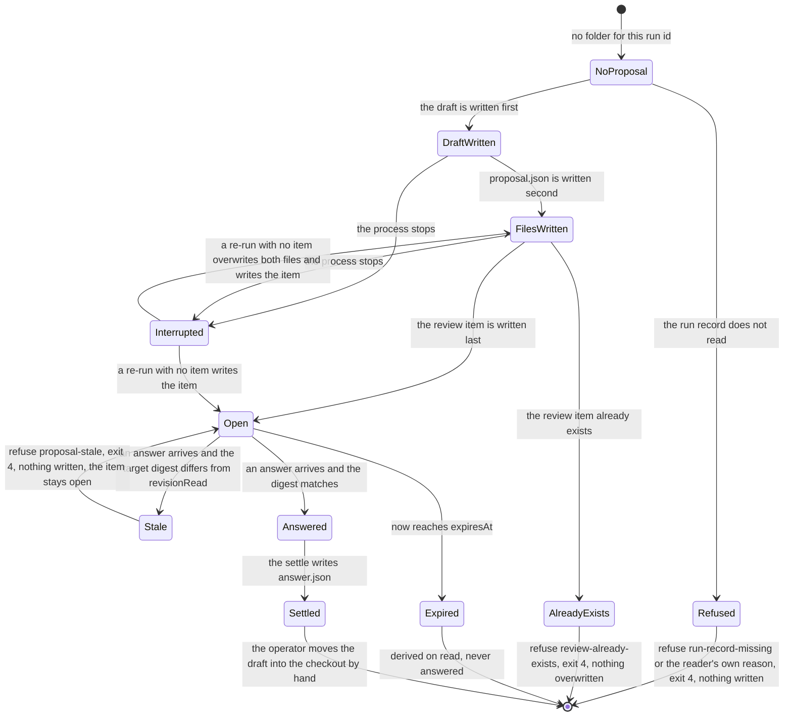
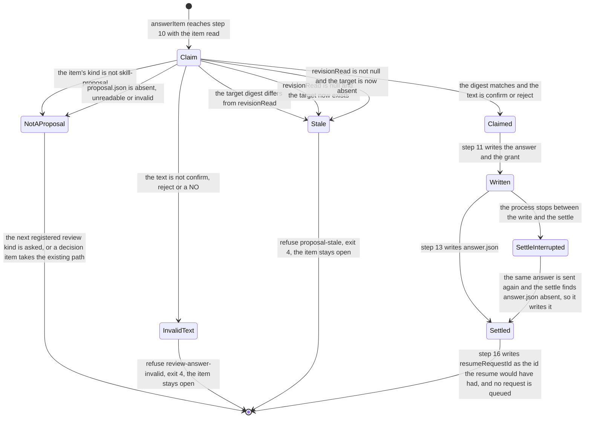

# The skills loader and the proposal lifecycle

Three machines, one per decision this phase makes. Each is drawn so a builder writes the branches in the order drawn, and each names the refusal on the edge that produces it. The refusal catalogue is `design/refusals.md`. The records are `design/record-schemas.md`.

Paths are relative to the repository root. `$R` is `.skilled/skills/system-skilled-bots/runtime`.

---

## 1. THE LOADER'S DECISION PATH

`loadSkills` walks the list in the order the definition wrote it and stops at the first refusal, so a run never dispatches with a partial list. The order of the four checks per name is fixed here and is not the builder's to choose.

**Why size before digest.** A body over the per-skill cap can never have an installed digest, because `bots install` runs the checker and the checker refuses `skills-too-large` before the install record is written. [SOURCE: .skilled/skills/system-skilled-bots/runtime/lib/installer.ts:569-572] So the size check is the one that can fire first in practice, and naming the bound a body broke is more use to the author than naming a digest mismatch the author cannot fix.

**Why the total is measured as the list is walked.** The refusal must name the skill that crossed the line, and the running total at that name is the only value that names it. [SOURCE: specs/system-skilled-bots/003-openbot-parity-build/009-skills/spec.md:162]

**Why no name needs a traversal check.** `SKILL_NAME_PATTERN` is the bot-id grammar, which admits no dot, no slash and no uppercase letter, so a name can never leave `<skilledTree>/.skilled/skills/`. [SOURCE: .skilled/skills/system-skilled-bots/runtime/lib/definition.ts:88] A name outside the grammar is refused at parse time as `skills-name-invalid`, before the loader runs.

---

## 2. THE PROPOSAL'S LIFECYCLE

The proposal is three writes and one review. The write order is fixed: the draft, then `proposal.json`, then the review item last, so an interrupted run leaves files a re-run can repair and never an item pointing at a draft that does not exist.

**Why the item is last.** The item is the only thing a person sees. An item written before its draft would offer a review of a file that does not exist, and the answer would then read a missing `proposal.json` and fall back to not-a-proposal, which loses the review silently. Writing the item last makes an interrupted proposal invisible rather than wrong.

**Why a re-run overwrites.** The one existing guard covers an item that already exists. [SOURCE: specs/system-skilled-bots/003-openbot-parity-build/009-skills/spec.md:231] A re-run with files present and no item is the repair path, and it must overwrite rather than refuse, because the files it finds are the interrupted run's own output for the same run id and the same target name. A re-run with an item present refuses as today, so an open question is never erased.

**Why a stale answer leaves the item open.** The pin is checked in the claim half of the review seam, before the answer and the scope are written. [SOURCE: specs/system-skilled-bots/003-openbot-parity-build/contracts/answer-seam.md, section "1. THE SEQUENCE", row 13] A refusal there writes nothing, so the item is still `open` and a fresh proposal can be reviewed against the new revision.

---

## 3. THE REVIEW ANSWER PATH

The seam has two halves. The claim runs before the write and may refuse with the item untouched. The settle runs after the write and applies the effect. `contracts/answer-seam.md` owns the numbered sequence and this machine draws only the branch this phase adds. [SOURCE: specs/system-skilled-bots/003-openbot-parity-build/contracts/answer-seam.md, section "1. THE SEQUENCE"]

**Why the NO set reads as `reject`.** `contracts/answer-seam.md` fixes it, so a channel answer that sends `no` records a denial rather than an approval. [SOURCE: specs/system-skilled-bots/003-openbot-parity-build/contracts/answer-seam.md, section "4. DECISIONS TAKEN"] The scope is `deny` and the decision word is `reject`.

**Why a damaged `proposal.json` is not a refusal.** `spec.md` NFR-R02 requires it to read as not a proposal review, so the answer path falls back to its existing behaviour rather than refusing every answer on the item. A damaged file is the operator's to repair, and refusing the answer would leave the item open with no way to close it.

**Why the settle is idempotent.** It writes `answer.json` only when the file is absent or holds a different decision. Every value it writes is copied from the answer and the proposal, so a second run writes the same bytes.

---

## 4. DECISIONS TAKEN

| Decision | Why |
|----------|-----|
| The loader stops at the first refusal and returns no partial list | A run with three of four bodies is a run whose instructions are silently incomplete, which is the outcome both caps exist to prevent |
| The four checks run in the order resolve, read, size, total, digest | Each check needs the previous one's result, and the size check must precede the digest check because a body over the cap can never have an installed digest |
| The proposal writes the draft, then `proposal.json`, then the item | An item is the only thing a person sees, so it must never name a file that does not exist |
| A re-run with files and no item overwrites, and a re-run with an item refuses | The first repairs an interrupted proposal and the second protects an open question |
| The pin is checked in the claim, not the settle | A refusal in the claim writes nothing, which is what leaves the item open for a fresh proposal |
| A damaged `proposal.json` reads as not a proposal | `spec.md` NFR-R02 requires the fallback, and a refusal would leave the item open with no way to close it |
