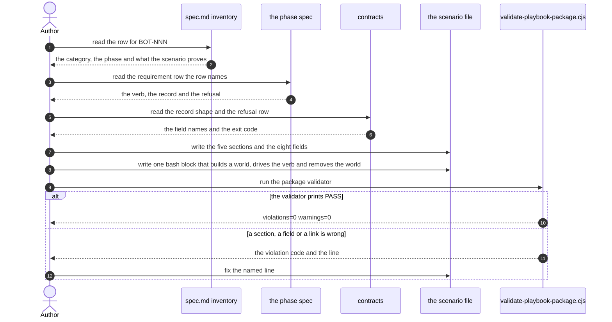
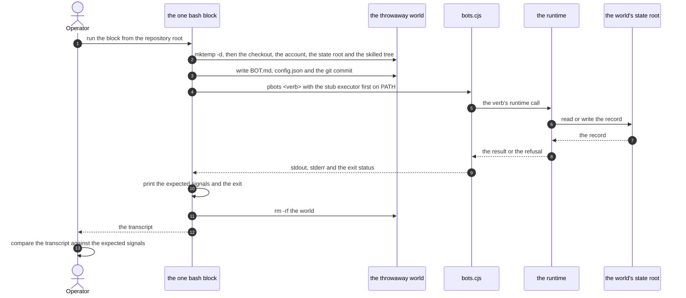
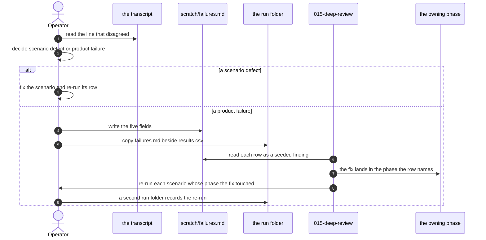

# Sequences

Four sequences carry this phase. Each one names the actor, the file it reads and the file it writes, so a builder can follow the diagram without opening another document. The record shapes are in `scenario-contract.md`, the states in `state-machines.md` and the refusal names in `refusal-catalogue.md`.

---

## 1. AUTHORING ONE SCENARIO

The author reads the phase requirement first and the inventory row second, so the scenario is written against the requirement rather than against a remembered behavior.

The author never writes a second copy of a command in the root index. The root index carries one summary line per scenario and the link, and the scenario file carries the execution truth. [SOURCE: .skilled/skills/sk-doc/sk-create-manual-testing-playbook/SKILL.md:158]

---

## 2. EXECUTING ONE SCENARIO

The operator runs one block in one shell. The block is self-contained, so its verdict never depends on another scenario having run.

| Step | What the operator reads | What decides the verdict |
|------|-------------------------|--------------------------|
| 4 | the verb's stdout and stderr | the expected signals in section 3 |
| 5 | the record the verb wrote | the record fields the scenario names |
| 7 | the exit status | the exit the scenario names |
| 10 | the whole transcript | the pass, fail and skip rules |

A block that prints a signal the scenario does not name is not a failure. A block that misses a signal the scenario names is.

---

## 3. RECORDING THE CORPUS

The recorder is the one writer. It checks every row before it writes anything, so a refused run leaves no folder.

```mermaid
sequenceDiagram
  autonumber
  actor Op as Operator
  participant Csv as the verdict CSV
  participant Rc as record-playbook-run.cjs
  participant Pb as the playbook root
  participant Fs as benchmark/reports
  Op->>Csv: one row per scenario with id, verdict, reason and evidence
  Op->>Rc: --playbook, --results, --label manual-testing-playbook--openbot-parity, --executor
  Rc->>Pb: collect every scenario id
  Pb-->>Rc: the 58 ids
  Rc->>Rc: check each row against the ids, the verdict vocabulary and the reason rule
  alt a row is wrong
    Rc-->>Op: the row number and the problem, and nothing is written
  else every row checks out
    Rc->>Fs: write results.csv, README.md and source.md under a staging name
    Rc->>Fs: rename the staging folder to <date>--<label>
    Rc->>Fs: insert the run's row in reports/README.md
    Rc-->>Op: the folder and the tally
  end
```

The recorder refuses an id the playbook does not define, a verdict outside the three, a `FAIL` or a `SKIP` with no reason, a scenario recorded twice on one runtime and a folder that already exists. [SOURCE: .skilled/skills/sk-doc/sk-create-manual-testing-playbook/scripts/record-playbook-run.cjs:248]

---

## 4. FILING A FAILURE AND HANDING IT ON

A product failure leaves this phase as one row and arrives at the deep review as one finding. The row is the whole handoff, so it carries the phase, the requirement, the observed line and the evidence.

| Field | Read by | Used for |
|-------|---------|----------|
| Scenario id | the deep review | which scenario to re-run |
| Phase | the deep review | which packet owns the fix |
| Requirement | the deep review | which requirement row the finding cites |
| Observed line | the deep review | the finding's evidence |
| Evidence path | the deep review | the transcript a reader opens |

The deep review's verdict cannot read PASS while a filed product failure is open, which is what makes the row binding rather than advisory. [SOURCE: specs/system-skilled-bots/003-openbot-parity-build/contracts/decisions.md, D4]
