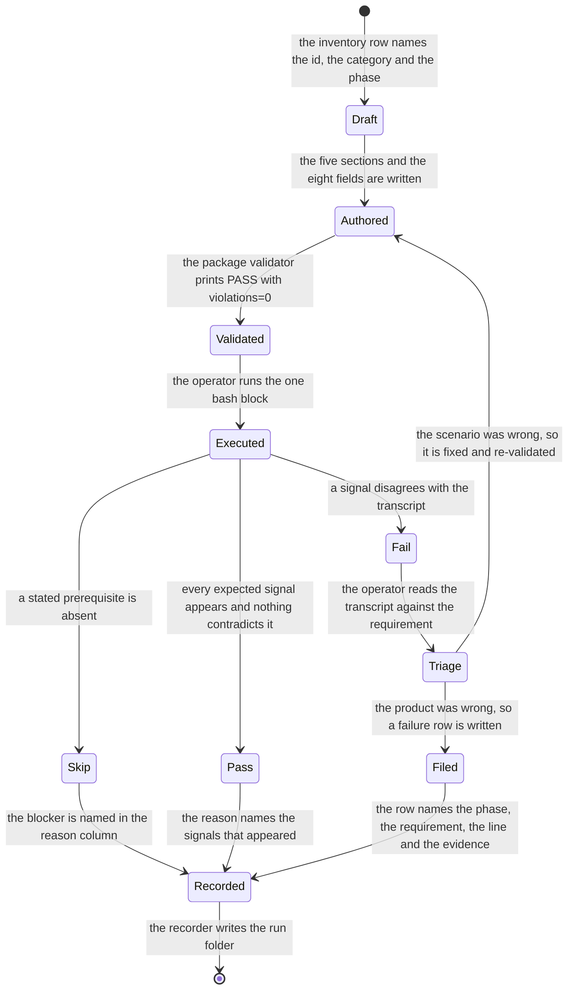
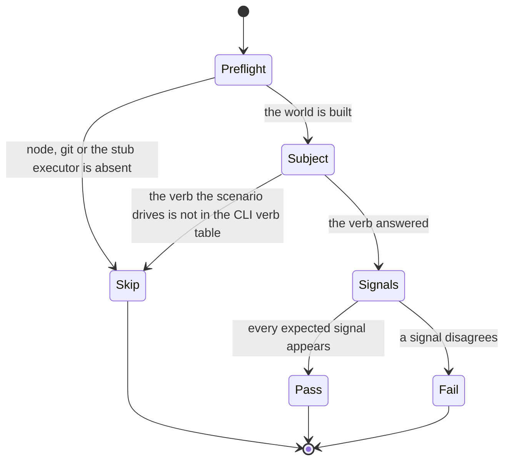
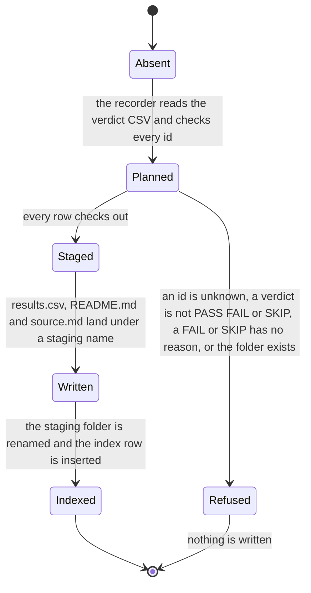
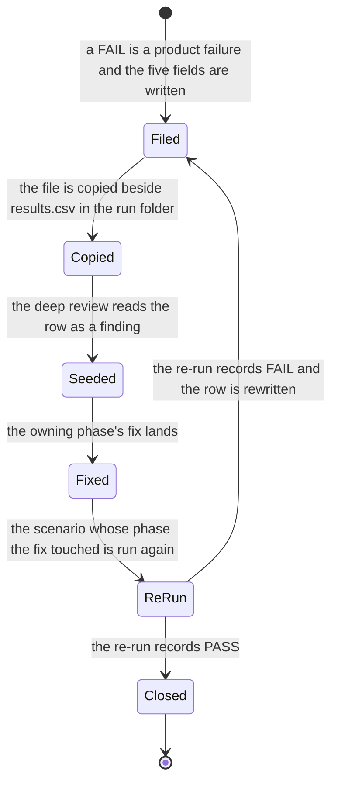
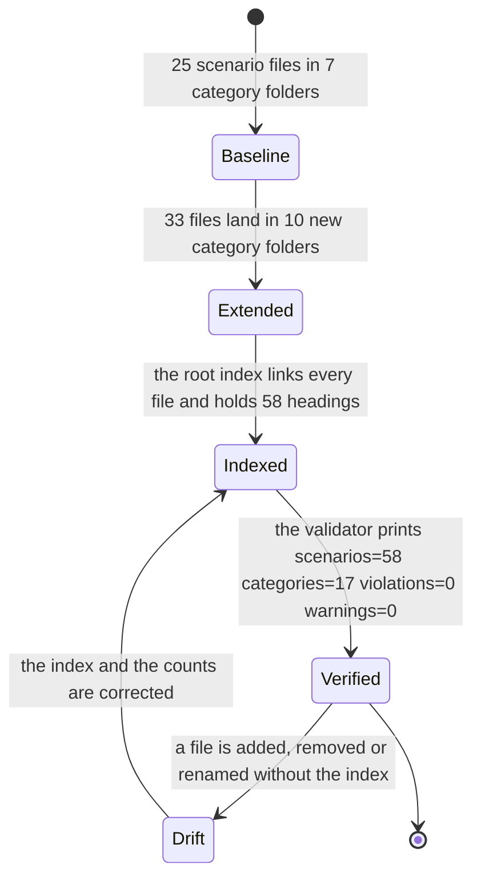

# State machines

Five machines govern this phase. Each one names its states, the event that moves it and the file that records the move, so a builder reads the diagram and knows which file to write. The record shapes are in `scenario-contract.md`, and the refusal names a transition can raise are in `refusal-catalogue.md`.

---

## 1. THE SCENARIO LIFECYCLE

A scenario is authored once and executed many times. The corpus is an input, so an execution never moves a scenario back to `authored` unless the scenario itself was wrong.

| State | Recorded in | Event that leaves it |
|-------|-------------|----------------------|
| `Draft` | the inventory table in `spec.md` | the file is written |
| `Authored` | the scenario file | the package validator passes |
| `Validated` | the validator's `PASS` line | the operator runs the block |
| `Executed` | the operator's transcript | the verdict is decided |
| `Pass` | the verdict row | the recorder writes the run |
| `Fail` | the verdict row | the triage decides scenario or product |
| `Skip` | the verdict row, with its blocker | the recorder writes the run |
| `Filed` | `scratch/failures.md` | the recorder writes the run |
| `Recorded` | `results.csv` | nothing, the run is closed |

A scenario that reaches `Filed` is still `Recorded`. The two are not exclusive, because a product failure is a recorded verdict and a filed row at the same time.

---

## 2. THE VERDICT DECISION

The verdict is decided by three questions in order. The first question is about the world, the second about the subject and the third about the signals.

| Question | Answer that stops the run | Blocker written in the reason |
|----------|---------------------------|------------------------------|
| Is the world buildable? | `node`, `git` or the stub executor is missing | the binary's name |
| Is the subject present? | the verb is absent from the verb table | the verb and the phase that adds it |
| Do the signals agree? | no, one disagrees | the line that disagreed, quoted |

A real channel account is a fourth preflight answer for the two channel scenarios that name one. Those two run on the fake transport, so the account is never required, and a scenario that names a real account records `SKIP` with the account as its blocker. [SOURCE: specs/system-skilled-bots/003-openbot-parity-build/011-messaging-channels/007-conformance-hardening-and-proof/spec.md, REQ-017]

---

## 3. THE RUN FOLDER LIFECYCLE

The recorder is the one writer, so every state below is entered by one process and never by a hand edit.

| State | On disk | Event that leaves it |
|-------|---------|----------------------|
| `Absent` | nothing | the recorder is invoked |
| `Planned` | nothing | every row validates |
| `Refused` | nothing | nothing, the operator fixes the CSV |
| `Staged` | `<folder>.partial-<pid>/` | the three files are written |
| `Written` | the staging folder holds three files | the rename succeeds |
| `Indexed` | `<folder>/` and one row in `reports/README.md` | nothing, the run is closed |

A run whose result changes gets a new folder rather than an overwrite, so `Indexed` has no outgoing edge. [SOURCE: .skilled/skills/sk-doc/sk-create-manual-testing-playbook/scripts/record-playbook-run.cjs:494]

---

## 4. THE FILED FAILURE

A filed failure is a handoff. This phase writes it, the deep review seeds it as a finding, and the fix pass closes it.

| State | Recorded in | Owner |
|-------|-------------|-------|
| `Filed` | `scratch/failures.md` | this phase |
| `Copied` | the run folder's `failures.md` | this phase |
| `Seeded` | the deep review's finding list | 015-deep-review |
| `Fixed` | the owning phase's packet | the phase the row names |
| `ReRun` | a second run folder | 015-deep-review |
| `Closed` | the second run's `results.csv` | 015-deep-review |

The re-run is decision D7: after the last fix, each scenario whose owning phase a fix touched is run again and its result recorded. [SOURCE: specs/system-skilled-bots/003-openbot-parity-build/contracts/decisions.md, D7]

---

## 5. THE CORPUS CENSUS

The census is derived from the tree on every validator run, so a hand-typed count is a warning rather than a source of truth.

| State | Derived from | Check |
|-------|--------------|-------|
| `Baseline` | the seven pre-parity folders | `scenarios=25 categories=7` |
| `Extended` | the tree walk | `find <playbook> -mindepth 2 -name '*.md' \| wc -l` prints 58 |
| `Indexed` | the root index's links | `INDEX_ORPHAN_FILE` names any file the index does not link |
| `Verified` | the validator's summary line | `violations=0 warnings=0` |
| `Drift` | the same walk, after a change | `CENSUS_MISMATCH` or `INDEX_ORPHAN_FILE` |

The root index states no hand-typed census, because the validator reports one as `HAND_TYPED_CENSUS` and this phase's criterion requires zero warnings. The counts live in the validator's summary line and in this phase's documents, never in the corpus root.
