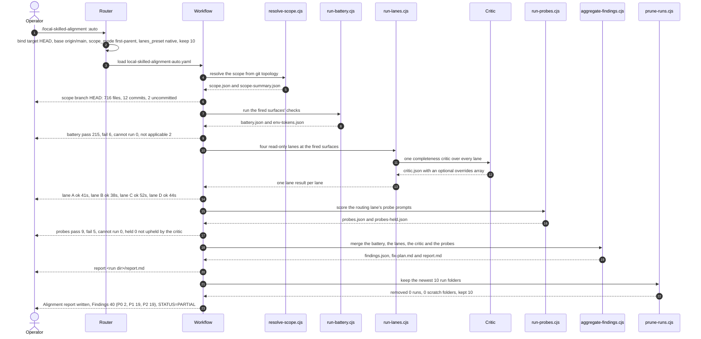
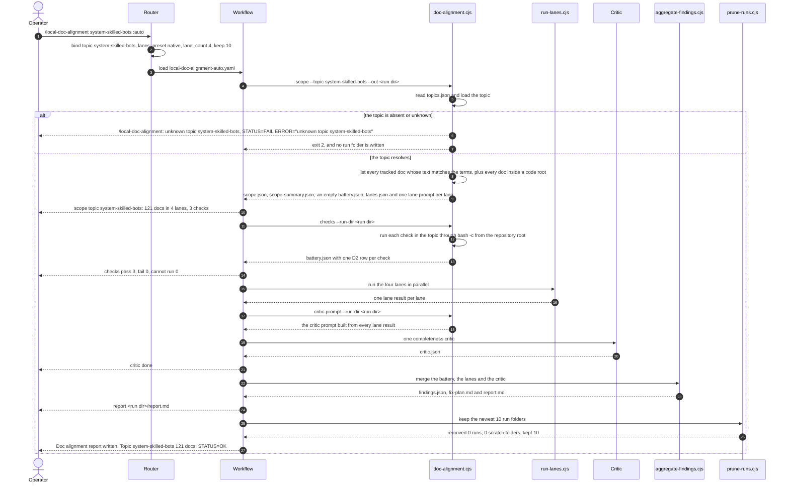
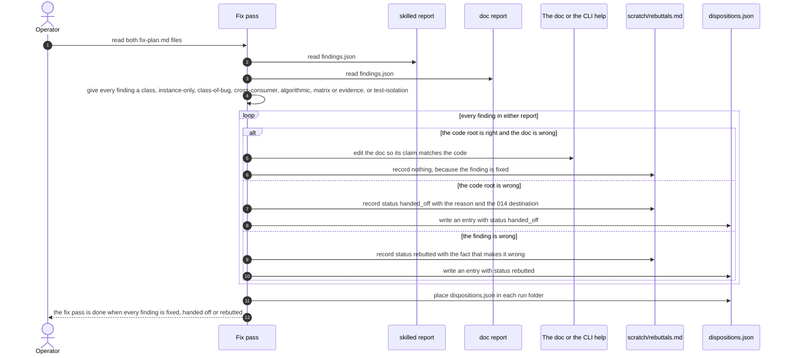
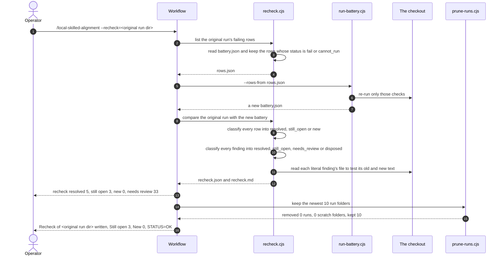
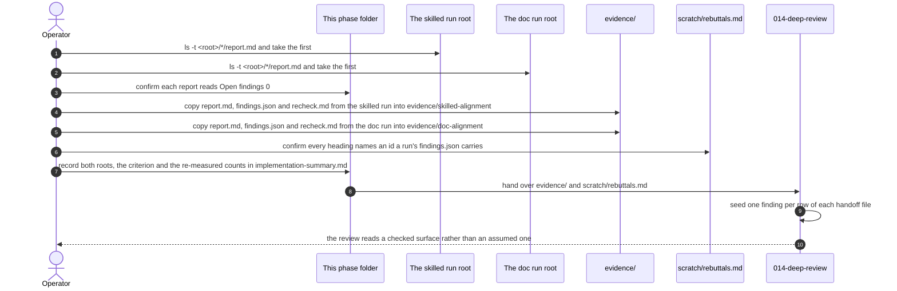

# The alignment sequences

Five sequences. Each one names the actor that does the work, the file it writes and the line it prints, so a builder can tell from the diagram alone whether a step happened. The participants are the router, the workflow, the scripts the workflow calls, the lane executor and the operator.

The scripts are the ones the two command documents list as owned assets. [SOURCE: .skilled/commands/local-skilled-alignment.md:19] [SOURCE: .skilled/commands/local-doc-alignment.md:21] A step that writes a file names the file. A step that prints a line quotes the line's shape from the presentation contract.

---

## 1. THE SKILLED-ALIGNMENT RUN

The run is report-only, so no step writes the checkout. [SOURCE: .skilled/commands/local-skilled-alignment.md:15] The one step that can write a repository file is `apply-fixes.cjs`, and it runs only under `--fix literal`, which this phase does not pass.

The `STATUS=PARTIAL` line is not a failure. It says the run finished and the report holds findings. A run with no findings prints `STATUS=OK`.

---

## 2. THE DOC-ALIGNMENT RUN

The `alt` block is the whole reason the topic lands first. A run that takes the first branch writes no run folder, so the operator sees a failure line and the state root gains nothing. [SOURCE: .skilled/commands/local-doc-alignment.md:41]

The doc run's `checks` step runs before the lanes, so a failing package validator is a `D2` row in the report whether or not a lane ever reads the file. That is the deterministic half of the run and it is the half that catches a broken package rather than a wrong sentence.

---

## 3. THE FIX PASS

The fix pass is a hand edit. It is drawn as a sequence because the order of its three outputs matters: the doc edit first, then the disposition, then the re-run that proves the edit landed.

Three rules the diagram encodes.

- **A fixed finding gets no disposition.** A disposition is for a finding the pass declines. A fixed finding leaves the open count because the next run no longer reports it, and a disposition on it would hide a fix that did not land.
- **`dispositions.json` goes into the run folder, not the phase folder.** The aggregator reads it from the run folder it is aggregating, so a disposition written anywhere else is ignored. [SOURCE: .skilled/commands/assets/local-skilled-alignment/aggregate-findings.cjs:620]
- **The rebuttals record and the disposition carry the same status word.** `scratch/rebuttals.md` is the phase's record and `dispositions.json` is the aggregator's input, and the two disagreeing is the one way a declined finding can be counted as open.

---

## 4. THE RECHECK

The recheck writes into a new run folder, so the original run's `report.md` stays the record of what the first run found. That is why the clean criterion reads the newest folder that holds a `report.md` and not the newest folder under the root.

`STATUS=OK` on a recheck means the recheck ran. The counts say what is still open, and the phase's criterion reads the counts. [SOURCE: .skilled/commands/assets/local-skilled-alignment/local-skilled-alignment-presentation.txt:145]

---

## 5. THE EVIDENCE COPY AND THE HANDOFF TO 014

The copy is the fix for the gap that both reports were written outside the checkout. A later reader opens `evidence/skilled-alignment/report.md` without the operator's state root, and the clean close is checkable after the run folders are pruned.

The handoff is two paths and nothing else: `evidence/` and `scratch/rebuttals.md`. 014 seeds one finding per row of each, so a `handed_off` row becomes a finding the review must settle and a `rebutted` row becomes a finding the review may overturn. That is the connection the plan-depth research found missing, and naming both paths here is what closes it.
