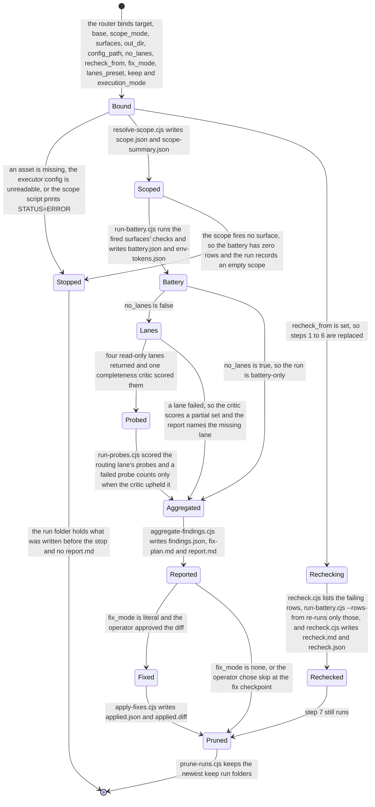
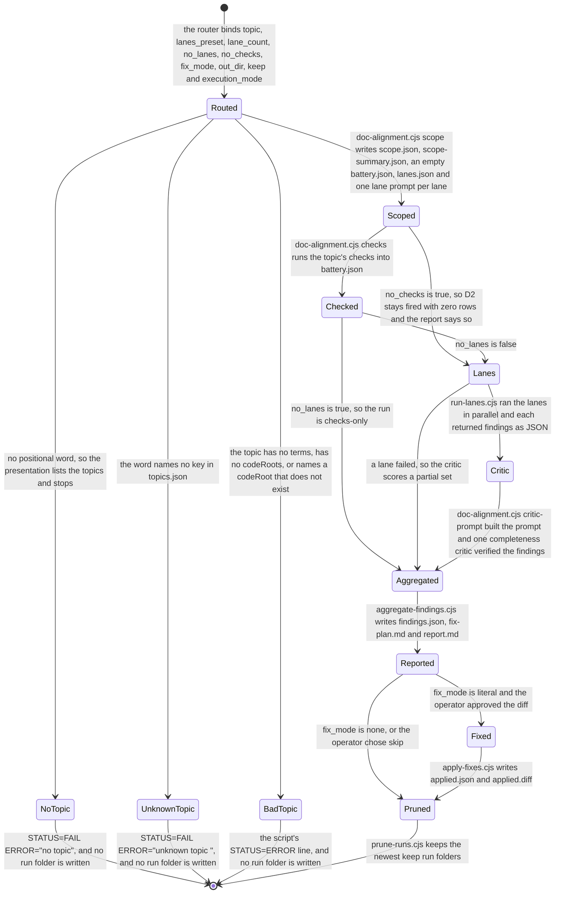
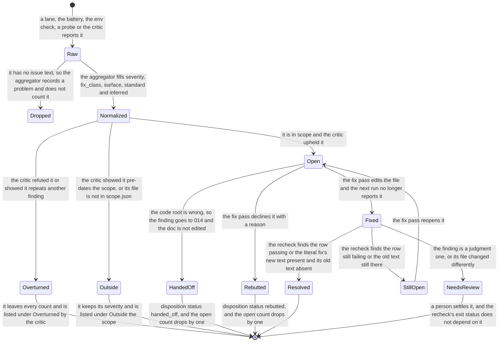
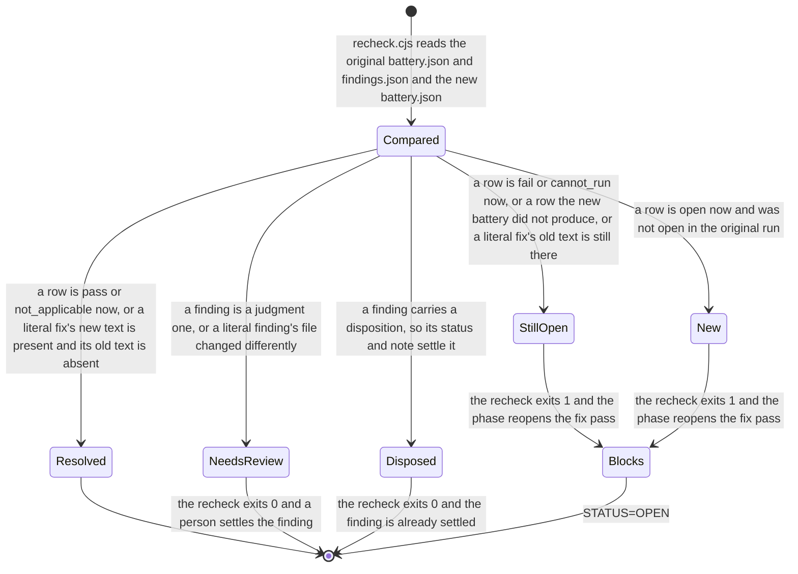
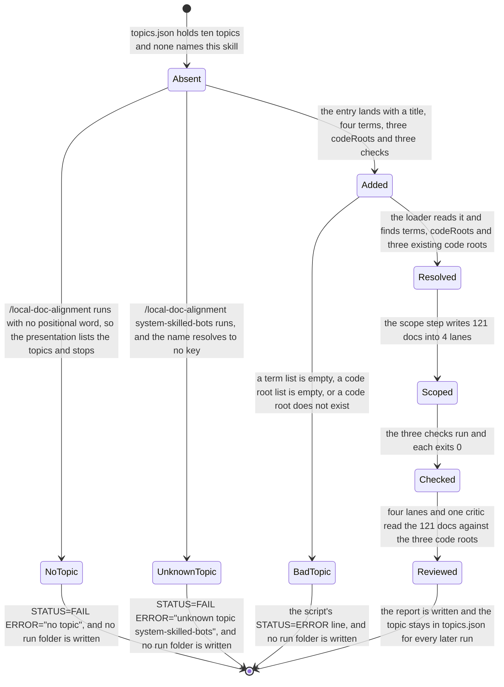
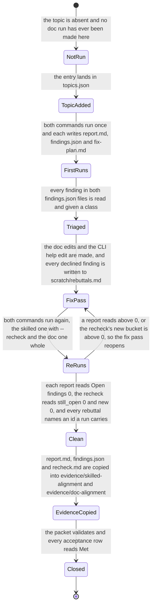

# The alignment state machines

Six machines decide this phase. The first two are the commands' own step order, read from their workflow summaries. [SOURCE: .skilled/commands/local-skilled-alignment.md:91] [SOURCE: .skilled/commands/local-doc-alignment.md:80] The third and fourth are the finding and the recheck bucket, read from the aggregator and the recheck script. [SOURCE: .skilled/commands/assets/local-skilled-alignment/aggregate-findings.cjs:397] [SOURCE: .skilled/commands/assets/local-skilled-alignment/recheck.cjs:148] The fifth is the topic, read from the loader. [SOURCE: .skilled/commands/assets/local-doc-alignment/doc-alignment.cjs:91] The sixth is this phase's own loop, which is the one machine no script enforces and the one a builder is most likely to get wrong.

A state named here is a state a reader can observe in a file or in a status line. A state that exists only in a person's head is not drawn.

---

## 1. THE SKILLED-ALIGNMENT RUN

The run is report-only unless `--fix literal` is passed. [SOURCE: .skilled/commands/local-skilled-alignment.md:15] Every state below writes at least one file into the run folder, so the folder is the record of how far the run got.

Three edges carry a rule a builder would otherwise invent.

- **`Scoped` to `Stopped` on an empty scope.** A scope with no `.skilled` change fires no surface and the battery writes zero rows. The run still writes `report.md` with `- Open findings: 0`, and the phase records that the scope was empty rather than claiming a clean pass over a change set that did not exist. The scope line's `note=` text is printed on a second line for exactly this case. [SOURCE: .skilled/commands/assets/local-skilled-alignment/local-skilled-alignment-presentation.txt:66]
- **`Lanes` to `Aggregated` on a failed lane.** A lane that errors does not stop the run. The critic scores what came back and the report's `Lanes:` line names the missing ids, so a partial review is visible rather than silent.
- **`Reported` to `Fixed` only under `--fix literal`.** This phase never takes that edge. The applier reaches only a literal finding whose exact text the critic did not overturn, and 4 of the last run's 40 findings were literal. [SOURCE: .skilled/commands/local-skilled-alignment.md:15]

---

## 2. THE DOC-ALIGNMENT RUN

The doc run has no recheck mode and no git range. Its scope is the doc set the topic resolves, so its first state can fail before any file is written.

The three failure edges before `Scoped` are the reason the topic must land first. A run that stops at `NoTopic` writes no run folder, so a typo in the topic name is distinguishable from a clean run by the absence of the folder rather than by a green report. [SOURCE: .skilled/commands/local-doc-alignment.md:41]

---

## 3. THE FINDING

One finding, from the moment a lane writes it to the moment it leaves the open count. The aggregator decides the first three edges and the fix pass decides the rest.

The `Open` to `HandedOff` edge is decision D3 and it is the one edge a builder is most likely to take wrongly. A finding whose code root is wrong is not fixed by editing the doc to agree with the runtime, because that turns the doc into a record of the bug. It is recorded in `scratch/rebuttals.md` with status `handed_off` and it goes to 014.

The `Fixed` to `NeedsReview` edge is why the clean criterion reads `still_open` and `new` and not `needs_review`. A judgment finding is settled by a person reading the file, and a re-run cannot decide it. The last full run over this repository left 33 findings in that bucket, so a criterion that counted it would never pass.

---

## 4. THE RECHECK BUCKET

Every row and every finding enters exactly one bucket, and the five buckets are disjoint. The machine is drawn because two of them look alike and only one of them blocks.

The exit rule is the whole point of the machine: `still_open` or `new` above 0 gives exit 1 and `STATUS=OPEN`, and everything else gives exit 0 and `STATUS=OK`. [SOURCE: .skilled/commands/assets/local-skilled-alignment/recheck.cjs:157] A `new` bucket above 0 reopens the fix pass even when `still_open` is 0, because a finding the first run missed is a finding the fix pass did not see.

---

## 5. THE TOPIC

The topic is a record with a lifecycle, and the phase's first task moves it from `Absent` to `Added`. The measured gap is the `Absent` to `NoTopic` edge.

The `Added` to `Resolved` edge is the one the completion criterion reads: `codeRoots.length` is 3 and `checks.length` is 3. The `Resolved` to `Scoped` edge is the one the design measured: 121 docs in 4 lanes.

---

## 6. THIS PHASE'S OWN LOOP

The machine no script enforces. It is drawn because the phase's clean criterion is a loop and a builder who treats it as a single pass will close on a run that is not the last one.

Three rules the machine encodes.

- **`ReRuns` to `Clean` reads the last run only.** A clean report from an earlier run does not satisfy the criterion when a later run reported a finding. The criterion reads the newest folder that holds a `report.md`, which is why the recheck's own folder, which holds no `report.md`, cannot be mistaken for it.
- **`ReRuns` to `FixPass` fires on `new` as well as on `still_open`.** A finding the first run missed is a finding the fix pass did not see, so a `new` bucket above 0 reopens the pass even when nothing is still open.
- **`Clean` to `EvidenceCopied` is not optional.** The two run roots sit outside the checkout, so a clean close that is not copied cannot be checked later. That is the gap this phase closes and the reason `evidence/` exists.
