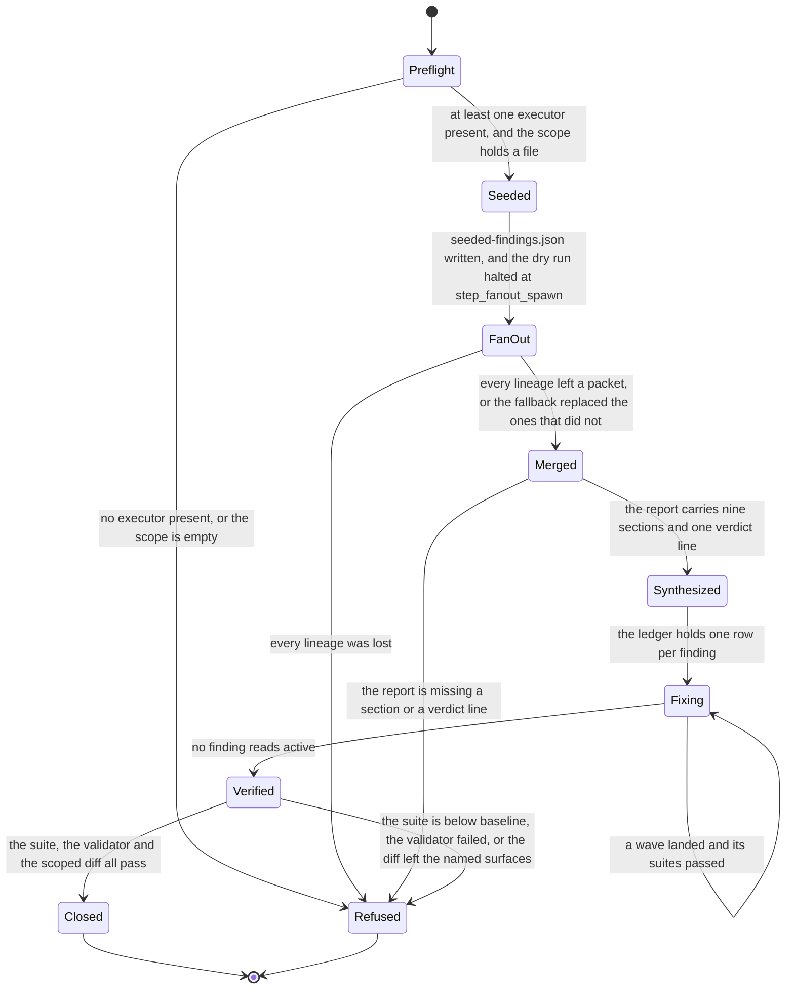
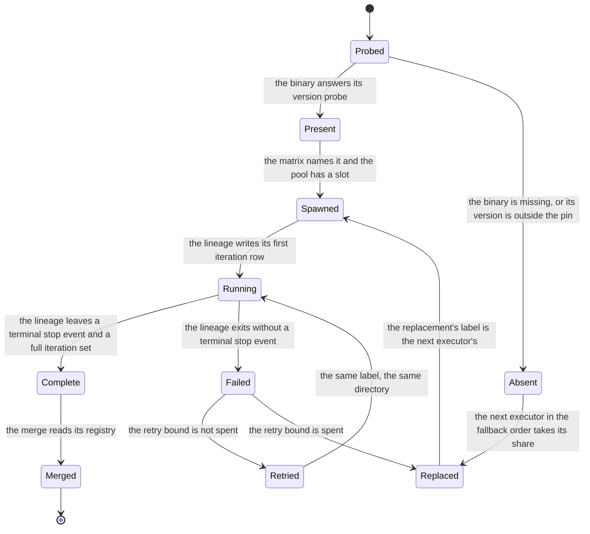
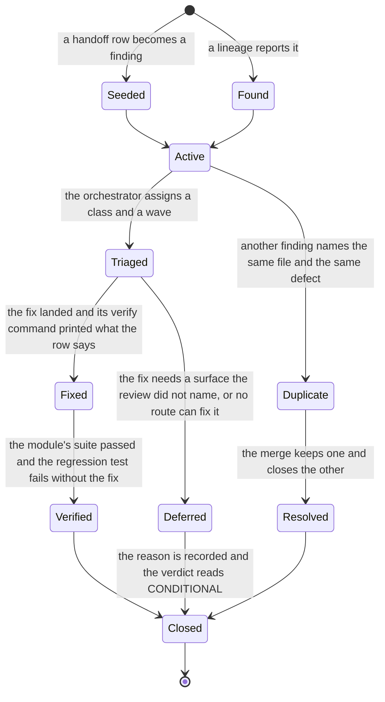
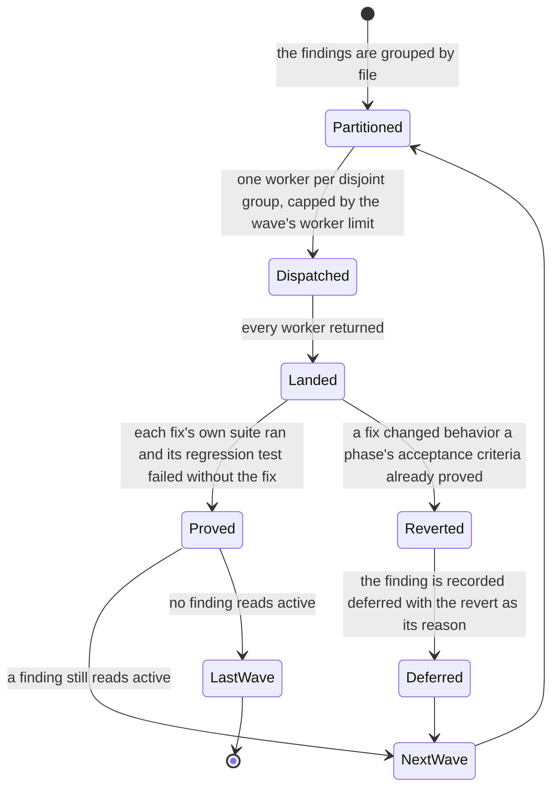
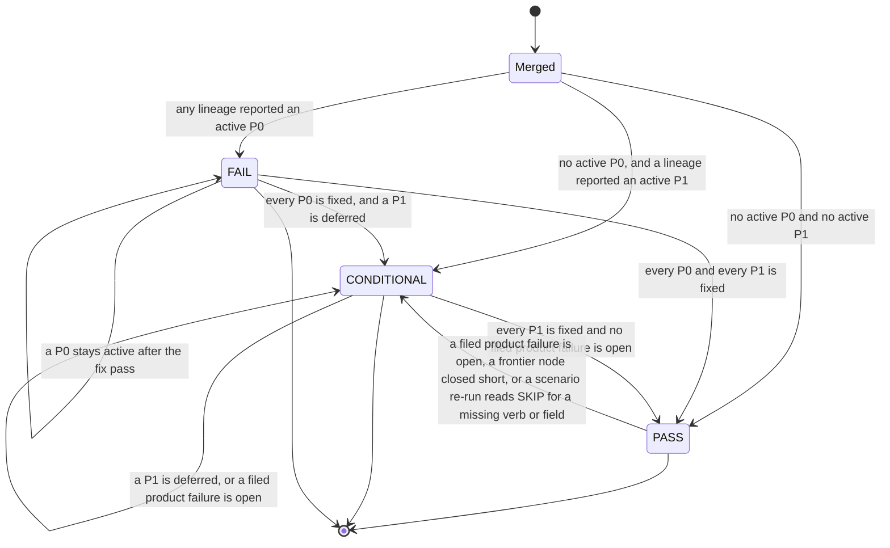
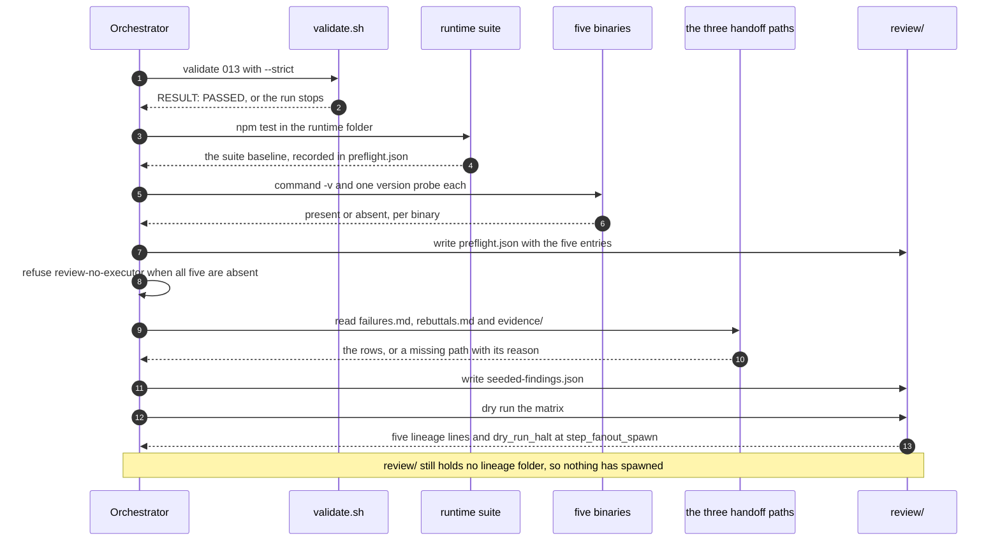
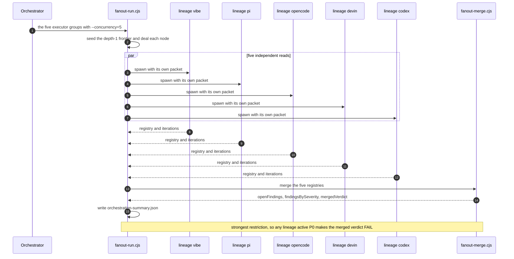
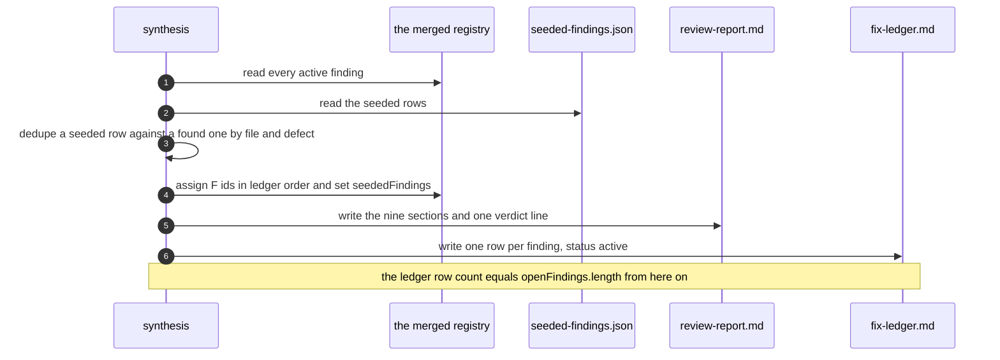
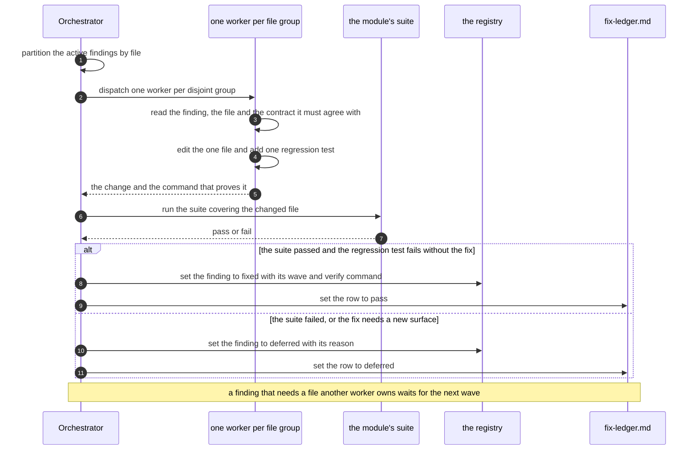
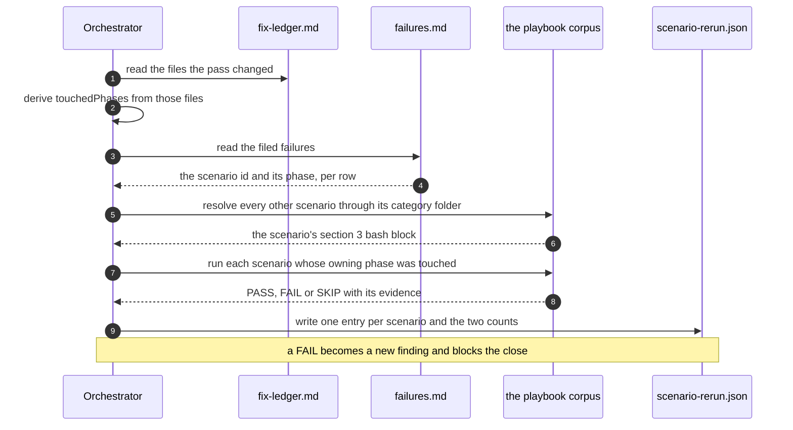

# The review run's state machines and sequences

This file fixes the order of the run. It draws the four machines the phase moves through, the five sequences that carry it, and the rule that turns findings into a verdict. The record shapes are in `design/records.md`. The refusals are in `design/refusals.md`.

The loop's own protocol is `.skilled/skills/system-deep-loop/deep-review/references/protocol/loop-protocol.md`. This file does not restate it. It fixes what this phase does around it.

---

## 1. THE RUN

The run has six states. A state is entered only when the one before it left the evidence the next one reads.

| State | Entered when | The evidence it leaves | The refusal if it cannot be entered |
|-------|--------------|------------------------|-------------------------------------|
| `Preflight` | the run starts | the five probes, the 013 validator line, the suite baseline | `review-no-executor`, `review-scope-empty` |
| `Seeded` | the three handoff paths were read | `seeded-findings.json` | `review-seed-unreadable` |
| `FanOut` | the dry run halted at `step_fanout_spawn` | `review/lineages/<label>/` for each lineage | `review-lineage-orphaned` |
| `Merged` | the merge wrote `orchestration-summary.json` | the merged registry and the summary | `review-merge-incomplete` |
| `Synthesized` | the report was written | `review-report.md` | `review-report-incomplete`, `review-verdict-missing` |
| `Fixing` | the ledger was written | `fix-ledger.md` | `review-ledger-incomplete` |
| `Verified` | the last wave landed | the ledger rows all read `pass` or `deferred` | `review-fix-outside-surface`, `review-suite-below-baseline`, `review-validator-failed` |
| `Closed` | the verdict row was appended | the verdict event and the summary | `review-verdict-blocked` |

`Refused` is terminal and writes no verdict line. A run that reaches it leaves the packet open and the report unwritten, because a review with no reader is not a clean review.

---

## 2. THE LINEAGE

Five lineages are planned. A lineage that cannot spawn is replaced, and a lineage that spawns and then fails is retried at most the runner's bound.

| Transition | Rule | Where it is decided |
|------------|------|---------------------|
| `Probed` to `Present` | the binary is on `PATH` and its version probe exits 0 | T003 |
| `Probed` to `Absent` | the binary is missing, or its version is outside the pin its mode names | T003, contracts D3 |
| `Absent` to `Replaced` | the next executor in the fallback order takes the share with `--count=2` | `plan.md` section 8.3 |
| `Running` to `Complete` | a terminal stop event and a full iteration set, which is the runner's own completion policy | `fanout-run.cjs` |
| `Running` to `Failed` | the process exited with no terminal stop event | `fanout-run.cjs` |
| `Failed` to `Retried` | the retry bound is not spent | NFR-R01 |
| `Failed` to `Replaced` | the retry bound is spent | NFR-R01, `plan.md` section 8.3 |

A lineage that is `Complete` but whose config still reads `running` is the case the plan-depth research hit: the work is there and the terminal row is not. The merge reads the iteration files and the registry, so such a lineage counts as `Complete` and its missing terminal row is recorded in the report's Audit Appendix. It is not `Failed`, because a failed lineage's findings would be reported as partial and this one's are whole.

The fallback keeps the count at five. A group with `--count=2` yields `<label>-1` and `<label>-2`, so the label set changes and the count does not. [SOURCE: .skilled/skills/system-deep-loop/runtime/lib/deep-loop/executor-config.ts:1366]

Every `Probed` outcome is written to `review/preflight.json` before the first spawn, so the machine's first two transitions leave a record a reader can check. The shape is `design/records.md` section 11.

---

## 3. THE FINDING

A finding is seeded or found, then triaged, then fixed or deferred, then verified.

| State | `status` in the registry | Counted in `findingsBySeverity` | Blocks a PASS |
|-------|--------------------------|--------------------------------|---------------|
| `Active` | `active` | yes | yes for P0 and P1 |
| `Triaged` | `active` | yes | yes for P0 and P1 |
| `Fixed` | `fixed` | no | no |
| `Verified` | `fixed` | no | no |
| `Deferred` | `deferred` | no | yes for P1, no for P2 |
| `Resolved` | `resolved`, in `resolvedFindings` | no | no |

A `Deferred` P1 blocks a PASS and does not block the close. The packet closes on `CONDITIONAL` and the report's Deferred Items section names the finding and its reason. That is the one case where the close and the verdict disagree, and it is deliberate.

A `Deferred` P2 blocks nothing. The verdict reads `PASS` with `hasAdvisories` true, and the finding stays in the report's Deferred Items section. That is D6.

---

## 4. THE FIX WAVE

A wave is one dispatch round. The hard constraint is the file: no two workers in a wave touch the same file.

| Wave | Task ids | Workers | What it proves |
|------|----------|---------|----------------|
| 0 | T001 to T004, T017 | 0 | the preconditions, the seeded intake and the preview |
| 1 | T005 to T007 | 5 lineages | the review ran and merged |
| 2 | T008, T009 | 0 | the report and the ledger exist |
| 3 | T010, T012 | at most 3 | every P0 is fixed and proved |
| 4 | T011, T012 | at most 4 | every P1 is fixed or deferred with a reason |
| 5 | T013 to T016, T018 | 0 | the suite, the validator, the scoped diff and the scenario re-run |

A wave's worker count is the number of disjoint file groups its findings fall into, capped by the wave's limit. A finding that needs a file another worker owns waits for the next wave. The seven file groups are in `tasks.md`.

---

## 5. THE VERDICT

The verdict is strongest restriction over the lineages, then narrowed by the fix pass's own state. The merge already applies strongest restriction, so any lineage's active P0 makes the merged verdict `FAIL`. [SOURCE: .skilled/skills/system-deep-loop/runtime/scripts/fanout-merge.cjs:1312]

The rule, in the order it is applied:

| Step | Test | Verdict if true | Verdict if false |
|------|------|-----------------|------------------|
| 1 | any finding reads `active` with severity `P0` | `FAIL` | step 2 |
| 2 | any finding reads `deferred` with severity `P1` | `CONDITIONAL` | step 3 |
| 3 | `seeded-findings.json` holds a `012-failures` row whose finding is not `fixed` | `CONDITIONAL` | step 4 |
| 4 | a `scenario-rerun.json` entry reads `SKIP` with a reason naming a missing verb or a missing field | `CONDITIONAL` | step 5 |
| 5 | a frontier node closed `exhausted` or `blocked` short of its dimension universe | `CONDITIONAL` | step 6 |
| 6 | a `blocked_stop` event is in the state log | `CONDITIONAL` | step 7 |
| 7 | every test above is false | `PASS` | not reached |

Step 3 is D4. A filed product failure does not block 012's close and it does block this phase's PASS, so a run that leaves one open reads `CONDITIONAL` and names it in Deferred Items.

Step 4 is the scenario re-run rule. A `SKIP` whose reason names a prerequisite the build does not own, such as a channel account or a host without a tty, is a recorded outcome and does not reach this step. A `SKIP` whose reason names a missing verb or a missing field is a defect, because phases 001 to 011 are closed before the corpus runs, so the run reads `CONDITIONAL` and names the row in Deferred Items.

`hasAdvisories` is true when any finding reads `deferred` with severity `P2`. It does not change the verdict.

The verdict line is written once, at the end of the Executive Summary, and the same string is written into the verdict event row and into `implementation-summary.md`. Three copies of one string, and the report's is the one AC-008 counts.

---

## 6. THE SEQUENCES

### 6.1 Setup and preflight

### 6.2 Fan-out and merge

### 6.3 Synthesis and triage

### 6.4 A fix wave

### 6.5 The scenario re-run

---

## 7. DECISIONS TAKEN

| Decision | Why |
|----------|-----|
| A lineage whose work is whole but whose terminal row is missing counts as complete | The plan-depth research hit exactly this case and judged the lineage on content [SOURCE: specs/system-skilled-bots/002-openbot-parity-research/003-plan-depth-research/research/research.md:5]. Calling it failed would report whole findings as partial |
| The fallback keeps the count at five and changes the label set | D3 says the fallback wins, and AC-003 reads five lineages after it. A group with `--count=2` yields two labels, so the count holds and the labels say which executor ran twice |
| A deferred P1 closes the packet on `CONDITIONAL` | REQ-005 allows a deferral and the handoff criteria reads zero active P1. A `CONDITIONAL` close is the honest reading of both, and a false PASS is the one outcome the phase may not produce |
| The verdict is applied as seven ordered tests, not as a score | A score leaves a builder choosing a weight. Seven tests each name a fact a reader can check |
| A `SKIP` for a missing verb or field is a verdict test and not a recorded outcome | A skip is honest only when the blocker is outside the build. After phases 001 to 011 close, a missing verb is a defect, and a `PASS` over it would claim a surface nobody proved |
| The scenario re-run resolves the owning phase from the failure row first | The row is precise and the folder is conservative. Reading the folder first would re-run nine conversation scenarios for a fix in 001 |
| A `FAIL` in the re-run is a new finding rather than a reopened one | The original finding was fixed and its fix proved. A new failure is a new defect, and merging the two would hide which change caused it |
