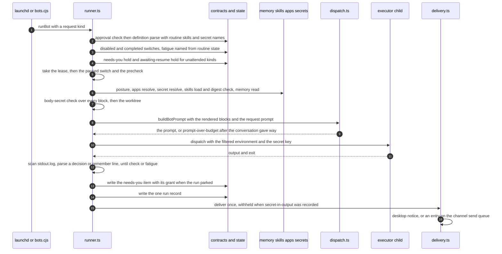
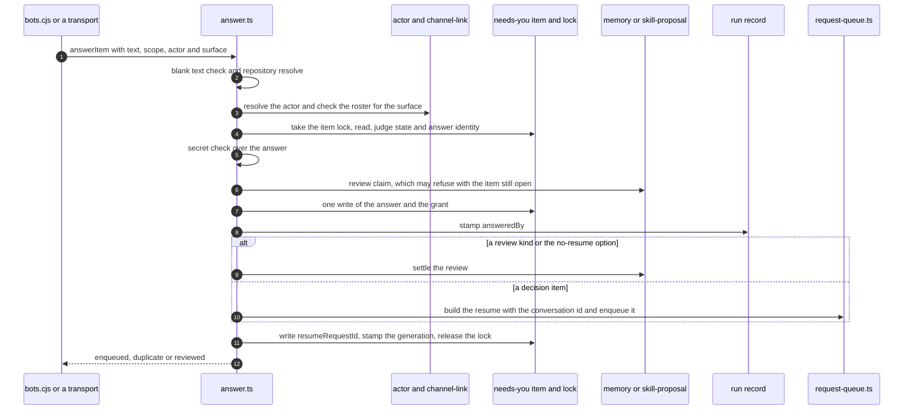
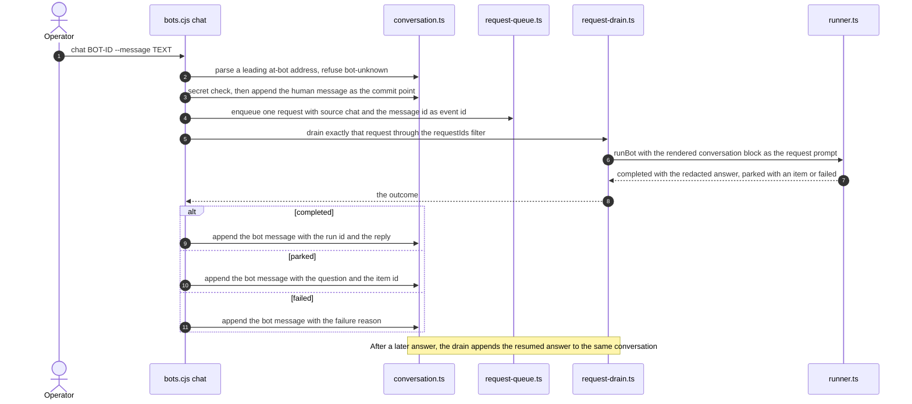
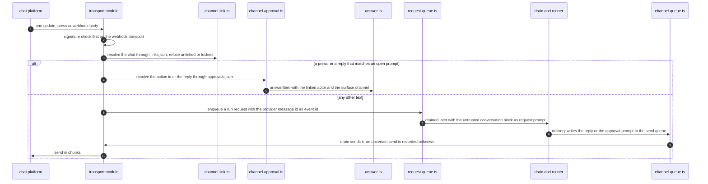

# Target runtime architecture

The sum of what fourteen phases do to `.skilled/skills/system-skilled-bots/runtime/lib/` and to the state root. Each phase still names its own files in its own `spec.md`. This file is where the sum, the import edges and the final tree are written once, so a builder of one phase can see where its module sits.

The runtime has 28 flat modules today in seven groups, and one direction rule: a contracts module imports no `lib/` module outside its own group, `repo-config.ts` imports no sibling, every other group may import the contracts group and no module imports the CLI or the checker. [SOURCE: .skilled/skills/system-skilled-bots/runtime/lib/README.md:21-39] The packet keeps that rule and adds one group, channels. After the packet the folder holds 51 modules.

---

## 1. MODULES AND IMPORT EDGES

### 1.1 Groups

| Group | Today | After the packet |
|-------|-------|------------------|
| Contracts and state | `repo-config`, `definition`, `identity`, `state-root`, `approval`, `run-record`, `switches`, `needs-you` | adds `actor`, `routine`, `routine-state`, `memory`, `action-kind`, `approval-ladder`, `secrets`, `secret-matcher`, `skills` |
| Schedule | `cron-translator`, `slot-lister`, `slot-accounting` | unchanged |
| Runner and dispatch | `runner`, `dispatch`, `posture`, `result-ledger` | adds `apps` |
| Isolation and delivery | `isolation`, `delivery` | unchanged |
| Request pipeline | `request-record`, `request-queue`, `request-drain`, `answer` | adds `skill-proposal`, `conversation` |
| launchd installer | `installer`, `plist-render`, `label`, `launchctl-print` | unchanged |
| Status index | `status-index`, `status`, `better-sqlite3.d.ts` | adds `activity` |
| Channels | none | `channel`, `channel-link`, `channel-approval`, `channel-queue`, `channel-telegram`, `channel-slack`, `channel-signal`, `channel-whatsapp`, `channel-terminal` |

Today's group membership is the README's file table. [SOURCE: .skilled/skills/system-skilled-bots/runtime/lib/README.md:45-74]

### 1.2 New modules

"Imports" lists the `lib/` siblings a module may import, beyond Node built-ins. A module imports nothing else from `lib/`.

| Module | Phase | Group | Imports | What it owns |
|--------|-------|-------|---------|--------------|
| `activity.ts` | 001 | Status index | `status-index` | The seven group ids, their order and the grouping of index rows [SOURCE: specs/system-skilled-bots/003-openbot-parity-build/001-activity-and-actor/spec.md, REQ-001] |
| `actor.ts` | 001 | Contracts and state | none | The precedence `--as` then the pinned operator then the OS user, plus the name pattern [SOURCE: specs/system-skilled-bots/003-openbot-parity-build/001-activity-and-actor/plan.md, section "Key Components"] |
| `routine.ts` | 002 | Contracts and state | `repo-config`, and `definition` as a type-only import | The block parse, `renderTrigger`, the `until` rules, `routineDelivery` and `checkRoutineFloor` over a period its caller passes [SOURCE: specs/system-skilled-bots/003-openbot-parity-build/002-routine-layer/plan.md, section "Key Components"] |
| `routine-state.ts` | 002 | Contracts and state | `state-root`, `run-record`, `switches`, `needs-you`, then `action-kind` and `approval-ladder` from 006 | The per-bot state file, the failure streak and the fatigue item [SOURCE: specs/system-skilled-bots/003-openbot-parity-build/002-routine-layer/plan.md, section "Key Components"] |
| `memory.ts` | 005 | Contracts and state | `state-root` | The entry line, the bounds, the parser, the renderer, append and forget [SOURCE: specs/system-skilled-bots/003-openbot-parity-build/005-memory/plan.md, section "Key Components"] |
| `action-kind.ts` | 006 | Contracts and state | none | The six kinds, their order, their word lists and `classifyAction` [SOURCE: specs/system-skilled-bots/003-openbot-parity-build/006-approval-grants/plan.md, section "Key Components"] |
| `approval-ladder.ts` | 006 | Contracts and state | `action-kind` | The four rungs, `decideApproval` and the scope rule |
| `apps.ts` | 007 | Runner and dispatch | `repo-config`, `state-root` | The only reader of `.utcp_config.json` and the only writer of a run's filtered copy [SOURCE: specs/system-skilled-bots/003-openbot-parity-build/007-per-bot-apps/plan.md, section "Key Components"] |
| `secrets.ts` | 008 | Contracts and state | `state-root`, `secret-matcher` | The name grammar, the backend, the index and the only read or write of a value [SOURCE: specs/system-skilled-bots/003-openbot-parity-build/008-vault/plan.md, section "Key Components"] |
| `secret-matcher.ts` | 008 | Contracts and state | none | The lifted one-pass multi-value matcher |
| `skills.ts` | 009 | Contracts and state | `approval` | The name grammar, the two caps, `parseSkillList`, `loadSkills` and `renderSkillsPrompt` [SOURCE: specs/system-skilled-bots/003-openbot-parity-build/009-skills/plan.md, section "Key Components"] |
| `skill-proposal.ts` | 009 | Request pipeline | `state-root`, `run-record`, `needs-you`, `action-kind`, `approval-ladder`, `dispatch` | The proposals folder, the review item and the settle |
| `conversation.ts` | 010 | Request pipeline | `state-root`, `dispatch`, `definition` | The message record, the append, the torn-line read, `@bot` routing, the bound and the block renderer [SOURCE: specs/system-skilled-bots/003-openbot-parity-build/010-conversations/002-conversation-runtime-and-chat-verb/plan.md, section "Key Components"] |
| `channel.ts` | 011 | Channels | `state-root` | The adapter contract, the message model, the capability table and `channels/config.json` [SOURCE: specs/system-skilled-bots/003-openbot-parity-build/011-messaging-channels/003-link-roster-and-answer-gate/plan.md, section "Key Components"] |
| `channel-link.ts` | 011 | Channels | `channel`, `state-root`, `actor` | The pairing code, the link record, the lockout and the roster [SOURCE: specs/system-skilled-bots/003-openbot-parity-build/011-messaging-channels/003-link-roster-and-answer-gate/plan.md, section "Key Components"] |
| `channel-approval.ts` | 011 | Channels | `channel`, `needs-you`, `state-root` | The approval index and the reply grammar [SOURCE: specs/system-skilled-bots/003-openbot-parity-build/011-messaging-channels/004-approval-index-and-send-queue/plan.md, section "Key Components"] |
| `channel-queue.ts` | 011 | Channels | `channel`, `state-root`, `run-record` | The durable send queue and the `unknown` state [SOURCE: specs/system-skilled-bots/003-openbot-parity-build/011-messaging-channels/004-approval-index-and-send-queue/plan.md, section "Key Components"] |
| `channel-telegram.ts`, `channel-slack.ts`, `channel-signal.ts`, `channel-whatsapp.ts` | 011 | Channels | `channel`, `channel-link`, `channel-approval`, `channel-queue`, `conversation`, `secrets`, `answer`, `request-queue` | One wire protocol, one chunk limit and one approval surface each [SOURCE: specs/system-skilled-bots/003-openbot-parity-build/011-messaging-channels/005-polling-transports/plan.md, section "Key Components"] [SOURCE: specs/system-skilled-bots/003-openbot-parity-build/011-messaging-channels/006-daemon-and-webhook-transports/plan.md, section "Key Components"] |
| `channel-terminal.ts` | 011 | Channels | the transport list above | Stdin lines, numbered or YES/NO answers and the 010 chat path |

### 1.3 Edges the packet adds to existing modules

| Module | New imports | Phase | Why |
|--------|-------------|-------|-----|
| `definition.ts` | `routine`, `skills`, `secrets` | 002, 009, 008 | The `routine` block, the `skills` list shape and the `secrets` name grammar are parse-time shape |
| `needs-you.ts` | `action-kind` | 006 | The grant's `kind` is validated against the six kinds |
| `dispatch.ts` | `secrets`, `secret-matcher` | 008 | Stored values join the known-secret map, matched in one pass |
| `runner.ts` | `routine-state`, `memory`, `skills`, `apps`, `secrets`, `action-kind`, `approval-ladder` | 002, 005, 009, 007, 008, 006 | The runner reads each input and passes rendered blocks to the builder |
| `answer.ts` | `actor`, `channel-link`, `memory`, `skill-proposal` | 001, 011, 005, 009 | The actor, the roster check and the two review settles |
| `request-drain.ts` | `conversation` | 010 | The drain appends a resumed run's answer to its conversation |
| `delivery.ts` | `channel-queue`, `secrets` | 011, 008 | A channel target is an entry on the send queue, and the delivery text is checked against stored values |
| `installer.ts` | `routine`, `skills`, `slot-accounting` | 002, 009 | The floor check at install and the recorded skill digests |
| `label.ts` | none | 005, 009 | `RESERVED_BOT_IDS` gains `memory-proposals` and `skill-proposals` |
| `status.ts` | `cron-translator`, `slot-lister`, `request-record` and the deep-loop `processAlive`, then `routine` | 001, then 002 | The live activity sources and the next fire. 002 adds `routine` so `status.ts` passes `describeStart` to `activityReport` as its `describe` argument [SOURCE: specs/system-skilled-bots/003-openbot-parity-build/001-activity-and-actor/design/data-model.md, section "4.3 An installed schedule and its next fire"] |

### 1.4 Acyclicity

No new edge closes a cycle. The edges that come closest, checked by hand:

- `answer` imports `skill-proposal`, which imports `dispatch`. `answer` already imports `dispatch` [SOURCE: .skilled/skills/system-skilled-bots/runtime/lib/answer.ts:20], and neither `skill-proposal` nor `dispatch` imports `answer`.
- A transport imports `answer`, which imports `runner` [SOURCE: .skilled/skills/system-skilled-bots/runtime/lib/answer.ts:23], which imports `delivery`. `delivery` imports `channel-queue` and never a transport, so the loop through a transport does not close.
- `answer` imports `channel-link`, which imports only `channel`, `state-root` and `actor`.
- `conversation` imports `dispatch` for the literal check and `definition` for the bot-exists test. Neither imports `conversation`, and `request-drain` imports `conversation` beside `runner`, which already reaches `dispatch`.
- `definition` imports `routine`, and `routine` imports `definition` for types only, which the compiler erases.
- `status` imports `routine` for `describeStart`, and `routine` imports neither `status` nor `activity`.

---

## 2. THE STATE ROOT TREE

Folder modes are 0700, the mode the state root gives every folder it makes. [SOURCE: .skilled/skills/system-skilled-bots/runtime/lib/state-root.ts:46] [SOURCE: .skilled/skills/system-skilled-bots/runtime/lib/state-root.ts:148-163] A file written through `writeStateAtomic` gets no explicit mode, so it carries the process umask inside its 0700 folder. [SOURCE: .skilled/skills/system-deep-loop/runtime/lib/deep-loop/atomic-state.ts:413-415] [SOURCE: .skilled/skills/system-deep-loop/runtime/lib/deep-loop/atomic-state.ts:623-630] The tree marks that as `umask`. A node with no phase in the owner column exists today.

### 2.1 The user state root

```text
<stateRoot>/                                    0700          today
  index/                                        0700          today
    status.sqlite                               0600          today, schema version stays 2 (001, 004)
  registered-roots                              umask         today
  authority                                     not set here  today, written by the deep-loop append gateway
  memory/                                       0700          005
    shared.md                                   0600          005
  <identityKey>/                                0700          today
    requests/                                   0700          today
      inbox/ tmp/ claimed/ done/ quarantine/    0700          today, request files 0600
      seen/                                     0700          today, marker files 0600
    leases/                                     0700          today
    switches/                                   0700          today
      <botId>.disabled.json                     umask         today
      <botId>.paused.json                       umask         today
      <botId>.completed.json                    umask         002
    needs-you/                                  0700          today
      <itemId>.json                             umask         today, keys added by 001 005 006 009 010
      <itemId>.lock                             0600          006
    records/                                    0700          today
      <runId>.json                              umask         today, fields added by 001 002 004 005 006 007 008 009 011
    installs/                                   0700          today
      <botId>.json                              umask         today, skillDigests added by 009
    receipts/<runId>/                           0700          today
    deliveries/                                 0700          today, claim files 0600
    approvals/<botId>.json                      umask         today
    slots/<botId>.<index>.json                  umask         today
    agent-logs/<label>.log                      launchd       today
    drain-backoff.json                          umask         today
    generation.json                             umask         today
    routines/<botId>.json                       0600          002
    memory/<botId>.md                           0600          005
    secrets/                                    0700          008
      index.json                                0600          008
      <name>.value                              0600          008, file backend only
    proposals/<runId>/                          0700          009
      SKILL.md                                  umask         009
      proposal.json                             umask         009
    conversations/<conversationId>.jsonl        0600          010
    channels/                                   0700          011
      config.json                               0600          011
      links.json                                0600          011
      approvals.json                            0600          011
      listen-<channel>.lease                    0600          011
      queue/                                    0700          011
      seen/                                     0700          011
    operators.json                              0600          011
```

| Node | Source |
|------|--------|
| `index/`, `status.sqlite` | [SOURCE: .skilled/skills/system-skilled-bots/runtime/lib/state-root.ts:135-140] [SOURCE: .skilled/skills/system-skilled-bots/runtime/lib/state-root.ts:249-250] [SOURCE: .skilled/skills/system-skilled-bots/runtime/lib/status-index.ts:50] |
| `registered-roots` | [SOURCE: .skilled/skills/system-skilled-bots/runtime/lib/state-root.ts:347] |
| Identity folders | [SOURCE: .skilled/skills/system-skilled-bots/runtime/lib/state-root.ts:117-131] |
| Request and marker files 0600 | [SOURCE: .skilled/skills/system-skilled-bots/runtime/lib/request-queue.ts:51] [SOURCE: .skilled/skills/system-skilled-bots/runtime/lib/request-queue.ts:133-135] |
| Switch files and the `completed` kind | [SOURCE: .skilled/skills/system-skilled-bots/runtime/lib/switches.ts:25] [SOURCE: .skilled/skills/system-skilled-bots/runtime/lib/switches.ts:42] [SOURCE: specs/system-skilled-bots/003-openbot-parity-build/002-routine-layer/plan.md, section "Key Components"] |
| Items and records | [SOURCE: .skilled/skills/system-skilled-bots/runtime/lib/needs-you.ts:164] [SOURCE: .skilled/skills/system-skilled-bots/runtime/lib/run-record.ts:367] [SOURCE: .skilled/skills/system-skilled-bots/runtime/lib/state-root.ts:176-183] |
| Delivery claims 0600 | [SOURCE: .skilled/skills/system-skilled-bots/runtime/lib/delivery.ts:255] [SOURCE: .skilled/skills/system-skilled-bots/runtime/lib/delivery.ts:292] |
| Approvals, installs, slots, drain backoff, agent logs, generation | [SOURCE: .skilled/skills/system-skilled-bots/runtime/lib/state-root.ts:199-255] |
| `routines/` | [SOURCE: specs/system-skilled-bots/003-openbot-parity-build/002-routine-layer/plan.md, section "Key Components"] |
| `memory/` both places, 0700 and 0600 | [SOURCE: specs/system-skilled-bots/003-openbot-parity-build/005-memory/spec.md, REQ-001 and REQ-002] [SOURCE: specs/system-skilled-bots/003-openbot-parity-build/005-memory/spec.md, REQ-012] |
| `secrets/` | [SOURCE: specs/system-skilled-bots/003-openbot-parity-build/008-vault/spec.md, section "6. RISKS & DEPENDENCIES"] [SOURCE: specs/system-skilled-bots/003-openbot-parity-build/008-vault/tasks.md, CHK-031] |
| `proposals/` | [SOURCE: specs/system-skilled-bots/003-openbot-parity-build/009-skills/spec.md, REQ-004] |
| `conversations/` | [SOURCE: specs/system-skilled-bots/003-openbot-parity-build/010-conversations/002-conversation-runtime-and-chat-verb/spec.md, REQ-001] |
| `channels/`, `operators.json` | [SOURCE: specs/system-skilled-bots/003-openbot-parity-build/011-messaging-channels/003-link-roster-and-answer-gate/plan.md, section "Technical Context"] [SOURCE: specs/system-skilled-bots/003-openbot-parity-build/011-messaging-channels/003-link-roster-and-answer-gate/spec.md, REQ-005] [SOURCE: specs/system-skilled-bots/003-openbot-parity-build/011-messaging-channels/005-polling-transports/spec.md, REQ-024] |

The state root is the unit of backup, and `bots status --rebuild` is the only repair. [SOURCE: specs/system-skilled-bots/003-openbot-parity-build/spec.md, section "Files to Change"]

### 2.2 The run root in the Skilled tree

Evidence a child may read without harm lives in the Skilled tree, under its gitignored `.state` folder. [SOURCE: .skilled/skills/system-skilled-bots/runtime/lib/state-root.ts:4-14]

```text
<skilledTree>/.skilled/skills/.state/system-skilled-bots/
  <identityKey>/runs/<runId>/                   0700          today
    ledger/state.jsonl                          umask         today
    observability.jsonl                         umask         today
    stdout.log                                  umask         today, scanned and redacted in place by 008
    utcp.json                                   umask         007
```

[SOURCE: .skilled/skills/system-skilled-bots/runtime/lib/state-root.ts:36] [SOURCE: .skilled/skills/system-skilled-bots/runtime/lib/state-root.ts:361-367] [SOURCE: .skilled/skills/system-skilled-bots/runtime/lib/runner.ts:334-345] [SOURCE: .skilled/skills/system-skilled-bots/runtime/lib/runner.ts:1062] [SOURCE: specs/system-skilled-bots/003-openbot-parity-build/007-per-bot-apps/plan.md, section "Data Flow"]

A worktree run also gets `<worktree>/.utcp_config.json`, the filtered config the project pin reads, restored after the child exits. That file is in the run's tree, not in either root. [SOURCE: specs/system-skilled-bots/003-openbot-parity-build/007-per-bot-apps/plan.md, section "Key Components"]

---

## 3. SEQUENCES

### 3.1 A run

The fixed order today is approval, disable switch, needs-you hold, lease, pause switch, precheck, posture, secret check, dispatch, result. [SOURCE: .skilled/skills/system-skilled-bots/runtime/lib/runner.ts:5-6] The packet adds its checks inside that order and adds none before approval.

The order the packet fixes is secret check, worktree, build and budget check, dispatch. The working-place line carries the tree path, so the builder runs after the tree is made. A `prompt-over-budget` refusal therefore fires with a fresh or reopened tree already recorded as active, and 005 finishes a fresh tree or returns a resumed one to kept on that refusal, as the existing `read-only-unconfined` branch does.



### 3.2 An answer

The numbered steps are in [answer-seam.md](answer-seam.md). The screen's own lanes are in [state-machines.md section 3](../003-terminal-screen/005-answer-flow/design/state-machines.md).



### 3.3 A chat turn



[SOURCE: specs/system-skilled-bots/003-openbot-parity-build/010-conversations/002-conversation-runtime-and-chat-verb/plan.md, section "Data Flow"] [SOURCE: specs/system-skilled-bots/003-openbot-parity-build/010-conversations/002-conversation-runtime-and-chat-verb/spec.md, REQ-002] [SOURCE: specs/system-skilled-bots/003-openbot-parity-build/010-conversations/002-conversation-runtime-and-chat-verb/spec.md, REQ-007]

### 3.4 A channel inbound message



[SOURCE: specs/system-skilled-bots/003-openbot-parity-build/011-messaging-channels/005-polling-transports/plan.md, section "Data Flow"] [SOURCE: specs/system-skilled-bots/003-openbot-parity-build/011-messaging-channels/004-approval-index-and-send-queue/spec.md, REQ-006] [SOURCE: specs/system-skilled-bots/003-openbot-parity-build/011-messaging-channels/006-daemon-and-webhook-transports/spec.md, REQ-012] [SOURCE: specs/system-skilled-bots/003-openbot-parity-build/011-messaging-channels/004-approval-index-and-send-queue/spec.md, REQ-013]

---

## 4. DECISIONS TAKEN

| Decision | Why |
|----------|-----|
| `routine.ts` is a contracts module, and `checkRoutineFloor` takes the shortest period as an argument that the checker and the installer compute | `definition.ts` calls the routine parser, and a contracts module may import nothing outside its group [SOURCE: .skilled/skills/system-skilled-bots/runtime/lib/README.md:39]. 002 has `routine.ts` measure the period itself with `schedulePeriodSeconds` from `slot-accounting.ts` [SOURCE: specs/system-skilled-bots/003-openbot-parity-build/002-routine-layer/plan.md, section "Key Components"], which is a schedule module that already imports `definition.ts`, so that edge would also close a cycle |
| `routine.ts` takes `parseTrigger` from `definition.ts` as a type-only import plus an argument | It reuses the trigger parser 002 names without a runtime cycle |
| `skills.ts` and `secrets.ts` sit in contracts and state | `definition.ts` checks the `skills` list shape and the secret name grammar at parse time [SOURCE: specs/system-skilled-bots/003-openbot-parity-build/009-skills/spec.md, REQ-008] [SOURCE: specs/system-skilled-bots/003-openbot-parity-build/008-vault/spec.md, REQ-005], and it may import only its own group |
| `dispatch.ts` composes rendered blocks and does not import `memory.ts` or `skills.ts` | The runner reads and renders, the builder joins and bounds. This keeps the budget check in one function, as [prompt-sections.md](prompt-sections.md) requires |
| Channels is a new group, and `delivery.ts` reaches it only through `channel-queue.ts` | A transport imports `answer`, which imports `runner`, which imports `delivery`. If `delivery` imported a transport the loop would close. 011 also requires every outbound message on the queue before the I/O [SOURCE: specs/system-skilled-bots/003-openbot-parity-build/011-messaging-channels/004-approval-index-and-send-queue/spec.md, REQ-013] |
| `answer.ts` may import `channel-link.ts` for the roster | 011 keeps the roster in `channel-link.ts` and puts the check in `answer.ts` [SOURCE: specs/system-skilled-bots/003-openbot-parity-build/011-messaging-channels/003-link-roster-and-answer-gate/spec.md, REQ-021], and `channel-link` imports nothing that reaches `answer` |
| New state files written by `writeStateAtomic` keep `umask` like today's, except files that hold a secret, a sender id or a person's words, which are 0600 | 005 and 008 already require 0600 for memory and secrets [SOURCE: specs/system-skilled-bots/003-openbot-parity-build/005-memory/spec.md, REQ-012]. Conversations, channel files, the roster and the item lock hold the same kind of content. Their phases name no mode |
| Pairing lockouts live in `links.json`, as [records.md](records.md) decides, and the listen lease is `channels/listen-<channel>.lease` | 011 requires both to be files and names neither path [SOURCE: specs/system-skilled-bots/003-openbot-parity-build/011-messaging-channels/003-link-roster-and-answer-gate/spec.md, REQ-004] [SOURCE: specs/system-skilled-bots/003-openbot-parity-build/011-messaging-channels/005-polling-transports/spec.md, REQ-024] |
| The item lock is `needs-you/<itemId>.lock` | 006 places it beside the item and names no path [SOURCE: specs/system-skilled-bots/003-openbot-parity-build/006-approval-grants/plan.md, section "Key Components"]. The listing reads `.json` files only, so the lock never reads as an item |
| A transport other than the terminal enqueues an inbound message as a request whose prompt is a `<conversation channel="...">` block, rendered by `conversation.ts` | One renderer, one label and one escape for every chat text, as [prompt-sections.md](prompt-sections.md) section 1.9 fixes |
